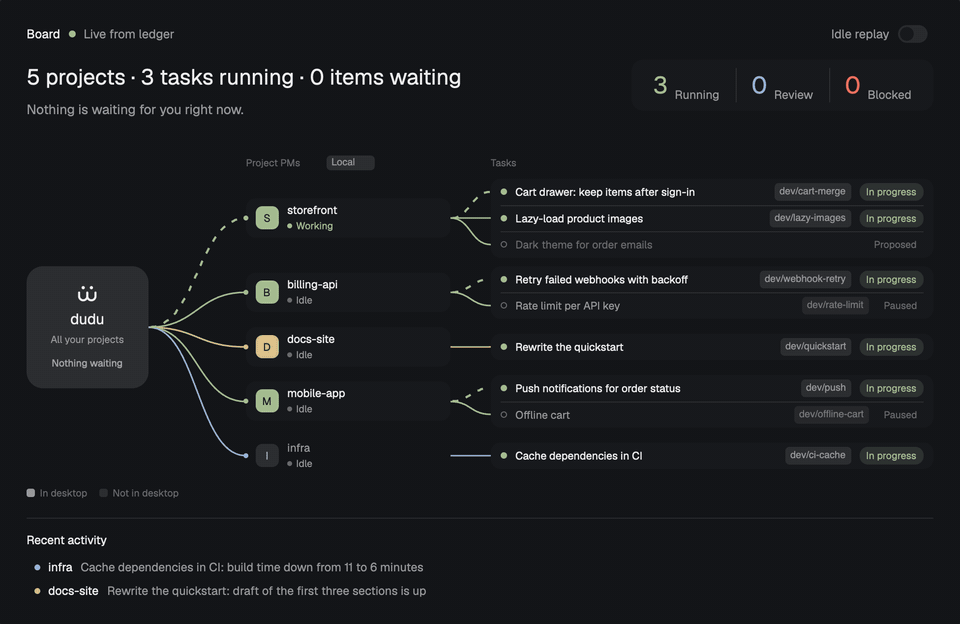

# dudu

Manage all your coding agents from one session. Tell it what you want; it dispatches agents, reviews and merges their work, and shows you only what is waiting for you.



The recording uses invented demo data.

For each project, one agent session in Herdr acts as the manager (any coding agent; Claude Code and Codex are tested): it hands tasks to coding agents in their own worktrees, checks what they bring back, and keeps a persistent task ledger, so progress survives restarts and is visible across projects and machines.

This first version supports the Herdr desktop app. The `herdr` terminal UI is not supported yet.

## Requirements

- A coding agent CLI, installed and authenticated, for both roles: the manager and the workers. Claude Code and Codex are tested; pi, Gemini CLI, opencode and any other can be configured (see [Configuration](docs/guide.md#configuration)).
- The Herdr desktop app, with `herdr-app` and `herdr-core` (`hc`) available on your PATH.
- Bash and Python 3 (tested on Python 3.14). The installer uses only Python's standard library.
- Git for repository work and worker worktrees.

## Install

Clone or download this repository, then run from its root:

```bash
./install.sh
```

It copies the skill into each coding agent it finds (Claude Code, Codex, pi), adds their hooks, and installs the desktop mods and a `pm` layout. Restart running agent sessions afterwards. `./install.sh --dry-run` previews without writing files.

You can also add it from herdr.dev and click **Set up** on the board. Both paths, every option and what gets written: [Install](docs/guide.md#install) and [Add it from herdr.dev](docs/guide.md#add-it-from-herdrdev).

## Get started

1. Switch to the installed layout:

   ```bash
   herdr-app do layout.switch '{"name":"pm"}'
   ```

2. Open an agent session (Claude Code, Codex, pi) in your project directory inside the Herdr desktop app and say **“act as PM for this project”**. Any other agent can be started as the manager with `pm.py start --kind <agent>`; see [Get started](docs/guide.md#get-started) in the guide.
3. Give it a concrete task, for example: “Ask a worker to add a search filter, run the relevant tests, and bring the result back for review.”
4. Click **Projects** in the sidebar to see every project and task, or open a project to talk with its manager.

## More

- [Configuration](docs/guide.md#configuration): language, default agents and models, adding other agents.
- [Alerts](docs/guide.md#alerts): which notifications the `pm` layout shows.
- [Uninstall](docs/guide.md#uninstall): `./install.sh --uninstall`, keeping the ledger.
- [Manual desktop layout fallback](docs/guide.md#manual-desktop-layout-fallback): when the layout cannot be generated.
- [Repository structure](docs/guide.md#repository-structure).

## Roadmap

Not done yet, roughly in this order:

- **Context size for agents other than Claude Code.** The warning to hand over is read from Claude Code transcripts only. The conversation log comes from the turn hook, so it needs an agent with hooks; Codex's hooks carry the same fields, but that path has not been run yet.
- **Tested agents beyond Claude Code and Codex.** pi, Gemini CLI, opencode and others can already be started with `--kind`, but only Claude Code and Codex have their startup handled and verified.
- **The `herdr` terminal UI.** Code paths exist but are untested.
- **Upstream: per-terminal or per-sub-agent alert control.** Herdr can silence its alert sound only globally, so a dispatched worker shows no toast but is still heard when it finishes (see [Alerts](docs/guide.md#alerts)). This needs Herdr to let a layout, mod or `hc run` option turn off alerts for one terminal or for sub-agents.
- **Uninstall from the board.** Setup is one click; removal still needs `./install.sh --uninstall`.

Requests and reports are welcome in the issues.

## License

MIT
