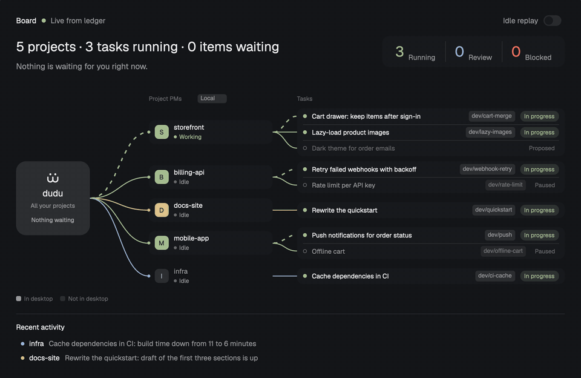

# dudu

Manage all your coding agents from one session. Tell it what you want; it dispatches agents, reviews and merges their work, and shows you only what is waiting for you.



The recording uses invented demo data.

For each project, one agent session in Herdr acts as the manager (Claude Code today): it hands tasks to coding agents in their own worktrees, checks what they bring back, and keeps a persistent task ledger, so progress survives restarts and is visible across projects and machines.

This first version supports the Herdr desktop app. Its mods add a sidebar entry and a board of every project and task. Discord is optional.

The `herdr` terminal UI is not supported yet: the skill contains code paths for it, but they are untested and may change.

## Requirements

- Claude Code for the manager session, installed and authenticated. The manager side currently relies on Claude Code's skills and hooks; the ledger, the board and the workers do not.
- The Herdr desktop app, with `herdr-app` and `herdr-core` (`hc`) available on your PATH.
- Bash and Python 3 (tested on Python 3.14). The installer uses only Python's standard library.
- Git for repository work and worker worktrees.
- A command-line coding agent for the workers. Codex CLI is the default and the only one tested; `--kind` starts any other installed program by name.

## Install

Choose either path:

- **From herdr.dev:** add the PM layout, or copy `layouts/` and `mods/` into your Herdr app folder (`~/.config/herdr-app`, or `$HERDR_APP_HOME`). Select the PM layout, open **Board**, then click **Set up**. The skill is bundled inside `pm-dash`; no repository checkout or separate installer command is needed.
- **From the repository:** clone or download this repository, then run from its root:

```bash
./install.sh
```

Both paths use `mods/pm-dash/setup.py`. This copies the PM skill to `~/.claude/skills/pm` and adds its `SessionStart` hook to `~/.claude/settings.json`. Existing settings and unrelated hooks are preserved. Before the first change to an existing settings file, the installer saves its original bytes as `settings.json.pm-backup`; later runs keep that backup.

With `./install.sh`, if `~/.config/herdr-app` exists, the installer also copies `pm-dash` and `pm-nav` into its `mods/` directory and creates `layouts/pm.json` from `layouts/main.json`. The original layout is unchanged. An existing PM layout containing `pm-nav` is kept. Before replacing another existing `pm.json`, the installer saves the first `pm.json.pm-backup`. Generated layouts are marked with `generated_by: "dudu install.sh"` and include `cloned_from` metadata when the main layout has a version. If the base layout is missing or has an incompatible structure, the skill and mods still install and the script prints manual layout steps.

```bash
./install.sh --desktop          # Install desktop mods even before its config directory exists
./install.sh --discord          # Also install optional Discord chat-mirroring hooks
./install.sh --desktop --discord
./install.sh --dry-run          # Preview without writing any files
./install.sh --uninstall        # Remove the installation, keeping the ledger
```

Options can be combined, including `--uninstall --dry-run`. Re-running the installer replaces the installed skill and mod directories to remove stale files, without duplicating hook commands. A destination linked to its repository source is left in place. Hooks are written atomically after file installation succeeds. Omitting `--discord` leaves any existing Discord hooks in place.

Installation destinations can be overridden:

```bash
CLAUDE_HOME=/path/to/claude-config \
HERDR_APP_HOME=/path/to/herdr-config \
./install.sh --desktop
```

Defaults are `~/.claude` and `~/.config/herdr-app`. Use the same overrides when uninstalling. Hook commands use the selected skill path, including paths containing spaces. Herdr desktop itself also recognizes `HERDR_APP_HOME`.

`CLAUDE_HOME` selects the install destination; it does not configure the other applications. The desktop mods read local state with the bundled `mods/pm-dash/skill/scripts/pm.py` under `appHome()`, and watch the ledger in `~/.claude/pm`. The board’s Set up action explicitly targets `~/.claude`; for desktop use, keep the default Claude destination. `pm.py` uses `PM_HOME` to override its ledger directory; an installation path override alone does not relocate ledger data.

Restart existing Claude Code sessions to load the skill and hooks.

## Add it from herdr.dev

This repository is also a Herdr layout: `layouts/pm.json` plus the `pm-nav` and `pm-dash` mods. Read [RECIPE.md](RECIPE.md) for its behavior, dependencies, and rebuild instructions. A public GitHub repository with the `herdr-layout` topic can appear in the [Herdr layout directory](https://herdr.dev/layouts).

Open **Board** and click **Set up** to copy the bundled skill and add its hooks. Before setup, the board shows a centered setup block and the sidebar says **Set up**; status checks do not write files. Success shows a reminder to restart Claude Code sessions and say “act as PM for this project”, then displays the board. Errors stay visible with a retryable button. If the installed `pm.py` differs from the bundle, the normal board shows a quiet **Update** action using the same installer. Setup is checked at startup and after the action, not on the ledger polling timer.

Local ledger reads use the bundled script. Connected machines still need `~/.claude/skills/pm/scripts/pm.py` and their own ledger for remote reads through `hc`. The sidebar’s remote cache starts writing only once the local skill and hooks are installed.

The shipped layout has no installer ownership marker. `./install.sh` keeps an existing layout containing `pm-nav`; otherwise it generates a layout from your own `main.json`, rather than copying the shipped file. `--uninstall` keeps the unmarked layout but removes the PM mods it needs, so switch away from it before uninstalling.

## Get started

1. Open a Claude Code session in your project directory inside the Herdr desktop app. Say **“act as PM for this project”**, or register the session explicitly:

   ```bash
   python3 ~/.claude/skills/pm/scripts/pm.py claim
   ```

2. Give the PM a concrete task, for example: “Ask a worker to add a search filter, run the relevant tests, and bring the result back for review.” The PM tracks the brief, worker, branch, and progress in the ledger. Workers run in herdr-core terminals.

3. View progress:

   ```bash
   python3 ~/.claude/skills/pm/scripts/pm.py status
   python3 ~/.claude/skills/pm/scripts/pm.py board
   ```

   Switch to the installed layout, then click the board entry under **PM** in the sidebar:

   ```bash
   herdr-app do layout.switch '{"name":"pm"}'
   ```

   The installer only prints this command; it does not switch your layout or touch running windows. `herdr-app commands` lists the commands supported by your installed version.

   For a browser board, run the following and open `http://127.0.0.1:7317/`:

   ```bash
   python3 ~/.claude/skills/pm/scripts/pm.py dash
   ```

Use `python3 ~/.claude/skills/pm/scripts/pm.py --help` for the ledger commands, and `dispatch --help` for worker options. With a custom install destination, substitute that path in the examples.

## Configuration

Create `~/.claude/pm/config.json` to set your worker preferences:

```json
{
  "lang": "zh",
  "worker": {
    "kind": "codex",
    "model": "your-model",
    "effort": "high"
  }
}
```

`lang` defaults to `en`; set it to `zh` for Chinese. It controls built-in text, including handover prompts, the labels around recorded user quotes, and dashboard text. User quotes, task titles, and logs are kept in their original language.

The skill includes two task brief templates: `assets/brief-template.md` (English) and `assets/brief-template.zh.md` (Chinese), under `mods/pm-dash/skill/`.

All three worker fields are optional. When `model` or `effort` is omitted, the worker program uses its own defaults. Explicit `pm.py dispatch --kind`, `--model`, and `--effort` arguments take precedence over the corresponding configuration values. Choose a kind and model available in your environment; the values above are examples.

The installer does not create or overwrite this configuration. Tasks, PM registrations, and project history live under `~/.claude/pm` and survive uninstalling the plugin.

## Discord (optional)

You can use the PM, dispatch workers, and view the boards without Discord. `--discord` only adds the `UserPromptSubmit` and `Stop` hooks for mirroring; it does not install a Discord plugin, create a bot, or bind a channel.

To enable it:

1. Install the official Discord plugin for Claude Code and its Bun runtime. Prepare your own Discord bot, a guild channel the bot can read and send messages in, and the Discord user IDs allowed to instruct the PM.
2. Supply the bot token through `DISCORD_BOT_TOKEN`, or put `DISCORD_BOT_TOKEN=your-bot-token` in `~/.claude/channels/discord/pm-token.env`. Keep that file private (for example, `chmod 600`), and never commit it.
3. Run `./install.sh --discord` and restart the Claude Code session to load the hooks.
4. From the PM's project session, bind your channel and allowed users:

   ```bash
   python3 ~/.claude/skills/pm/scripts/pm.py claim \
     --discord-channel YOUR_CHANNEL_ID \
     --discord-users YOUR_USER_ID
   ```

5. Follow the launch command printed by `claim`. You can print it again with `pm.py launch`. It uses a session-specific MCP configuration; restart the PM with that command and review the channel confirmation shown by Claude Code.

Only a registered PM bound to a channel mirrors its terminal conversation. Set `PM_NO_DISCORD=1` in the session environment to silence mirroring. To also mirror the task board to a channel, run `pm.py board --channel YOUR_CHANNEL_ID` once. See [the skill's Discord instructions](mods/pm-dash/skill/SKILL.md#discord) for details.

## Uninstall

```bash
./install.sh --uninstall
```

Use this command for either installation path; there is no uninstall button in the board. If you installed through herdr.dev, download this repository to run it.

This removes PM command hooks (commands containing `skills/pm/scripts/pm.py`), `skills/pm`, the two PM mod directories, and `layouts/pm.json` only when it carries the installer’s `generated_by` marker. Unmarked layouts (including layouts from older installers) are kept. If settings are invalid, uninstall warns and skips hook cleanup but still removes installed files. Other settings and hooks are kept, including unrelated commands grouped with a PM hook.

The ledger and configuration directory `~/.claude/pm`, `settings.json.pm-backup`, `layouts/pm.json.pm-backup`, and Discord credentials/state are retained. The uninstaller does not restore the entire settings backup, so settings added after installation are not lost. If you use the desktop PM layout, switch back to `main` before uninstalling:

```bash
herdr-app do layout.switch '{"name":"main"}'
```

## Manual desktop layout fallback

Use these steps when automatic layout generation is skipped. Paths below are relative to `HERDR_APP_HOME` (default `~/.config/herdr-app`). The mods must already be installed, for example with `./install.sh --desktop`.

1. Copy `layouts/main.json` to `layouts/pm.json`. If `main.json` is absent, obtain the default layout from your Herdr desktop installation first. Keep any custom layout you want to preserve before replacing it.
2. Find the `sidebar-lists` column. Insert this node as the first element of its `children` array:

   ```json
   {"id":"pm-nav","type":"block","size":{"px":64},"content":{"mod":"pm-nav"}}
   ```

3. Replace the `work` column at its current position with this stack. In the example below, replace `<original work node>` with the **entire original `work` object**, keeping its children and other properties intact. The placeholder is not valid JSON.

   ```text
   {
     "id": "pm-stage",
     "type": "stack",
     "active": "work",
     "children": [
       <original work node>,
       {"id":"pm-board","type":"block","content":{"mod":"pm-dash"}}
     ]
   }
   ```

4. Save valid JSON, then select it with `herdr-app do layout.switch '{"name":"pm"}'`.

## Roadmap

Not done yet, roughly in this order:

- **Other agents as the manager.** Today the manager must be a Claude Code session: the skill installs into `~/.claude`, the session-start reminder is a Claude Code hook, and session rotation restarts `claude`. The ledger and board are agent-neutral, so Codex and others can be supported by adapting those three points.
- **Tested worker programs beyond Codex.** Other programs can already be started with `--kind`, but only Codex has its startup handled and verified.
- **The `herdr` terminal UI.** Code paths exist but are untested.
- **Uninstall from the board.** Setup is one click; removal still needs `./install.sh --uninstall`.

Requests and reports are welcome in the issues.

## Repository structure

- `install.sh` — desktop installation, preview, and uninstall; calls the shared skill installer.
- `layouts/pm.json` — distributable PM layout.
- `mods/pm-dash/` — desktop project/task board, including `setup.py` for skill/hooks installation and read-only status.
- `mods/pm-dash/skill/` — the single bundled PM playbook, ledger CLI, and browser dashboard.
- `mods/pm-nav/` — desktop sidebar entry and summary.
- `tests/test_install.py` — installation tests using temporary directories.

License: MIT
