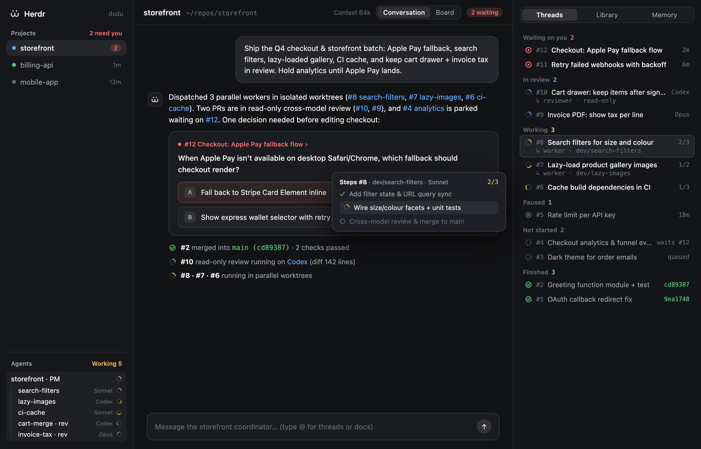

# dudu — Multi-Agent Workspace

Manage Claude Code, Codex, Gemini CLI, and other coding agents from one Herdr workspace. Each project opens as a single coordinator conversation paired with a live side panel for structured Threads (status groups, live worker steps, dependencies, and inline question cards), Library markdown docs, and two-layer log-verified Memory — with Quote and `@` mentions right in the composer. Switch to Board for a live hub graph across local and remote machines, or jump into any agent's terminal without leaving the layout. The preview uses invented demo data in the dark theme.



## What you see

- **Window and sidebar:** a horizontal root with no titlebar, traffic lights at 12px/16px, 14px/12px terminal padding, and a 1px divider. The sidebar is 268px wide, with 44px/480px limits and resizing disabled. Its top brand region is 46px high, its footer 69px. Between them, the 64px PM region and, right under it, the PM list (sized to its rows) precede equally weighted spaces and agents regions, each with a 90px minimum height.
- **PM entry:** a 31px header with a 14px dudu mark and “PM”, followed by a 30px Board row with an 8px radius. The row shows project and in-progress counts, plus a blocked count when nonzero. Base text is 13px; the header and counts are 11.5px. Below 120px sidebar width, it becomes a centered 32px button with a 22px mark and a 6px blocked dot; the summary moves into its tooltip.
- **Terminal workspace:** a 42px tabs bar, a body with 8px padding and gaps, and a 28px status bar. Terminal panes have a 10px radius, 1px border and focus outline, and an always-visible 30px header. A hidden side panel starts at 368px wide, bounded by 280px and 900px, with Files selected ahead of Changes.
- **Board header:** a 24px line contains Board, a 7px read-status dot, the ledger status, and an Idle replay switch. The switch is 30px by 18px with a 14px thumb. Below it, a wrapping summary uses 22px semibold type, or 16px below 800px board width. Supporting text is 13.5px with an 18px line height and a 36px clipped region. The 52px-high statistics capsule shows Running, Review, and Blocked; numbers are 24px, or 20px below 800px.
- **Board canvas:** minimum content width is 560px. Horizontal insets grow from zero to 28px as space permits, becoming 36px at 1500px board width; vertical padding is 24px, or 26px at that wide breakpoint. Below 1500px, recent activity sits beneath the graph with a top border. At 1500px and above, it occupies a 330px right column separated by a 36px gap and a left border with 28px inner padding.
- **Graph, left to right:** the dudu hub is 148px by 148px, or 176px wide in the wide layout, with a 20px radius, a 28px mark, an 18px bold title, and a waiting count. PM rows are 48px high and 168–214px wide in the narrow layout, or 260px wide in the wide layout. Each has a 28px initial badge, project title, live status, and optional waiting count. Task rows are 32px high, or 36px wide-layout height, grouped in 12px-radius panels; project lanes have 10px or 14px gaps. Task title text is 13px, PM titles 13.5px, and status pills 11.5px. Branch chips use 11px monospace and appear only when the task column is at least 360px wide. Machine chips above the PM column wrap within it and use 11px monospace; multiple machines get matching numbers on PM rows.
- **Fit and detail:** the graph scales vertically from 1 down to 0.6 to fit the measured available height, scaling row heights and internal decoration while preserving column positions and widths; the hub width also scales. Scaled text stays at least 10px. Remaining overflow scrolls on both axes with an always-mode scrollbar. Recent activity shows the latest five records, newest first, with 12px text in 24px rows, or 30px rows in the wide layout; an older replayed record may be added temporarily.
- **Notifications:** the layout root sets `"toast": "pm-toast"`, a copy of Herdr's shipped toast: full-size row on popover with 18px side padding and a 12px gap, hover fill, an 18px icon or an 8px level dot (error → blocked, warning → working, success → done, info → accent), a 13px semibold title and a 12px muted body, both truncated; machine-login notices keep their Copy button.
- **Color and type:** use Herdr's inherited UI font and theme tokens, not a fixed dark palette. Window and board use canvas, sidebar uses chrome, row groups use surface, hover/detail accents use raised, and separators use border. Text uses foreground, muted, and dim; selection uses selected and hover. Running uses ansi2, review uses accent, and blocked/waiting uses blocked. The project view follows the same tokens: canvas behind the conversation, chrome for the thread panel, surface for thread cards and message boxes, raised for the user's bubbles, quick answers and the thread chip, border for separators and the log line; a ready send button is solid on solid_foreground; the bell's badge is blocked with its highest-contrast text. Project colors are a stable hash into ansi4, ansi5, ansi6, ansi3, ansi2, and ansi1. The dark hub uses raised with foreground text; the light hub uses foreground with background text. Solid badges choose the highest-contrast text among foreground, background, surface, and accent_foreground. The two shipped SVG marks are tinted to match their context.

## How it behaves

- On startup, the board checks the installed skill and hooks of each coding agent (Claude Code, Codex, pi) with its bundled `setup.py --status`. It is ready when at least one agent is fully set up (skill, a skill folder matching the bundled one, and hooks where the agent has them) and no installed copy is outdated. Missing setup replaces the graph with a centered, borderless filled block: dudu mark, “Set up PM”, one agent-neutral sentence (“Copies the PM skill into your coding agents' skill folders (Claude Code, Codex, pi) and adds their hooks.”), and one solid “Set up” button. The sidebar says “Set up” without a read error. Clicking installs the skill and hooks for every agent whose home exists (Claude Code when none does), rechecks status, shows “Done. Restart your coding agent sessions, then say "act as PM for this project".”, and displays the normal board. Failure keeps the script error and button visible. Any installed skill folder that differs from the bundled one (`pm.py`, `pm_events.py` or any other file it installs) shows a quiet update notice above the normal board; Update runs the same setup. Ready adds nothing. All setup text has English and Chinese versions. Setup checks run on startup and after setup, not on the ledger timer; the board sends `pm-nav.setup-changed` after setup, and the sidebar rechecks on that command and board navigation.
- Board toggles between the graph and the terminal workspace (from a project view it shows the board). Without the layout's board stack, the same control opens the dashboard as a 980px by 640px overlay. Opening the board or a project view establishes a focus baseline; a later change of space, tab, pane, terminal, shown terminal, or agent returns to the workspace.
- Clicking a PM or task row with a matching live terminal focuses that terminal and returns to the workspace, or closes the dashboard overlay. Terminal matching prefers PM/task labels over recorded `hc:` panes and keeps machine identities separate. A PM without an exact match can open a live terminal on the same machine whose `cwd` equals its `repo`, ignoring trailing slashes; agent terminals take precedence over shells, then addresses sort lexically for a stable choice. Tasks have no project fallback. A PM without either match has no click action; its English/Chinese tooltip explains that the session is not in desktop and asks the person to start it there and run `pm.py claim`. With a fallback, the tooltip instead explains that clicking opens the project's space.
- PMs show their live status text, followed by the PM's agent program when the ledger records it (“Idle · codex”). Working has a green dot and green status text; blocked, done, idle, offline, and unknown use a dim dot and muted status text. A PM with an exact live terminal match has a surface fill and solid project badge; without one, its row loses that fill, the badge becomes translucent, and the title is muted, even when a project fallback makes it clickable. A fallback never supplies the PM's status; that continues to come from the ledger. Its blocked task count remains a separate waiting badge.
- In-progress tasks have a solid green dot and a translucent green pill reading “In progress”. Blocked tasks have a solid blocked-color dot and pill reading “Blocked · Waiting for you”; review uses accent with a plain “Review” (review is the PM's job, not waiting for you). Done, paused, proposed, merged, released, abandoned, and cancelled retain their ledger labels with outlined dim dots and muted pills; proposed titles are dim. Cleanup rows read “Merged · not retired”. Other task states use their status label, or “Working…” when the matched worker is working. The running total counts only in-progress tasks whose worker is working; the sidebar in-progress total counts all in-progress tasks.
- Within each project, blocked and review tasks come first, then in-progress tasks, then the rest; ties retain ledger order. The hub's waiting count and summary count blocked tasks only. Hovering a PM dims other projects and their wires to 35% opacity with a 160ms transition.
- Hovering a task shows a floating detail card: status, title, project, branch, any commit extracted from a leading log prefix, update time, and up to four wrapped log lines. Its width is at most 520px times the graph scale and never exceeds the task column. It sits 6px times the scale below the row, flips above when needed, and shrinks to the visible space. Real text overflow gets an ellipsis. A live terminal adds “Click to open its terminal”. Leaving the row, scrolling, or resizing dismisses the card; moving over a row can reopen it.
- Working PM links and eligible working task links animate as 2.2px dashed strokes, 6px on and 8px off, advancing 4px every 110ms. Other links are 1.6px curves at 50% opacity. Paused, proposed, done, merged, released, abandoned, and cancelled task links stay still even if a terminal reports working.
- New events animate a 10px packet along the connecting curves at 260px per second using 24px linear hops over a 2px-sampled curve. Prompts travel hub to PM; replies travel back. User dispatches travel hub to PM to task; other task events use the task link, with reports travelling back to the PM. Forward packets are filled; reverse packets are hollow. Row text and status wait for the event to arrive. Status changes briefly fade labels to 40%; entering blocked nudges the title 6px and springs it back. Events are separated by 400ms.
- Idle replay starts off. When enabled, after 20 seconds without new events it cycles through the last 12 records, marks replayed activity, and leaves ledger data unchanged. New events interrupt a replay; switching replay off cancels the current replay. The mods define no custom keyboard shortcuts.
- `pm-toast` gets every notification's props (`title`, `body`, `level`, `icon`, `action`, `timeout`, `overlay`). When the action is `agent.focus` with a `terminal` (Herdr's own agent notice, “ finished” or “ needs you”) and `terminals()` lists that address with a non-empty `task` label, or with a `parent` whose terminal has a non-empty `pm` label (an agent the PM dispatched), it calls `closeOverlay(props().overlay)` from `init` and renders an empty element. In every other case, including an unreadable terminal list, an unlisted terminal and the PM's own terminal, it shows the toast; clicking runs the action and closes it; an `agent.focus` action is not run as is but opened as the board opens a terminal (`focusPlan`: `pane.focus` on it or the nearest ancestor with a pane, `work` selected while `pm-stage` shows `pm-board` or `pm-project`, then `terminal.peek` for a paneless one), and with no pane to show it in, the click only closes the toast. Herdr's sound for that agent is not affected.
- **Project view (`pm-project`).** A click on a local PM's row in the PM list sets `shared('pm-project')` to `{pm: <PM name>}` and selects `pm-project` in `pm-stage` (the row stays highlighted while its project shows); a remote PM's row, or a layout without the block, keeps focusing the terminal. One project shows at a time: a 56px header with the project name (15px semibold) and its path (12px monospace, `~` for home), then a bell, a terminal icon and the side panel's icon (32px, 9–10px radius, hover fill). The bell's badge counts the places a click on it can go to: one per waiting item among the events shown, where an item is a blocked task's open question, or the thread row of a blocked task whose question is not among those events. A question is left out while its answer is in the coordinator's hands: the user answered it by name (picked one of its answers, at once while the bubble is still being sent, or wrote words that start with its `【title】`) and the coordinator has not replied since; once it has replied and the task is still blocked, the question waits again. Words that name no question hold none. So the bell's number can be lower than the board's count of blocked tasks. Its tooltip reads “N items waiting for you” and at zero there is no badge. Each click goes to one waiting item, the newest first, then the next older one, and round again after the oldest; it starts at the newest again when something waits that did not at the last click. The item is revealed with the least scrolling (one already on screen does not move) and has the bell's color around it for 1.5 s (a waiting thread row gets the hover fill). For this every part of a coordinator turn after its reply is its own child of the scroll area, which can only reveal one of its children; the rows keep the turn's spacing (12px inside a turn, 22px between blocks). The terminal icon focuses the PM's terminal (exact match, else the project-folder fallback) and selects `work`.
- The conversation is the last 200 events of `<ledger home>/projects/<project>/conversation.jsonl`, whose path `pm.py state` gives each PM as `conversation` (read with `tail`, so the log's size does not matter). It sits in a centered 680px column with 22px gaps and day dividers (Today/Yesterday/date). `user` is a right bubble (72% wide at most, 18px radius with a 6px lower-right corner; in a light theme, where `raised` is almost the canvas, it has a 1px border); a coordinator turn ends with its reply and is one 28px dudu avatar beside its parts: first the names of the threads the reply is about (one 20px dim line each, an upward hook and the title, 2px above the reply), then the `pm` reply, then what the coordinator did on the way to it: new threads, questions and `decision` lines (12.5px dim text with a check icon; the user's words in the tooltip). A reply is markdown (`TextView.markdown`, selectable). A link whose address is `thread:<task id>` (the playbook asks the PM to name threads that way) opens that thread in the side panel; an `http(s)` link goes to the browser; a folded reply shows a link's text only. One that is longer than its opening paragraph shows only that paragraph, as plain reply text with a small dim chevron right after it (under it at the left when the opening fills the column), until it is clicked. The newest reply is open, and so stays every reply that arrives while the project is on screen; an older open reply has a fold chevron at its end. A reply is about a thread when the coordinator itself wrote a ledger entry for it in that turn and the thread already showed earlier (its row or question in the same turn already names it). The coordinator is the session that spoke: `pm` events carry `by`, and a reply from before they did counts as the PM's pane now. A worker's entry names nothing, since it may have logged while the user asked about something else, and without a reply there is nothing to name. Thread rows, questions and decisions that got no reply of their own join the turn before them; with no turn before them, or while the reply is still to come, they stand without an avatar. The avatar fades in with its turn's first part. `agent` events are not shown. A task appears once, where it first appears; one that enters the log already `blocked` (the coordinator asking, `pm.py new --status blocked`) is its question alone, with no row. An `abandoned` task (a proposal another task replaced, a test run) has no line and names no reply; a question it asked stays. A thread is one 24px line: a 14px downward hook (a curve, no corner), the title in muted text (dim once the task is merged, released or done) that brightens under the pointer, and a mark of what it is now: three 4px dots while it is in progress (they breathe only while the task's own worker, the live terminal labeled with it, reports working; otherwise they rest at 40%), a 6px dot in the status color while it is blocked or in review, nothing once it is over; its tooltip names the status and a click opens it in the side panel. The event that turns a task `blocked` shows where it happened as the coordinator asking, on a card (560px at most, 14px radius; while it waits a lifted surface with the message box's border, once settled only a 1px outline on the canvas): the thread's name (12px dim with a chevron; a click opens the thread), the log text, and its `options` (`pm.py update --option`, or `pm.py new --option` for a question that belongs to no task yet) as rows: a 28px letter tile, the answer, a small accent “Recommended” tag on the first when the event says `recommended` (`--recommend`), and the option's line from `option_notes` (`--why`, after its `--option`) under it. While that is the task's newest question and the task is still blocked, a click on a row sends `【<task title>】<option>`; the picked row then stands alone with a check (at once, from the bubble being sent, and later from the same text in the log). A question answered in the user's own words keeps only its text. New coordinator parts fade in over 180ms. The view follows the end of the conversation as it grows, for a reader who is at the end. It cannot read where the scroll area rests, so it keeps count of how far above the end the reader is, from the wheel, each row's measured height and the area's height, and errs toward following: scrolling up counts no further than the area can scroll (a conversation that fits does not count at all) and never past two screens; scrolling down takes off three times its distance; a jump from the bell counts what the scroll area will move (nothing when the row is in view, so a question near the end leaves the reader at the end). While the count is above zero, what arrives does not move the view. Saying something (typed or picked on a question) goes to the end and follows again. A scrollbar dragged to the end is not seen until the wheel next moves down.
- The message box at the bottom (16px radius, auto-growing to six lines) sends with Enter and keeps Shift+Enter as a new line. What is typed and not sent is kept as it changes in the mod's `localStorage` (key `drafts`: one draft per project box and per thread box, the newest 40), because the view is rebuilt whenever a file of the mod is saved (an install does that) and when the app starts; the box takes its draft back when the project or the thread shows again, with the cursor after it and nothing selected. The store is read again before every write, and a write changes only its own box's entry, so two views of the mod (a second window, the build from before a reload) do not overwrite each other. The draft is removed when the send has worked, not when it starts; a message that could not be sent stays the draft, or is it again when nothing newer was typed. It runs `env -u HC_TERMINAL_ID hc send <PM terminal> <text>` on Unix (so the PM's turn hook records the text as `user`); on Windows Desktop it runs `hc send` directly, because there is no usable `env -u`. The bubble shows at once at 65% opacity and gives way to the same text once the log has it; a failed send keeps the bubble with a red mark whose tooltip gives the error and whose click sends it again. While the PM's terminal reports working, or a sent message is not yet in the log, three dots under an avatar breathe at the end (only what is at work moves in this view: these dots, the dots of a thread whose worker is working, and the side panel's turning arc and spinner). Without a live PM terminal (an exact match) the box is dimmed and its tooltip says why.
- Both message boxes take files: dropped on the box, picked with the paperclip, or a pasted screenshot (saved as `paste-<time>.png` in `<ledger>/projects/<project>/attachments`). The message carries their absolute paths as its last lines. For a project on another machine the files stay paths on this computer in the box (a pasted screenshot waits in `<ledger home here>/attachments/<machine>/<project>`); on sending, each is first copied beside the terminal the message goes to with `hc put --json -- <machine>/<terminal> <file>` (it lands in that machine's `~/.local/state/herdr-core/<session>/files/<terminal>/`), and the message names the paths it landed at. hc put turns each non-ASCII character of a name into `_`, so such a file goes as a copy named `image-<time>-<n>[-<its ASCII words>].<ext>` (`file-…` when not an image), made in a `sending-<ms>-<n>` folder beside the pasted screenshots and removed after the try. A send that went removes its pasted screenshots there (not ones a draft or a failed bubble still holds), and putting something there removes what under `<ledger home here>/attachments` is over a week old. Files that went in a try that failed later are remembered (by terminal and path) until the send goes, so sending again copies only the rest. A file that is not copied stops the send: nothing reaches the terminal, the project's bubble is marked failed with “<file> was not copied to <machine>: <hc's error>” under it, and the thread box shows the same line; the files stay in the draft and the bubble's retry mark sends again. A local project's files go as they are.
- The 360px side panel at the right rests on the thread list when the view is at least 1096px wide (the column, the panel and the column's margins), or when the header's third icon asked for it; that icon shows the list or puts the panel away (width transition, 200ms; the first measure places it without one). The list is in groups, each under an 11px dim label with its count. The PM's tasks that are not over come first, in up to five groups: **Waiting on you** (blocked), **In review**, **Working** (in progress), **Paused** and **Not started** (proposed). A row has a 14px mark (an arc that turns while the task's own worker, the terminal labeled with it, is working, and rests dim otherwise; a ring with a core in the status color for waiting and review; a dim ring with a dim core when paused; a bare ring when not started), the title with the time since the task last changed at its right (`3m`/`2h`/`1d`; in a Chinese view `3 分钟`/`2 小时`/`1 天`, and `刚刚` for under a minute), the newest log line under it (whole for a waiting task, since it is the question; one line otherwise), and its branch in monospace after a small hook. A click opens the thread. **Sessions**: the agents in the window whose folder is the project's or one of its worktrees (`pm.py state` gives each PM `worktrees`), without the PM and the workers of open tasks; a session that registered a task itself is still listed. Each is a 32px row: program icon, name (as the agents list reads it: a tab someone named, else the agent's title), terminal address in monospace, and the agents list's status mark (spinner, dot, ring); in that list's order. A click focuses the session and selects `work`. **Finished**: the six threads that ended last (merged, released or done; an abandoned one is not listed), as the conversation's 24px dim lines. A thread row, in the conversation or the list, puts that thread in the panel (clicking the same row or the close icon goes back to the list, or closes a panel that rests closed). It reads the task's ledger file and shows its title, a status pill, branch (monospace), the worker's program icon and terminal address, and its log as a timeline (a 1px line with 7px dots; the newest entry's dot is accent and its text foreground). A log line that starts with changed fields (`status=review, commit=abc; <note>`) shows its note; one that is only such changes is spelled out in the thread's log and left out under a row of the list. In a Chinese view the field names and the lines `pm.py` writes by itself read as Chinese (`状态改为已合并，提交 abc`, `登记（进行中）`, `派给 <name>（<agent>）`, `已回收：终端 …、工作树 …、分支 …`); what a person or an agent wrote is shown as written. Icons beside the title: open its terminal (the board's terminal match, opened by `focusPlan` as under Herdr APIs below: `pane.focus`, `work`, then `terminal.peek` for a paneless one; dimmed with a tooltip when there is nowhere to open it), see its changes (`terminal.open` with `git -C <worktree> diff <base>...<branch>` in a new tab named `diff <branch>`, in a Chinese view `改动 <branch>`, then `work`), and close. Its own message box sends only to that thread's terminal and never enters the conversation; without a live terminal it is dimmed.
- It reads `pm.py state` at start, every 10 seconds and when `<ledger home>/tasks` changes, and reads the log again when `<ledger home>/projects` changes. English is the default; the ledger's `lang` selects Chinese.
- The sidebar posts no notifications. A task entering `review` or `blocked` is announced by the PM's own turn ending, which Herdr notifies.
- Both mods read local state immediately, watch the `tasks` folder of the ledger home, and retry every 10 seconds. The ledger home is the `home` reported by local state; until the first state arrives they apply the same rule (`$PM_HOME`, else `~/.claude/pm` if it exists and is not symlinked to `~/.dudu`, else `~/.dudu`) without delaying the first render, and a changed home re-arms the watcher. Local read errors keep the last successful state and show an error indicator. The sidebar discovers remote state every 15 seconds; the visible board or overlay does so every 5 seconds. A disconnected machine is removed after successful discovery; a transient remote read failure retains its previous snapshot. English is the default; local state can select Chinese labels without translating ledger text.

## Built from

The static `layouts/dudu.json` retains the stock workspace in this node tree:

```text
root (row, toast → pm-toast)
├── sidebar (column, 268px)
│   ├── brand (block, 46px → workspace-chrome)
│   ├── sidebar-lists (column)
│   │   ├── pm-nav (block, 64px → pm-nav)
│   │   ├── pm-list (block, 30px, resized by the mod → pm-list)
│   │   ├── spaces (block, weight 1 → spaces)
│   │   └── agents (block, weight 1 → agents)
│   └── sidebar-footer (block, 69px → workspace-chrome, props.footer=true)
└── pm-stage (stack, active=work)
    ├── work (column)
    │   ├── tabs (block, 42px → tabs)
    │   ├── work-body (row)
    │   │   ├── main (block → active tab, pane header → pane)
    │   │   └── panel (hidden column, 368px)
    │   │       └── panel-body (stack, active=files)
    │   │           ├── files (block → files)
    │   │           └── changes (block → changes)
    │   └── status (block, 28px → workspace-status)
    ├── pm-board (block, window_drag → pm-dash)
    └── pm-project (block, window_drag → pm-project)
```

- `mods/pm-nav/`: `main.js` renders the entry, polls state, watches focus, and dispatches navigation. `model.js` compares focus identities, counts tasks, and supplies the Python cache writer. `mod.json` declares `place: "none"`; there are no custom input props. Its SVG is a 24-by-24-viewBox mark with two round-ended U-shaped strokes and two dots.
- `mods/pm-list/`: the PMs, right under the PM entry, whose title and Board row are their heading. One 30px row per PM (in a layout that keeps the block elsewhere, for example right above Agents where earlier versions put it, a header with “PM” and the count comes first, styled like the agents list's group headers): agent icon, `PM-<project>`, the machine name for a remote PM, age (`<1m`/`3m`/`1h`/`2d` since the status last changed, in a Chinese view `刚刚`/`3 分钟`/`1 小时`/`2 天`; first seen from the PM's newest ledger event), and a status mark only: spinner (working), dot (done), ring (idle), a dim “?” (unknown: the PM's live terminal reports no status, as on a platform or with a program that does not; never shown as idle), and a small “Needs you” badge (blocked). The marks are drawn by this mod to look like the agents list's; no Herdr code is copied. PMs come from local `pm.py state` `pms` plus the other machines in pm-nav's `<ledger home>/cache/remote-states.json` (read only; its age is not checked because pm-nav keeps `at` while nothing changes). Live status comes from `agents()`/`terminals()` by the same terminal match as the board (`model.js` copies `terminalFor`/`terminalTargetFor` from pm-dash; its test keeps them equal); a PM outside the desktop keeps the ledger status. Order: needs you, done, working, idle, unknown, then name. A live terminal labelled `pm=<project>` that no ledger row names, here or on another machine, gets a row of its own (`labelledPmRows`: the project name, its live status or unknown, tooltip “Not in this ledger. Click shows its terminal.”); a click shows its terminal, there is no project view to open and no archive icon. A click on a local PM opens its project view (see above); on a remote PM it opens the exact or project-folder terminal (on the PM's own machine) by `focusPlan` (`pane.focus`, `work` if the board or a project is up, then `terminal.peek` for a paneless one; nothing when there is nowhere to show it). The mod sizes its own block with `layout.resize`, compared with the node's current size (with no PM the header alone, or a 6px sliver without one; at most eight rows, then scroll); narrower than 120px (pm-nav's rule) it shows only icon and status mark.
- `mods/pm-project/`: `main.js` renders the header, conversation, message boxes and side panel; `model.js` holds the pure timeline (`timeline`, `turns`, `timelineRows`, `settlePending`, `parseConversation`), the bell (`inHand`, `bellTargets`, `bellNext`), the count of how far above the end the reader is (`riseAfterWheel`, `riseAfterJump`), drafts (`keepDraft`, `readDrafts`) and log lines (`logText`), the side panel's list (`threadList`, `sessionLabel`) and the send/diff commands, with copies of pm-dash's `cleanTaskLog`, terminal lookup and color helpers (`model.test.mjs` keeps them identical). Its SVG icons (bell, terminal, panel, diff, close, send, chevron, expand, collapse, check, agent, hook, hook-up, dudu) are 24-by-24 round-capped strokes. `mod.json` declares `place: "none"`.
- `mods/pm-toast/`: `main.js` is Herdr's shipped `toast` plus the worker check; `model.js` holds the pure `isWorkerNotice(props, terminals)`, tested in `mods/pm-dash/model.test.mjs`; `mod.json` declares `place: "none"`.
- `mods/pm-dash/`: `main.js` renders the graph, detail popup, totals, and feed; `model.js` supplies geometry, status text, state merging, terminal lookup, and curve sampling; `flow.js` owns a retained animation view so dash ticks do not rerender the parent. `mod.json` declares `place: "none"` and a 980-by-640 overlay. The host's `props().overlay` distinguishes overlay mode, allows remote reads there, and identifies the overlay to close. `FlowLayer` receives geometry, working wires, packet state, an overlay flag, and a completion callback. `model.test.mjs` contains pure-model tests. The dashboard carries its own copy of the same SVG mark. `skill/` is the single bundled PM skill; `setup.py` installs its skill and hooks per agent or returns read-only status facts per agent (`skill_present`, `hooks_present` where the agent has hooks, `script_matches`, and the installed and bundled skill's `{size, sha256}`: one SHA-256 over every file the install copies, by path and content, leaving out the tests and `__pycache__`, so a `pm.py` beside a `pm_events.py` of another version is outdated) with a summary of detected, installed, ready and outdated agents. The pure `setupState` function maps that summary to missing, outdated, or ready. `install.sh` imports this same installer and keeps desktop/layout installation in the shell entry point.
- Title bars: the `pm-board` and `pm-project` blocks set `window_drag`, so a left press that reaches the block moves the window and a double-click maximizes it, as on Herdr's `tabs` bar. Only the blank space and the words of a page's header let a press through: the mods stop it (`on_mouse_down("left", … cx.stop_propagation())`, `keepPress`) on the header's controls (view switch, new-project button, bell, terminal and panel icons) and on everything under the header (pm-project's conversation, message box and side panel, its grip included; pm-dash's board, project list and setup page). Stopping the press also stops the root's focus-on-press, so the kept press gives the page's focus handle the keyboard itself (Esc then reaches the page after a click in the sidebar); in pm-project the message boxes and a reply's selectable words keep their presses without it, since they take the keyboard themselves (`keepPressHandler` in model.js). Pages with no header move nothing: pm-project with no project chosen, and pm-dash's archived-projects page.
- Stock mods required from Herdr are `workspace-chrome`, `spaces`, `agents`, `tabs`, `pane`, `files`, `changes`, and `workspace-status`. They are referenced by the layout, not copied into this repository. UI primitives come from `gpui-kit` and `gpui-base`, including `View`, `PathBuilder`, `Scrollbar`, and `Popup`; curves are painted with `window.paint_path`.
- Herdr APIs used are `theme`, `home`, `appHome`, `exec`, `readTextFile`, `watchFolder`, `nextCommand`, `layout`, `focused`, `terminals`, `agents`, `panes`, `run`, `props`, `shared`, `setShared`, and `closeOverlay`. Navigation calls are `layout.select` with `{stack: "pm-stage", child: "work"}` or child `"pm-board"` or `"pm-project"`, `pane.focus` with `{terminal: address}` for a terminal that has a pane (in `panes()` or `agents()`), and for a sub-agent without one `pane.focus` on the nearest terminal up its `parent` chain that has a pane and is not another `pm` terminal (a `pm` terminal other than the current PM), else on its project's current PM (a worker that outlived a swapped, closed PM), then `terminal.peek` with `{terminal: address}` after the stage is shown; with neither, nothing runs and the stage stays (the thread's terminal icon is dimmed with a tooltip saying so). Never `agent.focus`: it switches no tab for a paneless terminal, so showing `work` revealed whatever space was active, another project's. `terminal.open` with `{argv, folder, place: "tab", name}` for a thread's diff, and the fallback `mod.open` with `{name: "pm-dash"}`. View timers, spawned tasks, notifications, child views, and `set_props` drive refreshes and animation.
- Both mods execute `python3 <appHome()>/mods/pm-dash/skill/scripts/pm.py state` for local reads. `appHome()` honors `HERDR_APP_HOME`. The board keeps the literal `mods/pm-dash/` prefix in its paths so Herdr’s mod-clone rewrite points a renamed copy at its own bundle; `setup.py` resolves `skill/` relative to itself. The dashboard expects `pms`, `tasks`, and `events` arrays; the sidebar accepts missing local events as an empty array. Optional `lang` selects built-in labels. Remote snapshots namespace PM names, task IDs, and event keys with their machine name while preserving source names for terminal matching.
- Both execute `hc machine ls --json`, select connected named machines, then execute `hc exec --on <machine> '<line>'`, where the line (built by `remoteStateCommand` in `model.js`; `pm-nav/model.js` holds a copy because a mod cannot import from another mod's folder) runs `state` with the first `pm.py` that exists among `~/.config/herdr-app/mods/pm-dash/skill/scripts/pm.py`, `~/.claude/skills/pm/scripts/pm.py`, `~/.codex/skills/pm/scripts/pm.py` and `~/.pi/agent/skills/pm/scripts/pm.py`. Each discovery/remote process has a 4000ms timeout. These commands read other machines through herdr-core and can cause network traffic; the mods do not implement their own transport.
- Outside their folders, the mods run `sh -c` once for the fallback ledger home, watch `<ledger home>/tasks` and read the bundled skill's ledger through its state command. Once the skill is installed for a local agent, the sidebar also executes `python3 -c` with the cache writer from `model.js` to create `<ledger home>/cache/remote-states.json`. It writes `{at, states}` through a sibling temporary file and atomic rename, creating the parent directory when needed; an unchanged valid snapshot is left untouched. Cache writes are best effort. The board reads that file once at startup, accepting structurally valid snapshots at most ten minutes old, then starts live remote reads. It does not write the cache.
- `preview.png` is documentation art made from invented demo data, not a runtime data source. No external image service or font download is used by the PM mods.

## Watch out

- The mods run `python3`, `sh` and `hc`, read the ledger home, and — only after the person clicks Set up (or explicitly runs `./install.sh`) — write each detected agent's `skills/pm` and hooks file (`~/.claude/settings.json`, `~/.codex/hooks.json`). Initial setup checks and ledger reads are read-only. After setup, the sidebar also writes the remote cache under `<ledger home>/cache`; it is suppressed while setup is missing. Codex runs new hooks only after the person trusts them at its next start.
- This needs the Herdr desktop app, its stock mods, Python 3, and `hc` on PATH. Adding the layout from herdr.dev or copying `layouts/` and `mods/` includes the skill: finish with Set up in the board, or use `./install.sh` as an equal installation path. Neither path creates PM registrations or tasks. The board always sets up `~/.claude` for Claude Code; the shell installer’s `CLAUDE_HOME` override does not redirect the board’s setup. `CODEX_HOME` and `PI_CODING_AGENT_DIR` apply to both.
- `pm-nav` deliberately depends on `mods/pm-dash/skill/` and `mods/pm-dash/setup.py`. A Herdr-cloned board uses its own rewritten folder paths, but the sidebar still needs the original `pm-dash` folder. Manually renaming a directory does not perform Herdr’s JavaScript path rewrite; update its literal `mods/<name>/` paths too. All copies install to the same agent skill folders, so different bundles can each offer an update.
- Remote machines need a connected herdr-core session, Python 3, `pm.py` in one of the four places above, and their own ledger. Discovery and reads happen automatically; failed reads are not proof that a remote ledger is empty. Cached state can be stale, and its timestamp is not refreshed when its contents stay unchanged. The sidebar keeps refreshing remote state while the board is hidden; hiding the board is not a network-off switch.
- Keep the IDs `pm-stage`, `pm-board`, `pm-project`, and `work` aligned with the mods' constants. Re-clicking an already focused item in the stock sidebar does not change focus, so it cannot return from the board. Click Board again or navigate to a different item. A shell changing directory is not treated as navigation.
- The hover card is informational, not an interactive panel. It has no click, focus, dismissal, or pointer handlers of its own; the task row owns the terminal action and hover lifetime. Moving off the row closes it. Do not promise selectable full logs, clickable card controls, or a fixed four-line height: short viewports can show fewer lines or no card.
- Terminal availability and ledger status are separate. A recorded task pane must not borrow its PM's live state, and a PM must not borrow a project fallback's live state. Task labels take precedence and remote machine prefixes matter. Rows are non-clickable when neither an exact terminal nor an eligible PM project fallback exists. Running is narrower than the sidebar's in-progress count; do not make those totals identical by assumption.
- There is no task editing, dispatch button, approval button, or task-count cap in these mods. Large ledgers produce more rows. The 560px minimum content width and 0.6 minimum vertical scale mean small windows can still require scrolling. Host APIs, clipping, popup placement, and live focus behavior need desktop validation on the target Herdr version.
- Keep the static layout unmarked: it has no `generated_by`, `version`, or `cloned_from` fields because this stock snapshot has no version and is not installer-owned. `install.sh` still generates from the user's `main.json`, adding `generated_by: "dudu install.sh"` and conditional `cloned_from` metadata; it does not copy this file. An existing layout containing `pm-nav` is kept, except that a marked one without a `toast` field gets `"toast": "pm-toast"` added; an unmarked one is left alone and the installer prints how to add the field by hand. Uninstall remains `./install.sh --uninstall`, with no board uninstall button. It removes only a marked layout, so a directory-installed unmarked layout remains while its PM mods are removed; switch away before uninstalling.
- The preview's dark theme and invented content are examples, not an included ledger or a forced theme. To list the repository, publish it on GitHub with `layouts/dudu.json`, the three mod folders, `RECIPE.md`, and `preview.png`, and add the `herdr-layout` topic. The directory files alone do not publish or confirm a listing.

- Herdr plays its finished/needs-you sound itself and offers only the global `sounds.enabled` switch, so a dispatched worker's sound still plays in this layout. Do not mute sounds globally or edit the person's `settings.json` to hide it; that needs per-terminal alert control upstream.
- The filter depends on Herdr's agent notice keeping the `agent.focus {terminal}` action and on the `task` / `pm` terminal labels the PM sets. If either changes, the toast simply shows again (fail open). A dispatched agent's “ needs you” notice is hidden too, by the person's choice: in this layout only the PM's agent notices show.

## Done when

- Adding only `layouts/` and `mods/` to a fresh app home shows Set up instead of a graph/error and writes nothing outside the mod before a click. Set up installs the bundled skill for each detected agent and the SessionStart, UserPromptSubmit, PreCompact and Stop hooks for Claude Code and Codex, replaces earlier `hook-mirror` hooks, preserves unrelated settings and hooks, shows the restart reminder and normal board; a repeat run does not duplicate hooks. An invalid hooks file produces an error and leaves every file unchanged. A same-size but different installed `pm.py` offers Update, which returns the board to ready.
- `./install.sh` produces the same skill files and hooks as the board's Set up, with `~/.claude/skills/pm/scripts/pm.py` and `~/.codex/skills/pm/scripts/pm.py` hook commands; `--agents` selects agents, and `--discord` is an unknown argument. Setup from a renamed standalone mod finds its own `skill/`. Uninstall preserves the ledger home, hooks-file backups, unrelated hooks, and unmarked layouts.
- The layout loads with the stock workspace initially selected, the PM entry and the PMs under it above Spaces and Agents, and both stock and PM mods available. Board toggles the stack without losing the original work node.
- With a populated PM ledger, the board shows PMs, grouped tasks, machine chips, running/review/blocked totals, and recent activity; an empty ledger instead shows zero totals and no records. A failed local state read shows a retry indicator without discarding the last successful snapshot.
- Working, blocked, review, done, and idle states follow the visual rules above. Only eligible working links animate; new event packets arrive before their held row text updates. Idle replay starts only when enabled and does not change ledger data.
- Clicking a row with a live labeled terminal or matching `hc:` pane opens that terminal and returns to work. A PM with only a project fallback opens that terminal but retains its not-in-desktop look and ledger status; its tooltip explains the destination. With no target, the PM stays inert and its tooltip explains how to claim a desktop session. Tasks without an exact match stay inert. Changing focus from the stock sidebar returns to work; re-clicking the same focused item does not.
- Task hover details remain inside the visible graph area, flip above when necessary, clip long logs, and disappear on scroll or resize. Narrow widths and short heights retain readable text and allow scrolling; wide boards move recent activity into the right column.
- A connected machine with a PM skill contributes separate rows; disconnecting it removes them after discovery, while a temporary read failure keeps the last snapshot. A valid startup cache can populate remote rows before live reads; an expired or invalid cache is ignored.
- In the `dudu` layout, an agent the PM dispatched shows no toast, finished or needing you, while the PM and an agent you started still do. Clicking a PM's toast with the board up returns to work with that PM focused. Moving a task to `review` or `blocked` posts no notification.
- Clicking a local PM in the PM list shows its project view; the header's terminal icon and Board both leave it. A message typed there is recorded as `user` in `conversation.jsonl` and its bubble is replaced by the logged one; the bell's number equals that PM's waiting count on the board; a blocked task's question card offers its `--option` answers (with their reasons and the recommended mark) until one is picked or the task moves on; a reply about a thread that showed earlier carries that thread's name above it. In a wide window the side panel lists the project's open tasks, the agent sessions working in its folder or worktrees (a click focuses one) and the threads that ended last; a thread row replaces the list with that thread, and its close icon brings the list back. The view reads correctly in dark and light themes.
- `herdr-app check mods/pm-dash`, `herdr-app check mods/pm-nav`, `herdr-app check mods/pm-list`, `herdr-app check mods/pm-toast`, `herdr-app check mods/pm-project`, `node --test mods/pm-dash/model.test.mjs mods/pm-list/model.test.mjs mods/pm-project/model.test.mjs`, `python3 -m unittest mods/pm-dash/skill/scripts/test_pm.py mods/pm-dash/skill/scripts/test_pm_events.py tests/test_install.py` (either test file may run first; both refuse a real ledger), and `bash -n install.sh` pass. Tests cover pure setup state, the remote command and fallback ledger home, the project view's timeline, thread list, waiting count and optimistic bubbles, `--option`, the conversation path and worktree folder in `state`, the sidebar order the installer writes, and isolated per-agent setup/status/update plus installation/uninstall preservation for Claude Code, Codex and pi. These source checks do not replace the desktop behavior checks above.
