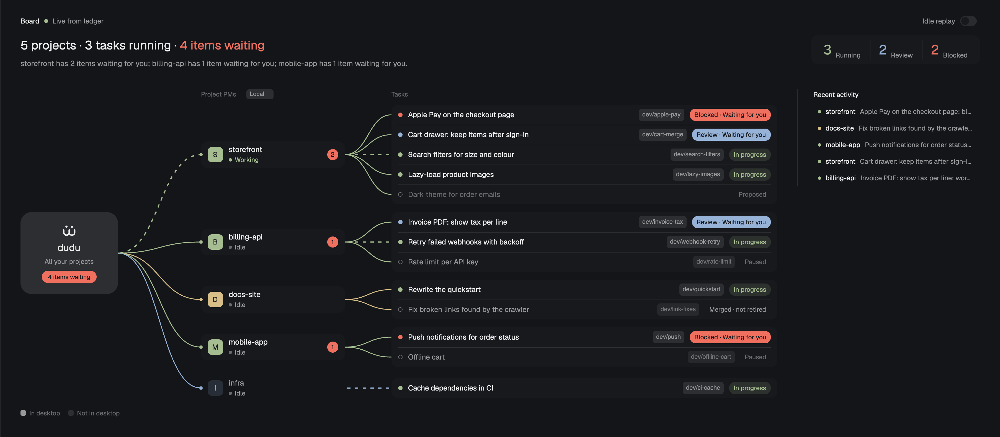

# dudu PM board

A Herdr desktop layout with a PM entry above the space and agent lists. Open Board to see a dudu hub connected to project PMs and their tasks, running/review/blocked counts, machine labels, and recent activity. Task rows lead back to live terminals; the original terminal workspace stays available behind the board. The preview uses invented demo data in the dark theme.



## What you see

- **Window and sidebar:** a horizontal root with no titlebar, traffic lights at 12px/16px, 14px/12px terminal padding, and a 1px divider. The sidebar is 268px wide, with 44px/480px limits and resizing disabled. Its top brand region is 46px high, its footer 69px. Between them, the 64px PM region precedes equally weighted spaces and agents regions, each with a 90px minimum height.
- **PM entry:** a 31px header with a 14px dudu mark and “PM”, followed by a 30px Board row with an 8px radius. The row shows project and in-progress counts, plus a blocked count when nonzero. Base text is 13px; the header and counts are 11.5px. Below 120px sidebar width, it becomes a centered 32px button with a 22px mark and a 6px blocked dot; the summary moves into its tooltip.
- **Terminal workspace:** a 42px tabs bar, a body with 8px padding and gaps, and a 28px status bar. Terminal panes have a 10px radius, 1px border and focus outline, and an always-visible 30px header. A hidden side panel starts at 368px wide, bounded by 280px and 900px, with Files selected ahead of Changes.
- **Board header:** a 24px line contains Board, a 7px read-status dot, the ledger status, and an Idle replay switch. The switch is 30px by 18px with a 14px thumb. Below it, a wrapping summary uses 22px semibold type, or 16px below 800px board width. Supporting text is 13.5px with an 18px line height and a 36px clipped region. The 52px-high statistics capsule shows Running, Review, and Blocked; numbers are 24px, or 20px below 800px.
- **Board canvas:** minimum content width is 560px. Horizontal insets grow from zero to 28px as space permits, becoming 36px at 1500px board width; vertical padding is 24px, or 26px at that wide breakpoint. Below 1500px, recent activity sits beneath the graph with a top border. At 1500px and above, it occupies a 330px right column separated by a 36px gap and a left border with 28px inner padding.
- **Graph, left to right:** the dudu hub is 148px by 148px, or 176px wide in the wide layout, with a 20px radius, a 28px mark, an 18px bold title, and a waiting count. PM rows are 48px high and 168–214px wide in the narrow layout, or 260px wide in the wide layout. Each has a 28px initial badge, project title, live status, and optional waiting count. Task rows are 32px high, or 36px wide-layout height, grouped in 12px-radius panels; project lanes have 10px or 14px gaps. Task title text is 13px, PM titles 13.5px, and status pills 11.5px. Branch chips use 11px monospace and appear only when the task column is at least 360px wide. Machine chips above the PM column wrap within it and use 11px monospace; multiple machines get matching numbers on PM rows.
- **Fit and detail:** the graph scales vertically from 1 down to 0.6 to fit the measured available height, scaling row heights and internal decoration while preserving column positions and widths; the hub width also scales. Scaled text stays at least 10px. Remaining overflow scrolls on both axes with an always-mode scrollbar. Recent activity shows the latest five records, newest first, with 12px text in 24px rows, or 30px rows in the wide layout; an older replayed record may be added temporarily.
- **Color and type:** use Herdr's inherited UI font and theme tokens, not a fixed dark palette. Window and board use canvas, sidebar uses chrome, row groups use surface, hover/detail accents use raised, and separators use border. Text uses foreground, muted, and dim; selection uses selected and hover. Running uses ansi2, review uses accent, and blocked/waiting uses blocked. Project colors are a stable hash into ansi4, ansi5, ansi6, ansi3, ansi2, and ansi1. The dark hub uses raised with foreground text; the light hub uses foreground with background text. Solid badges choose the highest-contrast text among foreground, background, surface, and accent_foreground. The two shipped SVG marks are tinted to match their context.

## How it behaves

- On startup, the board checks the installed skill and SessionStart hook with its bundled `setup.py --status`. Missing setup replaces the graph with a centered, borderless filled block: dudu mark, “Set up PM”, one sentence explaining the skill/settings paths, and one solid “Set up” button. The sidebar says “Set up” without a read error. Clicking installs the skill and hooks, rechecks status, shows “Done. Restart your Claude Code sessions, then say "act as PM for this project".”, and displays the normal board. Failure keeps the script error and button visible. A differing installed `pm.py` shows a quiet update notice above the normal board; Update runs the same setup. Ready adds nothing. All setup text has English and Chinese versions. Setup checks run on startup and after setup, not on the ledger timer; the board sends `pm-nav.setup-changed` after setup, and the sidebar rechecks on that command and board navigation.
- Board toggles between the graph and the terminal workspace. Without the layout's board stack, the same control opens the dashboard as a 980px by 640px overlay. Opening the board establishes a focus baseline; a later change of space, tab, pane, terminal, shown terminal, or agent returns to the workspace.
- Clicking a PM or task row with a matching live terminal focuses that terminal and returns to the workspace, or closes the dashboard overlay. Terminal matching prefers PM/task labels over recorded `hc:` panes and keeps machine identities separate. A PM without an exact match can open a live terminal on the same machine whose `cwd` equals its `repo`, ignoring trailing slashes; agent terminals take precedence over shells, then addresses sort lexically for a stable choice. Tasks have no project fallback. A PM without either match has no click action; its English/Chinese tooltip explains that the session is not in desktop and asks the person to start it there and run `pm.py claim`. With a fallback, the tooltip instead explains that clicking opens the project's space.
- PMs show their live status text. Working has a green dot and green status text; blocked, done, idle, offline, and unknown use a dim dot and muted status text. A PM with an exact live terminal match has a surface fill and solid project badge; without one, its row loses that fill, the badge becomes translucent, and the title is muted, even when a project fallback makes it clickable. A fallback never supplies the PM's status; that continues to come from the ledger. Its blocked/review task count remains a separate waiting badge.
- In-progress tasks have a solid green dot and a translucent green pill reading “In progress”. Blocked tasks have a solid blocked-color dot and pill reading “Blocked · Waiting for you”; review uses accent with “Review · Waiting for you”. Done, paused, proposed, merged, released, abandoned, and cancelled retain their ledger labels with outlined dim dots and muted pills; proposed titles are dim. Cleanup rows read “Merged · not retired”. Other task states use their status label, or “Working…” when the matched worker is working. The running total counts only in-progress tasks whose worker is working; the sidebar in-progress total counts all in-progress tasks.
- Within each project, blocked and review tasks come first, then in-progress tasks, then the rest; ties retain ledger order. The hub's waiting count and summary combine blocked and review tasks. Hovering a PM dims other projects and their wires to 35% opacity with a 160ms transition.
- Hovering a task shows a floating detail card: status, title, project, branch, any commit extracted from a leading log prefix, update time, and up to four wrapped log lines. Its width is at most 520px times the graph scale and never exceeds the task column. It sits 6px times the scale below the row, flips above when needed, and shrinks to the visible space. Real text overflow gets an ellipsis. A live terminal adds “Click to open its terminal”. Leaving the row, scrolling, or resizing dismisses the card; moving over a row can reopen it.
- Working PM links and eligible working task links animate as 2.2px dashed strokes, 6px on and 8px off, advancing 4px every 110ms. Other links are 1.6px curves at 50% opacity. Paused, proposed, done, merged, released, abandoned, and cancelled task links stay still even if a terminal reports working.
- New events animate a 10px packet along the connecting curves at 260px per second using 24px linear hops over a 2px-sampled curve. Prompts travel hub to PM; replies travel back. User dispatches travel hub to PM to task; other task events use the task link, with reports travelling back to the PM. Forward packets are filled; reverse packets are hollow. Row text and status wait for the event to arrive. Status changes briefly fade labels to 40%; entering blocked nudges the title 6px and springs it back. Events are separated by 400ms.
- Idle replay starts off. When enabled, after 20 seconds without new events it cycles through the last 12 records, marks replayed activity, and leaves ledger data unchanged. New events interrupt a replay; switching replay off cancels the current replay. The mods define no custom keyboard shortcuts.
- Both mods read local state immediately, watch the tasks folder, and retry every 10 seconds. Local read errors keep the last successful state and show an error indicator. The sidebar discovers remote state every 15 seconds; the visible board or overlay does so every 5 seconds. A disconnected machine is removed after successful discovery; a transient remote read failure retains its previous snapshot. English is the default; local state can select Chinese labels without translating ledger text.

## Built from

The static `layouts/pm.json` retains the stock workspace in this node tree:

```text
root (row)
├── sidebar (column, 268px)
│   ├── brand (block, 46px → workspace-chrome)
│   ├── sidebar-lists (column)
│   │   ├── pm-nav (block, 64px → pm-nav)
│   │   ├── spaces (block, weight 1 → spaces)
│   │   └── agents (block, weight 1 → agents)
│   └── sidebar-footer (block, 69px → workspace-chrome, props.footer=true)
└── pm-stage (stack, active=work)
    ├── work (column)
    │   ├── tabs (block, 42px → tabs)
    │   ├── work-body (row)
    │   │   ├── main (block → active tab, pane header → pane)
    │   │   └── panel (hidden column, 368px)
    │   │       └── panel-body (stack, active=files)
    │   │           ├── files (block → files)
    │   │           └── changes (block → changes)
    │   └── status (block, 28px → workspace-status)
    └── pm-board (block → pm-dash)
```

- `mods/pm-nav/`: `main.js` renders the entry, polls state, watches focus, and dispatches navigation. `model.js` compares focus identities, counts tasks, and supplies the Python cache writer. `mod.json` declares `place: "none"`; there are no custom input props. Its SVG is a 24-by-24-viewBox mark with two round-ended U-shaped strokes and two dots.
- `mods/pm-dash/`: `main.js` renders the graph, detail popup, totals, and feed; `model.js` supplies geometry, status text, state merging, terminal lookup, and curve sampling; `flow.js` owns a retained animation view so dash ticks do not rerender the parent. `mod.json` declares `place: "none"` and a 980-by-640 overlay. The host's `props().overlay` distinguishes overlay mode, allows remote reads there, and identifies the overlay to close. `FlowLayer` receives geometry, working wires, packet state, an overlay flag, and a completion callback. `model.test.mjs` contains pure-model tests. The dashboard carries its own copy of the same SVG mark. `skill/` is the single bundled PM skill; `setup.py` installs its skill and hooks or returns read-only status facts with installed/bundled `pm.py` sizes and SHA-256 hashes. The pure `setupState` function maps those facts to missing, outdated, or ready. `install.sh` imports this same installer and keeps desktop/layout installation in the shell entry point.
- Stock mods required from Herdr are `workspace-chrome`, `spaces`, `agents`, `tabs`, `pane`, `files`, `changes`, and `workspace-status`. They are referenced by the layout, not copied into this repository. UI primitives come from `gpui-kit` and `gpui-base`, including `View`, `PathBuilder`, `Scrollbar`, and `Popup`; curves are painted with `window.paint_path`.
- Herdr APIs used are `theme`, `home`, `appHome`, `exec`, `readTextFile`, `watchFolder`, `nextCommand`, `layout`, `focused`, `terminals`, `agents`, `run`, `props`, and `closeOverlay`. Navigation calls are `layout.select` with `{stack: "pm-stage", child: "work"}` or child `"pm-board"`, `agent.focus` with `{terminal: address}`, and the fallback `mod.open` with `{name: "pm-dash"}`. View timers, spawned tasks, notifications, child views, and `set_props` drive refreshes and animation.
- Both mods execute `python3 <appHome()>/mods/pm-dash/skill/scripts/pm.py state` for local reads. `appHome()` honors `HERDR_APP_HOME`. The board keeps the literal `mods/pm-dash/` prefix in its paths so Herdr’s mod-clone rewrite points a renamed copy at its own bundle; `setup.py` resolves `skill/` relative to itself. The dashboard expects `pms`, `tasks`, and `events` arrays; the sidebar accepts missing local events as an empty array. Optional `lang` selects built-in labels. Remote snapshots namespace PM names, task IDs, and event keys with their machine name while preserving source names for terminal matching.
- Both execute `hc machine ls --json`, select connected named machines, then execute `hc exec --on <machine> 'python3 ~/.claude/skills/pm/scripts/pm.py state'`. Each discovery/remote process has a 4000ms timeout. These commands read other machines through herdr-core and can cause network traffic; the mods do not implement their own transport.
- Outside their folders, the mods watch `~/.claude/pm/tasks` and read the bundled skill's ledger through its state command. Once the local skill and hooks are installed, the sidebar also executes `python3 -c` with the cache writer from `model.js` to create `~/.claude/pm/cache/remote-states.json`. It writes `{at, states}` through a sibling temporary file and atomic rename, creating the parent directory when needed; an unchanged valid snapshot is left untouched. Cache writes are best effort. The board reads that file once at startup, accepting structurally valid snapshots at most ten minutes old, then starts live remote reads. It does not write the cache.
- `preview.png` is documentation art made from invented demo data, not a runtime data source. No external image service or font download is used by the PM mods.

## Watch out

- The mods run `python3` and `hc`, read `~/.claude/pm`, and — only after the person clicks Set up (or explicitly runs `./install.sh`) — write `~/.claude/skills/pm` and `~/.claude/settings.json`. Initial setup checks and ledger reads are read-only. After setup, the sidebar also writes the remote cache under `~/.claude/pm/cache`; it is suppressed while setup is missing.
- This needs the Herdr desktop app, its stock mods, Python 3, and `hc` on PATH. Adding the layout from herdr.dev or copying `layouts/` and `mods/` includes the skill: finish with Set up in the board, or use `./install.sh` as an equal installation path. Neither path creates PM registrations or tasks. The board always sets up `~/.claude`; the shell installer’s `CLAUDE_HOME` override does not redirect the board’s setup or ledger watches.
- `pm-nav` deliberately depends on `mods/pm-dash/skill/` and `mods/pm-dash/setup.py`. A Herdr-cloned board uses its own rewritten folder paths, but the sidebar still needs the original `pm-dash` folder. Manually renaming a directory does not perform Herdr’s JavaScript path rewrite; update its literal `mods/<name>/` paths too. All copies install the same Claude skill destination, so different bundles can each offer an update.
- Remote machines need a connected herdr-core session, Python 3, the same skill path, and their own ledger. Discovery and reads happen automatically; failed reads are not proof that a remote ledger is empty. Cached state can be stale, and its timestamp is not refreshed when its contents stay unchanged. The sidebar keeps refreshing remote state while the board is hidden; hiding the board is not a network-off switch.
- Keep the IDs `pm-stage`, `pm-board`, and `work` aligned with the mods' constants. Re-clicking an already focused item in the stock sidebar does not change focus, so it cannot return from the board. Click Board again or navigate to a different item. A shell changing directory is not treated as navigation.
- The hover card is informational, not an interactive panel. It has no click, focus, dismissal, or pointer handlers of its own; the task row owns the terminal action and hover lifetime. Moving off the row closes it. Do not promise selectable full logs, clickable card controls, or a fixed four-line height: short viewports can show fewer lines or no card.
- Terminal availability and ledger status are separate. A recorded task pane must not borrow its PM's live state, and a PM must not borrow a project fallback's live state. Task labels take precedence and remote machine prefixes matter. Rows are non-clickable when neither an exact terminal nor an eligible PM project fallback exists. Running is narrower than the sidebar's in-progress count; do not make those totals identical by assumption.
- There is no task editing, dispatch button, approval button, or task-count cap in these mods. Large ledgers produce more rows. The 560px minimum content width and 0.6 minimum vertical scale mean small windows can still require scrolling. Host APIs, clipping, popup placement, and live focus behavior need desktop validation on the target Herdr version.
- Keep the static layout unmarked: it has no `generated_by`, `version`, or `cloned_from` fields because this stock snapshot has no version and is not installer-owned. `install.sh` still generates from the user's `main.json`, adding `generated_by: "dudu install.sh"` and conditional `cloned_from` metadata; it does not copy this file. An existing layout containing `pm-nav` is kept. Uninstall remains `./install.sh --uninstall`, with no board uninstall button. It removes only a marked layout, so a directory-installed unmarked layout remains while its PM mods are removed; switch away before uninstalling.
- The preview's dark theme and invented content are examples, not an included ledger or a forced theme. To list the repository, publish it on GitHub with `layouts/pm.json`, both mod folders, `RECIPE.md`, and `preview.png`, and add the `herdr-layout` topic. The directory files alone do not publish or confirm a listing.

## Done when

- Adding only `layouts/` and `mods/` to a fresh app home shows Set up instead of a graph/error and writes nothing outside the mod before a click. Set up installs the bundled skill and SessionStart hook, preserves unrelated settings, shows the restart reminder and normal board; a repeat run does not duplicate hooks. Invalid settings produce an error and leave files unchanged. A same-size but different installed `pm.py` offers Update, which returns the board to ready.
- `./install.sh` produces the same skill files and hooks as before, including `~/.claude/skills/pm/scripts/pm.py` hook commands and optional Discord hooks. Setup from a renamed standalone mod finds its own `skill/`. Uninstall preserves the ledger, settings backups, unrelated hooks, and unmarked layouts.
- The layout loads with the stock workspace initially selected, the PM entry above Spaces and Agents, and both stock and PM mods available. Board toggles the stack without losing the original work node.
- With a populated PM ledger, the board shows PMs, grouped tasks, machine chips, running/review/blocked totals, and recent activity; an empty ledger instead shows zero totals and no records. A failed local state read shows a retry indicator without discarding the last successful snapshot.
- Working, blocked, review, done, and idle states follow the visual rules above. Only eligible working links animate; new event packets arrive before their held row text updates. Idle replay starts only when enabled and does not change ledger data.
- Clicking a row with a live labeled terminal or matching `hc:` pane opens that terminal and returns to work. A PM with only a project fallback opens that terminal but retains its not-in-desktop look and ledger status; its tooltip explains the destination. With no target, the PM stays inert and its tooltip explains how to claim a desktop session. Tasks without an exact match stay inert. Changing focus from the stock sidebar returns to work; re-clicking the same focused item does not.
- Task hover details remain inside the visible graph area, flip above when necessary, clip long logs, and disappear on scroll or resize. Narrow widths and short heights retain readable text and allow scrolling; wide boards move recent activity into the right column.
- A connected machine with a PM skill contributes separate rows; disconnecting it removes them after discovery, while a temporary read failure keeps the last snapshot. A valid startup cache can populate remote rows before live reads; an expired or invalid cache is ignored.
- `herdr-app check mods/pm-dash`, `herdr-app check mods/pm-nav`, `node --test mods/pm-dash/model.test.mjs`, `python3 -m unittest mods/pm-dash/skill/scripts/test_pm.py tests/test_install.py`, and `bash -n install.sh` pass. Tests cover pure setup state and isolated setup/status/update plus installation/uninstall preservation. These source checks do not replace the desktop behavior checks above.
