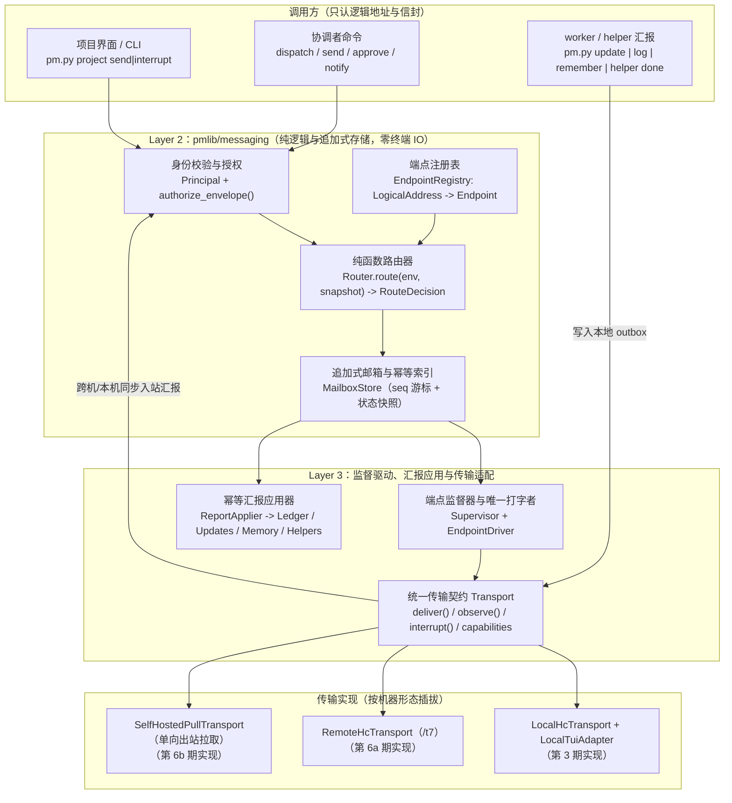
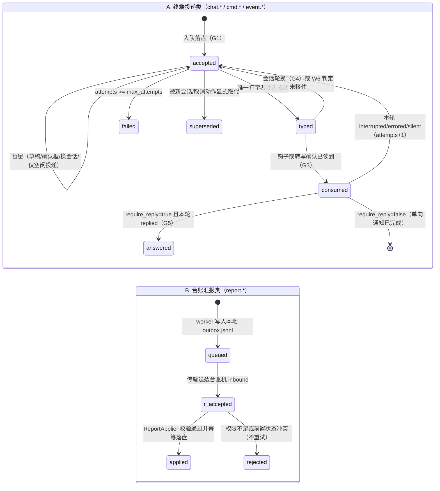
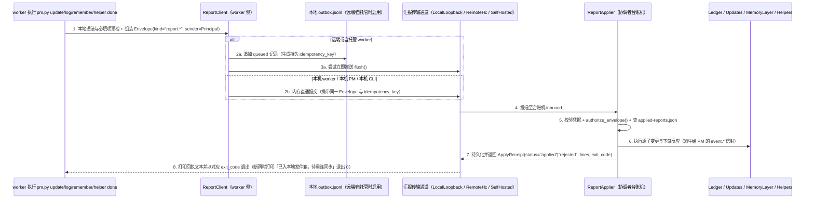
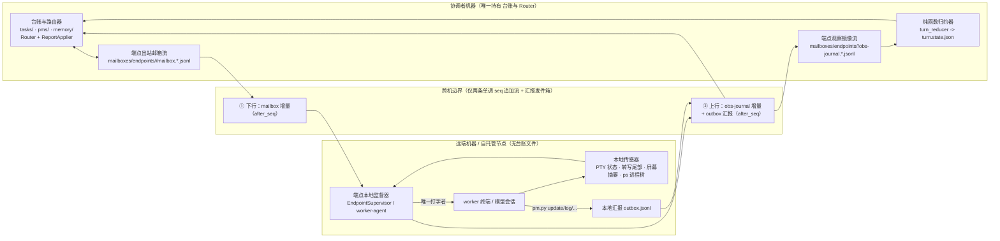

# PM 消息调度、路由与跨机传输架构设计

> **状态：设计稿，待拍板（未改任何生产代码与测试）。** 撰写于 2026 年 11 月 25 日。
> **前情**：本文扩展 `docs/design/pm-stuck-root-fix.md`（任务 `#328`，下称「根因设计稿」），并对照 `docs/design/pm-turn-and-delivery-reliability.md`（任务 `#301`）与当前主线代码（`4c5507c`）给出可直接按稿实现的模块化设计。
> **路径约定**：文中未带前缀的 Python 模块路径均位于 `mods/pm-dash/skill/scripts/pmlib/` 下；`<ledger_home>` 表示协调者所在机器的台账根目录（如 `~/.dudu`）；`<worker_state>` 表示远端或自托管 worker 本地的轻量状态目录；Herdr 宿主接口文档只读引自 `~/.config/herdr-app/AGENTS.md` 与 `herdr.d.ts`，`hc` 行为引自 `hc --help` 各子命令与 `hc schema`（`herdr-core 0.1.22`）。

---

## 0. 结论先行与既定方向核验

### 0.1 核心目标与边界

当前 `pmlib` 把「发什么」「发给谁」「何时唤醒或暂缓」「往哪个终端打字」「对方汇报如何写回台账」混在 20 余个模块里：终端打字散落在后端 14 处 `hc.send`、5 处 `hc.keys`/`hc.interrupt`、7 处 `tui` 调用以及前端 `mods/pm-project/main.js` 的 5 处裸 `hc send` 调用路径（`3855, 3945, 3959, 4557, 8040`）中；地址用裸字符串前缀区分；worker 汇报与钩子直接读写本机台账文件；身份靠环境变量 `HC_TERMINAL_ID` 推断。界面里现有的「远端项目」（`mods/pm-project/main.js:612, 666, 671, 2915, 2938` 经 `remotePmArgv` 在远端跑整套 `pm.py`）是「协调者与台账都在远端、界面跨机查看」，而不是用户现在要的 **「协调者与台账在本机，worker 在远端机器或自托管环境」**。

本设计在根因设计稿第 3 期（消息生命周期）重写的同一刀里，把 PM 侧消息与汇报链路拆成职责正交的三层——**信封与邮箱（Envelope & Mailbox）**、**纯函数路由器（Router）**、**传输层（Transport）**——并把跨机接缝一次留对：**日后接入 `hc` 远端终端（`<machine>/t7`）或自托管 worker（Self-Hosted Worker），只需新增一个 `Transport` 实现并补齐工作树/代码同步等外围前置，无需重开路由器、邮箱、状态机或业务调用方。**



### 0.2 对既定工作方向的取证核验与三处修正

按任务要求，先用源码与 `hc schema` 逐条核验既定方向。总体结构完全成立，但代码与 `hc` 的真实行为揭示出三处必须在设计里正面修正的细节（R1–R3）：

| 既定方向 | 核验结论 | 证据与必要的精确修正 |
| --- | --- | --- |
| **1. 与根因设计稿第 3 期合并实施；不建通用消息总线、不建常驻全局消息服务** | **完全成立** | 本机继续复用每项目按需拉起的监督器进程（现 `pm.py deliver`，`events/deliverer.py:86-120`），空闲可退、读取或入站时由 `ensure_running` 拉起；不引入跨项目守护进程或外部 Broker。 |
| **2. 三层拆分（信封与邮箱 / 纯函数路由 / 传输接口）** | **成立，补两处修正（R1、R2）** | **修正 R1（领域信封 vs 会话引导原语）**：盘点全部 `14 + 5 + 7` 处终端写入点后可见，`manager/service.py:326, 388` 往裸 shell 打 `"exec pm.py seat ..."`、`workers/codex_pool.py:304` 往池化热备终端打 `"/fast"`、以及 `events/stalls.py:390` / `helpers/watch.py:150` / `workers/send.py:127` 用 `hc.keys` 自动点掉安全确认框，属于 **会话诞生前或确认框态的底层终端控制**，不是业务消息——若塞进领域信封，换会话（G4）时会把 `"exec ..."` 重打进已启动的模型会话。因此它们归入会话启动器与 `Transport.unblock_prompt()`，受同一端点打字锁串行化，但不进领域路由。<br>**修正 R2（终端投递状态机 vs 台账汇报事务状态机）**：发往 agent 终端的消息走根因设计稿 3.7 的四态（`accepted → typed → consumed → answered`）；但 worker 发回台账的汇报（`update`/`log`/`remember`/`helper done`）终点是 **台账状态机（`ledger://<slug>`）** 而非终端 PTY，不存在「打入终端」或「模型答完一轮」。强套四态会混淆「台账已落盘」与「PM 已读汇报」。因此同一 `Envelope` 结构下区分两条正交子状态链：汇报信封走 `queued → accepted → applied \| rejected`；应用成功后若策略要求通知 PM，再派生一条独立的事件信封投入 `pm://<slug>` 邮箱走 `accepted → typed → consumed → answered`。 |
| **3a. 监督器可与台账异机运行，跨机只走「邮箱 + 观察日志」两条追加流，按偏移同步** | **成立，修正偏移表示（R3）** | **修正 R3（64 位单调记录序号 `seq` 取代纯字节偏移作为跨机游标）**：实测 `hc file --help` 与 `hc schema` 可见：（1）`hc file read --on <machine> --offset <N> --limit <L>` 的 `offset` 是 **从 1 开始的行号** 而非字节偏移（响应上限 8 MB）；（2）`hc file write --on <machine>` 是 **整文件原子替换**（`Swapped in whole`，上限 8 MB），**没有远端文件追加原语**。此外跨平台换行或日志分片轮转会使纯字节偏移失灵。因此两条 JSONL 追加流统一为每条记录赋予跨分片严格单调递增的 `seq: int`（从 1 起），本机附带 `(seq → 文件分片, byte_offset)` 索引以 $O(1)$ 定位，跨机同步一律按 `after_seq` 游标增量拉取/推送，严禁用 `hc file write` 覆盖在写流。 |
| **3b. 汇报同样走信封（worker 写本地发件箱 → 传输运回台账机 → 幂等应用）** | **完全成立** | 本机 worker 通过 `LocalHcTransport` 走同一套 `ReportClient → Authz → ReportApplier` 同步直通管线（耗时毫秒级，保留原 CLI 退出码与报错文案）；远端/自托管 worker 断网时落本地 `outbox.jsonl`，恢复后按 `idempotency_key` 幂等重放。 |
| **3c. 信封显式携带身份，台账侧校验角色权限** | **完全成立，且消除现有伪造隐患** | 现代码中 `events/stalls.py:226` 为绕过 `landing.py:314` 的 `is_pm_caller` 检查，在拉起子进程时手动注入 `env["HC_TERMINAL_ID"] = pm_term` 伪造协调者终端身份。新设计用显式签发/核验的 `Principal` 取代环境变量猜身份，彻底根除该隐患。 |
| **4. 自托管 worker 单向出站拉取邮箱；台账只驻留协调者机器** | **完全成立** | 自托管 worker 侧只存它自己的 `inbox.jsonl`、`outbox.jsonl`、`obs-journal.jsonl` 副本与凭据，通过出站 HTTPS 或 SSH 标准流主动拉取邮箱并推送观察与汇报，无需入站端口或内网穿透。 |

### 0.3 与根因设计稿（`pm-stuck-root-fix.md`）不变量及保证的一致性

本设计完整保留根因设计稿的十条不变量（I1–I10）与五条消息保证（G1–G5）。涉及跨端点与跨机扩展的四条精确泛化如下，无任何削弱：

| 编号 | 根因设计稿原表述 | 本文中的一致性与泛化说明 |
| --- | --- | --- |
| **I1** | 轮次身份 `turn.id = <终端>:<前台进程号>:<hc turn + 1>` | **泛化**：多机下裸 `<终端>`（如 `t7`）会跨机重名。改为 `<endpoint_uid>:<session_epoch_or_pid>:<turn_seq>`（例如 `hc:local:t12:48291:455`、`hc:gpu-box:t7:19022:12`、`sh:node-1:ep3:8812:4`），第 1 期快照同步采用结构化 `Endpoint`（见第 3、9 节）。 |
| **I2、I3、I5** | 无正面证据不报卡死；单快照读取；纯函数归约器 | **原样保持**。远端与自托管端点的观察记录格式与本机完全相同，归约器无需感知机器位置。 |
| **I4** | 快照新鲜度显式；监督器心跳过期时状态为 `unknown`，绝不外推 | **自然延伸至跨机分区**：当 `hc machine ls` 显示远端机器 `state != "connected"`、RPC 返回 `{"kind": "unavailable"}`，或自托管 worker 拉取/心跳租约超时时，端点状态一律归约为 `health: "unknown"`（附 `link_state: "disconnected"`），**绝不判为 `stalled` 或 `offline`/`gone`**，且挂起一切破坏性自动处置（如自动回收或改派）。 |
| **I6** | 往协调者终端打字的只有一个进程 | **泛化为每端点唯一打字者**：第 3 期起不仅是协调者座位，任何受管端点（worker、reviewer、helper）的出站投递、确认框按键与打断都经由持有该端点 `typist.lock` 的唯一驱动者调用 `Transport`，废除无锁并发的后台 `pm.py _deliver-send`（`workers/send.py:170-193`）与前端直连 `hc send`。注：细粒度轮次阶段归约器（`turn_reducer`）与 W1–W5 自动恢复阶梯在第 1–4 期仍只管协调者座位，本机 worker 卡死巡检暂保留 `events/stalls.py`（改走信封与 `Transport` 接口），第 5 期再统一并入归约器（与根因设计稿 4.6 及文末范围说明对齐）。 |
| **I7 & G1–G5** | 入站内容在「被读到且那一轮正常答完」前由系统负责 | **原样保持并双向闭合**：协调者与 worker 的对话型投递均遵守 G1–G5；worker → 台账的汇报信封在收到台账 `ApplyReceipt(applied|rejected)` 前一直留在 worker 本地 `outbox.jsonl` 重试，被拒收时必有面向 worker 或协调者的显式反馈（6.4 节），目标文件与幂等键单文件原子提交（2.3、2.5 节），两边都不丢、不静默吞错、不重做。 |
| **I8、I9、I10** | 恢复阶梯、前台占用预算、用户随时可叫停且知情 | **原样保持**。对不支持打断的传输（`can_interrupt=False`），I10 要求当场如实告知能力边界并提供取消排队/接管替代动作（见 5.4 与 11.5）。 |

---

## 1. 模块边界、接口签名与现有模块归宿

### 1.1 分层位置与依赖方向（对齐 `tests/test_layers.py`）

仓库在 `mods/pm-dash/skill/scripts/tests/test_layers.py:21-41` 用 AST 静态检查强制实施五层有向无环图（Layer 0 → Layer 4）及函数顶部导入纪律（禁止函数内延迟 `import`，防止长驻进程热更新混入新旧代码）。新模块严格嵌入现有分层，不引入任何反向边或循环：

- **Layer 0**（不变）：`__init__`、`errors`、`osutil`
- **Layer 1**（不变）：`config`、`context`、`home`、`store`、`gitrepo`、`procs`、`terminals`、`agents`
- **Layer 2**（新增 `"messaging": 2` 与 `"project/turn_reducer": 2`，移除旧 `"events/policy": 2`）：
  - `pmlib/messaging/` 只依赖 Layer 0、Layer 1 及同属 Layer 2 的纯领域模型（`ledger/task`、`project/project`、`caller` 基础类型）。
  - 因为 `Transport` 的具体实现（`local_hc.py`、`tui.py`、未来的 `remote_hc.py`、`self_hosted.py`）只调用 Layer 1 的 `terminals/hc`、`terminals/tui`、`procs`、`agents/turn_adapters`，放在 `pmlib/messaging/transports/`（Layer 2）即可让 Layer 3 所有业务服务直接使用，无需在 Layer 3 内部增加横向依赖边。
- **Layer 3**（新增 `"reports": 3`）：
  - `events/`（含 `supervisor.py`）：依赖 Layer 2 的 `messaging` 与 `project/turn_reducer`，负责驱动邮箱出站投递、采样观察日志和运行恢复阶梯。
  - `reports.py`：位于 Layer 3 顶部，`ARROWS["reports"] = {"reactions", "review", "workers", "helpers", "events"}`（与 `landing` 同级）。它实现 `ReportClient`（构造并发送汇报信封）与 `ReportApplier`（校验授权并调用 `Updates`/`Ledger`/`MemoryLayer`/`Helpers` 幂等落盘）。`ReportApplier` 沿用现有 `procs.py:510-523`（`deliver_watchers`）的注册注入模式挂载到监督器循环上，`events` 不反向导入 `reports`。
- **Layer 4**（不变）：`cli`、`commands`、`hooks`、`views`、`compat`。

### 1.2 核心接口签名（Python 3.11+）

```python
# === pmlib/messaging/address.py (Layer 2) ===
from dataclasses import dataclass
from typing import Literal, Protocol

AddressKind = Literal["pm", "worker", "reviewer", "helper", "ui", "discord", "hub", "ledger"]
RuntimeKind = Literal["hc", "tui", "self_hosted", "virtual"]

@dataclass(frozen=True, slots=True)
class LogicalAddress:
    kind: AddressKind
    project: str                 # 项目 slug；hub 时为 ""
    target: str                  # pm->slug, worker/reviewer->task_id, helper->"<owner_kind>:<owner_id>/<name>",
                                 # discord->channel_id, ui->slug, ledger->slug, hub->"local"
    def to_uri(self) -> str: ... # 如 "pm://dudu", "worker://dudu-dudu-foo", "helper://pm:dudu/probe"
    @classmethod
    def parse(cls, uri: str) -> "LogicalAddress": ...

@dataclass(frozen=True, slots=True)
class Endpoint:
    runtime: RuntimeKind         # "hc" | "tui" | "self_hosted" | "virtual"
    machine: str | None          # None 表示协调者本机；远端 hc 为 machine 名；自托管为注册节点 ID
    terminal: str                # hc 为 "t12"（不含机器前缀与 "hc:"）；tui 为 pane id；自托管为槽位名
    workspace: str = ""          # hc workspace / TUI session
    session_id: str = ""         # 模型会话 ID 或自托管会话代号
    agent_kind: str = ""         # "claude" | "codex" | "agy" | "pi" | "other"
    fg_pid: int | None = None    # 当前前台进程号（用于轮次身份锚定）
    epoch: int = 1               # 每次 rotate / reattach / escalate 递增，隔离旧会话残余消息

    @property
    def uid(self) -> str:
        """全局唯一端点键，如 'hc:local:t12'、'hc:gpu-box:t7'、'sh:node-01:slot-0'。"""
        host = self.machine or "local"
        return f"{self.runtime}:{host}:{self.terminal}"

class EndpointRegistry(Protocol):
    def resolve(self, addr: LogicalAddress) -> Endpoint | None: ...
    def reverse_lookup(self, endpoint: Endpoint) -> list[LogicalAddress]: ...
```

```python
# === pmlib/messaging/principal.py & authz.py (Layer 2) ===
RoleKind = Literal["user", "pm", "worker", "reviewer", "helper", "supervisor", "hub", "discord"]

@dataclass(frozen=True, slots=True)
class Principal:
    role: RoleKind
    actor_id: str                # 如 "user:ui", "pm:dudu", "task:dudu-dudu-foo", "helper:pm:dudu/probe"
    project: str
    machine: str | None = None   # None = 本机
    task_id: str = ""            # worker / reviewer / task-owned helper 绑定的任务 ID
    helper_name: str = ""
    helper_mode: Literal["", "readonly", "exec"] = ""
    for_task: str = ""           # PM 委托的 exec helper（如 land-<tid>）绑定的目标任务 ID
    epoch: int = 1               # 签发时端点的 epoch
    credential_id: str = ""      # 令牌 ID（本机 spawn token 或远端/自托管注册凭据 ID）

@dataclass(frozen=True, slots=True)
class AuthzDecision:
    allowed: bool
    reason: str = ""

def authorize_envelope(
    principal: Principal,
    envelope: "Envelope",
    snapshot: "RoutingSnapshot",
) -> AuthzDecision: ...
```

```python
# === pmlib/messaging/envelope.py & mailbox.py (Layer 2) ===
Priority = Literal[0, 1, 2, 3, 4]  # 0=CONTROL, 1=USER, 2=RESUME, 3=DIRECT, 4=BATCH

DeliveryState = Literal[
    "accepted", "typed", "consumed", "answered", "failed", "expired", "superseded"
]
ReportState = Literal["queued", "accepted", "applied", "rejected"]

@dataclass(frozen=True, slots=True)
class Envelope:
    env_id: str                  # 全局唯一 ID："env_<utc_ms_hex>_<rand8>"
    idempotency_key: str         # 幂等去重键（调用方传入或按确定性规则派生）
    schema_version: int          # 固定为 1
    created_ms: int              # 发送方创建时的 UTC 毫秒
    kind: str                    # 如 "chat.user", "cmd.brief", "cmd.send", "cmd.approve_land",
                                 # "event.batch", "ctrl.interrupt", "report.update", "report.log", ...
    sender: Principal
    recipient: LogicalAddress
    project: str
    cause: dict[str, object]     # {"kind": "user"|"task_transition"|"stall"|..., "ref": ...}
    priority: Priority
    body: dict[str, object]      # 结构化载荷；终端投递类含 "text": str，汇报类含命令参数字典
    attachments: tuple[str, ...] = ()  # 附件逻辑引用（相对路径或内容哈希，不内联大文件）
    coalesce_key: str = ""       # 合并/折叠键（如同一任务的连续状态事件）
    require_reply: bool = False  # True -> 需走到 answered（用户消息、汇报批次）；False -> 走到 consumed 即完成
    max_attempts: int = 3
    ttl_ms: int = 0              # 0 表示不过期

@dataclass(frozen=True, slots=True)
class MailboxItem:
    seq: int                     # 邮箱追加流里的 64 位单调序号（从 1 递增）
    envelope: Envelope
    state: DeliveryState | ReportState
    attempts: int
    accepted_ms: int
    updated_ms: int
    target_endpoint_uid: str = ""
    bound_turn_id: str = ""
    last_error: str = ""

class MailboxStore:
    """管理单个邮箱流（JSONL 段文件 + 物化状态快照 + 幂等键集合 + 打字租约）。"""
    def enqueue(self, env: Envelope, *, initial_state: str = "accepted") -> tuple[MailboxItem, bool]:
        """幂等入队：若 idempotency_key 已存在，返回原条目与 created=False。"""
    def transition(self, env_id: str, to_state: str, *, now_ms: int, **meta: object) -> MailboxItem: ...
    def pending_for_endpoint(self, endpoint_uid: str) -> list[MailboxItem]: ...
    def read_stream_after(self, after_seq: int, *, limit: int = 200) -> tuple[list[dict], int]: ...
    def record_intent(self, env_id: str, *, pre_turn: int, pre_status_ms: int, now_ms: int) -> None: ...
    def acquire_typist_lease(self, endpoint_uid: str, owner_pid: int, ttl_ms: int) -> bool: ...
```

```python
# === pmlib/messaging/router.py (Layer 2) ===
ActionKind = Literal["deliver", "hold", "coalesce", "drop_duplicate", "apply_report", "mirror_only", "reject"]

@dataclass(frozen=True, slots=True)
class RouteDecision:
    action: ActionKind
    endpoint: Endpoint | None
    priority: Priority
    wake: bool                   # 是否需要立即拉起/唤醒目标端点
    if_idle_only: bool           # True -> 仅在目标端点 idle 时打入（如汇报批次）；False -> 工作中也可打入
    hold_reason: str = ""        # action == "hold" 时的明确原因（供 UI 展示或日志审计）
    settle_until_ms: int = 0     # 防抖静置截止时间（如问题卡连发 8s 窗口）
    coalesce_into_env_id: str = ""
    rule_id: str = ""            # 命中的路由表规则编号（如 "R-USER-PM"），便于单测断言与排障

class Router:
    """纯函数路由器：输入信封与当前只读快照，不执行任何文件写入、子进程或网络调用。"""
    def route(self, env: Envelope, snapshot: "RoutingSnapshot") -> RouteDecision: ...
```

```python
# === pmlib/messaging/transport.py (Layer 2) ===
LinkState = Literal["connected", "connecting", "disconnected", "unauthorized"]

@dataclass(frozen=True, slots=True)
class TransportCapabilities:
    can_report_status: bool      # 端点是否报告明确的状态词（如 OSC 7501 idle/working；hc reported==False 时动态为 False）
    can_interrupt: bool          # 是否支持打断当前轮次（Esc / SIGINT / 远端取消）
    can_unblock_keys: bool       # 是否支持发送确认框按键（hc keys）
    can_observe_screen: bool     # 是否支持屏幕文本摘要采样
    can_observe_procs: bool      # 是否支持前台子进程树采样
    can_observe_transcript: bool # 是否支持步级转写增量采样
    delivery_mode: Literal["push", "pull"]
    supports_if_idle: bool       # 底层是否原生支持原子 --if idle 检查（can_report_status==False 时必为 False）

@dataclass(frozen=True, slots=True)
class DeliverOutcome:
    status: Literal[
        "typed",                 # 已成功注入目标会话输入（附 started_turn 指示是否已触发开轮；无状态端点为 None）
        "status_mismatch",       # 传了 if_idle=True 但目标此刻不再是 idle（对应 hc error.kind=="status_mismatch"），未注入
        "blocked_prompt",        # 目标停在确认框（对应 hc error.kind=="blocked"），未注入
        "endpoint_gone",         # 正面证据确认目标终端/会话已退出或不存在（对应 hc finished / not_found）
        "partitioned",           # 机器不可达/连接断开（对应 hc unavailable / machine_unknown，必须映射为 unknown）
        "timeout_uncertain",     # 传输调用超时（>70s），无法确认字节是否已入 PTY（需走 pre_turn 对账）
        "rejected",              # 格式或协议级拒绝（不可重试）
    ]
    started_turn: bool | None = None
    observed_turn: int | None = None
    observed_status_ms: int | None = None
    detail: str = ""

@dataclass(frozen=True, slots=True)
class InterruptOutcome:
    # 对齐 hc schema InterruptResult.outcome 真实四态，外加传输层三态：
    status: Literal[
        "stopped",               # 离开了 working，或 shell 重新回到提示符
        "exited",                # 进程因打断信号退出（例如未报状态终端收到 ctrl+c 后退出）
        "still_working",         # 超时窗口内未观察到停止
        "unknown",               # 目标不报告状态（reported==False），hc 无法判断打断是否生效
        "unsupported",           # 传输实现不支持打断（can_interrupt==False）
        "partitioned",           # 跨机连接断开
        "endpoint_gone",         # 目标终端已结束或不存在
    ]
    key_sent: str = ""           # hc 实际发送的按键：报状态程序为 "esc"，不报状态程序为 "ctrl+c"
    detail: str = ""

@dataclass(frozen=True, slots=True)
class ObserveBatch:
    link_state: LinkState
    observations: tuple[dict[str, object], ...]  # 标准化的观察事件（直接喂给 turn_reducer）
    next_cursors: dict[str, int]                 # {"transcript_seq": ..., "obs_seq": ...}
    inbound_reports: tuple[Envelope, ...] = ()   # 远端发件箱捎带拉回的汇报信封

class Transport(Protocol):
    def capabilities(self, endpoint: Endpoint) -> TransportCapabilities: ...
    def deliver(
        self, endpoint: Endpoint, item: MailboxItem, *, if_idle: bool, timeout_s: float
    ) -> DeliverOutcome: ...
    def observe(
        self, endpoint: Endpoint, cursors: Mapping[str, int], *, include_screen: bool, include_procs: bool
    ) -> ObserveBatch: ...
    def interrupt(self, endpoint: Endpoint, *, timeout_s: float = 5.0) -> InterruptOutcome: ...
    def unblock_prompt(self, endpoint: Endpoint, keys: Sequence[str]) -> bool: ...
```

### 1.3 状态归属与唯一打字者（Single Typist）

| 状态数据 | 唯一拥有者模块 | 允许读取方 | 约束说明 |
| --- | --- | --- | --- |
| 邮箱流 `mailboxes/<box>/mailbox.*.jsonl` 与 `mailbox.state.json` | `messaging/mailbox.py` | `events/supervisor.py`、`reports.py`、`views/`（经只读快照） | 任何写入必须持 `<box>/mailbox.lock`；状态迁移只能追加事件并刷新快照，禁止外部模块手改 JSON。 |
| 端点打字租约 `endpoints/<uid>.typist.lock` | `events/supervisor.py`（`EndpointDriver`） | 降级直发路径（仅在监督器未就绪时尝试非阻塞抢锁） | **全系统唯一打字者契约**：只有持有 `<uid>.typist.lock` 的进程才能调用该端点的 `Transport.deliver()` 或 `Transport.unblock_prompt()`。 |
| 观察日志 `*-turn-journal.jsonl` 与轮次快照 `pm-turn.json` v2 | `events/supervisor.py` + `project/turn_reducer.py` | `commands/project.py`、`views/state.py`、前端 mod | 钩子只追加观察行；任何读取方不自行拼凑终端状态外推卡死（I3、I4）。 |
| 台账任务与项目注册表 `tasks/<id>.json`、`pms/<slug>.json` | `ledger/ledger.py`、`project/project.py` | 全局只读；仅协调者本机的 `Updates` / `ReportApplier` / `Manager` 可写 | **只存在于协调者所在机器**；远端或自托管 worker 本地不存在 `tasks/` 目录。 |
| 汇报幂等表 `projects/<slug>/applied-reports.json` | `reports.py`（`ReportApplier`） | `reports.py` | 与任务/记忆落盘在同一临界区内登记 `idempotency_key -> ApplyReceipt`。 |

**谁是每个端点的唯一打字者？**
1. **本机协调者端点（`pm://<slug>`）与本机/远端 `hc` worker 端点（`worker://<tid>`、`reviewer://...`、`helper://...`）**：均由该项目在协调者机器上运行的监督器进程（`pm.py deliver`，内部升级为 `ProjectSupervisor`）统一驱动。监督器为项目内每个活跃端点维护一个非阻塞 `EndpointDriver` 状态机，持该端点的 `typist.lock` 按优先级出队打字。
2. **监督器冷启动兜底（保留 G2 可用性且不破唯一打字者）**：当 `project send` 或无 PM 项目的 `pm.py send` 入队后发现监督器心跳已过期，先调 `ensure_running()` 拉起监督器；若 3 秒内监督器仍未接手，调用方才尝试获取 **同一个 `endpoints/<uid>.typist.lock`** 自执行一次投递——若监督器此刻刚起来拿到了锁，调用方抢锁失败即安全退出，绝不会双写。
3. **自托管 worker 端点（`runtime == "self_hosted"`）**：终端和 PTY 在 worker 自己的机器上，协调者机器上的 `SelfHostedPullTransport.deliver()` 只把信封标记为「可供拉取（`ready_for_pull`）」；worker 机器本地运行的轻量代理 `pm.py worker-agent` 是该终端的唯一打字者，持本地 `typist.lock` 往本地 agent 会话注入内容，并把 `typed` / `consumed` 观察事件推回协调者机器。

### 1.4 现有模块逐一归宿表

| 现有模块（`pmlib/` 下） | 现状职责与问题 | 新架构下的归宿 |
| --- | --- | --- |
| `terminals/hc.py` | `hc` CLI 薄封装（14 处 `send`、5 处 `keys`/`interrupt` 直接调它） | **保留在 Layer 1**，仅供 `messaging/transports/local_hc.py`、`remote_hc.py`、会话启动器（`seat`/`codex_pool`）及只读查询调用；在 `test_layers.py` 新增 AST 规则禁止业务模块直接调 `ctx.hc.send/keys/interrupt`。 |
| `terminals/tui.py` | Herdr TUI socket 封装（7 处直接调 `agent_prompt`/`agent_send_keys`/`pane_run`） | **保留在 Layer 1**，投递与按键收拢进 `messaging/transports/tui.py`；仅保留无新功能维护（符合产品方向）。 |
| `events/policy.py` | 唤醒规则 `wake_rule`、`is_news`、`manager_ready_for_batch` | **删除并迁入 `messaging/router.py`**，消除 `wake_rule` 与 `is_news` 的重复定义（见第 4 节）。 |
| `events/inbox.py` | 旧 TUI 收件箱 `<pm>.log` 字节偏移读取与 `pm.py watch` 轮询（`52-64`） | **废弃并在第 5 期删除**（过渡期保留只读排空），由按逻辑端点组织的 `MailboxStore` 取代。 |
| `events/deliver.py` | 游标扫描 `conversation.jsonl`、拼批次文本、写 `delivered.json` 与 `turn-cause.json` | **拆分收缩**：批次格式化保留为 `events/batch_format.py`；游标与「那一轮答完才算完成（G5）」统一进 `pm://<slug>` 邮箱的 `event.batch` 信封状态机；`delivered.json` 与 `turn-cause.json` 在第 5 期退役。 |
| `events/deliverer.py` | 每项目后台循环，同步调 `hc.send`（最长卡 180 秒） | **升级为 `events/supervisor.py`**：非阻塞驱动项目内各端点邮箱出站、观察采样、归约快照与恢复阶梯；`deliverer.py` 留薄入口兼容 `pm.py deliver`。 |
| `events/notify.py` | `pm.py notify` 录对话日志并催投递器 | **改为信封投递封装**：构造 `kind="event.notify"` 信封交 `Router` 入队，`commands/events.py:63` 里绕过队列直打 `ctx.hc.send` 的分支删除。 |
| `events/stalls.py` | 巡检 worker 卡死、调 `hc.keys` 点确认框、伪造 `HC_TERMINAL_ID` 调 `approve` | **职责一分为二**：确认框自动按键通过端点驱动调 `Transport.unblock_prompt()`；卡死升级与自动合并触发改为用显式 `Principal(role="supervisor")` 发送信封/调用服务，删除 `events/stalls.py:226` 环境变量伪造。 |
| `events/deps_watch.py` | 监听前置依赖满足并记 `deps-ready` 事件 | **保留为监督器 watcher**，产出 `event.deps_ready` 信封经 `Router` 投给 `pm://<slug>`。 |
| `project/turn_state.py` | 混装轮次状态、`outbox`、`inflight`、`hc.send`（853、978 行）与 `hc.interrupt`（918 行） | **大幅瘦身**：轮次计算迁入 `project/turn_reducer.py`；`outbox`/`inflight`/`recent_msg_ids` 迁入 `MailboxStore`；直接调 `hc.send/interrupt` 的代码全部删除，`send_user_message` 仅写信封入队并返回（G1）。 |
| `events/agy_watch.py` | 同步 `agy` 转写并直接改 `TurnTracker` 状态 | **退为适配器与对话镜像**：步级证据通过 `TurnAdapter` 写入观察日志；用户/PM 最终文本继续同步到 `conversation.jsonl`，不再直接驱动轮次阶段。 |
| `workers/send.py` | 启动任务书发送 `send_when_ready`、`update --send` 的 `send_back_for`、无锁后台 `_deliver-send` | **重写收缩**：启动任务书与 `send_back` 均改为向 `worker://<tid>` 邮箱投递 `cmd.brief` / `cmd.send` 信封；删除无锁子进程 `_deliver-send`（由端点唯一打字者接管）。 |
| `workers/service.py` | `dispatch`、`Workers.send`（1206 行）、`deliver_send`（1238 行），1134 行拒绝 `"/" in term` | **解耦终端细节**：`dispatch` 注册结构化 `Endpoint` 并入队 `cmd.brief`；`pm.py send` 入队 `cmd.send`（`--wait` 改为等待该信封到达 `typed`/`consumed` 状态回执），自然支持远端与自托管 worker。 |
| `workers/lifecycle.py` & `project/readmodel.py` | `is_pane_live_for`（59 行）遇 `"/"` 盲返 `True`；`readmodel.py` 四处跳过远端 | **改为查询端点快照与 `EndpointRegistry`**：远端机器断连时返回 `unknown` 而非假活或假死。 |
| `workers/reattach.py` & `workers/escalate.py` | 289 行拒绝接管远端 worker；401 行直调 `hc.interrupt` | `escalate` 改为递增 `Endpoint.epoch`、先发 `ctrl.interrupt` 信封再切换目标端点；`reattach` 通过 `Transport` 支持远端 `hc` 会话重挂。 |
| `workers/codex_pool.py` | 热备池启动并打 `"/fast"`（304 行） | **保留为本机/远端 `hc` 会话引导器**，`"/fast"` 留在池槽位绑定业务端点之前的会话初始化步骤。 |
| `helpers/records.py`、`helpers/service.py`、`helpers/watch.py` | `helpers/records.py:340` 直调 `hc.send` 通知父 worker；`helpers/service.py:896` `done` 直写父台账；`helpers/watch.py:150` 直调 `hc.keys` | `helper done` 改为经 `ReportClient` 发送 `report.helper_done` 信封；通知父 worker 改为向 `worker://<tid>` 邮箱入队 `event.helper_done`（若父 worker 正在 `helper wait` 则路由器判 `hold/mirror_only`，消除竞态）。 |
| `manager/seat.py`、`manager/rotate.py`、`manager/service.py` | `manager/service.py:326,388` 打 `"exec ..."`；`manager/seat.py:398` 后台线程打接手提示词；`manager/rotate.py:402` 直调 `hc.send` | `"exec pm.py seat ..."` 保留为裸 shell 引导原语；接手首条提示词与旧座位未退提醒均改为投入新座位 `pm://<slug>` 邮箱（递增 `epoch` 并按 G4 回收旧会话未读信封）。 |
| `landing.py` & `review/review.py` | `landing.py:355` 对远端置 `worker_live=False`；`465` 行直调 `send_async_later` | `approve` 改为通过 `EndpointRegistry` 判定活性并投递 `cmd.approve_land` 信封（远端仓库约束见 11.4 演练）；自动开审通过 `Router` 触发或抑制。 |
| `hooks.py` | 钩子直改 `TurnTracker`、写 `turns.log`/`receipts.json`（`580`），且在 worker 侧直扫 `raw_tasks()` 并改写 `tasks/<id>.json`（`188, 259, 548`） | **改为纯本地上下文读取 + 本地观察追加**：在任何机器上钩子只读本地会话上下文 `<worker_state>/context.json`（或本机 token 元数据）与本地标记文件，只向本地观察日志追加 `hook_*` 行，零跨机台账扫描（详见 6.5 节）；`receipts.json` 在第 5 期退役。 |
| `commands/ledger.py`、`views/status.py`、`commands/memory.py`、`commands/helpers.py` | `update`、`log`、`remember`、`helper done` 直写 `<ledger_home>`；`recall`、`show`、`helper start|wait|ls|stop` 直读 `<ledger_home>` | **读写双向收口**：写路径经 `ReportClient.submit()` 发 `report.*` 信封送达 `ReportApplier`（6.1–6.4 节）；读路径与子 helper 经本地快照 `context.json` / 只读 `QueryClient` / 本地协同监督器执行（6.5 节）。 |
| `discord.py` | 看板单消息更新（`208-233`）与会话回复镜像（`290-299`，由 `hooks.py:631, 648, 670` 调用） | **封装为出站镜像观察者 / 虚拟端点 `discord://<slug>/<ch>`**，保持未配置时零开销。 |
| `mods/pm-project/main.js`（前端） | 5 处路径直接经 `sendArgv`（`model.js:2684`）调裸 `hc send`：主输入框两处回退（`3945, 3959` → `3855`）、右侧线程输入框 `sendThread`（`4557` → `3898`）、浮动小窗 `sendAgentWindowMessage`（`8040`） | **全部收口进后端信封命令**：主输入框统一走 `pm.py project send`（支持 `--from` 传大文本，移除 60 KB 裸发旁路）；右侧线程框与浮动小窗统一走 `pm.py send <target> --from -` 入队 `worker://` 或 `helper://` 邮箱，前端不再直调 `hc send`。 |

---

## 2. 信封模式（Envelope Schema）与邮箱存储格式

### 2.1 信封字段定义与幂等键规则

所有方向的消息（用户 → PM、PM → worker/helper、系统事件 → PM、worker/helper 汇报 → 台账、控制信号 → 端点）共享同一 JSON 信封外层结构：

```json
{
  "env_id": "env_019ae41f8c10_7f3a9c12",
  "idempotency_key": "ui:dudu:msg-9b12e4",
  "schema_version": 1,
  "created_ms": 1795648200125,
  "kind": "chat.user",
  "sender": {
    "role": "user",
    "actor_id": "user:desktop",
    "project": "dudu",
    "machine": null,
    "task_id": "",
    "helper_name": "",
    "helper_mode": "",
    "for_task": "",
    "epoch": 1,
    "credential_id": "local-uid"
  },
  "recipient": "pm://dudu",
  "project": "dudu",
  "cause": { "kind": "user_prompt", "question_task": "" },
  "priority": 1,
  "coalesce_key": "",
  "require_reply": true,
  "max_attempts": 3,
  "ttl_ms": 0,
  "attachments": [],
  "body": {
    "text": "看一下 #329 的路由表有没有漏掉 helper wait",
    "format": "plain"
  }
}
```

**ID 与幂等键（`env_id` vs `idempotency_key`）职责分离：**
- **`env_id`**：信封实例主键，格式 `env_<48位UTC毫秒十六进制>_<32位随机十六进制>`，按字典序天然大体有序，用于日志追踪、状态迁移引用与转写回执匹配。
- **`idempotency_key`**：业务语义查重键。同一业务意图在超时重试、断网重传、用户点击失败气泡重发时 **必须保持同一个 `idempotency_key`**：
  - 界面用户消息：`ui:<slug>:<前端生成的 msg_id>`（沿用根因设计稿 4.1 修好的重试保留原 `msg_id`）。
  - CLI `pm.py send` / `approve`：支持 `--idempotency-key`，未传时由命令入口生成并在进程内重试期间固定；`approve` 默认用 `approve:<task_id>:<commit_sha>:<epoch>`，防止双击批准发两遍合并指令。
  - 汇报命令（`update`/`log`/`remember`/`helper done`）：worker 侧在首次写入本地 `outbox.jsonl` 时生成 `rep:<actor_id>:<local_outbox_seq>:<rand6>` 并持久化；此后无论网络断多久、重推多少次，都携带该固定键。
  - 系统派生事件（如卡死报警、前置依赖就绪）：用确定性业务键，如 `deps_ready:<task_id>:<dep_hash>`、`stall:<task_id>:<round_turn>:<stage>`，从源头消除重复入队。

### 2.2 双子状态机（共享信封，按终点职责闭合）



### 2.3 排序、至少一次投递与幂等应用

1. **严格优先级 + 同级 FIFO 排序**：
   出站队列对同一目标端点按 `(priority ASC, seq ASC)` 选择下一条可投递条目：
   - `P0 (CONTROL)`：`ctrl.interrupt`、`ctrl.cancel_queued`（控制动作永远抢在任何待打字文本之前执行）。
   - `P1 (USER)`：`chat.user`（用户在项目界面或线程侧栏直接发的话）。
   - `P2 (RESUME)`：`cmd.resume_turn`（根因设计稿 W1/W2/W6 的续上提示，确保被打断的那一轮先收口再接新批次）。
   - `P3 (DIRECT)`：`cmd.brief`、`cmd.send`、`cmd.approve_land`（点对点明确指令）。
   - `P4 (BATCH)`：`event.batch`、`event.notify`、`event.helper_done`、`event.deps_ready`（后台状态汇总，仅在目标端点 `idle` 时打入，且在等待期间按 `coalesce_key` 合并）。
   - **防饥饿约束**：`P1` 在协调者工作中若运行时支持中途读取（或排入轮末缓冲区）可直接打入；`P4` 批次在协调者回到 `idle` 且无未决 `P1/P2/P3` 时立即合并为单条批次打入，不会被后续源源不断的 `P4` 事件无限推迟（静置窗口最多推迟至 `first_event_ms + max_settle_ms`）。
2. **至少一次投递 + 幂等应用（At-Least-Once + Idempotent Apply）**：
   - **终端侧**：每条 `chat.*` / `cmd.*` / `event.batch` 打入终端时，首行固定携带轻量化信封锚点标记（例如 `<hc from="pm" id="env_019ae4...">` 或 `[from pm.py #env_019ae4...]`），转写与钩子优先按 `env_id` 精确核销 `consumed`（无标记的终端手敲输入仍回退文本前缀核销），彻底避免用户连发两句相同的话（「继续」）时核销串位。
   - **台账侧（单文件原子提交幂等标记 + 预写反应日志，彻底消除双文件间崩溃重做）**：若先改 `tasks/<id>.json` 再写独立的 `applied-reports.json`，两步之间进程崩溃会导致重试时把状态变更和下游反应再跑一遍；反之若先写幂等表再改任务文件，崩溃会导致变更永久跳过。因此采用 **目标文件内嵌幂等键 + 预写意图恢复**：
     1. `ReportApplier` 先向追加流 `applied-reports.jsonl` 写入一条 `{"rec": "applying", "idem_key": K, "env_id": ...}`；
     2. 在持目标锁（如 `task.lock`）执行 `write_atomic` 替换 `tasks/<id>.json`（或 `pms/<slug>.json`、`memory/<name>.md` frontmatter）时，**把 `idem_key: K` 连同业务变更一起写进同一个目标文件的 `last_applied_keys` 环形表（及最新 `log[-1].idem_key`）中**——借由单文件 `os.replace` 原子性，「业务数据落盘」与「该目标已应用 `K`」在操作系统层面绝对同生共死；
     3. 随后的下游派生动作（写 `conversation.jsonl`、向 `pm://<slug>` 入队唤醒信封、拉起自动审查、触发 `deps`/`rollup`）全部以由 `K` 派生的确定性幂等键（如 `react:wake:<K>`、`autorev:<tid>:<sha>`）执行，天然可重入；
     4. 全部反应完成后向 `applied-reports.jsonl` 追加 `{"rec": "applied", "idem_key": K, "receipt": ...}` 并更新内存/快照索引。崩溃恢复或重传命中 `"applied"` 直接返回缓存回执；命中 `"applying"`（说明上次在步骤 2 与 4 之间崩溃）则先读目标文件核对 `K`——若已在目标文件内则 **跳过主状态重做**，仅幂等补齐未完的下游入队动作并补写 `"applied"`。

### 2.4 追加流偏移（`seq`）、保留策略、目录布局与锁层次

**追加流记录格式（JSONL，每行一条不可变事件）：**
- 入队记录：`{"rec": "enq", "seq": 41, "at_ms": ..., "env": { ...完整信封... }, "state": "accepted"}`
- 投递前意图记录（解决半途崩溃）：`{"rec": "intent", "seq": 42, "at_ms": ..., "env_id": "env_...", "attempt": 1, "pre_turn": 18, "pre_status_ms": 1795648100000}`
- 状态迁移记录：`{"rec": "st", "seq": 43, "at_ms": ..., "env_id": "env_...", "from": "accepted", "to": "typed", "attempt": 1, "turn_id": "hc:local:t12:48291:19"}`

每条记录的 `seq` 在该流生命周期内从 `1` 起严格连续递增（跨文件分片不重置）。物化快照 `mailbox.state.json` 保存 `{ "last_seq": 43, "segment": "mailbox.0002.jsonl", "byte_offset": 18492, "active": { ...未终态条目... }, "recent_keys": { ...最近 2048 个 idempotency_key -> env_id/state... } }`。

**台账根目录（`<ledger_home>`，仅在协调者机器）文件布局：**

```text
<ledger_home>/
├── projects/<slug>/
│   ├── pm-turn.json                     # v2 轮次快照（含结构化 Endpoint 与活跃 inbox 视图投影）
│   ├── pm-turn-journal.0001.jsonl       # 协调者观察日志分片（带单调 seq）
│   ├── pm-turn.beat                     # 协调者监督器心跳文件
│   ├── applied-reports.0001.jsonl       # 汇报预写与完结追加流（applying -> applied | rejected）
│   ├── applied-reports.json             # 物化幂等回执快照（保留最近 4096 条或 30 天）
│   ├── mailboxes/
│   │   ├── pm/                          # pm://<slug> 的邮箱
│   │   │   ├── mailbox.lock
│   │   │   ├── mailbox.0001.jsonl
│   │   │   └── mailbox.state.json
│   │   ├── inbound-reports/             # ledger://<slug> 收到的跨机/本机汇报流
│   │   │   ├── mailbox.lock
│   │   │   ├── mailbox.0001.jsonl
│   │   │   └── mailbox.state.json
│   │   └── endpoints/                   # 该项目下各 worker / reviewer / helper 的出站邮箱与观察流
│   │       └── <endpoint_safe_uid>/
│   │           ├── mailbox.lock
│   │           ├── typist.lock          # 该端点唯一打字者互斥锁
│   │           ├── mailbox.0001.jsonl
│   │           ├── mailbox.state.json
│   │           ├── obs-journal.0001.jsonl
│   │           └── turn.state.json
└── tokens/                              # 0700 目录：本机会话凭据与自托管 worker 注册表
    ├── local-<endpoint_safe_uid>.token  # 0600，派发终端时签发
    └── workers.json                     # 自托管节点公钥/哈希凭据与吊销列表
```

> **内部文件清单同步红线**：实施时，`pm-turn-journal*`、`pm-turn.beat`、`applied-reports*` 与 `mailboxes` 目录名必须 **同时** 加入 `pmlib/store.py` 与 `mods/pm-project/model.js` 两处的 `INTERNAL_PROJECT_FILES`，防止项目文档扫描把它们当成用户 Library 文件列出。

**远端 / 自托管 worker 本地状态目录（`<worker_state>`，如 `~/.dudu-worker/<node_id>/`）：**
只存该节点受权任务的本地运行态：`credential.json`（`0600`）、`context.json`（派活时随 `cmd.brief` 下发的只读任务与项目记忆快照，供本地钩子与离线 `recall` 读取，见 6.5 节）、`hook-state.json`（本地钩子去重标记，如 `subplan_reminded`、`reported_this_round`）、`inbox.0001.jsonl`（从协调者拉下的待办信封镜像 + `ack_seq`）、`outbox.0001.jsonl`（本地汇报发件箱 + `acked_seq`）、`obs-journal.0001.jsonl`（本地采样观察流 + `pushed_seq`）。**无权威 `tasks/`、无 `pms/`、无全局台账。**

**保留与轮转（Retention & Compaction）：**
- 单个 `.jsonl` 分片达到 **2 MiB** 时轮转新分片（`mailbox.0002.jsonl`），首行写入分片头 `{"rec": "seg", "seq": 1420, "prev_last_seq": 1419}`。
- 当某旧分片内所有信封均已进入终态（`answered` / `applied` / `rejected` / `failed` / `expired` / `superseded`）且跨机同步游标 `ack_seq` 已越过该分片的末尾 `seq` 后，保留最近 **2 个** 历史归档分片备查，更早的分片自动清理。
- `applied-reports.json` 保留最近 **4,096 条记录或 30 天**（取并集上限 8,192 条），足以覆盖「worker 离线数小时乃至数天后恢复重传」的幂等去重。

**严格锁顺序（死锁预防）：**
当一次操作需跨锁时，只允许按以下单向顺序加锁，禁止逆序：
`任务/项目台账锁 (task.lock / registration.lock)` → `汇报幂等表锁 (applied-reports.lock)` → `目标邮箱锁 (mailbox.lock)` → `观察日志锁 (turn.lock)`。
`typist.lock` 是非阻塞租约锁（`try_lock`），持锁期间执行终端投递时 **不持有** `mailbox.lock`（先持 `mailbox.lock` 写 `intent` 并释放 → 持 `typist.lock` 调 `Transport.deliver` → 再持 `mailbox.lock` 写 `typed` 状态迁移），保证任何耗时 IO 都不会卡住前端 `project send` 入队（G1）。

### 2.5 任意两态之间崩溃的恢复矩阵

| 崩溃发生点 | 盘上留下的状态 | 重启/下次循环的确定性恢复行为 | 结果保证 |
| --- | --- | --- | --- |
| **C1. `enqueue` 写 JSONL 半行时崩溃** | 末尾留下一行无 `\n` 或 JSON 校验失败的残片 | 读取器按 `\n` 扫描，丢弃最末不完整行并截断到上一个换行边界；调用方未拿到受理回执，以原 `idempotency_key` 重发 | 零脏数据、不丢消息 |
| **C2. 已写 `enq`（未刷 `mailbox.state.json`）崩溃** | `.jsonl` 有 `seq=N`，`state.json` 的 `last_seq < N` | 打开邮箱时恒从 `state.json.byte_offset` 往后重放 `.jsonl` 增量行再对外提供服务，内存与快照瞬间补齐 | 受理即持久（G1） |
| **C3. 已写 `intent`，在 `Transport.deliver` 阻塞中途崩溃（未知是否已打进终端）** | `.jsonl` 最后一条是 `intent(env_id, pre_turn, pre_status_ms)`，无 `st(to=typed)` | **先对账、后决定是否重打**：监督器先采样一次端点状态与转写尾部——若终端 `turn > pre_turn` 或 `(state=="working" and status_ms > pre_status_ms)` 或转写已含 `env_id` 标记，直接补写 `typed`（及 `consumed`），**不重复打字**；若终端仍停在 `pre_turn` 且未开轮，按原 `env_id` 重打 | 把「半途崩溃双打」窗口压到最小 |
| **C4. `typed` 之后、`consumed` 之前崩溃** | 条目处于 `typed` | 监督器重启后从 `obs-journal` 游标继续追转写/钩子；匹配到 `env_id` 或文本则升 `consumed`；若崩溃期间会话已重启（`fg_pid`/`epoch` 变了），按 G4 自动退回 `accepted` 重打；若空闲超 20s 仍无匹配，进入 W6 | 已打未读绝不静默丢失（G3、G4） |
| **C5. `consumed` 之后、`answered` 之前崩溃** | 条目处于 `consumed`，绑定 `bound_turn_id` | 归约器回放观察日志收口 `bound_turn_id`：结局为 `replied` 则升 `answered`；结局为 `interrupted`/`errored`/`silent` 且 `require_reply=True`，则 `attempts + 1` 退回 `accepted` 触发续上或重投（G5） | 死轮/打断不吞用户问题与汇报批次 |
| **C6a. 汇报已原子改写 `tasks/<id>.json`，但在写完下游反应与 `applied-reports` `applied` 记录前崩溃** | `applied-reports.jsonl` 末条为 `applying(idem_key=K)`，而 `tasks/<id>.json` 的 `last_applied_keys` 已含 `K` | 重启或收到重传时识别到 `applying`：读目标文件见 `K` 已在内，**跳过主文件二次修改**，仅以确定性幂等键（`react:wake:<K>` 等）补跑完下游入队反应，最后追加 `applied` 回执 | 彻底消除跨文件写入间隙导致的重复记日志或重复开审 |
| **C6b. 汇报与 `applied` 回执均已落盘，返回回执给 worker 前崩溃或断网** | 台账与 `applied-reports` 均已完结 `K`；worker 本地 `outbox.jsonl` 仍为 `queued` | worker 重连后重推同一信封；`ReportApplier` 直接命中 `applied` 缓存，零 IO 副作用原样回传 `ApplyReceipt`；worker 推进本地 `acked_seq` | 跨机汇报精确生效一次 |

---

## 3. 寻址模型：逻辑地址、结构化端点与旧格式平滑迁移

### 3.1 逻辑地址体系（调用方与信封唯一可见的地址）

业务代码与信封字段中 **严禁再传递裸终端号（如 `hc:t12`）**，一律使用 `LogicalAddress`：

| 逻辑地址种类 | URI 形式示例 | 代表的角色 | `EndpointRegistry.resolve()` 解析来源 |
| --- | --- | --- | --- |
| **项目协调者座位** | `pm://dudu` | 该项目的当前活跃 PM 会话 | `pms/<slug>.json` 的 `endpoint` 字段（换会话时原地更新 `terminal`/`session_id`/`epoch`，逻辑地址不变） |
| **任务 worker** | `worker://dudu-dudu-pm-routing` | 负责该开发/调研任务的当前 worker | `tasks/<id>.json` 的 `endpoint` 字段（`escalate`/`reattach` 时更新端点并递增 `epoch`） |
| **独立审查员** | `reviewer://dudu-dudu-pm-routing-review` | 只读代码审查子任务会话 | 审查任务 `tasks/<review_id>.json` 的 `endpoint` 字段 |
| **临时辅助会话（helper）** | `helper://pm:dudu/probe-1` 或 `helper://task:dudu-dudu-foo/land-1` | 挂在协调者或任务名下的只读/执行 helper | 宿主记录（`pms/<slug>.json` 或 `tasks/<id>.json`）`helpers[]` 中同名活跃项的 `endpoint` |
| **项目界面 / 用户** | `ui://dudu` | 项目对话面板与问题卡读者 | 解析为虚拟端点 `Endpoint(runtime="virtual", machine=None, terminal="ui:dudu")`，写入 `conversation.jsonl` / 任务问题卡字段 |
| **Discord 频道镜像** | `discord://dudu/123456789` | 可选的外部频道桥接 | 解析为虚拟端点 `Endpoint(runtime="virtual", ..., terminal="discord:...")`，由 `DiscordMirror` 消费 |
| **本机跨项目中枢（hub）** | `hub://local` | 多项目汇总协调会话（`references/hub.md`） | `pms/_hub.json`（若已登记）的 `endpoint` |
| **项目台账入口** | `ledger://dudu` | 接收 `report.*` 汇报信封的权威状态机 | 解析为协调者本机虚拟端点 `Endpoint(runtime="virtual", machine=None, terminal="ledger:dudu")`，交 `ReportApplier` 处理 |

### 3.2 结构化端点（`Endpoint`）

当路由器将逻辑地址解析为物理投递目标时，得到结构化的 `Endpoint`（持久化在 `pms/<slug>.json` 与 `tasks/<id>.json` 新增的 `"endpoint"` 对象中）：

```json
{
  "runtime": "hc",
  "machine": "gpu-box",
  "terminal": "t7",
  "workspace": "ws_9a2",
  "session_id": "conv_81f2...",
  "agent_kind": "claude",
  "fg_pid": 19022,
  "epoch": 2
}
```

- **本机 `hc` 终端**：`runtime="hc", machine=None, terminal="t12"` → `hc` CLI 目标参数为 `"t12"`。
- **远端 `hc` 终端**：`runtime="hc", machine="gpu-box", terminal="t7"` → `hc` CLI 目标参数为 `"gpu-box/t7"`（与 `hc run --on gpu-box` 返回的 `address: "gpu-box/t7"` 及 `hc schema` 中 `Machine.name` 定义严格一致）。
- **自托管 worker**：`runtime="self_hosted", machine="node-east-1", terminal="slot-0"` → 走 `SelfHostedPullTransport`。
- **Herdr TUI 窗格**：`runtime="tui", machine=None, terminal="w1:p2", workspace="main"` → 走 `LocalTuiTransport`。

### 3.3 存量台账裸字符串的兼容读取与历史矛盾清理

盘点现有代码可见，当前 `pmlib` 对远端地址的假设存在内部自相矛盾：
- `ledger/task.py:263-266` 的 `hc_terminal_of(task)` 只认 `pane.startswith("hc:")`，对裸 `"gpu-box/t7"` 返回 `""`；
- 而 `workers/lifecycle.py:47-48, 59-60`（`is_pane_live_for`）先判 `if "/" in pane: return True`（不管是不是 `hc:`，甚至包括 TUI 的 `"sess/w1:p1"` 都会命中！），导致远端或带斜杠窗格永远被盲判为「存活」；
- 同时 `events/stalls.py:299`、`workers/send.py:274`、`workers/service.py:1134`、`landing.py:355, 503`、`workers/reattach.py:289`、`project/readmodel.py:110, 143, 193, 214` 又在 `hc:` 剥离之后用 `"/" in term` 跳过或直接抛 `Refused`！

**迁移期统一解析函数 `parse_legacy_endpoint(raw_pane: str, raw_ws: str = "", agent_kind: str = "") -> Endpoint | None`：**

| 存量 `pane` 字符串形态 | 解析出的结构化 `Endpoint` | 说明 |
| --- | --- | --- |
| `""` 或 `None` | `None` | 未绑定终端（如 `proposed` 或纯手动任务） |
| `"hc:t12"` | `Endpoint(runtime="hc", machine=None, terminal="t12", workspace=raw_ws)` | 存量本机 `hc` 终端 |
| `"hc:<machine>/t7"` | `Endpoint(runtime="hc", machine="<machine>", terminal="t7", workspace=raw_ws)` | 带 `hc:` 前缀的远端 `hc` 终端 |
| `"<machine>/t7"`（末段匹配 `^t[0-9a-z]+$` 且不含 `:`） | `Endpoint(runtime="hc", machine="<machine>", terminal="t7", workspace=raw_ws)` | `hc run --on` 原生返回的远端地址 |
| `"w1:p1"` 或 `"<sess>/w1:p1"`（含 `:` 的窗格坐标） | `Endpoint(runtime="tui", machine=None, terminal="w1:p1", workspace="<sess>" or raw_ws)` | Herdr TUI 窗格（修复此前 `"sess/w1:p1"` 因含 `/` 被误当成远端机器的漏洞） |

写入兼容：第 1、3 期在写入 `tasks/<id>.json` 与 `pms/<slug>.json` 时 **双写** 结构化 `"endpoint"` 字段与向后兼容的 `"pane"` 字符串（本机 `"hc:t12"`、远端 `"hc:<machine>/t7"`、自托管 `"sh:<node>/<slot>"`），旧版只读工具不崩；所有新代码一律只读 `record_endpoint(rec)`，彻底废除 `hc_terminal_of` 与散落的 `"/" in term` 判断。

---

## 4. 路由器策略：现行规则全量盘点、冲突消解与声明式路由表

### 4.1 现行代码路由 / 唤醒 / 暂缓 / 合并 / 去重 / 反应规则全量盘点

以下每一条均直接打开当前工作树源码逐行核实（路径相对于 `mods/pm-dash/skill/scripts/pmlib/`，前端注明完整路径）：

| 编号 | 源文件与精确行号 | 现行规则真实行为 | 审计标记（重复 / 矛盾 / 缺陷） |
| --- | --- | --- | --- |
| **E-01** | `events/policy.py:29-53`、`events/deliverer.py:259-277`、`events/deliver.py:379-385`、`procs.py:545-546` | `manager_ready_for_batch` 只看终端状态词：`state=="idle"` 返回 `(True, True)`，`state=="done"` 返回 `(True, False)`，`state=="working"` 且 `last_turn_stopped` 且（匹配英文 `shells still running` 或 `bg_work`）返回 `(True, False)`；其余（含空状态 `""`/`null`）恒返回 `(False, False)`。`is_held_back()` 在 `seat.next_session_ready`（换会话期间存在 `next-session.json`）时扣住批次。 | **严重投递黑洞 + 不看用户发件箱 + FS-12**：① 终端不报状态（`reported: false`）时，哪怕 `turns.log` 的 `Stop` 与 `pm-turn.json` 已证明收轮（任务 `#330`），也永久返回未就绪；② 完全不感知 `pm-turn.json` 的 `outbox`/`inflight`；③ `events/deliverer.py:271-273` 与 `project/turn_state.py:1096-1100` 把整数 `fg_pid` 传给只受字典/对象的 `background_work`。 |
| **E-02** | `project/turn_state.py:61, 72-76, 816-904` | `send_user_message`：若存在 `should_queue_reason`（`blocked`/`error`/`starting`/`next_session`）、`outbox` 非空或 50 秒 `INFLIGHT_LEASE_MS`（`61, 844`）未过期，则排入 `pm-turn.json:outbox` 返回 `status="queued"`；否则无论 `idle` 还是 `working` 都直调 `ctx.hc.send(term, body, timeout=35, errors=True)`（`853`）；报错若匹配 `_DIALOG_OR_DRAFT_ERR_RE`（`72-76`）则插回 `outbox[0]`（`877`）。 | **超时与 `hc` 冲突（MSG-4）+ 前端误当报错（MSG-5）**：`hc send` 内部最多等用户草稿 60s，35s 超时强杀后若未进 `turn` 自增分支会走重排或抛 `Refused`；且前端 `mods/pm-project/main.js:3954-3956` 把 `status==="queued"` 当异常抛出。 |
| **E-03** | `project/turn_state.py:931-999` & `events/deliverer.py:247-249, 282` | `drain_outbox_and_check_stall`：先恢复过期的 `inflight` 租约（`942-970`），随后只要 `outbox` 非空且 `live_state not in ("blocked", "error") and not next_session.is_file()`（`975`，即含 `working`、`idle`、`done`、空状态），就调 `ctx.hc.send(term, head["text"], timeout=35)` 排空队首。 | **双打字者竞态（违反 I6）**：`975` 行排空 `outbox` 时 **未检查是否有未过期的 `inflight` 租约**（另一进程的 `project send` 可能正阻塞在 `853` 行的 `hc.send` 上！），且 `events/deliverer.py:282` 紧接着又对同一终端发批次，两套队列互不互斥。 |
| **E-04** | `events/policy.py:17-18, 56-113` | 写入侧 `wake_fields` / `wake_rule(task, status, reported, caller)`：PM 自己写返回 `{"source": "pm"}`（有 `app_pm` 时 `wake_fields_for` 标 `wake=False`）；他人写归类为 `worker`/`helper`/`session`（跨任务写附 `from_task`，`109-110`）；当新状态属于 `WAKING = ("review", "blocked", "done", "proposed")`（`17`），或 `worker`/`helper` 在任务已处于 `REPORT_WAKING = ("review", "blocked", "done")`（`18`）时带 `--note`/`--commit` 汇报（`111-112`），置 `wake=True`。 | **与 E-05 双重定义且对 `merged` 不一致**：注意 `WAKING` **不含 `"merged"` 与 `"abandoned"`**（也不含脱离阻塞回 `"in_progress"`）；当 `has_app_pm` 为真时，`wake_fields_for`（`58-62`）会把非 `WAKING` 状态显式写成 `wake=False`。 |
| **E-05** | `events/policy.py:116-159` | 读取侧 `is_news(e, pms, task_of)`：先看显式布尔值——`e.get("wake") is False` 返 `False`，`e.get("wake") is True` 返 `True`（`133-136`，`notify`、`stall`、`deps`、`rollup`、`helper` 及带 `wake` 的 `thread` 均由此命中）；仅在无 `wake` 字段（旧记录或写入时无 `app_pm`）时回退解析 `type=="thread"`（`137-158`）：排除 `source=="pm"` 或 `by in pms`；特判 `status=="merged"` 在 `moved=="merged"` 且 `source in ("worker", "helper")` 时返 `True`（`143-145`）；其余要求 `status in WAKING` 且满足状态跃迁、90s 内首条建单记录（`152-153`）或 `REPORT_WAKING` 下的提交/非纯字段备注（`154-158`）。 | **读写两侧规则重复且对委托 `merged` 存在不对称陷阱**：`143-145` 想让 worker/helper 的 `status=merged` 唤醒 PM，但若经 `Updates` 写入时 `has_app_pm` 为真，E-04 因 `merged not in WAKING` 会先写下 `wake=False`，导致 E-05 在 `133` 行直接短路返回 `False`！ |
| **E-06** | `events/deliver.py:34`、`events/policy.py:182-189`、`events/deliverer.py:250-253` | 日志先于任务落盘的 2 秒静置窗口（`SETTLE = 2`）：`pending_items` 遇到时间戳落在 `[now - 2s, now + 60s]` 内的日志行时截断批次扫描（`end = at`），因为 `Change.note` 先追加 `conversation.jsonl` 随后才原子保存 `tasks/<id>.json`，读取方需等任务文件落盘后再拿提交号与最新状态拼批次。 | **因「先写对话日志、后存任务文件」倒序产生的补丁**。新架构由 `ReportApplier` 先原子落盘任务文件再入队事件信封，信封自带快照摘要，不再需要靠墙钟猜落盘时机。 |
| **E-07** | `ledger/transition.py:265-277`、`review/review.py:192-230, 526-589`、`reactions.py:180-189, 228-230`、`events/deliver.py:441-484` | 自动开审的唤醒抑制与合并呈现：当 `should_auto_review` 判定需自动开审（或 `skip_reason == "duplicate running commit"`）时，`ledger/transition.py:266-277` 在写任务日志前 **直接将 `told["wake"]` 覆写为 `False`** 并写入 `task["auto_review"] = {"status": "starting", ...}`；随后 `reactions.py:228-230`（第 3 行反应）调 `run_auto_review` 拉起审查并提前 `return`（若拉起失败，`review/review.py:551-563` 补记一条 `wake=True` 日志把汇报转交 PM）；审查员报 `done` 时，`reactions.py:180-189` 把父任务的 `worker_commit`/`worker_note` 注入 `review_extra`，由 `events/deliver.py:441-484` 把 worker 汇报与审查结论拼成同一条批次项唤醒 PM。 | **状态机耦合在日志行字段修补上**，但业务闭环清晰合理；迁入 `ReportApplier` 反应表与路由器后保持完全一致的外部行为。 |
| **E-08** | `events/policy.py:19, 190-228` | `pending_items` 的三项批次折叠与淘汰规则：① **PM 介入取代**（`191-195`）：若日志出现 `by in pms` 的 `thread` 行且状态与该任务此前待投递项不同，直接移除旧待投递项；② **按键去重计数**（`199-211`）：`type in ("thread", "stall")` 按 `dedup_key = task` 去重，`type=="event"` 且 `source in ("deps", "rollup")` 按 `dedup_key = (source, task)` 去重，只留最新一条并累加 `earlier` 计数；③ **`moved_on` 终态/过时过滤**（`213-228`）：除 worker/helper 完成委托合并本身（`status=="merged"`，`219-221`）保留外，读取任务当前盘上状态 `st`——`deps` 事件在 `st != "proposed"` 时丢弃（`223-224`），`rollup` 事件在 `st == "done"` 或 `st in MOVED_ON` 时丢弃（`225-226`），其余事件在 `st in MOVED_ON`（`merged`/`released`/`abandoned`）时丢弃（`227`）。 | **关键去重与防过时噪音规则，4.2 节必须完整保留**。 |
| **E-09** | `events/deliver.py:30, 285-306, 536-592` & `hooks.py:593-620` | 批次消费确认与顺风车捎带：① 钩子 `UserPromptSubmit` 一读到批次头即调 `took_delivery` → `ack_delivery` 把字节区间记入 `delivered.json` 的 `received`（最多 `MAX_RECEIVED_RANGES=128` 段），若已覆盖则打印重复警告「不要再处理一遍」（`events/deliver.py:559-562`）；② 用户主动发消息触发 `UserPromptSubmit` 时，调 `peek_pending` + `ack_delivery`（`hooks.py:610-620`）把待投递事件顺带打印进本轮上下文。 | **「收到即完成」违反根因设计稿 G5**（本轮中断则批次丢失，重投还被警告抑制）；顺风车捎带（`bring_pending`）则是省轮次的好机制，在新邮箱中改为标记随本轮 `consumed`、等本轮 `replied` 才升 `answered`。 |
| **E-10** | `commands/events.py:25-72`、`events/notify.py:20-59`、`events/inbox.py:52-64` | `pm.py notify`：通过 `Notifier.target` 按显式 `--repo` → 调用方自身任务 → 父目录 → TUI workspace 查找 PM；若有桌面 `app_pm`，写 `type="agent", source="session", wake=True` 入 `conversation.jsonl`（`commands/events.py:51`）；否则追加到 `inbox/<name>.log`，并在无活跃 `pm.py watch` 锁（`57`）时直调 `ctx.hc.send(target[3:], text)`（`63`）或 `ctx.tui.agent_prompt`（`63, 67`）。 | **桌面无仓库/TUI 路径绕过唯一打字者直打终端**。统一收口至目标端点邮箱。 |
| **E-11** | `helpers/records.py:325-384` | `_notify_helper_owner_for`：owner 为 PM 时写 `type="helper", wake=not quiet` 入 `conversation.jsonl`（`376-381`）；owner 为 worker 时，若无 `helper_wait_active_for` 锁、任务仍 `in_progress`、终端未换且 `hc` 为 `live`，无锁直调 `ctx.hc.send`（`340`）。 | **PM 与 worker 通知机制割裂，且无锁直打 worker 终端**。 |
| **E-12** | `events/stalls.py:26-29, 162-289, 333-408, 447-487` | worker 卡死与合并超时巡检：① 内存字典 `stops[tid] = (key, now_, reported)` 按 `key = f"{term}:gone"` 或 `f"{term}:{state}:{turn}"` 静置 `STALL_GRACE=5` 秒（`367-377`），对安全 `trust`/`update` 确认框最多调 2 次 `hc.keys` 自动放行（`386-404`）；② 持久化 `stall` 事件前倒序扫 `conv.events()` 比对任务最近一条的 `key` 去重（`479-482`；`fallback_land_to_helper` 在 `282` 行则先筛 `type=="stall"` 再比 `key`，两处口径微差）；③ `worker_stopped` 在 Claude Code `Stop` 钩子里拦截未汇报停车的 worker（`447-469`）；④ worker 委托合并超 `LAND_APPROVE_TIMEOUT=300` 秒（`28, 333-361`）时抢 `fallback_at` 并伪造 `env["HC_TERMINAL_ID"] = pm_term`（`226`）调 `approve --via helper`。 | **去重依赖全量倒扫对话日志 + 子进程环境变量伪造身份 + 远端（`"/" in term`，`299` 行）完全漏检**。 |
| **E-13** | `events/deps_watch.py:30-115`、`commands/ledger.py:108-121`、`ledger/transition.py:204-209, 227-228`、`reactions.py:269-280` | 前置依赖就绪对账：`proposed` 任务的所有 `depends_on` 满足或废弃时，在任务锁下比对并写入 `task["deps_notified"] = dep_key`（`events/deps_watch.py:68-70`），成功后记一条 `type="event", source="deps"` 唤醒 PM；当 `depends_on` 变更或任务离开 `proposed` 时清除 `deps_notified`。 | **幂等锁认领设计干净，保留进反应表并通过信封幂等键双重兜底**。 |
| **E-14** | `reactions.py:281-418` & `commands/ledger.py:155-156` | 父子任务 `Family.rollup` 级联（第 10 行反应，最多向上 `MAX_ROLLUP_DEPTH=5` 层）：子任务进入终态时锁住父任务重算——若满足自动结项则将父任务改为 `status=done`（`source="rollup", wake=wake_pm`）并继续级联触发依赖对账与祖父任务（`362-398`）；若需通知协调者则比对并写入 `parent["rollup_notified"] = key` 后发 `type="event", source="rollup"`（`352-361, 399-415`）；新增子任务或子任务回 `ACTIVE` 时调 `clear_rollup_notified`（`284-285`）。 | **关键级联规则，完整保留在台账侧 `ReportApplier` / `Updates` 反应链中**。 |
| **E-15** | `reactions.py:6-21, 193-206, 212-290` & `workers/send.py:170-193, 258-307` | `Updates` 有序反应表（第 1–9b 行）：含 PM `--send` 自动解除 worker 阻塞回 `in_progress`（`193-199`，不误解 PM 自己发的问题卡）、收集调研报告（第 2 行，`224-227`）、自动开审短路（第 3 行，`228-230`）、`--send` 打字（第 4 行，`workers/send.py:274` 遇 `"/" in term` 报 `Refused`，PM 调用拆无锁 `_deliver-send`）、互斥回收/关闭审查与 worker 终端及清理记忆候选（第 5a/5b/6/7 行，`235-265`）、同步父任务 `@review` 步骤（第 8 行，`266-267`）。 | **有序反应链本身必须在台账侧完整保留**，但其中所有终端打字、关闭与远端阻断逻辑须替换为 `Router` 信封与 `Transport` 调用。 |
| **E-16** | `landing.py:353-476` | `pm.py approve`：355 行遇 `"/" in term` 强置 `worker_live=False`（`--via worker` 必拒，默认静默退化为本机 helper），委托 worker 时拆无锁 `send_async_later`（`465`）。 | **远端分支坏死 + 无锁并发打字**。 |
| **E-17** | `discord.py:41-64, 208-233, 290-299`、`procs.py:506-508`、`hooks.py:631, 648, 670` | 可选 Discord 镜像：`after_save` 钩子原地编辑看板单条消息（`discord.py:208`）；`hooks.py` 在收发轮次时调 `DiscordMirror.mirror` 转发文本（若 `replied_on_discord` 检测到已用插件回复工具答过则跳过，`41-64`）；入站消息由官方插件 MCP 服务送入会话。 | **保留原插件入站与看板同步，出站转发收敛为订阅对话/告警事件的镜像观察者**。 |
| **E-18** | `events/deliverer.py:110-158` | `_note_undelivered` / `_record_deliver_stall`：批次滞留满 900 秒只往 `conversation.jsonl` 写一条无人渲染的 `source="deliver-stall", wake=False` 记录并置 `_stall_warned=True`。 | **告警不达人**（`#330`），由 4.3 节 `R-UNDELIVERED-ALERT` 取代。 |

### 4.2 台账反应表与纯函数路由器规则表

现有系统之所以难改，是因为把「**台账状态跃迁后的领域反应**（改父任务、解依赖、派审查、关工作树）」和「**消息怎么折叠、抑制、排序、送达终端**」揉在了一起。本设计将两者明确拆成上下衔接的两张表：

#### 4.2.1 台账状态跃迁有序反应表（位于 `ReportApplier` → `Updates`，完整继承 `reactions.py:6-21`）

当 `report.task_update`（或本机 `pm.py update` / `new`）在协调者机器完成锁内状态变更后，按以下固定顺序执行反应，但 **不再直接碰任何终端**：

| 序号 | 触发条件（与 `reactions.py` 严格对应） | 台账与文件系统动作 | 产出的信封（交 `Router.route`） |
| --- | --- | --- | --- |
| **Row 1** | 本次变更满足唤醒条件（非 PM 自改、且未触发 Row 3 自动开审抑制）：新状态属于 `("review", "blocked", "done", "proposed")`，或 worker/helper 完成委托合入报 `"merged"`（**修复 E-04/E-05 不对称**），或在 `("review", "blocked", "done")` 下带 `--note`/`--commit` 汇报 | 原子保存任务文件后（无需 2s `SETTLE` 等待） | `Envelope(kind="event.task_updated", idempotency_key="react:wake:<K>", recipient="pm://<slug>", coalesce_key="task:<tid>")` |
| **Row 2** | 状态处于 `("review", "blocked", "done", "merged", "released")` 且状态变化或带 `--note`/`--commit` | 本机任务调 `collect_research`；跨机任务读取已同步至 `<ledger_home>/artifacts/<tid>/` 的报告产物 | — |
| **Row 3** | `will_auto_review == True`（`should_auto_review` 通过：有新提交、未设 `no_review`、未超轮次上限） | 任务记录 `auto_review={"status": "starting", ...}`；调 `Reviews.run_auto_review` 创建审查子任务并短路跳过 Row 4–9b。**若拉起审查失败**（`review/review.py:551-563`），将 `auto_review.status` 置 `"failed"` | 成功：向 `reviewer://<rid>` 投 `cmd.brief`（原任务暂不发 `event.task_updated`）；失败：立即补发 `event.task_updated(wake=True)` 转交 PM |
| **Row 4** | 请求带 `--send`（PM 指导 worker；若原状态是 worker 报的 `blocked` 且未显式指定状态，`probe` 已自动将其恢复为 `in_progress`） | 更新任务的 `round` 基准锚点 | `Envelope(kind="cmd.send", priority=3, recipient="worker://<tid>", body={"text": note})`（不再拆 `_deliver-send`，远端照常支持） |
| **Row 5a/5b/6/7** | 互斥生命周期收尾：`5a` `merged` 关关联审查线程；`5b` PM 派发的 `merged`（或合后步骤 `done`）且无 `--keep` 回收工作树与会话；`6` 终态无 `--keep` 按配置关终端并清理 `MemoryCandidates`；`7` `review` 按 `close_reported` 空闲后关终端 | 更新台账标记与清理记忆候选 | 向目标端点对应的 `Transport` / `WorkspaceProvisioner` 下发异步回收指令（若自关，等当前轮结束） |
| **Row 8** | `review_of` 审查子任务变为 `done` | `Reviews.sync_on_done` 更新父任务 `@review` 步骤、`auto_review` 结论与 `last_reviewed_commit` | 产出的 `event.task_updated` 信封自动携带父任务的 `(worker_commit, worker_note)` 与本次审查结论，合并成一条批次项发给 `pm://<slug>` |
| **Row 9a/9b** | `9a` `proposed` 设 `--depends-on` 记下 `deps_notified`；`9b` 任务进入 `("merged", "released", "done", "abandoned")` | `DependencyWatcher.reconcile_dependents_of` 锁住受影响的 `proposed` 下游任务认领 `deps_notified = dep_key` | 每认领一个就绪下游任务，向其所属项目发出 `Envelope(kind="event.deps_ready", idempotency_key="deps:<dep_tid>:<dep_key>", coalesce_key="deps:<dep_tid>")` |
| **Row 10** | 子任务关系变更或进入终态，存在 `parent` | `_rollup_ancestors` 最多向上级联 5 层：满足自动结项则改父任务为 `done` 并继续级联；满足通知则锁父任务认领 `rollup_notified = rollup_key` | 自动结项产出 `event.task_updated(source="rollup")`；仅通知产出 `Envelope(kind="event.rollup", idempotency_key="rollup:<parent_id>:<rollup_key>", coalesce_key="rollup:<parent_id>")` |

#### 4.2.2 声明式纯函数路由与批次折叠/淘汰表（`Router.route` + `MailboxStore` 实现规格）

`Router.route(env, snapshot) -> RouteDecision` 无任何 IO，自上而下匹配：

| 规则 ID | 匹配信封 `kind` 与条件 | 解析目标 | 优先级 | 投递时机（Wake / Hold） | 合并、取代与 `moved_on` 淘汰规则 | 完结条件 |
| --- | --- | --- | --- | --- | --- | --- |
| **R-REPORT** | `report.*`（`recipient == ledger://<slug>`） | 本机 `ReportApplier` | `P0` | 立即校验并执行原子落盘 + 4.2.1 反应表 | 目标文件内嵌 `idem_key` + `applied-reports` 精确去重 | `applied` 或 `rejected` |
| **R-REPORT-REJECTED** | `event.report_rejected`（异步汇报被 `ReportApplier` 拒收时自动派生，见 6.4 节） | 若原 worker 仍活跃且同 `epoch` 且非越权 → `worker://<tid>`；否则（或属权限拒绝）→ `pm://<slug>` + `ui://<slug>` | `P3`（回 worker）/ `P4`（报 PM） | `wake=True`；绝不静默丢弃离线拒收结果 | 按 `rejected:<orig_env_id>` 去重 | `consumed`（worker）或 `answered`（PM） |
| **R-CTRL** | `ctrl.interrupt` / `ctrl.cancel` | `resolve(recipient)` | `P0` | 立即执行；`can_interrupt==False` 返 `unsupported` 并支持取消待发队列 | 同轮次同目标合并为一次打断 | `InterruptOutcome` 返回 |
| **R-USER-PM** | `chat.user` → `pm://<slug>` | `pm://<slug>` 端点 | `P1` | `wake=True, if_idle_only=False`；端点处于 `starting` / `next-session` 换人 / `blocked` 确认框 / 分区时 `hold`；**顺风车捎带（保留 E-09 `bring_pending`）**：若开轮时邮箱中有就绪 `P4` 事件，一并附入本轮上下文并标为随本轮 `consumed` | 按 `idempotency_key` 查重；`steers_mid_turn==False`（如 `agy`）且正在工作时留队首待轮末立即打入 | `answered`（本轮 `replied`，G5） |
| **R-USER-WK** | `chat.user` → `worker://<tid>` 或 `helper://...`（右侧线程输入框 `main.js:4557` 与浮动小窗 `main.js:8040`） | 对应端点 | `P1` | `wake=True, if_idle_only=False`；确认框或分区时 `hold` | 按 `idempotency_key` 查重 | `consumed` |
| **R-RESUME** | `cmd.resume_turn`（W1/W2/W6 续上提示） | 对应端点 | `P2` | `wake=True, if_idle_only=True`（等被打断轮离开 `working` 后打入） | 同一 `turn_id` 仅保留最新一条 | `answered`（PM）或 `consumed`（worker） |
| **R-DIRECT** | `cmd.brief` / `cmd.send` / `cmd.approve_land` → `worker`/`reviewer`/`helper`/`pm` | `resolve(recipient)` | `P3` | `cmd.brief` 等首次就绪（确认框先 `unblock_prompt`）；`cmd.send` / `cmd.approve_land` 为 `if_idle_only=False`；**PM 介入取代（继承 E-08 ①）**：PM 对某任务下发状态变更或新指令时，自动将该任务在 `pm://<slug>` 邮箱中尚未投递的旧状态事件标为 `superseded` | `approve` 按 `approve:<tid>:<sha>:<epoch>` 查重，新批准取代未发旧批准 | `consumed` |
| **R-SELF-SUPPRESS** | `event.*` 且 `sender` 与 `recipient` 属同一逻辑主体（如 PM 自己改任务） | `ui://<slug>` / `discord` | — | `action="mirror_only", wake=False`（吸收 E-04/E-05 自写抑制） | — | 落盘即完 |
| **R-QUIET** | `event.helper_done(quiet=True)` 或纯 `subplan`/`log` 静默进展、依赖未齐的 `proposed` | `ui://<slug>` | — | `action="mirror_only", wake=False` | — | 落盘即完 |
| **R-BATCH-PM** | `event.task_updated` / `event.deps_ready` / `event.rollup` / `event.stall` / `event.helper_done` / `event.notify` / `event.late_report` | `pm://<slug>` | `P4` | `wake=True, if_idle_only=True`（无 `next-session` 扣留、无未决 `P0–P3`，且满足 4.3 节三级证据就绪时合批打入） | **完整继承 `events/policy.py:199-228` 三条规则**：<br>① **分键折叠**：任务/卡死事件用 `coalesce_key="task:<tid>"`，依赖就绪用 `"deps:<tid>"`，父子汇总用 `"rollup:<tid>"`，同键只留最新并累计 `earlier`；<br>② **出队前 `moved_on` 实时复核**：核对快照中任务当前状态 `st`——除 worker/helper 完成委托合入（`status=="merged"`）保留外，`deps:*` 在 `st != "proposed"` 时标 `superseded`，`rollup:*` 在 `st in ("done","merged","released","abandoned")` 时标 `superseded`，其余 `task:*` 在 `st in ("merged","released","abandoned")` 时标 `superseded` | `answered`（处理该批次的那一轮 `replied`，G5；重投时注明「上次处理中断」而非「重复勿动」） |
| **R-NOTIFY-WK** | `event.helper_done`（owner 为 `worker://<tid>`，`quiet=False`） | `worker://<tid>` | `P4` | 若该 worker 有活跃 `helper wait` 或任务已离开 `in_progress`：`action="mirror_only"`（继承 E-11 `helpers/records.py:328-336`）；否则 `if_idle_only=False` 投递 | 按 `helper_done:<owner>:<name>:<run_id>` 去重 | `consumed` |
| **R-UNDELIVERED-ALERT** | `alert.undelivered`（待投递信封滞留超阈值：`P1/P3` > 2 分钟，`P4` > 15 分钟） | **面向人**：`ui://<slug>` + `hub://local` + `discord://<slug>` | `P1` | 立即路由给人（绝不投回被堵住的目标端点自身） | 按 `undelivered:<endpoint_uid>:<oldest_seq>` 原地更新，排空自动消解 | 队列排空或人工处置 |

### 4.3 多级证据就绪判定与「N 分钟未送达」达人机制（覆盖无状态汇报端点）

2026-11-26 线上事故（任务 `#330`）暴露了一条根本教训：**端点是否能向宿主报告状态词（`idle`/`working`）只是传输与运行时的可选能力（`TransportCapabilities.can_report_status`），绝不是投递器得以工作的前提假设**——旧版 CLI、在裸 shell 里手起会话、未装桥接的 `pi`、TUI 窗格或简版自托管包装器都可能终生 `status: null, reported: false`。

#### 1. `if_idle_only=True`（如 `P4` 汇报批次）的三级证据就绪判定表

路由器与端点驱动根据当前端点 **实际存在** 的证据分层裁决「此刻能否打入批次」及「调 `deliver()` 时是否传 `if_idle=True`」：

| 证据层级 | 适用条件 | 何时判为就绪（`ready=True`） | `deliver(if_idle=...)` 参数 | 边界与防卡死兜底 |
| --- | --- | --- | --- | --- |
| **第 1 级：有终端状态词** | `can_report_status == True` 且已观测到非空状态词 | ① 状态为 `idle` → 就绪；② 状态为 `done` → 就绪；③ 状态为 `working` 但已满足 T4（见到本轮收轮证据且进程树仅剩后台 shell）→ 就绪；其余（真 `working` / `blocked`）→ 暂缓 | 仅情况 ① 传 `if_idle=True`；情况 ②③ 传 `if_idle=False`（`hc --if` 只认 `idle` 与 `working`） | 沿用现有精确边界 |
| **第 2 级：无终端状态词，但有步级/轮次证据** | `can_report_status == False`（如 `hc` 的 `reported == False`），但钩子或转写适配器有记录 | ① 观察日志/快照中最近一轮已收口（`Stop` 钩子或转写终态回复，阶段 `idle`）→ **立即就绪**；② 最近一轮处于活跃阶段 → 暂缓 | 恒为 `if_idle=False`（底层无状态可查，但仍受输入框草稿保护） | **Esc 打断无 `Stop` 兜底**：若最后一条记录是开轮（如 `UserPromptSubmit`），但转写步、屏幕摘要与前台子进程 CPU 均已连续静默满 **30 秒**，归约器自动将该悬空轮收口为 `silent`，恢复就绪，防止一次按 Esc 永久堵死后续批次 |
| **第 3 级：零状态词且零钩子/转写证据（纯黑盒端点）** | 既不报状态词，也无钩子与可读转写 | **有界静默放行（「永不投递」被明令禁止）**：只要端点进程存活、屏幕文本连续 **10 秒** 未变化（不在滚屏输出），且距上一次向该端点打字已满 **15 秒** 冷却期 → **判为就绪** | 恒为 `if_idle=False` | 现代命令行 agent（Claude Code、Codex 等）在轮中收到输入会纳入当前轮或排入轮末缓冲区，且 `hc send` 内部自带最多 60s 的用户未发草稿保护（`terminal.send`）；有界静默保证黑盒会话也能在十余秒内稳定收到通知 |

#### 2. 「N 分钟未能送达」必须路由给人（W8 投递受阻升级）

任何待投递信封只要因确认框阻塞（`blocked_prompt`）、`hc send` 持续等待终端按键草稿、长轮不退（`working`）、机器断连（`machine_disconnected`）或端点失踪（`endpoint_gone`）滞留，系统按两级时间线主动触达 **人**，彻底取代无人渲染的 `deliver-stall` 死日志：
1. **即时状态投影（0 秒起）**：邮箱将 `{ "count": N, "oldest_ms": ..., "reason": "..." }` 实时写入快照的 `undelivered` 字段。项目界面气泡与顶栏立即显示原因，`pm.py status` 与 `pm.py state` 直接输出一行待投递提示（即使在纯 SSH 命令行下运行 `pm.py status` 也一眼可见）。
2. **超时升级告警（`P1/P3` 滞留满 2 分钟，`P4` 汇报批次滞留满 15 分钟）**：监督器生成 `alert.undelivered` 信封，经 `R-UNDELIVERED-ALERT` 路由至：
   - **项目界面与对话时间线（`ui://<slug>`）**：写入并原地更新一条显眼的 `source="pm-incident", class="W8_undelivered"` 横幅（「有 N 条汇报已等待 15 分钟未能送达协调者，原因：<具体原因>」），并在侧栏 `pm-list` 挂等待角标；
   - **跨项目中枢（`hub://local`）与已配置的 `discord://<slug>`**：主动推送一条告警摘要（因为被堵住的往往正是该项目的协调者终端自己，发给中枢或外部通知渠道才能确保人一定收到）；
   - 一旦积压信封随后成功 `typed` 或被人工清空，事故横幅原地折叠为「已恢复送达」。

---

## 5. 传输层契约（Transport Interface）与故障语义

### 5.1 超时、非阻塞异步发送与 `hc` 草稿等待契约对齐

核查 `hc schema`（`0.1.22`）可见两项关键事实：
- `terminal.get`（`Terminal` schema）**没有任何「是否存在未发草稿」字段**；草稿保护完全由 `terminal.send` 在 `herdr-core` 内部执行（*「Paste text and press Enter after a person sends or clears their draft (at most 60 s since their last key), otherwise after ~3 s of quiet. Refuses a blocked program unless force.」*）。
- `terminal.send` 的真实错误枚举为：`not_found`、`machine_unknown`、`finished`、`unavailable`、`blocked`（程序停在确认框）、`status_mismatch`（传了 `--if idle` 但状态已不是 `idle`）、`invalid_params`、`config`、`cancelled`。

根因设计稿查明的两处时序缺陷——`Deliverer` 同步阻塞调 `hc send` 最长 180 秒冻住整个循环（RS-4），以及 `project send` 用 35 秒超时强杀最多等草稿 60 秒的 `hc send`（MSG-4）——统一按以下机制根治：

1. **监督主循环非阻塞 + 子进程超时对齐 `hc` 60 秒草稿窗口**：
   - `EndpointDriver` **绝不在主循环里同步等待 `deliver()`**：它持 `typist.lock`（租约 **75 秒**）以异步后台子进程启动一次 `hc send`（**不传 `--wait`**，子进程超时设为 **`timeout_s = 70.0`**，完整包住 `hc` 最长 60 秒草稿等待 + 3 秒静默期 + 跨机 RPC 余量），主循环每轮仅非阻塞 `poll()` 退出码，单步耗时恒 `< 2 秒`。
   - 若目标停在确认框或 `--if idle` 不匹配，`hc send` 毫秒级立即返回 `blocked` 或 `status_mismatch`，映射为 `DeliverOutcome("blocked_prompt" | "status_mismatch")`，信封保持 `accepted` 等待下一轮。
   - 若该异步 `hc send` 子进程运行超过 **5 秒** 仍未退出（即已越过常规 ~3 秒静默窗口，说明 `herdr-core` 正在等待人工敲字草稿清空或发出），`EndpointDriver` 将该信封的实时活动子状态标为 `waiting_quiet_or_draft`，界面气泡下方如实提示「正在送达（若终端正在输入，将等停笔或发出后再注入）」，既不提前杀进程报错，也不冻住观察采样。
2. **部分投递（`timeout_uncertain`）与发送前锚点对账**：
   网络抖动或 SSH 卡顿时，`hc send` 可能字节已写入远端 PTY 但回执在路上超时（返回 `timeout_uncertain`）。此时**严禁盲目立刻重打**：
   - `EndpointDriver` 在调 `deliver()` 前已将 `(pre_turn, pre_status_ms)` 记入邮箱 `intent` 记录；
   - 收到 `timeout_uncertain` 后，信封进入短暂的 `reconciling` 子状态；接下来的观察周期一旦恢复连通，比对远端端点当前的 `(turn, status_ms)` 及转写尾部中的 `env_id` 标记——若已推进则确认 `typed`/`consumed`，未推进才重打。
3. **回执分层（避免概念混同）**：
   - **传输回执（`DeliverOutcome.typed`）**：只证明字节已送入目标会话输入流（推进到 `typed`）。
   - **消费回执（观察流 `obs_consumed`）**：证明模型会话已把该信封读入上下文（推进到 `consumed`）。
   - **完结回执（归约器 `turn_closed(replied)` / 台账 `ApplyReceipt`）**：证明该轮正常答复完毕（`answered`）或汇报已落台账（`applied`）。

### 5.2 网络分区语义（严格遵守不变量 I4：`unknown`）

跨机引入的最大失效模式是 **网络分区（SSH 断连、远端机器休眠、自托管节点断网）**。传输层与归约器共同执行以下铁律：

- **正面分区识别**：
  - 在 `hc schema`（`0.1.22`）中，`machine.list` 返回每台远端机器的 `state: "connecting" | "connected" | "needs_login" | "unreachable"` 及 `since_ms`；而 `terminal.send`、`terminal.interrupt`、`machine.exec`、`file.read` 在断连时返回错误 `{"kind": "unavailable"}`（注意：`terminal.get` 与 `terminal.read` 的错误枚举仅含 `not_found` / `machine_unknown`，在断连期间可能返回上次缓存镜像或 `lost`）。
  - 因此 `RemoteHcTransport.observe()` **必须先核对 `machine.list` 中该 `endpoint.machine` 的连接状态**：只要 `state != "connected"` 或任何 RPC 返回 `unavailable` / `needs_login`，立即返回 `ObserveBatch(link_state="disconnected", ...)`，`deliver()` 返回 `DeliverOutcome(status="partitioned")`。
  - `SelfHostedPullTransport`：当距离该 worker 最近一次出站同步请求（`/sync` 心跳）超过 `lease_timeout_s`（默认 30 秒）时，`observe()` 返回 `link_state="disconnected"`。
- **归约器与策略响应（I4）**：
  1. `link_state != "connected"` 时，端点快照的 `health` 强制设为 **`"unknown"`**（附 `unknown_reason: "machine_disconnected"` 与断连起始 `since_ms`），**所有卡死计时器（W1/W4/W5/W6）暂停冻结，绝不累加触发 `stalled`**。
  2. **挂起破坏性回退**：当远端 worker 处于 `unknown` 时，禁止自动判定它「已退出」而回收任务，也禁止在未获用户确认前自动为同一分支拉起第二个竞争写者；发往该端点的信封安全停留在邮箱 `accepted` 状态，待重连后自动恢复投递。

### 5.3 三种传输实现的完整行为矩阵

| 接口与维度 | 1. `LocalHcTransport`（第 3 期实现；含 `LocalTuiAdapter` 兼容） | 2. `RemoteHcTransport`（第 6a 期：远端 `hc` 终端 `<machine>/t7`） | 3. `SelfHostedPullTransport`（第 6b 期：自托管 worker，单向出站） |
| --- | --- | --- | --- |
| **前提条件** | 协调者本机运行 `herdr-core`（或 TUI socket） | 用户已通过 `hc machine add/login` 配通 SSH，远端运行 `herdr-core` | worker 机器只需能出站访问协调者端同步接口（HTTPS 或受限 SSH 通道），无需入站端口、无需安装 Herdr 桌面端 |
| **`capabilities`** | `can_report_status` 按 `hc get` 的 `reported` 动态返回（未报过状态词时为 `False`，连带 `supports_if_idle=False`）；`can_interrupt=True`, `can_unblock_keys=True`, `can_observe_screen=True`, `can_observe_procs=True`, `can_observe_transcript=True`, `delivery_mode="push"`（`tui` 下 `can_report_status=False`, `can_observe_procs=False`, `supports_if_idle=False`） | `can_report_status` 按远端 `hc get` 的 `reported` 动态返回；`can_interrupt=True`, `can_unblock_keys=True`, `can_observe_screen=True`, `delivery_mode="push"`；若启用远端轻量监督辅助（见第 7 节）则 `procs` 与 `transcript` 均为 `True`，否则仅靠 `hc` 原生状态与屏幕保底 | `delivery_mode="pull"`, `can_report_status` 与 `can_interrupt` 按本地运行时实情声明（无 OSC 7501 或纯管道包装器声明 `can_report_status=False`，自动走 4.3 第 2/3 级证据就绪）；`can_observe_*=True`（由 worker 本地监督器采集推送） |
| **`deliver()`** | 异步子进程调 `hc send <term> [--if idle] <tagged_text>`（超时 70s 包住 `hc` 60s 草稿保护；`error.kind=="blocked"` → `blocked_prompt`，`"status_mismatch"` → `status_mismatch`，`"finished"\|"not_found"` → `endpoint_gone`）；TUI 调 `tui.agent_prompt` | 先查 `machine` 连通性；异步调 `hc send <machine>/<term> [--if idle] <tagged_text>`（超时 70s）；遇 `error.kind == "unavailable"` 返 `partitioned` | 协调者侧无需外呼：将邮箱条目标为 `ready_for_pull` 并唤醒长轮询等待器；worker 侧 `worker-agent` 拉回后写本地 `inbox.jsonl`、在本地 PTY/stdin 注入，并在下一轮同步推回 `typed` 回执 |
| **`observe()`** | 订阅 `hc events` + `hc get <term>` + 按需 `hc read <term>` 屏幕摘要 + 本机 `ps` 子进程树 + 本机按字节/行偏移增量读转写文件 | `hc get <machine>/<term>` + 按需 `hc read <machine>/<term>`；若远端装有 `pm.py` 监督辅助，则通过 `hc file read --on <machine> --offset <seq_line> --limit 200` 增量拉取远端生成的 `obs-journal.jsonl` 与 `outbox.jsonl` 行 | 协调者侧读取最近一次 worker 出站 `POST /sync` 推送过来的 `obs-journal` 增量行（`after_seq`）与 `outbox` 汇报信封；若超租约未收到同步则报 `link_state="disconnected"` |
| **`interrupt()`** | 调 `hc interrupt <term>` 并读取返回 `{key, outcome}`（`hc schema`：报状态终端发 `esc`，**不报状态终端发 `ctrl+c`**；`outcome` 为 `stopped` / `exited` / `still_working` / `unknown`） | 调 `hc interrupt <machine>/<term>` 并核对 `{key, outcome}`；遇 `unavailable` 返 `partitioned` | 在该 worker 的控制通道写入高优 `P0 ctrl.interrupt` 信封并唤醒长轮询；worker 本地代理收到后对本地子进程/PTY 执行打断并回传真实 `InterruptOutcome` |
| **`unblock_prompt()`** | 调 `hc keys <term> <keys...>` | 调 `hc keys <machine>/<term> <keys...>` | 由 worker 本地监督器按下发的白名单策略在本地执行或回传确认框摘要 |

### 5.4 当传输不支持打断（`can_interrupt == False`）时的契约

并非所有未来的自托管运行时都能在轮次中途优雅打断（例如单次无状态容器任务、外部 Webhook 批处理 worker、或未接按键通道的管道包装器）。当 `capabilities(endpoint).can_interrupt == False` 时：
1. `Transport.interrupt()` 立即返回 `InterruptOutcome(status="unsupported", detail="transport does not support live turn interruption")`，不假装成功。
2. 路由器与邮箱层 **仍立即执行队列级止损**：将该端点邮箱中所有尚未 `typed` 的低优先级待发条目按请求标为 `superseded`（若用户点的是「取消排队消息」），或将用户的插话排在 `P1` 队首保证当前轮一结束第一个被读到。
3. 界面（I10）当场展示明确反馈：「当前执行环境不支持中途打断正在运行的轮次；你的新指示已置顶，将在本轮结束后立即处理（也可选择强制解绑该任务）」，绝不静默吞掉点击。

---

## 6. 汇报方向（Report Path）：统一信封化与本机零退化直通

### 6.1 汇报命令如何改造

当前 worker 与 helper 靠直接读写共享文件系统向协调者汇报，共有四条核心命令加一条合并收尾命令：
- `pm.py update <id> ...`（`commands/ledger.py:165` → `reactions.py:142` `Updates.update`）
- `pm.py log <id> "<text>"`（`views/status.py:26` → `Ledger.change`）
- `pm.py remember "<text>" ...`（`commands/memory.py:28` → `MemoryLayer.remember`）
- `pm.py helper done ...`（`commands/helpers.py:36` → `helpers/service.py:896` `Helpers.done`）
- （附）worker 受权执行 `pm.py land <id>` 完成合并后的状态回写（`landing.py`）

在新架构下，这组命令全部改为 **客户端—服务端逻辑分离（同一套代码，本机进程内直通、跨机异步同步）**：



### 6.2 各汇报信封载荷与本机同步语义保留

| 命令 | 信封 `kind` | `body` 结构化字段 | 台账侧 `ReportApplier` 动作 | 本机直通如何保持 100% 兼容 |
| --- | --- | --- | --- | --- |
| `pm.py update` | `report.task_update` | `task_id`, `status`, `note`, `commit`, `plan`, `subplan`, `step`, `ask`, `options`, `recommend`, `send` 等（与 `UpdateRequest` 一一对应） | 调 `Updates(ctx).update()`：完成校验（如未获批改 `merged` 拒绝、无 `--ask` 改 `blocked` 拒绝，`reactions.py:124-130`）、写任务日志、触发自动开审或把唤醒事件作为 `event.task_updated` 信封交给 `Router` | `LocalReportTransport` 在同一进程内同步调 `ReportApplier.apply(env)`，原样抛出/格式化 `Refused` / `NotFound` 错误码与标准输出行，耗时增加 `< 2ms` |
| `pm.py log` | `report.task_log` | `task_id`, `text` | 调 `Ledger.change` 追加一条带 `env_id` 与 `by=principal.actor_id` 的日志，并路由 `mirror_only` 事件 | 同步返回，无行为变化 |
| `pm.py remember` | `report.memory_write` | `scope` (`project`\|`personal`), `text`, `type`, `name`, `quote`, `verified`, `body`, `expires`, `new`, `topic` | 校验角色可写的记忆类型（如 worker 写 `pitfall`/`reference`，不可篡改用户拍板的 `decision`），调 `MemoryLayer.remember` | `ApplyReceipt` 带回 `notes` 与配额超限标志；若触及条数上限，`commands/memory.py:58-59` 照旧以退出码 `3` 退出 |
| `pm.py helper done` | `report.helper_done` | `owner_kind`, `owner_id`, `name`, `conclusion`（跨机时内联结果正文，上限 256 KiB）, `summary` | 将 `conclusion` 原子落盘至协调者机器该 helper 登记的 `result` 路径（解决跨机无共享结果文件问题！），调 `finalize_helper_for` 更新状态，并向 owner 邮箱路由 `event.helper_done` | 本机 helper 既可先写本地 `result` 文件也可传 `--text`/`--stdin`，均走同一 `ReportApplier` 完成收尾与终端清理 |

### 6.3 断网重连后的过期与状态冲突裁决（Staleness & Conflict）

当远端或自托管 worker 断网一小时后再把积压在本地 `outbox.jsonl` 里的汇报推上来时，台账上的任务可能已经发生了变化（例如用户把任务 `paused` / `abandoned` 了，或 PM 因机器失联把任务 `reattach` / `escalate` 给了另一个新 worker，此时任务的 `endpoint.epoch` 已从 `1` 升到 `2`）。`ReportApplier` 按以下规则安全裁决，绝不静默覆盖新状态：

1. **追加型汇报永远保真留痕（不丢工作成果）**：
   - `report.task_log` 与 `report.memory_write`：只要发送方曾是该项目的合法 worker，日志照常追加（标注 `[delayed report from epoch 1, created <UTC>]`），记忆照常按内容幂等入库。
2. **状态跃迁型汇报校验 `epoch` 与终态保护**：
   - 若 `env.sender.epoch == task.endpoint.epoch` 且任务仍为活跃态（`in_progress` / `blocked` / `review`）：正常执行状态跃迁（如推进到 `review` 并记录 `commit`）。
   - 若 `env.sender.epoch < task.endpoint.epoch`（任务已被换人接管）或任务已处于终态（`merged` / `done` / `abandoned`）：**不回退、不覆盖当前任务主状态与当前负责人**，而是把该汇报降级写入任务 `log[]` 与项目对话日志（标记 `late_report: true`，保留其提交哈希 `commit` 与完整 `note`），并派生一条 `P4 event.late_report` 提醒协调者：「旧 worker（epoch 1）重连后补交了一份离线期间的汇报（commit `<sha>`），因任务已切换至 epoch 2 未自动改状态，请核查是否采纳」。此时的回执标为 `applied`（降级归档成功），worker 本地 `outbox` 正常核销，不死循环重试。

### 6.4 汇报被拒收（`rejected`）时的反馈与可见性契约（绝不静默丢弃）

当汇报因业务规则冲突（如用户已回答后不带 `--ask` 再次报 `blocked`，`reactions.py:124-130`；提交哈希不存在；未获批改 `merged`）或权限校验不通过（`authorize_envelope` 返回 `allowed=False`）而被 `ReportApplier` 标为 `rejected` 时，分同步与异步两路保证 **必有人看见**：

1. **在线同步提交（本机直通，或跨机链路连通时的交互式 CLI）**：
   `ReportClient.submit()` 在连通状态下等待最多 5 秒获取 `ApplyReceipt`。一旦收到 `status == "rejected"`，命令当场把拒绝原因打印到 `stderr` 并以非零退出码（默认 `1`，记忆超配额为 `3`）返回给正在执行 Bash 工具的 worker，worker 在同一轮内即可看到报错并修正命令重发。
2. **离线缓冲后异步重传被拒（worker 早已退出该条命令，甚至已收轮空闲）**：
   此时命令行进程早已结束，若只把 `inbound-reports` 标为 `rejected`，worker 与协调者都会蒙在鼓里。因此 `ReportApplier` 在写入 `ApplyReceipt(status="rejected")`（终止 `outbox` 死循环重传）的同时，**强制派生一条 `event.report_rejected` 信封交 `R-REPORT-REJECTED` 路由**：
   - **若原 worker 仍活跃、同 `epoch` 且属业务校验类拒绝**：以 `P3` 投回 `worker://<tid>` 邮箱唤醒该 worker（`"[from pm.py ledger] 你提交的汇报（seq=<N>）被拒绝：<原因>。请修正后重新汇报。"`）；
   - **若原 worker 已离线/退役/换代，或拒绝原因是越权行为（`authz_denied`）**：直接将该拒绝详情记入任务 `log[]` / `conversation.jsonl`（供界面 `ui://<slug>` 渲染），并以 `P4 wake=True` 投进 `pm://<slug>` 唤醒协调者裁决。

### 6.5 远端与自托管 worker 的台账读取路径、子 helper 与本地钩子契约

「台账只驻留协调者机器」不仅约束写操作（汇报），还必须交代当前 worker 在运行期间 **读取** `<ledger_home>` 的四类真实路径在跨机时如何工作：

| worker 侧现有读取/协同场景 | 现代码位置 | 跨机与本机统一的解耦方案 |
| --- | --- | --- |
| **1. 会话钩子（`SessionStart` / `PreToolUse` / `PreCompact` / `UserPromptSubmit` / `Stop`）** | `hooks.py:180-313, 353-392, 534-556`（每次工具/收轮都扫 `raw_tasks()`、`own_pm_record()`，甚至直改 `tasks/<id>.json` 的 `subplan_reminded` 与 `agent_session`） | **钩子彻底本地化（零跨机 RPC、零全表扫描）**：派活下发 `cmd.brief` 时同步在 `<worker_state>/context.json` 落盘只读会话上下文 `{role, project, task_id, epoch, has_app_pm, land_approved, lang}`。① `PreToolUse` 直接读 `context.json` 拦截 `AskUserQuestion`，并在本地 `hook-state.json` 记 `subplan_reminded`；② `ReportClient` 在成功提交 `--plan` 或状态汇报时同步更新 `hook-state.json` 的 `subplan_recorded` / `reported_this_round`，`Stop` 钩子在 `< 2ms` 内纯本地判断是否拦截未汇报停车（继承 `events/stalls.py:447-469`）；③ `session_id` / `transcript_path` 作为 `obs_session` 记录追加进本地 `obs-journal.jsonl` 随流同步，不再直改任务文件。 |
| **2. 查阅项目/个人记忆（`pm.py recall` / `pm.py memory`）** | `commands/memory.py:62-103`（任务书页脚提示按需 `pm.py recall <name>`，合并后步骤亦读记忆，`landing.py:275`） | **派活快照 + 按需只读查询双兜底**：`context.json` 内含派活时刻该项目与个人记忆的只读索引与正文快照（通常总计 `< 300 KiB`），因此断网离线时 `pm.py recall` 也能毫秒级本地命中；在线时若本地未命中或传 `--live`，经受权只读接口 `QueryClient.query("memory.recall")` 从协调者机器拉取最新条目（严格按 `Principal.project` 隔离作用域）。 |
| **3. 查看任务元数据（`pm.py show <id>`）** | `views/status.py:40-80` | 本机直读；远端/自托管经 `QueryClient.query("task.show", task_id)` 只读拉取同项目内脱敏后的任务摘要（离线时回退读 `context.json` 中自身任务快照）。 |
| **4. worker 派发临时只读子 helper（`pm.py helper start\|wait\|ls\|stop`）** | `helpers/service.py`（最多 3 个并行只读调研 helper，需读取 worker 当前分支工作树代码） | **就地运行 + 生命周期信封回传**：因为子 helper 要读的代码在 worker 所在机器的工作树里，子 helper 必须 **就地** 在该 worker 同一台机器上由本地 `hc` 或 `worker-agent` 启动与等待（本地强制执行 3 个上限与只读约束）；启动与结束分别向台账发 `report.helper_started` 与 `report.helper_done` 信封，使桌面界面的 Threads 面板仍能实时展示该任务下挂载的子 helper。 |

---

## 7. 监督器部署位置与跨机数据边界

### 7.1 为什么传感器必须在终端旁边

根因设计稿 3.2 节的五种活性信号中，有三种本质上是 **机器本地资源**：
1. **步级转写文件**（`~/.claude/projects/.../*.jsonl`、`~/.codex/sessions/...`、`~/.gemini/.../transcript_full.jsonl`）只写在运行模型 CLI 的那台机器磁盘上；
2. **前台工具子进程树与 CPU 时间**（`ps` 按 `fg_pid` 查子孙进程）只能在该终端所在的操作系统内核里读取；
3. **终端 PTY 与确认框/草稿状态** 紧邻本地宿主进程。

因此，架构铁律是：**采样传感器随终端走（Co-located Sensing），台账与全局路由留在协调者机器（Centralized Ledger & Router），两者之间只允许穿过两条追加式数据流。**

### 7.2 三种形态下的监督器放置与跨机双流契约



**跨机边界上允许穿过的全部数据（无任何其它文件读写）：**

| 流向 | 流名称 | 单条记录内容 | 同步游标 | 大小与频率量级 |
| --- | --- | --- | --- | --- |
| **协调者机 → worker 机** | **下行邮箱流**（`mailbox`） | 待向该 worker 投递的信封（`cmd.brief` 附初始只读 `WorkerContextSnapshot`、`cmd.send`、`cmd.approve_land`、`event.report_rejected`、`chat.user`、`ctrl.interrupt`）及台账对上行汇报的 `ApplyReceipt` 确认序号 `acked_outbox_seq` | `worker_inbox_seq`（64 位单调整数） | 低频：每次派活/发消息/打断各 1 条（派活含记忆快照约百 KB，其余数 KB） |
| **worker 机 → 协调者机** | **上行观察与汇报流**（`obs-journal` + `outbox`；另附无状态只读查询 `query.*`） | ① 标准化观察事件（`hc_state`, `obs_session`, `step_tool_start`, `step_tool_end`, `pty_frozen`, `pty_resumed`, `proc_stat`, `consumed(env_id)`, `heartbeat`）；② worker 本地 `outbox` 新增的 `report.*` 信封 | `obs_seq` 与 `outbox_seq`（各自独立的 64 位单调整数） | 常态每步 1–2 条观察（约 200 B/条），空闲仅每 10s 一条心跳 |

**远端 `hc` 终端（`<machine>/t7`）的两阶段工程取舍：**
- **轻量模式（第 6a 期默认即可用）**：`herdr-core` 本身已通过 SSH 桥接了远端终端的 `get`（含 `status`、`status_ms`、`turn`、`foreground`）、`read`（屏幕文本）、`send`、`keys`、`interrupt` 与事件推送！因此即使不在远端机器额外部署守护进程，协调者本机的 `RemoteHcTransport` 也能直接获得终端状态与屏幕探针（满足根因设计稿 3.10「最低保障由终端状态和屏幕探针提供」），并通过 `hc file read --on <machine> --offset <next_seq>` 拉取远端 worker 写的 `outbox.jsonl`。
- **全传感器模式（按需启用）**：在远端由 `hc exec` / 会话包装器随 worker 一同拉起轻量 `pm.py endpoint-watch`，就地采集远端转写与 `ps` 进程树写入远端 `obs-journal.jsonl`，协调者侧按行号 `seq` 增量拉回——因为边界从一开始就是这两条流，从轻量模式升级到全传感器模式对协调者侧归约器与路由器 **零改动**。

### 7.3 自托管 worker 的外围前置条件清单（划清边界，不在本模块展开深设计）

消息与路由模块把「怎么寻址、发指令、盯死活、收汇报」全部解耦了，但一个自托管 worker 要在另一台机器上真正跑起编码任务，还需要以下 5 项独立前置模块配合。此处按任务要求列出每项职责与接口契约，不做展开设计：

| 前置项 | 为什么需要 | 它需要向其它模块暴露的最小契约 |
| --- | --- | --- |
| **1. Git 代码传输（Git Transport）** | worker 需要拿到基准分支代码，且审查/合并时协调者机器需要拿到 worker 提交的分支对象 | 共享远端（SSH/HTTPS Git remote）或基于同步通道的 `git bundle create / unbundle`；worker 报 `review` 前须确保 `commit_sha` 已推送到协调者可抓取的引用（如 `refs/remotes/workers/<node>/<branch>`），否则 `ReportApplier` 拒绝标记为可本地合并。 |
| **2. 远端工作树生命周期（Remote Worktree）** | `dispatch` 现在直接在本机 `~/.herdr/worktrees/` 调 `git worktree add` | 将工作树准备抽象为 `WorkspaceProvisioner.prepare(task, endpoint)` 与 `cleanup(task, endpoint)`，在 worker 所在机器检出指定 `base` 与 `branch`。 |
| **3. 任务书与附件分发（Briefs & Attachments）** | 现任务书直接传本机绝对路径（如 `<ledger_home>/briefs/...` 或截图路径），远端机器打不开 | `cmd.brief` 信封正文直接携带渲染后的 Markdown 任务书全文；二进制或大文本附件放入信封 `attachments` 内容寻址清单（`sha256` + 相对名），由 worker 在拉取信封时按需下载到 `<worker_state>/attachments/` 并改写本地路径占位符。 |
| **4. 证据产物回收（Evidence Collection）** | 调研/测试线程产出的 `evidence/<topic>/` 或截图在远端盘上 | 提供独立文件上传命令或 `pm.py artifact put <path>`（带大小配额与扩展名白名单），落入协调者机器 `<ledger_home>/artifacts/<task_id>/`，不在 JSONL 信封里硬塞数十 MB 图片。 |
| **5. 跨机验证检查（Verify Checks）** | `pm.py land` 前跑的 `verify`（如单测或编译）可能依赖特定机器环境（如 GPU 或特定 OS） | 合并策略区分「在协调者机器主仓库集成工作树跑最终 `verify`（默认，防 worker 环境污染或伪造绿灯）」与「显式委派可信远端 runner 跑平台专属检查并签发结构化测试回执」。 |

---

## 8. 身份认证、角色授权与威胁模型

### 8.1 彻底废除环境变量猜身份：显式 `Principal`

当前代码在 `procs.py:461`、`events/deliver.py:323`、`events/stalls.py:226`、`helpers/service.py:508,530`、`landing.py:367,500` 及前端 `mods/pm-project/model.js:3541-3542,3662` 等多处直接读取环境变量 `HC_TERMINAL_ID` 来判断调用者是不是 PM 或某个 worker。同一机器上的任何子进程只要改一下环境变量就能冒充协调者（`events/stalls.py:226` 甚至把这种冒充写成了正常业务逻辑），而在跨机场景下环境变量更是完全不可信。

新设计规定：**每条信封都携带结构化 `Principal`（见 1.2），但台账侧 `authorize_envelope()` 绝不盲信信封自报的 `Principal`，必须先由传输层用不可伪造的通道凭据核实（Bind & Verify）该 `Principal`。**

| 传输通道 | 身份凭据怎么签发与携带 | 台账侧怎么核实身份（不可伪造依据） |
| --- | --- | --- |
| **本机终端（`LocalHcTransport`）** | `dispatch` / `seat` / `helper start` 拉起终端时，在 `<ledger_home>/tokens/`（权限 `0700`）生成随机 256 位令牌文件（`0600`），仅把令牌文件路径或句柄传给该会话，令牌记录绑定的 `(role, project, task_id, epoch, terminal)` | 本机进程同属当前系统用户 UID，且 `ReportClient` 提交信封时出示令牌 HMAC；本机手动 CLI（用户在自己终端敲 `pm.py`）无会话令牌但具备本机同 UID 且不在任何受管 worker 终端内（可通过 `hc get` 前台进程树核验），映射为 `Principal(role="user", actor_id="user:cli")`；`stalls.py` 等内部监督动作使用监督器自己的 `Principal(role="supervisor")`，无需再伪造 `HC_TERMINAL_ID` |
| **远端 `hc` 终端（`RemoteHcTransport`）** | 信任根为 `hc machine add/login` 建立的本机到远端 SSH 认证通道；启动远端 worker 时为该 `(task_id, epoch)` 生成单任务随机令牌注入远端 `<worker_state>/credential.json`（`0600`） | 协调者本机主动经指定 `<machine>` 拉取该 worker 目录下的 `outbox.jsonl`，并校验信封上的单任务令牌 HMAC，确保远端机器上的 worker A 不能冒充同机上的 worker B，更不能冒充协调者 |
| **自托管 worker（`SelfHostedPullTransport`）** | **注册 + 任务租约两级凭据**（见 8.3）：节点持长期 `node_credential`，每接一个任务获签短期 `task_grant(task_id, epoch, exp_ms)` | 出站请求携带 `Authorization: Bearer <token>` 或 Ed25519 请求签名；网关层根据凭据表反查出真实的 `(node_id, allowed_projects, active_task_grants)`，**强制覆盖/校验**信封中的 `sender` 字段，客户端自填高权限角色直接 `403 rejected` |

### 8.2 角色权限矩阵（RBAC + 资源作用域校验）

`authorize_envelope(principal, env, snapshot)` 是零 IO 纯函数，按以下矩阵判定：

| 发送方角色 `Principal.role` | 允许发送的信封 `kind` 与目标范围 | **明确拒绝（`rejected`）的越权行为** |
| --- | --- | --- |
| **`user`**（本机桌面 UI / 本机非受管 CLI） | `chat.user`（任意项目 PM / worker / helper）、`ctrl.interrupt`、`cmd.*`、本机直接管理命令 | 无（最高权限主体） |
| **`discord`**（已绑定的频道桥） | 对所绑定 `<slug>` 的 `pm://<slug>` 发送 `chat.user` | 跨项目投递；直接调 `approve` / `report.*` |
| **`pm`**（某项目 `<slug>` 的活跃协调者座位，且 `epoch` 匹配） | 本项目内 `cmd.brief` / `cmd.send` / `cmd.approve_land` / `ctrl.interrupt`；本项目 `report.*`；对 `hub://local` 的跨项目摘要汇报 | 修改非管辖项目（除非配置了跨项目作用域）；在已被轮换退役的旧 `epoch` 下继续下发 `cmd.approve_land` |
| **`supervisor`**（项目监督器内部身份） | `cmd.resume_turn`（W1/W2/W6）、`ctrl.interrupt`（W1/W4/W5）、`event.stall`、`event.deps_ready`、受策略允许的委托合并辅助触发 | 篡改用户对话文本、越过熔断上限无限重启 |
| **`worker`**（绑定特定 `task_id`） | ① 对 `ledger://<slug>` 发送 **仅限自身 `task_id`** 的 `report.task_update`（状态限于 `in_progress`/`blocked`/`review`，或持有有效 `land_approved` 时报 `merged`）、`report.task_log`；② `report.memory_write`（类型限于 `pitfall` / `reference`，不可写 `decision`、不可删改他人保护项）；③ 对自身名下 `helper` 的控制与等待 | **严禁**：发送 `cmd.approve_land`（不能自己批准自己合并！）；修改其它 `task_id`；在无 `land_approved` 时把状态改成 `merged`/`done`；编辑项目 Library 或架构 `decision`；向其它任务的 worker 直接发指令 |
| **`reviewer`**（绑定只读审查任务 `review_task_id`） | 对自身 `review_task_id` 发送 `report.task_update`（`done` / `blocked`）与 `report.task_log`；写 `pitfall`/`reference` 记忆 | 修改被审父任务状态、批准或执行合并、向任何 worker 发 `cmd.*` |
| **`helper`（`readonly`）** | **仅允许** 对自身绑定的 `(owner_kind, owner_id, helper_name)` 发送一次 `report.helper_done` | 任何 `report.task_update`、`report.memory_write`、`cmd.*`、或传 `--pm`/`--task` 标记别的 helper 完成（保留 `helpers/service.py:914-928` 约束） |
| **`helper`（`exec`，如 `for_task` 合并执行器）** | 除自身 `report.helper_done` 外，若台账中 `for_task` 的 `land_approved.helper_name == principal.helper_name`，允许提交该任务的合并完成汇报 | 操作未授权给它的任何其它任务或分支 |

### 8.3 自托管 worker 的注册（Enrollment）、认证与吊销流程

1. **单次短效注册码签发（在协调者机器执行）**：
   用户运行 `pm.py worker enroll --name <node-alias> --projects <slug> [--ttl 15m]`，协调者生成一次性高熵注册令牌 `enroll_<256bit>`（有效期 15 分钟，用完即焚，仅存 SHA-256 摘要于 `<ledger_home>/tokens/workers.json`），输出一行供复制到目标机器运行的引导命令。
2. **节点绑定与长期凭据交换（在自托管机器执行）**：
   目标机器运行 `pm.py worker join --hub <url-or-ssh-host> --token enroll_...`：在本地 `<worker_state>/credential.json`（`0600`）生成 Ed25519 密钥对，将公钥与机器能力声明用一次性注册令牌提交给协调者机器，换回固定的 `node_id`（不记录宿主机敏感隐私信息，仅存用户起的逻辑别名 `<node-alias>`）。
3. **请求认证与防重放**：
   每次出站同步请求（`POST /v1/worker/sync` 或受限 SSH 子命令 `pm.py mailbox-sync --stdio`）对 `(node_id, timestamp_ms, request_body_sha256)` 进行 Ed25519 签名（时钟偏差窗口 ±300s + 短期 nonce 缓存防重放）。
4. **任务级最小权限（Task Grant）与即时吊销**：
   即便一个已注册的自托管节点被攻破，它平时也 **没有任何任务的写权限**；只有当协调者通过 `dispatch` 把具体任务 `T` 派给该节点时，才签发绑定 `(node_id, task_id=T, epoch=E)` 的任务授权；任务一旦关闭（`merged`/`done`/`abandoned`）或用户执行 `pm.py worker revoke <node-alias>`，该节点的拉取与汇报权限立即失效，哪怕攻击者篡改本地 `outbox.jsonl` 也无法改写台账上的其它任务或自行批准合并。

### 8.4 威胁模型（恰如所需的深度）

- **信任边界**：协调者机器（`<ledger_home>` 所在主机与本机登录用户）是唯一可信计算基（TCB）；跨机网络链路、远端共享开发机与自托管 worker 机器均视为 **半可信 / 可能被单点攻破的受限执行域**。
- **需要防御的威胁及对策**：
  1. *被攻破或失控的远端 worker 试图批准自己的代码直接合入主线，或篡改别的任务/项目记忆* → 台账在协调者机器，由 `authorize_envelope` 拦截一切非授权角色与非本 `task_id` 的写请求；最终 `git` 合入主分支的检查在协调者侧核验 `land_approved` 记录与提交哈希匹配（`landing.py:340-348`）。
  2. *窃听或中间人篡改跨机消息* → `RemoteHcTransport` 走 SSH 加密隧道；`SelfHostedPullTransport` 强制走 TLS（HTTPS）或 SSH，配合 Ed25519 请求签名。
  3. *超大载荷或洪泛写爆协调者磁盘（DoS）* → 单条信封上限 **512 KiB**，单次同步批次上限 **4 MiB**，按节点限流。
  4. *恶意分支代码利用合并时的测试脚本在协调者机器执行任意命令* → 属于代码审查本身的安全职责（正是为什么要把 `approve` 权限严格锁在协调者与用户手中，审查员在独立工作树先审过指定 `commit_sha` 后协调者才签发绑定该 `commit_sha` 的 `land_approved`）。
- **明确不纳入防御范围（Non-Goals）**：不防御拥有协调者机器本机同 UID root/shell 权限的本地攻击者（本机用户本就是系统主人）；不做多租户 SaaS 级组织隔离。

---

## 9. 分期实施与平滑迁移计划

### 9.1 对根因设计稿第 1 期（观察内核）的增量调整

为避免第 1 期刚落盘的 `pm-turn.json` v2 到第 3、6 期再经历一次破坏性改版，第 1 期做两处零成本前瞻对齐：
1. **结构化会话与端点字段**：`pm-turn.json` v2 的 `session` 块直接存放结构化 `Endpoint` 字段（`{"runtime": "hc", "machine": null, "terminal": "t12", "workspace": "...", "session_id": "...", "agent_kind": "agy", "fg_pid": 48291, "epoch": 1}`），`turn.id` 采用 `<endpoint.uid>:<fg_pid>:<hc_turn + 1>`（如 `hc:local:t12:48291:455`）。
2. **观察日志原生携带 `seq`**：`pm-turn-journal.jsonl` 从第 1 期起每行带单调递增的整数 `"seq"`，使本机观察日志与第 6 期跨机观察日志格式 100% 同构。

### 9.2 第 3 期（消息生命周期 + 模块化路由）实施步骤与 `14 + 5 + 7` 调用点迁移顺序

第 3 期在实现根因设计稿 I6、I7、G1–G5 的同时，一次性搭好三层骨架（仅实现 `LocalHcTransport` 与 `LocalTuiTransport`）：

**步骤 3.1：建立 `pmlib/messaging/`（Layer 2）与 `pmlib/reports.py`（Layer 3）**
- 落地 `address.py`（含 `parse_legacy_endpoint`，修掉 `hc_terminal_of` 与 `"/" in pane` 的历史矛盾）、`principal.py`、`envelope.py`、`mailbox.py`、`router.py`（吸收并删除 `events/policy.py`）、`authz.py`、`transport.py`、`transports/local_hc.py`、`transports/tui.py`、`transports/fake.py`。
- 更新 `tests/test_layers.py` 的 `LAYERS` 与 `ARROWS`。

**步骤 3.2：分四波迁移全部 `14 处 hc.send + 5 处 hc.keys/interrupt + 7 处 TUI + 5 处前端 hc send` 调用点**

| 迁移波次 | 涉及的存量调用点（精确到文件与行号） | 迁移动作 |
| --- | --- | --- |
| **第 1 波：分类剥离底层会话引导原语（5 处）** | `manager/service.py:326`（`claim` 打 `"exec ..."`）、`manager/service.py:388`（`start` 打 `"exec ..."`）、`workers/codex_pool.py:304`（池热备打 `"/fast"`）；加 TUI 的 `manager/rotate.py:73`、`workers/reattach.py:197`（`pane_run`） | 保留在 `terminals/hc.py` / `tui.py` 的专用引导方法 `bootstrap_shell_exec()` / `init_session_flag()` 中，明确仅允许在端点尚未绑定活跃业务邮箱前调用。 |
| **第 2 波：协调者座位入站、打断与前端主框收口（8 处后端 + 3 处前端）** | 后端：`project/turn_state.py:853`（`send_user_message`）、`project/turn_state.py:978`（`drain_outbox`）、`project/turn_state.py:918`（`interrupt_pm`）、`events/deliverer.py:282`（批次 `hc.send`）、`commands/events.py:63, 67`（`notify` 的 `hc.send` 与 `tui.agent_prompt`）、`manager/seat.py:398`（接手首句）、`manager/rotate.py:402`（旧座位提醒）；<br>前端：`mods/pm-project/main.js:3855`（`send` 基础方法）及 `deliverProject` 的两处回退（`main.js:3945` 旧命令回退、`main.js:3959` 超 60 KB 回退） | 全部改为向 `pm://<slug>` 邮箱投递 `chat.user` / `event.batch` / `event.notify` / `cmd.brief` / `ctrl.interrupt` 信封，由 `events/supervisor.py` 持 `typist.lock` 成为协调者终端唯一打字者；前端大文本改走 `pm.py project send --from` 文件/标准输入流，移除裸 `hc send` 降级旁路。 |
| **第 3 波：worker / reviewer / helper 投递、按键、打断与前端侧栏/小窗收口（12 处后端 + 2 处前端）** | 后端：`workers/send.py:127`（`hc.keys`）、`workers/send.py:140`（`send_when_ready`）、`workers/send.py:284`（`send_back_for`）、`workers/service.py:1028`（TUI `dispatch`）、`workers/service.py:1206`（`Workers.send`）、`workers/service.py:1238`（`deliver_send`）、`workers/escalate.py:334`（`tui_prompt_for`）、`workers/escalate.py:401, 403`（`hc.interrupt` 与 `tui.agent_send_keys`）、`helpers/records.py:340`（通知父 worker `hc.send`）、`events/stalls.py:390`（`hc.keys`）、`helpers/watch.py:150`（`hc.keys`）；<br>前端：`mods/pm-project/main.js:4557`（右侧线程详情框 `sendThread` → `3898` `this.deliver`）与 `mods/pm-project/main.js:8040`（浮动小窗 `sendAgentWindowMessage` 直调 `sendArgv`） | 业务消息与前端侧栏/小窗聊天统一入队目标端点邮箱（`worker://<tid>` / `helper://...`），删除无锁后台子进程 `_deliver-send` 与前端 `model.js:2684` `sendArgv`；3 处确认框 `hc.keys` 收口到持 `typist.lock` 的 `Transport.unblock_prompt()`；`escalate` 改发 `ctrl.interrupt` 信封。（注：worker 的卡死巡检判定在第 3–4 期仍留在 `events/stalls.py`，第 5 期再并入 `turn_reducer`。） |
| **第 4 波：汇报写路径、本地化钩子与读取契约收口** | `commands/ledger.py:165`（`update`）、`views/status.py:26`（`log`）、`commands/memory.py:28`（`remember`）、`commands/helpers.py:36`（`helper done`）、`hooks.py:180-313, 353-392, 534-556`（worker 钩子本地化读 `context.json`）；删除 `events/stalls.py:226` 伪造 `HC_TERMINAL_ID` | 本机汇报通过 `LocalReportTransport` 同步直通 `ReportApplier`（含目标文件内嵌幂等键）；加 `test_layers.py` AST 门禁与前端单测断言锁死不得再直调 `hc send`/`keys`/`interrupt`。 |

**迁移过渡期新旧路径共存策略（保证每刀可独立合入、不双发不漏发）：**
- **升级即吸纳旧队列**：打开 `pm://<slug>` 的 `MailboxStore` 时，若检测到旧 `pm-turn.json` 里残留 v1 的 `outbox` 条目或旧 `inbox/<pane>.jsonl` 非空，一次性持锁将其转译为 `accepted` 信封迁入新邮箱并清空旧字段。
- **游标单调交接**：`events/deliver.py` 的旧 `delivered.json` 偏移在新监督器首次启动时作为 `conversation.jsonl` 桥接扫描器的起始点，此后新增事件直接由 `ReportApplier` / 命令入口产生成型信封，不再靠事后扫聊天记录猜新闻。

### 9.3 后续独立分期：第 6 期（远程终端与自托管 worker）

- **第 6a 期：`RemoteHcTransport`（基于 `hc` SSH 远端机器 `<machine>/t7`）**
  - 实现 `messaging/transports/remote_hc.py`：接入 `machine.list` 连通性判定（断连 → `unknown`）、`<machine>/<term>` 投递与打断、基于 `hc file read --on <machine> --offset <seq>` 的远端 `outbox.jsonl` 拉取。
  - 打通远端 `hc` 机器上的工作树准备与 Git 分支抓取（7.3 前置项 1–3 的 `hc exec --on <machine>` 实现）。
- **第 6b 期：`SelfHostedPullTransport` 与 `worker-agent`（自托管单向拉取节点）**
  - 实现 `pm.py worker enroll | join | revoke | list` 与 `pm.py worker-agent`（含本地传感器采样、本地打字驱动、本地 `outbox.jsonl` 缓冲与出站同步客户端）。
  - 在协调者侧提供轻量同步服务端点（集成于常驻 dudu 服务 HTTP API，以及无公网 HTTP 时的受限 SSH stdio `pm.py mailbox-sync` 模式），补齐 7.3 前置项 4–5。

### 9.4 当前明确不做的事（Deliberate Non-Goals Now）

1. **不在第 3 期造任何网络守护进程、HTTP 服务器或消息中间件（Redis/NATS/SQLite WAL 服务）**。
2. **不支持多台机器同时持有或双写同一份台账（Multi-Master Ledger）**：台账永远只在协调者机器上有一份权威真值。
3. **不在第 3 期实现跨机 Git 打包传输、远端工作树创建与制品上传**：仅冻结消息、汇报与监管两条流的接口接缝。
4. **不为 Herdr TUI 增加远端或自托管管理交互**：TUI 仅通过 `LocalTuiTransport` 维持现有本机功能可用。

---

## 10. 测试策略

设计要求每一层都能在无真实远端机器、无睡眠等待（零 `time.sleep`）的条件下确定性验证：

| 测试套件 | 测什么 | 具体断言与手段 |
| --- | --- | --- |
| **1. 路由器与反应表纯函数测试**（`test_router_policy.py`） | 4.2.1 反应表（Rows 1–10）与 4.2.2 路由表（12 条规则 + `moved_on` 淘汰）及 4.3 三级就绪判定 | 纯内存构造 `(Envelope, RoutingSnapshot)` 输入表，覆盖：① E-01/4.3（`can_report_status=False` 下的三级就绪与 Esc 无 `Stop` 30s 静默兜底）；② E-04/E-05 修复（委托 `merged` 必唤醒）；③ E-07（自动开审抑制与启动失败补发）；④ E-08 完整三项（PM 改状态取代旧项、`task`/`deps`/`rollup` 分键折叠、`moved_on` 终态淘汰及保留委托 `merged`）；⑤ 6.4 节离线汇报被拒收时 `R-REPORT-REJECTED` 唤醒原 worker 或协调者；⑥ E-18 积压超期 `alert.undelivered` 达人。 |
| **2. 邮箱与汇报幂等崩溃注入测试**（`test_mailbox_properties.py`） | 幂等性、优先级+FIFO 顺序、分片轮转、2.5 节全部 7 个崩溃点（C1–C5, C6a, C6b） | 用固定随机种子驱动状态机生成数千步交错操作序列：① 断言同一 `idempotency_key` 永远只产生一个 `seq` 条目；② 专门注入 **C6a（`tasks/<id>.json` `os.replace` 刚完成、`applied-reports` 尚未写 `applied` 时崩溃）**，断言恢复重传不会写第二条任务日志、不会开第二个审查线程，且未完的下游入队被补齐；③ 断言 C3（`intent` 后崩溃）对账正确及 `.jsonl` 重放与快照字节级一致。 |
| **3. 可编程假传输 `FakeTransport`**（`pmlib/messaging/transports/fake.py`） | 为上层监督器、归约器与迁移测试提供完全受控的端点替身 | 配合虚拟时钟 `FakeClock` 支持脚本化注入：正常接字开轮、从不报状态词（`can_report_status=False`，`interrupt` 模拟发 `ctrl+c` 返 `unknown` 或 `exited`）、`hc send` 内部等待人工草稿延迟（如延迟 25s 后成功）、停在确认框（`blocked_prompt`）、`--if idle` 竞态不匹配（`status_mismatch`）、打字超 70s（`timeout_uncertain`）、不支持打断（`can_interrupt=False`）、以及网络分区切换。 |
| **4. 统一传输契约测试 `TransportContractTest`**（`test_transport_contract.py`） | 所有 `Transport` 实现必须通过的同一套行为契约基类 | 定义 `TransportContractMixin`：① `deliver` 幂等锚点格式与 `if_idle=True` 在目标忙碌时返 `status_mismatch` 绝不注入；`can_report_status=False` 时 `supports_if_idle` 必为 `False`；② `observe` 游标单调性；③ 端点已结束返 `endpoint_gone`，链路断开 **必须** 返 `partitioned` / `link_state="disconnected"`；④ `interrupt` 返回真实四态（`stopped`/`exited`/`still_working`/`unknown`）或 `unsupported`，与 `capabilities()` 一致。 |
| **5. 模拟网络分区端到端测试**（`test_partition_resilience.py`） | 验证跨机断网全周期满足 I4、I6、I7 与离线汇报幂等对账 | 脚本跑完整时间线：worker 正常工作中 → 注入分区持续虚拟时间 60 分钟（期间验证：协调者侧端点快照始终为 `health: "unknown"`、0 条 `stalled` 误报、不触发自动回收；PM 发出的 `cmd.send` 停在 `accepted`；worker 离线执行的两次 `pm.py update` 和一次 `pm.py log` 落入本地 `outbox.jsonl`）→ 注入恢复连通且在第一次同步时故意丢弃响应模拟重传 → 断言：挂起的 `cmd.send` 自动打入一次，3 条离线汇报按序精确生效一次，状态回到 `ok`。 |
| **6. 架构分层静态门禁扩展**（`test_layers.py`） | 锁死唯一打字者边界，防止日后有人回退直调 `hc.send` | 在 `test_layers.py` 新增 AST 检查：除 `terminals/`、`messaging/transports/` 及显式登记的 2 个底层引导函数（`seat` shell 引导、`codex_pool` 初始化）外，任何模块出现 `.hc.send(`、`.hc.keys(`、`.hc.interrupt(`、`.tui.agent_prompt(` 直接判测试失败。 |

---

## 11. 七个关键边界场景全链路演练

以下逐一将任务要求的六个边界场景与 2026-11-26 线上无状态终端投递场景放到新设计中从头走到尾，核验每个模块的输入、盘上状态与输出：

### 11.1 场景一：协调者正在轮次中途（Mid-Turn）时，用户发来一条新消息

1. **受理（几十毫秒内完成，G1）**：用户在项目界面输入「顺便查下 #325 的分支删了没」点发送，前端生成 `msg_id="m-88"` 调 `pm.py project send dudu ... --msg-id m-88`。`commands/project.py` 构造 `Envelope(kind="chat.user", idempotency_key="ui:dudu:m-88", sender=Principal(role="user"), recipient="pm://dudu", priority=1, require_reply=True)`。
2. **路由与入队**：`Router.route` 命中 `R-USER-PM` → `RouteDecision(action="deliver", priority=1, wake=True, if_idle_only=False)`。`MailboxStore.enqueue` 持 `mailboxes/pm/mailbox.lock` 追加 `enq(seq=105, state="accepted")`，同步写 `conversation.jsonl` 用户气泡并唤醒监督器，CLI 立即返回 `{"status": "accepted", "env_id": "env_..."}`。
3. **按运行时能力分流投递（`TurnAdapter.steers_mid_turn`）**：
   - **情况 A：协调者运行时为 Claude Code（`steers_mid_turn == True`）**：监督器的 `EndpointDriver` 见 `if_idle_only=False` 且终端非 `blocked`，立即获取 `typist.lock`（租约 75s），写 `intent(pre_turn=12)`，以非阻塞异步子进程调 `LocalHcTransport.deliver(..., if_idle=False, timeout_s=70)`（若此刻终端恰有人在敲草稿，`hc send` 内部最多等 60s 停笔或发出后再注入，超过 5s 时界面显示「正在送达，等终端停笔」），完成后状态迁为 `typed`。界面气泡下方显示：**「已送达，等它做完当前这一步后看到」**（旁附「打断它，先处理这条」按钮）。Claude Code 在当前工具调用结束的下一个边界读入该输入，转写出现对应行 → 观察日志触发状态迁为 `consumed`（绑定当前轮 `turn.id`），界面变为「已读到」；本轮以 `replied` 收轮时迁为 `answered`。
   - **情况 B：协调者运行时为 `agy`（`steers_mid_turn == False`，轮中打入会排在轮末且在被 Esc 打断时行为未定）**：路由器/驱动器识别到当前端点 `phase in ("generating", "tool")` 且 `steers_mid_turn == False`，保持信封在邮箱队首 `accepted`（`hold_reason="mid_turn_buffered"`），界面气泡下方如实显示：**「协调者正在 <当前活动摘要>；这条消息会在它答完这一轮后立即送达（点此打断它立即处理）」**。一旦本轮离开 `working`（无论是正常答完还是用户点了打断），`P1` 优先级确保它在任何 `P4` worker 汇报批次之前第一个被 `EndpointDriver` 打入并开新轮，直到新轮 `replied` 标为 `answered`。

### 11.2 场景二：worker 的同一份汇报到达了两次

1. **首次发送与网络闪断**：远端 worker 完成代码提交 `a1b2c3d`，执行 `pm.py update dudu-dudu-foo --status review --commit a1b2c3d --note "已完成路由表实现与单测"`。`ReportClient` 生成 `env_id="env_01"`, `idempotency_key="rep:task:dudu-dudu-foo:7:9f21aa"` 写入本地 `outbox.jsonl`（`seq=7, state="queued"`），并发起推送。
2. **台账机首次处理**：信封到达协调者机器 `inbound-reports` 邮箱，`ReportApplier` 核验该 worker 的任务凭据合法、`authorize_envelope` 放行，查 `applied-reports` 未命中 → 先写 `applying(idem_key="rep:task:dudu-dudu-foo:7:9f21aa")`，再持任务锁调 `Updates`：在单次 `write_atomic` 写入 `tasks/dudu-dudu-foo.json` 时 **将状态 `review`、台账日志与 `last_applied_keys` 中的该 `idem_key` 一并原子落盘**，随后按 4.2.1 反应表第 3 行拉起一次自动审查线程 `dudu-dudu-foo-review`（原任务的唤醒按 E-07 抑制，等审查员完成一并唤醒 PM），最后追加 `applied` 记录缓存 `ApplyReceipt(applied=True, lines=[...], exit_code=0)`。此时回执在回传给 worker 的网络途中因超时丢失（即便在 `write_atomic` 之后、`applied` 记录之前发生进程崩溃，恢复时见任务文件内已有该 `idem_key` 也不会重做变更）。
3. **第二次到达**：worker 侧未收到 `ack`，重试推送 **同一个信封**（原 `idempotency_key`）。`ReportApplier` 再次收到后：核验凭据 → 查 `applied-reports`（或恢复对账目标文件 `last_applied_keys`）**直接命中** `rep:task:dudu-dudu-foo:7:9f21aa`！
4. **结果**：`Updates.update` **根本不会被第二次调用**——任务 `log[]` 里只有一条汇报记录，不会开出第二个重复的审查线程，也不会往 `conversation.jsonl` 写两条事件；`ReportApplier` 直接把缓存的 `ApplyReceipt` 原样发回，worker 收到后将本地 `outbox` 的 `acked_seq` 推进到 `7`。

### 11.3 场景三：worker 所在机器断网离线一小时后发回汇报

1. **T = 0m（断网发生）**：远端机器休眠或断网。30 秒内协调者机器的 `Transport.observe()` 检测到 `machine.state == "unreachable"`（或自托管同步租约超时），产出 `link_state="disconnected"`。归约器按 I4 将该 worker 端点快照置为 `health: "unknown", unknown_reason: "machine_disconnected"`，看板任务行温和显示「连接断开 · 状态未知」，不报卡死、不乱杀。
2. **T = 25m（worker 在离线机器上干完活汇报）**：假定为便携机断网但本地进程仍在跑（或容器内网隔离），worker 执行 `pm.py log <tid> "修掉边界用例"` 与 `pm.py update <tid> --status review --commit 8899aa1 --note "..."`。`ReportClient` 将两条信封（`seq=11, 12`）持久化进本地 `<worker_state>/outbox.jsonl` 并刷盘（`fsync`）；尝试连接协调者失败后，向 worker 标准输出打印：`[pm] ledger unreachable; report queued locally (seq=12) and will sync automatically when reconnected`，命令以退出码 `0` 正常返回，worker 会话正常收轮空闲，不会报错崩掉。
3. **T = 60m（网络恢复，分两种子情形演练）**：
   - **子情形 3A（离线期间协调者一直在等它，未换人，`epoch == 1`）**：连通恢复瞬间，同步通道按 `after_seq=10` 把 `seq=11, 12` 按序推达 `ReportApplier`。校验 `sender.epoch (1) == task.endpoint.epoch (1)` 通过，`log` 与 `status=review` 依次幂等落入台账（保留原始 `created_ms` 供审计），端点 `health` 恢复 `ok`，自动审查与通知照常触发。
   - **子情形 3B（离线到第 40 分钟时用户等不及，手动运行了 `pm.py reattach` 在本机另开新 worker 接手，`task.endpoint.epoch` 已升至 `2`）**：T = 60m 旧机器上线推来 `seq=11, 12`（携带 `sender.epoch == 1`）。`ReportApplier` 按 6.3 节规则：`seq=11`（`log`）附离线标签照常记入日志；`seq=12`（`status=review`）检测到 `epoch 1 < 2`，**拒绝覆盖当前正在干活的新 worker 状态**，将旧 worker 的 `commit 8899aa1` 与说明降级记入任务日志，并向 `pm://<slug>` 发一条 `event.late_report` 供协调者决定是否直接挑拣旧 worker 已经做完的提交。新旧两边的成果都不丢，状态机也不串台。

### 11.4 场景四：向远端 worker 下发合并批准（`pm.py approve`）

这个场景最能检验「消息路由边界」与「Git 仓库物理位置边界」是否切分干净：

1. **协调者执行 `pm.py approve <tid>`**：`landing.py` 校验调用者为合法 `Principal(role="pm")`，并核对所要批准的 `commit_sha` 是否已在协调者本机仓库可见（7.3 前置项 1：远端 worker 报 `review` 前已将分支推送到协调者可抓取的引用）。
2. **路由与执行者选择（修正现 `landing.py:355` 盲废远端的逻辑）**：
   - `pm.py land` 的职责是 **把分支合入协调者机器上的主仓库工作区（`<repo>` main checkout）并跑合并门禁检查**。远端 worker 的磁盘上只有它自己的远端工作树，并没有协调者机器上的 `<repo>` 主工作区！
   - 因此从第一性原理出发，远端或自托管任务的合并分两步协作：
     - **情况 A（默认推荐：本机合并执行器 + 远端会话通知收尾）**：因为目标主工作区在协调者机器本机，`approve` 自动在协调者机器拉起轻量本机执行 helper（`land-<tid>`，携带 `for_task=<tid>` 授权）在主仓库完成 `git merge/rebase` 与 `verify`；同时通过 `Router` 向远端 `worker://<tid>` 邮箱投递一条信息通知信封 `event.land_delegated`（「PM 已批准提交 `<sha>` 并由本机合并器执行合入，请保持待命；若合入冲突将退回给你处理」）。若本机合并遇冲突失败，协调者/helper 将冲突详情封装为 `cmd.send` 信封经 `RemoteHcTransport` / `SelfHostedPullTransport` 发回远端 `worker://<tid>`，让仍保有完整上下文的远端 worker 在原工作树解冲突重推！合并成功后，按 `no-auto-retire-unclosed-tasks` / 回收策略通过 `Transport` 关闭或保留远端会话。
     - **情况 B（用户显式指定 `--via worker` 且共享同一远端裸仓库主线）**：`approve` 在台账写入 `land_approved(executor="worker", commit=commit_sha, epoch=E)`，并构造 `Envelope(kind="cmd.approve_land", idempotency_key="approve:<tid>:<sha>:<E>", priority=3, recipient="worker://<tid>")` 投入远端端点邮箱。若此刻远端机器在线，`RemoteHcTransport.deliver` 将合并指令注入远端终端，远端 worker 处理完推送主线后通过 `ReportClient` 发回 `report.task_update(status="merged", landed={...})`（`authorize_envelope` 核验台账确有匹配该 `worker` 与 `commit_sha` 的 `land_approved` 后放行落盘）；若此刻远端机器处于断连（`unknown`），信封安全排在邮箱 `accepted`，命令当场提示 PM：「已登记合并授权并入队；远端机器当前断连，恢复后将自动送达（若急需合入可改跑 `pm.py approve <tid> --via helper` 在本机直接合入）」。

### 11.5 场景五：向一个不支持打断（`can_interrupt == False`）的端点发送打断请求

1. **触发**：某自托管批处理 worker（例如通过单次云端 Job 容器跑长推理评估的 `SelfHostedPullTransport` 端点，注册能力 `can_interrupt=False`）正在运行。用户在界面点击该线程的「打断」图标（或协调者运行 `pm.py interrupt <tid>`），并紧接着发了一条新指示「改用小数据集先跑冒烟」。
2. **控制信封处理**：`ctrl.interrupt` 信封以 `P0` 优先级进入 `Router` → `EndpointDriver` 查询 `transport.capabilities(endpoint).can_interrupt` 为 `False`，调用 `transport.interrupt(endpoint)` 立即拿到 `InterruptOutcome(status="unsupported")`。
3. **邮箱队列止损与诚实反馈**：
   - `EndpointDriver` 检查该端点邮箱中是否有尚未 `typed` 的旧任务指令（如有，可根据 `--cancel-queued` 将其标为 `superseded` 防止旧指令继续下发）；
   - 新发的那条「改用小数据集」作为 `P1 chat.user` 排在邮箱队首 `accepted`；
   - 归约器与界面绝不假装进入 `interrupted`，而是立即向用户/协调者返回结构化回执：`{"outcome": "unsupported", "queued_next": true}`，界面弹出清晰提示：「该自托管 worker 不支持中途打断当前运行步；新消息已置顶，将在当前步返回后第一个执行（如需彻底放弃该步，可点『解绑重派』切换新 worker）」。
   - 若该端点同时触发了根因设计稿的恢复阶梯（如 W1 上游挂起），恢复执行器读到 `can_interrupt == False` 会自动跳过「② 打断这一轮」这一级，直接按阶梯规则进入等待流超时或升级通知用户，不会卡死在无效的打断重试上。

### 11.6 场景六：同一时刻有两个发送方同时向同一个端点发消息

1. **并发到达（T = 0ms）**：设目标端点为 `pm://dudu`（对 `worker://<tid>` 完全同理，例如 PM 敲 `pm.py send <tid>` 的同一毫秒，该 worker 的辅助进程刚跑完触发 `event.helper_done`）。
   - 进程 A（桌面界面用户点击发送）：调用 `pm.py project send dudu "先停一下发版"`（`P1 chat.user`）。
   - 进程 B（某个后台任务刚结束，触发事件入队或另一终端运行 `pm.py notify`）：提交 `event.notify` / `event.batch`（`P4`），或者另一处同时运行 `pm.py send`（`P3`）。
2. **邮箱串行化（微秒级文件锁，零竞态）**：
   进程 A 与进程 B 各自调用 `MailboxStore.enqueue()`，在操作系统内核的 `fcntl.flock` / `msvcrt.locking`（`store.py` 现有跨平台 `file_lock`）下串行追加进 `mailboxes/pm/mailbox.0001.jsonl`：假定进程 B 先拿到锁分配到 `seq=201`（`P4`），1 毫秒后进程 A 拿到锁分配到 `seq=202`（`P1`）。两个进程写完各自释放 `mailbox.lock`，进程 A 立即向界面返回 `accepted`。
3. **唯一打字者租约与优先级裁决（零交错打字）**：
   - 无论此刻是常驻监督器被文件变更唤醒，还是监督器原本没跑、进程 A 与进程 B 同时尝试冷启动兜底直发，双方都必须先抢占 **同一个非阻塞 `endpoints/hc_local_t12.typist.lock`**。
   - 只有一个胜出者（通常是监督器进程）拿到 `typist.lock`；败者立即退出打字路径。
   - 胜出的 `EndpointDriver` 调用 `pending_for_endpoint()`，按 `(priority ASC, seq ASC)` 排序：尽管进程 B 的 `seq=201` 更早落盘，但进程 A 的用户消息是 `P1 (priority=1)`，排在 `P4 (priority=4)` 之前！
   - 若两条同属同一优先级（例如两个管理员窗口同一毫秒发了两条 `P1`），则严格按 `(seq=201) -> (seq=202)` 先后顺序逐条打入（第一条打入触发开轮进入 `working` 后，第二条视 `steers_mid_turn` 按序跟进或轮末合并），PTY 输入流里永远不会出现两条文本字符交错混拼，也不会有两个 `_deliver-send` 进程同时抢占同一个终端。

### 11.7 场景七：协调者终端从不报状态词（`status: null`），以及批次积压 N 分钟未能送达

对应 2026-11-26 线上协调者静默失聪 13 小时的故障形态（任务 `#330`）：

1. **端点能力如实反映**：该协调者在裸 shell 里手动启动了旧版或无 OSC 7501 输出的会话，`hc get` 返回 `status: null, reported: false`。`LocalHcTransport.capabilities(endpoint)` 返回 `can_report_status=False, supports_if_idle=False`。
2. **worker 汇报到达时的分级就绪放行（4.3 节）**：
   - **子情形 7A（钩子或转写可读）**：协调者上一轮结束时 `Stop` 钩子已向 `pm-turn-journal.jsonl` 追加了 `hook_stop`，归约快照 `phase == "idle"`。worker 报 `review` 后，`EndpointDriver` 走 **第 2 级证据就绪**，确认上一轮已收口，立即以异步 `deliver(..., if_idle=False, timeout_s=70)` 将批次打入终端（不再傻等不存在的 `hc` `idle` 状态词；若有人正在敲草稿则由 `hc send` 自身保护最多等 60s）。若此后某轮被用户按 Esc 中断未触发 `Stop`，30 秒屏幕+转写+进程 CPU 静默兜底自动收口悬空轮，下一批汇报照常送达。（另注：因 `reported: false`，若对其调 `hc interrupt` 会发 `ctrl+c` 并返 `outcome: "unknown"` 或 `"exited"`，`InterruptOutcome` 如实透传该结果。）
   - **子情形 7B（既无状态词也无钩子/转写的黑盒会话）**：走 **第 3 级证据就绪**——采样确认屏幕连续 10 秒无输出滚动且距上次打字已过 15 秒冷却期后，有界放行调 `deliver(..., if_idle=False)`，消除「永久不投递」。
3. **假设终端真的因未决确认框或长轮挂死而无法送达（`N` 分钟达人演练）**：
   - 例如协调者停在一个非常规权限/登录对话框（`hc send` 立即返回 `error.kind == "blocked"` → `DeliverOutcome("blocked_prompt")`），或上一轮前台进程一直不退。
   - **T = 0s**：邮箱快照更新 `undelivered = { count: 2, oldest_ms: ..., reason: "blocked_prompt" }`；无论用户在项目界面查看，还是在 SSH 里跑 `pm.py status` / `pm.py state`，都立刻看到「2 条汇报待投递（终端停在确认框）」。
   - **T = 15m**：滞留达到阈值，监督器发出 `alert.undelivered`，经 `R-UNDELIVERED-ALERT` 直达 `ui://<slug>`（持久横幅 + `pm-list` 角标）、`hub://local` 与已配置的 `discord://<slug>`，主动把人叫来处理，绝不会只写一行没人渲染的 `deliver-stall` 后沉默 13 小时。

---

## 12. 留待用户拍板的决定与未验证事项

### 12.1 需要拍板的决定（每项第一条为推荐方案）

| 编号 | 决定事项 | 备选方案（首项为推荐） | 推荐理由 |
| --- | --- | --- | --- |
| **MR-D1** | 远端 / 自托管 worker 任务被批准合并（`pm.py approve`）时的默认执行位置 | **1.（推荐）默认由协调者本机的轻量执行 helper 在主仓库完成合并与最终 `verify`，远端 worker 保活待命（遇冲突再发回给远端 worker 解冲突）** / 2. 只要远端 worker 活着，就由远端 worker 自己合并并 `git push` 主线 | 协调者本机才有权威主工作区与一致的门禁环境，且无需给半可信的远端/自托管节点开放直推 `main` 分支的写权限；遇冲突仍能无缝退回原 worker 利用其上下文解决。 |
| **MR-D2** | 自托管 worker 出站同步的默认网络协议（第 6b 期） | **1.（推荐）双模同构协议：优先走 dudu 本地/远端服务的 HTTPS JSON 端点（`POST /v1/worker/sync`），同时支持免公网端口的受限 SSH 标准流（`ssh <host> pm.py mailbox-sync --stdio`）** / 2. 只做 HTTPS / 3. 只做 SSH | 两条通道承载完全相同的 JSON 请求与响应体；有常驻服务端时 HTTPS 最适合容器/NAT 环境，纯个人多机无公网域名时 SSH 标准流开箱即用。 |
| **MR-D3** | 远端 `hc` 终端（`<machine>/t7`，第 6a 期）是否默认拉起远端观察辅助进程 | **1.（推荐）按需渐进：第 6a 期先用 `hc` 原生桥接的终端状态与屏幕探针跑通（零远端守护进程），仅在需要步级转写与远端 `ps` 进程树诊断时自动附带轻量 `endpoint-watch`** / 2. 一律强制在远端跑常驻监督器 | `hc`（`0.1.22`）已通过 SSH 同步了状态词、`status_ms`、`turn` 与屏幕，足以支撑核心投递与卡死保底；渐进接入可把第 6a 期的部署复杂度降到最低。 |
| **MR-D4** | 离线重连后到达的过期状态汇报（`sender.epoch < current_epoch`）如何提醒协调者 | **1.（推荐）自动归档进任务日志并向协调者发一条 `P4` 低优事件摘要（不改任务当前状态）** / 2. 静默记入日志不唤醒协调者 / 3. 直接丢弃返回 `rejected` | 离线 worker 可能已经把难修的 bug 改完提交了，提醒一句能让协调者决定是否直接复用其 commit，同时绝不打乱已接手的新 worker。 |

### 12.2 未验证的部分与实施前核查项

按红线约束，本次设计未向 `hc` 添加任何远端机器、未在其它机器上拉起或输入终端，以下事项仅由源码与 `hc schema` 静态推导得出，留待对应分期实施前实测验证：

| 事项 | 当前依据 | 实施时如何补齐验证 |
| --- | --- | --- |
| 1. `hc` 在 SSH 闪断瞬间对正在阻塞的 `terminal.send` 返回错误码的精确延迟与表现 | `hc schema` 标明 `terminal.send` 错误含 `unavailable`，但未在真实拔网线/休眠场景实测其超时返回时长，以及断连前最后一刻字节是否可能已入远端 PTY | 第 6a 期在隔离测试环境用本机回环 SSH 转发（主动掐断 TCP 连接）跑 `TransportContractTest`，实测 `timeout_uncertain` 与 `pre_turn` 对账路径。 |
| 2. Windows（NTFS）下 `mailbox.jsonl` 被一个进程持锁追加时，另一个只读诊断进程不加锁读取尾部的句柄共享行为 | 仓库已有 `store.py` 跨平台文件锁与 `windows-utf8-reexec` 经验，但新邮箱段轮转（`rename`/清理旧段）在 Windows 下若有未关闭读句柄会报 `PermissionError` | 第 3 期实现 `MailboxStore` 时确保所有读取采用短生命周期 `with open(...)` 读完即关，并在 Windows 11 虚拟机上跑 `test_mailbox_properties.py` 轮转单测。 |
| 3. `agy` 在轮次中途不打字、改为轮末邮箱合并投递后的体感延迟与转写核销率 | 代码核实 `events/agy_watch.py:88-98` 对 `USER_INPUT` 的提取逻辑，但带 `<hc id="env_...">` 标记的多条合并消息在 `agy` 转写中的落盘格式未实测 | 第 3 期在真终端模拟层（`turn_sim`）对 Claude Code、Codex、`agy`、`pi` 各录一段带 `env_id` 标记的单条与合并投递夹具。 |
| 4. `hc file read --on <machine>` 在高延迟跨国 SSH 链路上的单次往返耗时 | `hc schema` 给出单次上限 8 MB、超时默认 60s，未实测百毫秒 RTT 下的吞吐与 CPU 开销 | 第 6a 期实测；轮询间隔设为事件触发 + 空闲退避（2s → 10s），避免高频空拉。 |
