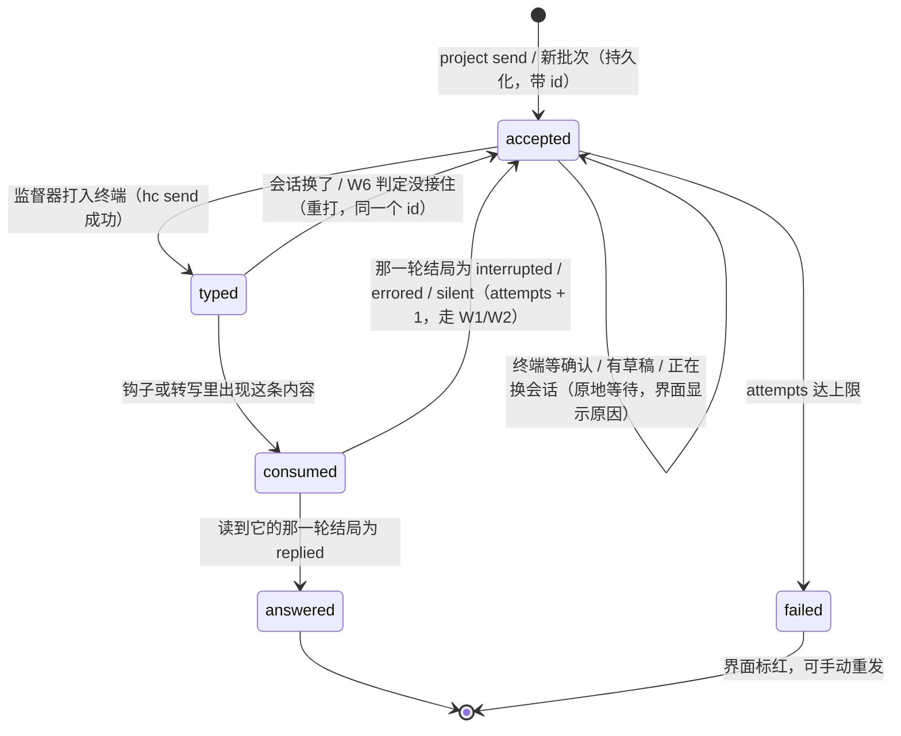

# 根治协调者「卡住干活」：取证复盘与根因架构设计

> **状态：设计稿，待拍板（未改任何生产代码）。** 撰写于 2026 年 11 月 25 日。
> **前情**：`docs/design/pm-turn-and-delivery-reliability.md`（下称「上一版方案」，任务 `#301`，提交 `a70d24b`）已实现 `pm-turn.json`、`pm.py project send/interrupt`、UTC `at_ms`/`seq`、活动行、90 秒 / 300 秒卡死检测与 `AsyncGate`。上线一天后用户仍然报告协调者「卡住干活」。
> **用词**：文中「协调者」在代码标识符、文件路径与 CLI 子命令里对应 `pm`。时间一律写 UTC；台账里的 `at` 是宿主机本地时间（UTC-5）。路径里的 `<ledger_home>` 指台账根目录，`pmlib/` 指 `mods/pm-dash/skill/scripts/pmlib/`。
> **取证方式**：只读。读了现场截图、`<ledger_home>/projects/<slug>/` 下的 `pm-turn.json`、`agy-transcript.json`、`conversation.jsonl`、`delivered.json`、`seat.json`，协调者当前会话的转写（1244 行、162 轮），以及 `hc`（herdr-core 0.1.22）的帮助、接口定义和只读命令实测。

---

## 0. 结论先行

**「卡住干活」里混着三件不同的事（占用、假卡、真卡），旁边还连着一条消息链路。上一版方案没有碰用户说的那一件，把最显眼的那件做反了，另外两件各做了一半。**

| 类别 | 是什么 | 现场证据 | 上一版方案 |
| --- | --- | --- | --- |
| **占用** | 协调者活着、也在推进，但它在前台自己干活（查代码、逐字写任务书、跑命令），对话这条线被占住 | 用户原话的本义（见 1.2）。两天 70 个用户轮里 21 个超过 60 秒，10 个超过 90 秒；截图那一轮 71 秒，其中 25 秒在逐字生成一份任务书 | **没有处理**：没有预算、没有度量、没有约束，派活还要求协调者先写好任务书文件 |
| **假卡** | 协调者在正常干活，系统却说它卡死了，或者说不清它在干什么 | 上线以来台账里的 11 条「N 分钟无进展」事件 **全部是误报**，没有一条真阳性 | **做反了**：卡死时钟挂在上一轮的时间戳上；三个读取出口算出三种状态；活动行显示的是已经结束的那条命令 |
| **真卡** | 这一轮确实不再推进 | 11-23 一次：模型流空闲 10 分钟超时，再连续 7 次 503，13 分钟后这一轮无回复结束，用户的问题没有任何答复 | **只报警不处置**：给两个图标让用户自己点；打断结果不核对；轮次以错误结束时对话里什么都不留 |
| **消息** | 发出去的话被报错、被重复或被吞 | 代码核实：后端答复「已排队」时界面当成失败显示红字，用户点重试后协调者会收到两遍；已打进终端但没被读到的消息 15 分钟后被静默清除 | **做了一半**：幂等入站和当场落盘是对的；入站之后「有没有被读到、有没有被答复」没人负责 |

根因不在阈值，在三处结构：

1. **观察**：把异质的信号（钩子、转写、终端状态）压成一个标量 `last_activity_ms`，再用两个常数阈值去切。这个标量没有绑定「是哪一轮的」，也分不清「在生成」「在跑工具」「在等上游」各自该有什么样的活性证据。
2. **写入**：`pm-turn.json` 有五个互不知情的写入方（钩子、转写监听、`project send`、投递器、打断命令），各带一段局部逻辑；三个读取方又各自拿着不同的终端信息重新推断。时序逻辑散在各处，无法整体测试——全部时序行为只有 8 条单测，其中一条把「长命令跑到 305 秒 = 卡死」写成了期望。
3. **角色**：协调者是一个串行的 LLM 会话，谁占着它的前台轮次，对话就等谁。上一版方案把「卡住干活」理解成「状态失步」，于是只让占用变得看得见，没有让占用变少，也没有让用户能随时插话或叫停。

根治方案由四根支柱组成，分第 0–5 期落地，另设第 6 期扩展远程终端与自托管 worker（第 4 节）：

- **A. 观察内核**：一个监督器、一本观察日志、一个纯函数归约器。轮次身份锚定在终端自己报告的轮次边界上；按阶段给活性契约，不再用全局常数阈值；所有读取方只读同一份快照，监督器心跳过期时如实显示「状态未知」，绝不外推成「卡死」。
- **B. 占用治理**：给协调者前台轮次设预算并度量；提供「薄派活」，让协调者不必在前台写任务书和做诊断；界面上任何时候都能叫停，消息排队状态说清楚「它什么时候会看到」。
- **C. 消息生命周期**：消息从「已受理」到「已打入终端」到「已被读到」到「已答复」全程有状态；唯一打字者；换会话时未读到的消息自动重投；worker 汇报批次以「这一轮正常答完」为完成，而不是「收到」。
- **D. 恢复阶梯**：每类真卡对应一条「最小破坏优先」的自动处置阶梯（中断卡住的命令 → 中断这一轮并续上 → 换备用模型的新会话接手 → 才来找用户），每一步核对效果，带熔断。

验收标准是可度量的（3.8 节的四条 SLO），不再靠「看起来不卡了」。

---

## 1. 取证：现场到底发生了什么

### 1.1 截图那一刻（2026-11-25，UTC）

截图（`paste-20261125-201849.png`）是协调者终端：一串 `Read`/`Bash`、三段思考，最后一行是 `Create(…/briefs/next/mention-history-threads.md)`，下面是转圈的 `Editing files...`。对照转写逐步时间：

| 时间 | 发生了什么 | 来源 |
| --- | --- | --- |
| 12:17:15 | 用户在界面发出「这个 @ 的时候找不到」 | `conversation.jsonl` seq 106，`source: ui` |
| 12:17:16 – 12:17:46 | 协调者自己查：读截图、`grep`、读 `model.js` 和 `main.js`（各约一万行）、再 `grep`。四步，每步模型往返 5–9 秒 | 转写 step 1204–1213 |
| 12:17:46 – 12:18:11 | **生成 `write_file` 的参数（一份 3.8 KB 的任务书）。这 25 秒转写没有任何新行**，终端显示 `Create(…)` / `Editing files...`——就是截图画面 | step 1214 的 `created_at` 为 12:17:46，对应工具结果行的 `Created At` 为 12:18:11 |
| 12:18:13 – 12:18:21 | `pm.py new` + `dispatch` | step 1217–1218；台账 12:18:21 两条 `thread` 事件 |
| 12:18:26 | 最终回复落盘。**整轮 71 秒** | seq 107 |
| 12:19:24 | 用户发出「carbon 没有完全根治 pm 卡主干活的问题」并附这张截图 | seq 108 |
| 12:19:24 – 12:20:55 | 下一轮 **91 秒**：读截图、读两个文件、两条命令，再用 **36 秒逐字生成一份 5.5 KB 的任务书**，然后派出 | step 1220–1237 |

结论：**截图里协调者没有卡死，它在前台逐字写任务书。** 这一轮里没有任何一条前台命令超过 9 秒，时间花在「每步约 9 秒的模型往返 × 8 步」加「25 秒写文件」上。

当时界面活动行显示什么，没有日志可查（界面不落日志）。按代码推断：转写在那 25 秒里最后一行是上一条 `grep` 的结果，后端把「最后一条已结束的工具」当成活动返回（`pmlib/project/turn_state.py:396-405`），前端不看 `kind` 直接拼成「正在运行 <摘要> · <整轮耗时>」（`mods/pm-project/model.js:2776-2810`）。也就是说，终端在 `Editing files...` 的同时，界面写的是「正在运行 grep … · 50s」。这是推断，不是观测。

### 1.2 「卡住干活」这个词的本义

这个词是用户的，三次出现的上下文一致：

| 时间（本地） | 用户原话 | 当时的现场 |
| --- | --- | --- |
| 11-22 00:35 | 「我发现 Project 的主对话窗口经常会被 Bash 卡住？」紧接着：「不对，为什么 pm 主对话要去干活？」 | 协调者承认在主对话里跑合并检查（最长 10 分钟）、装机、`hc send` 等 worker 空闲；「跑完之前你发的话我都接不到」 |
| 11-23 22:26 | 「pm 还是会卡住干活。」附截图：对话底部 `• • •`，用户上一条消息还是半透明的待处理气泡 | 协调者那几轮在自己排查「为什么消息丢了」，单轮 69–124 秒、6–14 步 |
| 11-25 12:19 | 「carbon 没有完全根治 pm 卡主干活的问题。」附本次截图 | 见 1.1 |

三次指的都是：**主对话被协调者自己手上的活占住了。** 用户要的是「我说话它马上接得住」。上一版方案的背景一节把它转述成「对话底部长期停在 `• • •` 不消失、双气泡、漏回显」，问题定义从「占用」滑到了「状态失步」。后者确实存在也确实该修，但不是用户说的那件事。

### 1.3 量化：这位协调者两天里的前台占用

对当前会话转写（11-23 16:13 至 11-25 12:21，162 轮；「一轮」指一条 `USER_INPUT` 到下一条之前的全部行，含自唤醒续轮）逐步统计：

| | 轮数 | 中位 | p75 | p90 | ≥60 秒 | ≥90 秒 | 合计 |
| --- | ---: | ---: | ---: | ---: | ---: | ---: | ---: |
| 用户发起的轮 | 70 | 40 秒 | 63 秒 | 109 秒 | 21（30%） | 10 | 87 分钟 |
| worker 汇报触发的轮 | 92 | 19 秒 | 26 秒 | 44 秒 | 5 | 1 | 35 分钟 |

时间花在哪里：

| 去向 | 合计 | 说明 |
| --- | ---: | --- |
| 模型生成（每步从开始到工具启动） | 约 3460 秒 | `run_command` 步 246 次、平均 9.2 秒；`write_file` 步 33 次、平均 21.4 秒、最长 59 秒（一次写 4 份任务书共 17 KB） |
| 工具执行 | 约 1720 秒 | 其中装机 317 秒、各类 `pm.py` 命令约 600 秒 |
| 超过 20 秒的前台命令 | 3 条 | 11-22 那条「不在前台跑慢命令」的规矩基本守住了 |

用户轮的工具调用数：中位 3，p90 10，最多 28。整轮只有最后一段文字会进对话，用户在这之前看到的只有活动行。

所以今天的占用主因已经不是慢命令，而是 **协调者在用户轮里自己做诊断（步数）和逐字写任务书（长生成）**。派活命令要求先有任务书文件（`pmlib/commands/dispatch.py:156`，无文件时报 `dispatch needs --brief <file>`），等于在流程上要求协调者前台写长文。

### 1.4 「N 分钟无进展」事件：11 条全部误报

`conversation.jsonl` 里 `source: pm-stall` 的事件，第一条出现在 11-24 15:32，到取证时共 11 条。逐条对照前后事件：

| 特征 | 结果 |
| --- | --- |
| 触发时机 | 10 条在一条 worker 汇报（`wake: true`）之后 4–5 秒；1 条在用户往终端直接打字之后 |
| 事件里的「N 分钟」 | 5、9、7、5、7、10、6、10、5、19、111——恰好等于 **上一轮结束到这次被唤醒** 的间隔 |
| 之后 | 11 条全部在 14–43 秒内出现协调者的正常回复 |

真阳性 0 条。

这些事件本身在项目对话里看不到：`mods/` 下没有任何界面代码引用 `pm-stall`，时间线只渲染 `user` / `pm` / `decision` / `thread` 四类（`model.js:1997-2068`），它们只是占着 200 条事件窗口里的位置。用户看到的是另一条路：登记卡死时文件阶段被写成 `stalled`，本机界面监听到文件变化立即重读，活动行变红显示「已连续 N 分钟无响应」并给出「打断 / 换新会话」两个图标，直到 4–5 秒后监听器读到新行才恢复（这一段按代码推断，界面不落日志）。如果用户照着点，打断的是一轮刚开始的正常工作。

整段转写（含上线之前）里「空闲 ≥ 300 秒后被唤醒」共 48 次（22 次是汇报，26 次是用户消息），所以这不是偶发条件。从界面发的消息不触发误报，因为 `project send` 会重置时间戳（`turn_state.py:715-727`）；其余路径都会。

成因（已对代码逐行核实）：

1. 投递器把汇报批次 `hc send` 进终端后，只推进投递游标，**不登记新轮次**（`pmlib/events/deliverer.py:282-297`）。
2. `agy` 的转写按「步」落盘：一步做完才追加一行，`created_at` 是这一步开始的时间。`USER_INPUT` 行要等第一步做完才出现。实测一次：消息 12:19:24.8 打入，监听器 12:19:29.3 才读到这一行（`pm-turn.json` 的 `started_ms`），滞后 4.5 秒，与 11 条误报的 4–5 秒时差一致。
3. 这 4–5 秒里终端状态已经是 `working`，而 `pm-turn.json` 还是上一轮留下的 `idle`。快照函数在这种组合下直接拿文件里的 `started_ms` / `last_activity_ms` 算空闲时长（`turn_state.py:1152-1159`），这两个值是 **上一轮** 的。只要上一轮结束超过 300 秒，立刻判 `stalled`。
4. 卡死登记不检查文件里的阶段，直接写一条对话事件并把阶段改成 `stalled`（`turn_state.py:1001-1023`）；之后 `stalled` 是粘滞的（`turn_state.py:1172`、`model.js:2779`），要等监听器读到新行才解除。

### 1.5 真卡：两天里的两次

| 时间 | 经过 | 结局 |
| --- | --- | --- |
| 11-23 16:50:36 | 用户问「什么进展了」。模型请求发出后 **10 分钟没有任何输出**，17:00:36 报 `stream idle timeout (10m0s)`；随后 7 次重试全部 `503 No capacity available for model …`，17:03:53 放弃 | **这一轮无回复结束。** 用户的问题没有答复，对话里没有任何说明。下一条用户消息是 7 小时后的「继续」 |
| 11-24 02:47:20 | 模型请求 151 秒无输出，02:49:51 报上游连接 `EOF`，自动重试成功，02:49:56 回复 | 自愈，用户多等了 2 分半 |

背景数字：这台机器最近 60 个 `agy` 会话的转写里共有 57 行 `ERROR_MESSAGE`。上游错误是日常，不是罕见事件。

worker 侧还有两个同类现场，说明「消息打进去了但没被接住」是真实存在的一类：11-22 一条合并批准没进 worker 的对话，worker 空闲 7.5 小时无人察觉；11-25 05:37 一条批准 `started=false`，这次 harness 自动改交 helper（worker 侧已有阶梯，协调者侧没有）。

### 1.6 `hc` 的行为事实（本设计依赖的部分）

以下来自 `hc --help`、`hc schema` 与只读实测（hc 0.1.22）：

| 事实 | 出处 | 对设计的含义 |
| --- | --- | --- |
| `status` 是程序自己通过 OSC 7501 报的词（`idle`/`working`/`done`/`blocked`/`error`），带 `msg`、`kind`（权限 / 提问 / 认证）、`progress` | 接口定义 `Status` | 轮次边界和「等确认」由程序自己声明，是最快也最统一的信号；但程序挂死时它会一直停在 `working` |
| `status_ms`：这个词上次变化的时间 | `Terminal.status_ms` | `working` 时它就是 **本轮开始时间**，不需要等钩子或转写 |
| `turn`：「每次状态离开 `working` 加一」 | `Terminal.turn` | 是 **已结束轮数**，不是开始计数。现有代码用 `after_turn > pre_turn` 判「消息打进去了」（`turn_state.py:859-865`）在「空闲 → 开始工作」时判不出来 |
| `hc ls` 的行只有 `address, agent, cwd, state, status（一个词）, turn, where`；`status_ms`、`foreground`、状态文案只有 `hc get` 才有 | 实测 | `pm.py state` 用 `hc ls --all` 的行喂快照函数（`pmlib/views/state.py:192,204-210`），拿不到文案和前台进程 |
| `hc send`：先等人把草稿发出或清掉（距最后一次按键最多 60 秒），否则等约 3 秒安静再打入；程序 `blocked` 时拒绝（除非 `--force`）；返回 `started`（几秒内是否进入 `working`，不报状态的程序为 null） | `terminal.send` | 一次 `send` 至少约 3 秒，最坏 60 秒以上；现有 `project send` 给它 35 秒超时 |
| `hc interrupt`：报状态的程序按 `esc`，否则 `ctrl+c`，**从不升级**；返回 `outcome`：`stopped` / `exited` / `still_working` / `unknown` | `terminal.interrupt` | 打断有没有生效是可以核对的；现有 `interrupt_pm` 不看返回值（`turn_state.py:918`） |
| `hc read` 读当前屏幕文本，一次约 15 毫秒（8 次实测 7–26 毫秒） | 实测 | 可以低频采样屏幕做活性探针 |
| 工作中的 Claude Code 屏幕每秒都在变（计时与 token 计数），8 次间隔 1 秒的采样 8 次不同；空闲的 `agy` 屏幕 4 秒内 4 次采样完全相同 | 实测 | 「屏幕在变」是进程级活性的可用信号。`agy`、Codex 工作中的采样尚未实测（见第 8 节） |
| 事件订阅只推 `created/lost/restarted/keep/finished/removed/status/turn/title/labels/size/doc` | `events.subscribe` | 没有「最近输出时间」这种事实，输出活性只能靠 `hc read` 采样或 `attach --observe` 原始流 |

---

## 2. 复盘：上一版方案为什么没根治

### 2.1 缺陷清单

「运行时」一列：C = Claude Code，X = Codex，A = `agy`，P = `pi`。

#### 假卡与盲区（协调者在干活，状态机说错或说不清）

| 编号 | 机制 | 位置 | 运行时 | 证据 / 表现 |
| --- | --- | --- | --- | --- |
| **FS-1** | **陈旧锚点**：终端已 `working`、文件还是上一轮的 `idle` 时，用上一轮的 `started_ms`/`last_activity_ms` 算空闲 | `turn_state.py:1152-1159`；`deliverer.py:282-297` 投递后不登记新轮 | A：每次汇报唤醒、每次终端直接打字。C/X：后台命令完成通知、斜杠命令、换会话接手提示都被归为 `other`/`rotate`，不登记新轮（`pmlib/hooks.py:591-592,633-634`）。P：终端与批次轮全部 | 11/11 误报（1.4） |
| **FS-2** | **卡死粘滞**：一旦写入 `stalled`，不管后续有没有新证据都保持 | `turn_state.py:1018-1021,1172`；`model.js:2779` | 全部 | 误报后图标一直挂到下一行转写出现 |
| **FS-3** | **三个出口三种真相**：投递器用 `hc get`（全量）；`pm.py state` 用 `hc ls` 的行（只有一个状态词）；`pm.py project events` 什么终端信息都不传 | `deliverer.py:241`；`views/state.py:192,204-210`；`pmlib/commands/project.py:424` | 全部 | 界面优先用 `project events` 那份（`mods/pm-project/main.js:3888-3890`）。这份快照不知道终端在干什么：文件阶段是 `idle` 时它恒为 `idle`，活动行只剩三个点，没有文字、计时和图标；文件阶段陈旧时它直接按旧时间戳输出。「后台残留不算在忙」的校正在这条路径上也不生效 |
| **FS-4** | **步内盲区**：转写按步落盘，一步之内（长思考、长文件生成）磁盘上没有任何变化；阈值是不分情形的 90 秒 / 300 秒 | `turn_state.py:59-60` | 全部（C 的钩子同样只在一步做完后触发） | 1.1 的 25 秒、36 秒；1.3 的最长 59 秒。写一份长文档就会越过 90 秒 |
| **FS-5** | **长工具 = 卡死**：钩子不上报任何工具进度——`PreToolUse` 只匹配提问和编辑类工具，且不碰轮次状态；`PostToolUse` 没注册 | `mods/pm-dash/setup.py:27-37`；`hooks.py:271-312` | C、X | 单测把「`run_checks.py` 跑到 305 秒 = `stalled`」写成期望（`tests/test_turn_reliability.py:290-321`） |
| **FS-6** | **活动行说的是上一件事**：探针把「最后一条已结束的工具」当活动返回（`kind: thinking` 但带着旧工具的摘要），前端不看 `kind` | `turn_state.py:396-405`；`model.js:2776-2810` | 全部 | 终端在写文件，界面显示「正在运行 <上一条命令> · <整轮耗时>」（1.1） |
| **FS-7** | **`agy` 一报错就收口**：`ERROR_MESSAGE`（哪怕是「第 1 次尝试失败，正在重试」）直接结束轮次；之后的工具活动不会把 `idle` 改回 `working` | `pmlib/events/agy_watch.py:111-112,842-843`；`turn_state.py:580-581` | A | 转写 step 52、489：报错后同一轮继续工作并正常回复 |
| **FS-8** | **`agy` 自唤醒没有起点**：定时器、后台任务完成会以 `SYSTEM_MESSAGE` 行开启新一轮，监听器不认；纯文字的中间回复被当成终态收口 | `agy_watch.py:75-114,831-841` | A | 两天 11 次自唤醒续轮 |
| **FS-9** | **`Stop` 钩子不带轮次号**：上一版方案要求按 `turn_seq` 收口，实现里 `end_turn()` 不传 `expected_seq`；`Stop` 又是异步钩子 | `hooks.py:656-657`；`setup.py:243-244`；`turn_state.py:603-612` | C、X | 上一轮迟到的 `Stop` 会把新一轮改成 `idle` 并取走它的起因 |
| **FS-10** | **`Stop` 不来就不收口**：按 Esc 打断、进程退出、崩溃时没有 `Stop`（代码注释自己写了这种情况）；没有任何持久化的校正；换会话、认领、重启座位都不重置 `pm-turn.json` | `hooks.py:687-688`；全仓只有 `turn_state.py` 写这个文件 | C、X、P | 文件停在 `working`。界面是否显示活动行只看终端当前状态，所以空闲时看不出来；等下一次终端进入 `working` 而没有登记新轮，或用户发出一条消息还在待确认时，这份旧时间戳被直接拿来显示「已连续 N 分钟无响应」 |
| **FS-11** | **转写取错文件**：读 `agent_session.transcript`，而生产写入的键是 `path`；只要项目目录里留着 `agy-transcript.json`，任何运行时都先去读那份 `agy` 转写 | `turn_state.py:1034-1049`；`pmlib/workers/sessions.py:46,65-69` | X：转写 **从未** 被探到，任何超过 300 秒的轮必判卡死。C：只碰巧在按会话号拼出的路径存在时才读到。曾用过 `agy` 的项目换回 C/X 后读的是死文件 | 代码核实 |
| **FS-12** | **后台进程检测是死代码**：两处调用把进程号（整数）传给只认字典 / 对象的函数，恒返回空 | `turn_state.py:1096-1100`；`deliverer.py:271-273`；`pmlib/procs.py:254-268` | 全部 | 实测 `background_work(<pid>)` 恒为 `[]`。后台残留只能靠英文文案 `shells still running` 识别，等于只支持 Claude；其余情况既会误判卡死，也会堵住批次投递（`pmlib/events/policy.py:51`） |
| **FS-13** | **前端自己越阈值**：用本地时钟外推空闲时长，自己判 `slow`/`stalled` | `model.js:2775,2779-2780` | 全部 | 数据一旧（远程抖动、读取挂起），界面自己造出「无响应」 |
| **FS-14** | **一条界面消息记两轮**：`project send` 加一次 `turn_seq`，监听器 / 钩子读到同一条再加一次 | `turn_state.py:715-720,542-548` | 全部 | `stall_logged_seq` 这类按轮号去重的逻辑语义不稳 |
| **FS-15** | **`pi` 只桥接了结束**：设计要求的 `agent_start`、`tool_execution_start` 没有实现 | `mods/pm-dash/skill/scripts/pm_pi_compact.js:95-129` | P | 终端打字和批次触发的轮没有起点、没有活动 |
| **FS-16** | **活动行的计时会冻住**：每秒刷新的节拍只在整页完整渲染时预约一次，回调只通知对话面板，而对话面板的渲染不会续订下一次 | `main.js:10518-10528` | 全部 | 按代码阅读，时长约每 10 秒（一次轮询）才跳一下，看上去像停住了。提交 `e10c7f0` 把原来会自续的整页通知改成了只通知面板。宿主是否启用子实体模式未在运行中验证（第 8 节） |
| **FS-17** | **「较慢 / 无响应」显示的是整轮时长**，不是无进展时长 | `model.js:2784` | 全部 | 一轮跑了 40 分钟、最近 5 分钟没进展，显示「已连续 40 分钟无响应」 |

#### 真卡（确实不推进时，检测到了也救不回来）

| 编号 | 机制 | 位置 | 表现 |
| --- | --- | --- | --- |
| **RS-1** | **只报警不处置**：给两个图标，没有任何自动步骤。后端 `interrupt_pm` 不看 `hc interrupt` 的 `outcome`，`interrupted_ms` 只写不读；前端把打断和换会话两条命令的结果丢弃、错误吞掉。图标只在「较慢 / 无响应」时出现，点过打断或发过一条消息后时间戳被重置，图标消失 90 秒，换会话图标再等 300 秒。换会话不重置 `pm-turn.json`，新会话接手的那一轮仍可能显示「无响应」 | `turn_state.py:727,906-929`；`pmlib/terminals/hc.py:473-479`；`main.js:3892-3924`；`model.js:2792-2814` | 用户不在场就一直卡着；点了打断不知道有没有生效，失败了也没有任何提示 |
| **RS-2** | **静默死轮**：一轮以错误结束、没有回复时，状态回到 `idle`，对话里不留任何痕迹，也不重试 | `agy_watch.py:842-843`；C/X 没有注册失败收口类钩子 | 1.5 第一例：用户的问题石沉大海 |
| **RS-3** | **上游挂起只能等程序自己超时**：`agy` 流空闲超时是 10 分钟；即使 300 秒时判对了，也只是报警。模型容量不足（503）这类错误，重试同一个模型没有用 | — | 1.5 第一例里唯一有效的出路是换模型 |
| **RS-4** | **监督循环会被自己堵住**：投递器的循环是单线程的，批次 `hc send` 同步等最多 180 秒、发件箱 `hc send` 同步等 35 秒；这期间 `agy` 转写同步、卡死巡检、发件箱都停 | `deliverer.py:282-287`；`turn_state.py:978` | 有人在协调者终端里留着草稿时，对话界面跟着停更 |
| **RS-5** | **监督器不在时没人知道**：卡死登记、发件箱排空只在投递器里跑；投递器在终端不在线时直接退出本次循环；`state` 和 `project events` 不负责拉起它（上一版方案要求过）；没有心跳 | `deliverer.py:241-249` | 读取方拿着旧文件继续外推 |
| **RS-6** | **消息没被接住时对协调者没有处置**：`started=false` 之后只按报错文案的正则决定排队还是报错 | `turn_state.py:853-904` | worker 侧同类问题已有自动改交 helper，协调者侧没有 |

#### 消息投递

| 编号 | 机制 | 位置 | 表现 |
| --- | --- | --- | --- |
| **MSG-1** | **「已送达」不等于「已读到」**：消息打进终端就记为已送达、写进对话。协调者正忙时它只是躺在输入队列里；等待匹配的标记 15 分钟后被静默清掉 | `turn_state.py:64,510-516,670-741` | 这一轮若被打断、崩溃或换会话，消息在界面上是已发送，协调者却从没见过，没有任何提示 |
| **MSG-2** | **换会话不带走「已打入未读到」的消息** | `pmlib/manager/` 下 rotate / handover / seat / service 均无 `pm-turn`、发件箱相关引用 | 同上 |
| **MSG-3** | **批次「收到即完成」**：钩子 / 监听器一读到批次就确认；重复投递会被标上「这是重复，不要再处理」 | `pmlib/events/deliver.py:536-563` | 处理批次的那一轮中途死掉，这批 worker 汇报对协调者来说就丢了 |
| **MSG-4** | **两个打字者，超时对不上**：界面进程里的 `project send` 和投递器都在调 `hc send`，租约只管用户消息；`hc send` 的 35 秒超时短于 `hc` 自己最长 60 秒的草稿等待，超时后报错文案匹配不上重排队的正则，直接抛拒绝 | `turn_state.py:72-76,853,904`；`hc.py:245-255` | 协调者终端里有草稿时，从界面发消息会报错而不是排队 |
| **MSG-5** | **后端说「已排队」，前端当成失败**：`project send` 返回 `status: "queued"` 时前端直接抛错，再用正则给报错分类；原因是 `inflight`、`fifo`、`starting`、`pm is error` 时哪条正则都匹配不上，走失败分支 | `main.js:3878-3880,4460-4462`；`model.js:2892-2894`；`turn_state.py:818-835` | 红字「未发送：fifo」，草稿被还原，气泡移出本地队列——而后端发件箱里那条照样会投递。用户点重试会生成新的 `msg_id`，**协调者收到两遍**。协调者正在换会话（`starting`）时必现，正好是上一版方案边界场景 10 承诺要解决的情况 |
| **MSG-6** | **同样的话 60 秒内发第二遍，会被第一条的日志行核销**：按文本核销时不排除带着另一个 `msg_id` 的事件 | `model.js:1226-1233,1272-1282` | 第二个气泡立刻消失，它后来投递失败也无处显示 |
| **MSG-7** | **两种情况绕过 `msg_id`**：消息超过 60 KB；或某次报错文案里出现 `unrecognized arguments` 之类字样，被误判为旧版后端，此后直到切换项目都走裸 `hc send` | `main.js:3858-3884`；`model.js:4193-4197,4531` | 回到上一版方案之前的非幂等路径 |
| **MSG-8** | **发送队列的门闩没装全**：`flushQueue` 用的还是布尔锁，50 秒的逃生口不会自己触发；`pm-list`、`pm-nav` 仍是裸布尔锁加无超时的调用 | `main.js:4132-4150,4314`；`mods/pm-list/main.js:90-95`；`mods/pm-nav/main.js:129-134` | 一次调用不返回，后面的气泡一直停在「排队中」，侧栏数据冻住 |

#### 占用

| 编号 | 机制 | 表现 |
| --- | --- | --- |
| **OCC-1** | 没有「前台预算」这个概念：不度量、不反馈、不约束，只有 playbook 里的一句话和两条记忆 | 规矩靠模型自觉，两次约法三章后仍然回潮 |
| **OCC-2** | 派活要求先有任务书文件，协调者只能在前台逐字写 | 33 次写文件，平均 21 秒，最长 59 秒 |
| **OCC-3** | 用户报问题时协调者先自己诊断再派 | 用户轮 p90 10 步，每步约 9 秒 |
| **OCC-4** | 整轮沉默：只有最终回复进对话；活动行按步刷新且会说错（FS-6） | 用户面对的是 40–110 秒的 `• • •` |
| **OCC-5** | 插不进话也停不下来：`agy` 把中途输入排到轮末再合并；界面只在「慢 / 无响应」时才给打断图标 | `model.js:2792-2813` |

#### 测试

| 编号 | 机制 |
| --- | --- |
| **TST-1** | 全部轮次时序行为只有 `test_turn_reliability.py` 里 8 条单测；钩子到 `pm-turn.json` 的映射没有任何断言；一条测试把假卡写成期望；测试替身不模拟 `status_ms` 与轮次边界；没有任何「回放一段真实时间线」的测试 |

### 2.2 四种运行时现在各自看得见什么

| | 轮次开始 | 轮次结束 | 一步之内 | 目前的盲区 |
| --- | --- | --- | --- | --- |
| **Claude Code** | `UserPromptSubmit`（仅用户 / 批次 / 其它 agent 的话） | 仅 `Stop`（异步、不带轮号） | 无（钩子不报工具进度，转写常常没被读到） | FS-1、5、9、10、11 |
| **Codex** | 同上 | 同上 | 无（转写从未被读到） | 同上，FS-11 最重 |
| **`agy`** | 转写里出现 `USER_INPUT`（滞后一步） | 转写里出现纯文字回复或任何报错行 | 无（按步落盘） | FS-1、4、7、8 |
| **`pi`** | 仅界面发消息 | 桥接的 `agent_end` | 无 | FS-15 |

共同点：**没有一种运行时用到了终端自己报告的轮次边界（`status` / `status_ms`）来给轮次定身份**，也没有一种能在一步之内区分「在生成」「在跑命令」「挂了」。

### 2.3 上一版方案里要保留的部分

`msg_id` 幂等入站与当场落盘、`seq`/`at_ms`/`server_now_ms`、发件箱、合并消息的有序行匹配、`AsyncGate`、`python.js` 只缓存已解析结果、终端状态边沿触发增量读日志。这些解决的是「消息与显示失步」，方向正确，本方案在其上继续。

---

## 3. 根因架构

### 3.1 不变量

实现和评审都以这十条为准：

| 编号 | 不变量 |
| --- | --- |
| **I1** | 每个时钟都属于一个明确的轮次。轮次身份来自终端自己报告的边界；换了一轮，所有计时从这一轮的起点重新算 |
| **I2** | 没有正面证据不说「卡死」。「没看到进展」和「看到了它不动」是两回事；前者只能是「未知」或「较慢」 |
| **I3** | 同一时刻所有读取方看到同一个状态。读取方只读快照，不重新推断 |
| **I4** | 快照的新鲜度是显式的。监督器心跳过期时，状态是「未知」，并触发拉起监督器，绝不外推 |
| **I5** | 轮次状态机是一个纯函数，输入是观察记录的序列。任何一次现场都能导出、回放、断言 |
| **I6** | 往协调者终端打字的只有一个进程 |
| **I7** | 一条入站内容（用户消息或汇报批次）在「被读到并且那一轮正常答完」之前，一直由系统负责；任何中途失败都回到待处理 |
| **I8** | 每类真卡都有一条写明的处置阶梯；每一步都核对效果；自动处置有次数上限 |
| **I9** | 协调者的前台时间是被度量、有预算的资源；超预算是一个事件，不是一个感觉 |
| **I10** | 用户随时能叫停，随时知道自己发的话处于什么状态、什么时候会被看到 |

### 3.2 活性信号：没有哪一个是「真信号」，要按职责分工

| 信号 | 它能证明什么 | 证明不了什么 | 延迟 | 成本 | 覆盖 |
| --- | --- | --- | --- | --- | --- |
| **终端状态**（`hc`：`status`、`status_ms`、`turn`，推送） | 程序自己声明的轮次开始 / 结束 / 等确认 | 程序挂死时仍是 `working`；轮内在干什么 | 毫秒级 | 订阅，近零 | 所有报 7501 的程序 |
| **步级证据**（转写新行；有钩子的运行时加钩子） | 一步做完了；这一步是什么工具、什么报错；最终回复 | 一步之内的任何事 | 等于这一步的时长 | 文件通知 + 尾部读取 | C、X、A；P 靠桥接 |
| **屏幕变化**（`hc read` 的文本摘要是否在变） | 进程活着、事件循环在转 | 上游有没有在出字（转圈不等于在生成） | 采样间隔 | 约 15 毫秒 / 次 | 所有带终端界面的程序 |
| **屏幕文字提示**（可选的按运行时解析：重试横幅、token 计数、确认框标题） | 「正在第 N 次重试」「token 在涨」这类加分证据 | 解析会随版本变脆，**只能加分、不能作为报警依据** | 同上 | 同上 | 按运行时逐个适配 |
| **进程树**（`ps`） | 前台工具子进程在不在、跑了多久、CPU 时间有没有涨；轮次结束后还有没有后台残留 | 模型请求的情况 | 采样间隔 | 一次 `ps` | 全部 |

分工结论：

- **轮次边界归终端状态**。它最快、跨运行时统一，而且是程序自己说的。钩子和转写里的边界只用来补充「为什么开始」「怎么结束的」。
- **进展归步级证据**。
- **进程死活归屏幕变化**。这是唯一能在一步之内说话的信号，也是唯一能给出「它不动了」这种正面证据的信号。
- **工具状态归进程树**。
- 屏幕探针只在需要时开：处于工作阶段且步级证据已经安静超过 10 秒，才每 5 秒采样一次。一轮几十秒的常态下几乎不采。

「不可伪造」只对「进程活着」成立。「在进展」没有不可伪造的单一信号——上游断流时转圈照转（1.5 第一例）。所以进展只能用「阶段契约」来约束：每个阶段写明应当持续出现什么证据、多久不出现算可疑、多久算卡死（3.5 节）。

### 3.3 监督器、观察日志、归约器

```
          采样（只读）                    归约（纯函数）                      执行（副作用，仅监督器）
 ┌─ 终端状态（hc 订阅 / hc get）─┐                                   ┌─ 打字（唯一打字者）
 ├─ 钩子（C/X）、桥接（P）────────┤                                   ├─ 恢复阶梯（中断命令 / 中断轮次 / 续上 / 换会话）
 ├─ 转写尾部（按运行时适配）──────┼─▶ 观察日志 ─▶ reduce(状态, 观察) ─▶┼─ 对话里的事故行（每起一行，原地更新）
 ├─ 屏幕摘要（hc read，按需）─────┤   （只追加）      │                 └─ 占用提示（附在下一条入站内容上）
 └─ 进程树（ps，按需）────────────┘                   ▼
                                           pm-turn.json v2（快照） ◀── 所有读取方只读这一份
```

**不新增常驻进程。** 监督器就是现有的每项目投递器进程（`pm.py deliver`）：它已经有独占锁、保活入口和文件 / 终端变更唤醒。变化在内部结构：

- **观察日志** `projects/<slug>/pm-turn-journal.jsonl`：只追加，每条一行 `{"t": <UTC 毫秒>, "src": "...", ...}`。写入方：监督器自己的采样、钩子进程、`project send`（受理一条消息）、`project interrupt`（用户意图）。钩子不再直接改状态，只追加一条观察；追加在 `pm-turn.lock` 下进行（与现有 `append_event` 持锁追加的做法一致），持锁时间只是一次小写入。屏幕和进程探针只记 **变化**（「开始不变」「恢复变化」），不记每次采样。文件满 1 MiB 轮转一份，保留最近两份。
- **归约器** `pmlib/project/turn_reducer.py`：`reduce(state, obs, cfg) -> state` 与 `tick(state, now_ms, cfg) -> (state, due_actions)`，零 IO。谁持有 `pm-turn.lock` 谁就可以把日志里未归约的部分归约进快照（快照里记 `journal_offset`）；归约是确定性的，所以谁来做结果都一样。**执行动作只有监督器可以做。**
- **快照** `pm-turn.json` v2（3.4 节）。
- **心跳** `projects/<slug>/pm-turn.beat`：监督器每次循环 `utime` 一下，不重写大文件。读取方用它的修改时间判断快照是否有人在维护。
- **监督循环不许同步等待。** 打字、打断、`ps` 都以子进程启动后轮询结果；循环里任何一步同步耗时不得超过 2 秒。这一条直接消除 RS-4。

**读取方契约**（`pm.py state`、`pm.py project events`、界面）：

1. 持锁把未归约的日志归约掉，读快照。
2. 心跳在 10 秒内：直接返回快照，`supervised: true`。
3. 心跳过期：调一次 `ensure_running`；做一次降级直读（一次 `hc get`），只用终端状态词给出 `working`/`idle`/`blocked`，`health: "unknown"`，`supervised: false`。**不计算慢，不计算卡死。**

三个出口从此走同一个函数、同一份输入，FS-3 不复存在。

### 3.4 轮次身份、锚定规则与快照结构

**轮次身份** `turn.id = <终端>:<前台进程号>:<hc turn + 1>`。终端或前台进程号一变（换会话、重启座位），整份轮次状态重置——这一条同时关掉 FS-10 的「换会话不重置」。

**锚定规则**（归约器里的四条，全部可表驱动测试）：

| 规则 | 条件 | 动作 |
| --- | --- | --- |
| **T1 开轮** | 观察到终端 `working`，且 `(turn, status_ms)` 与快照里的当前轮不同 | 新开一轮：`started_ms = status_ms`，清空上一轮的全部证据与计时。起因按入站队列归属：`status_ms` 之前最近一条「已打入」的内容是谁的就是谁；找不到归为 `self`（自唤醒）。**不需要等钩子，也不需要等转写。** |
| **T2 提前开轮** | 打字结果 `started=true`，或钩子 `UserPromptSubmit` 先到 | 进入 `submitted`，等 T1 确认；T1 到来时合并，不重复计轮（消除 FS-14） |
| **T3 收轮** | 终端离开 `working`（到 `idle`/`done`/`error`）；有钩子的运行时，`Stop` 先到也算 | 结束这一轮并定结局：有最终回复 → `replied`；有待核对的打断动作 → `interrupted`；最后一条步级证据是报错或终端为 `error` → `errored`；否则 `silent`。`Stop` 迟到时若轮号已变则丢弃（消除 FS-9） |
| **T4 残留不算轮** | 终端仍 `working`，但已见到本轮的收轮证据（`Stop` / 转写终态），且进程树显示只剩后台子进程 | 阶段为 `idle`，另记 `bg_shells`。判定用进程树，不靠英文文案（消除 FS-12） |

报错行不再等于收轮（消除 FS-7）：`agy` 的 `ERROR_MESSAGE`、Claude 的重试提示都只是一条步级证据，是否收轮由 T3 决定。

**快照结构**（`pm-turn.json` v2，示意；与 v1 同名的字段继续保留，见 4.8 的兼容说明）：

```json
{
  "version": 2,
  "journal_offset": 48213,
  "session": { "terminal": "t12", "agent_kind": "agy", "fg_pid": 48291 },
  "turn": {
    "id": "t12:48291:455",
    "phase": "generating",
    "health": "ok",
    "cause": { "kind": "user", "msg_ids": ["u-…"], "batch": null },
    "started_ms": 1795609035000,
    "phase_since_ms": 1795609066000,
    "evidence": {
      "hc":   { "state": "working", "status_ms": 1795609035000, "obs_ms": 1795609081000 },
      "step": { "last_ms": 1795609066000, "count": 5 },
      "pty":  { "changed_ms": 1795609080000, "frozen_since_ms": 0, "hint": "" },
      "proc": { "tool_pid": 0, "cmd": "", "since_ms": 0, "cpu_ms": 0 }
    },
    "activity": { "kind": "generate", "tool": "", "summary": "", "since_ms": 1795609066000 },
    "budget":   { "soft_ms": 45000, "hard_ms": 120000, "over": false }
  },
  "last_turn": { "id": "t12:48291:454", "outcome": "replied", "duration_ms": 71000,
                 "split": { "generate_ms": 52000, "tool_ms": 19000, "steps": 8 } },
  "inbox": [
    { "id": "u-…", "kind": "user", "state": "consumed", "accepted_ms": 0, "typed_ms": 0, "consumed_ms": 0, "attempts": 1 }
  ],
  "incident": null,
  "bg_shells": { "count": 0, "commands": [] }
}
```

`phase`：`idle` / `submitted` / `generating` / `tool` / `waiting_upstream` / `blocked` / `recovering` / `starting` / `offline`。
`health`：`ok` / `slow` / `suspect` / `stalled` / `unknown`。`slow` 是中性的告知，`suspect` 表示正在加密探测，只有 `stalled` 触发处置。

`activity` 只描述 **当前阶段**：`generating` 时 `kind` 为 `generate`，没有工具名；`tool` 时才有工具名和摘要，`since_ms` 是这条工具的开始时间（消除 FS-6）。

### 3.5 阶段契约

替换 90 秒 / 300 秒两个全局常数。默认值写在 `config.json` 的 `pm.turn` 下，可按项目覆盖。

| 阶段 | 进入 | 健康时应持续出现的证据 | 较慢（只告知，中性色） | 可疑（加密探测） | 卡死（触发处置） |
| --- | --- | --- | --- | --- | --- |
| **`submitted`** 已打入、等开轮 | 打字成功 | 8 秒内终端进入 `working` | — | 8 秒：读一次屏幕，识别确认框 / 草稿 | 20 秒仍未开轮 → 类型 W6 |
| **`generating`** 模型在想或在出字 | 开轮；上一步工具结果落盘 | 屏幕每 5 秒内有变化；并在预算内出现下一条步级证据 | 75 秒没有新的一步：显示「正在生成较长内容 · 时长」 | 屏幕连续 20 秒不变：改为每秒采样复核 | 屏幕连续 45 秒不变 → W5；屏幕出现已知重试横幅 → 转 `waiting_upstream`；240 秒没有新的一步且没有加分证据 → W1 |
| **`tool`** 在跑一条工具 | 转写出现工具调用行 / 进程树出现前台子进程 | 子进程存在 | 超过前台命令软预算（协调者默认 30 秒）：显示「正在运行 X · 时长」并记一次占用 | 子进程在、CPU 时间 60 秒不涨、屏幕 60 秒不变：标「可能在等输入」 | 可疑持续 120 秒，或超过硬预算（默认 180 秒）→ W4 |
| **`waiting_upstream`** 程序自己在重试 | 步级证据或屏幕提示为「第 N 次重试」 | 重试次数在走 | 立即如实显示「模型服务重试中」 | — | 程序放弃（收轮结局 `errored`）→ W2；持续 5 分钟 → W1 |
| **`blocked`** 等确认 | 终端状态 `blocked` | — | 立即显示「等你在终端确认」及确认框类型 | — | 已知安全的确认框按策略自动回答；其余通知用户（W3） |

数字的依据：两天里一步模型生成最长 59 秒，75 秒的「较慢」线留了余量；240 秒是最长观测值的 4 倍，同时明显短于 `agy` 自己的 10 分钟流空闲超时。`generating` 的两条卡死线性质不同：屏幕不变是 **正面证据**（进程不动了），45 秒就够；没有新的一步只是 **缺少证据**，所以给到 240 秒，并且有加分证据（例如屏幕上的 token 计数在涨）时不触发。

按这张表回看现场：1.1 的 25 秒和 36 秒写文件，全程 `generating / ok`；1.4 的 11 次唤醒，T1 在终端一进 `working` 就开了新轮，没有任何计时越线；1.5 第一例，240 秒进入 W1 阶梯，而不是干等 13 分钟。

### 3.6 恢复阶梯

七类真卡，每类一条阶梯。原则：**先告知，再做破坏性最小的一步，核对效果，不行再升一级，最后才找用户。**

| 类型 | 是什么 | 怎么认出来 | 阶梯（逐级升级） |
| --- | --- | --- | --- |
| **W1 上游挂起** | 模型请求不出字，程序还在转圈 | `generating` 240 秒无新步、屏幕在变、无加分证据 | ① 活动行显示「模型服务无响应」 → ② 打断这一轮并核对 `outcome == stopped` → ③ 续上（见下） → ④ 再失败转 W2 |
| **W2 死轮** | 这一轮以错误结束，没有回复 | 收轮结局 `errored` 或 `silent`，且起因是用户消息或批次 | ① 对话里记一行事故「这一轮因 <错误摘要> 中止，正在重试」 → ② 20 秒后续上 → ③ 90 秒后再续一次 → ④ 换备用档的新会话接手（模型容量类错误直接跳到这一步） → ⑤ 通知用户 |
| **W3 等确认** | 权限 / 信任目录 / 升级提示 / 提问框 | 终端 `blocked` 及其 `kind` | ① 已知安全且策略允许的自动回答（沿用 `pmlib/terminals/tui.py` 对 worker 的处理） → ② 活动行显示并通知用户。**不算卡死，不进事故** |
| **W4 命令挂住** | 前台命令在等输入或超出硬预算 | `tool` 阶段的可疑 / 硬预算 | ① 只动这条命令：向命令进程及其子孙发 `SIGINT`，5 秒后 `SIGTERM`，再 5 秒 `SIGKILL`。命令以失败返回，**这一轮自己继续**。不能按进程组发：前台命令和 agent 本身同组（`procs.py` 判定后台命令正是看「不同组」）→ ② 命令杀不掉才打断整轮 → ③ 续上，并说明「前台命令 X 超过 N 秒被中断；长命令放后台或交给 helper」 |
| **W5 进程不动** | 屏幕连续不变而状态是 `working`，或前台进程已不是该程序 | 屏幕探针 / `hc` 的 `foreground` | ① 先读屏幕分类：是没报状态的确认框就转 W3（按 Esc 会把它当成拒绝）；否则打断并核对；`still_working` → ② 在原座位重启会话，从台账接手 → ③ 通知用户 |
| **W6 没接住** | 打字成功但没有开轮 | `submitted` 20 秒 | ① 读屏幕分类：确认框转 W3；有草稿就等；否则 ② 补按一次回车 → ③ 同一条内容重打一次（同一个 `id`，幂等） → ④ 通知用户 |
| **W7 监督器失效** | 心跳过期 | 读取方发现 | 读取方拉起；锁被占着但心跳过期超过 60 秒，按心跳文件里记的进程号结束它再拉起。这一条不走事故，由读取方直接做 |

**续上**是往终端打一条带固定前缀的提示，而不是把原消息再发一遍（原消息已经在会话上下文里）：

> `[from pm.py supervisor]` 上一轮在答复之前中断了（原因：<一句话>）。用户的这条消息还没有得到答复：「<摘要>」。请先用 `pm.py status` 核对已经做完的动作，然后继续答复，不要重复已完成的动作。

起因是批次时，改为把这批汇报放回待处理并重新投递，批次头注明「第 N 次投递，上次处理中断」，并去掉「重复，不要处理」的抑制（3.7 的 G5）。

**执行与约束：**

- 事故对象 `incident = { id, class, turn_id, stage, opened_ms, next_due_ms, actions: [...] }` 存在快照里，监督器每次循环按 `next_due_ms` 推进一级。阶梯是数据表，不是散落的分支。
- 每个动作都核对：打断看 `hc interrupt` 的 `outcome`；发信号看进程是否还在；续上看是否开了新轮；换会话看新会话是否就绪。核对失败才升级。
- 熔断：同一轮最多自动打断 2 次；同一项目 30 分钟内最多自动换会话 1 次；触顶后只通知用户。
- 力度可配：`pm.recovery.auto` 取 `off`（只告知）/ `safe`（默认：W4 的信号、W5、W6、W2 的续上，以及 W1 的打断续上）/ `full`（另含自动换备用模型）。见第 7 节的决定 D1、D5。
- 对话里每起事故只有一行，按 `key` 原地更新；60 秒内自动恢复的折叠成「已自动恢复」。不再有「N 分钟无进展」这种每次一行的事件。

### 3.7 消息生命周期与唯一打字者



保证：

| 编号 | 保证 | 做法 |
| --- | --- | --- |
| **G1** | 受理先于一切副作用 | `project send` 只做两件事：持锁把消息写进 `inbox`（幂等查重沿用现有 `recent_msg_ids`）并写对话日志，然后返回。界面这次调用从「最长 35 秒」降到几十毫秒 |
| **G2** | 唯一打字者 | 用户消息、续上提示、汇报批次都进同一个 `inbox`，由监督器按「用户 > 续上 > 批次」的优先级打入。监督器心跳过期时，`project send` 先拉起它，3 秒内没拉起才自己打（沿用现有租约），保证不因监督器故障发不出消息 |
| **G3** | 「已读到」是一个显式状态 | 沿用现有的文本匹配与合并消息的有序行匹配（`consume_ui_prompt`），但匹配成功要落成 `consumed`；匹配不上不再 15 分钟后静默清掉，而是在协调者下一次空闲后 20 秒进入 W6 |
| **G4** | 换会话带走未读到的消息 | 会话身份一变，所有 `typed` 未 `consumed` 的内容回到 `accepted`，由新会话接手后重打；`consumed` 未 `answered` 的写进交接摘要的「未答复的用户消息」 |
| **G5** | 批次至少被完整处理一次 | 批次的完成条件从「钩子收到」改为「处理它的那一轮结局为 `replied`」；否则放回待处理重投，最多 3 次，之后记成一条需要用户处理的事件 |

批次只在协调者空闲时打入（沿用现有 `--if idle`）。用户消息在协调者工作中也立即打入：Claude Code 会在下一个工具边界读到，`agy` 会排到轮末。两种情况界面的措辞不同（3.9 节）。

### 3.8 占用治理

目标是四条可度量的 SLO，度量直接来自观察日志：

| 编号 | 指标 | 目标 |
| --- | --- | --- |
| **SLO-1 接话** | 用户消息从受理到「被读到」；以及到协调者第一段可见文字 | 协调者空闲时 p90 ≤ 10 秒；忙时界面立即显示排队状态与预计时机 |
| **SLO-2 占用** | 用户发起的轮的时长 | p90 ≤ 45 秒；任何超过 120 秒的轮记为一次占用越界（当前 p90 为 109 秒） |
| **SLO-3 真实** | 误报的卡死 | 回放集上为 0；线上每周复核一次 |
| **SLO-4 自愈** | 可自动处置的真卡，从发生到恢复 | ≤ 4 分钟，不需要用户动手 |

机制：

- **O-a 度量**。每轮收轮时把时长与拆分（生成 / 工具 / 步数 / 最长的一步）写进观察日志和 `last_turn`。新增 `pm.py turns <slug> [--since 24h]` 输出分布与最耗时的前几类动作，供协调者自己和用户看。
- **O-b 薄派活**。新增 `pm.py dispatch --ask "<用户原话或一句意图>" [--attach <文件>]… [--note "<协调者补充，至多几行>"] [--profile …]`。任务书由 harness 按模板拼：用户原话（逐字）、附件、最近几轮对话的出处指针、协调者的补充、固定的调查与汇报要求（「先自己查清楚再动手；需要拍板就报 blocked」），再接现有的汇报与记忆两节。协调者不再前台写任务书文件，也不必为了写任务书先读代码。调查由 worker 做。
  一个旁证：本任务的任务书是协调者花 36 秒写的，它把用户的「卡住干活」转述成了「干活时卡死」，而用户原话加对话历史指向的是「占用」。逐字转交比匆忙转述更保真。
- **O-c 预算反馈**。用户轮超过软预算（默认 45 秒）时，监督器在 **下一条** 打入协调者的内容前附一行：`〔占用提示〕上一轮前台 91 秒（预算 45 秒）：写任务书 36 秒、读代码 15 秒。派活用 dispatch --ask，调查交给线程。` 只在越界时附，每 10 分钟最多一次。不拦截、不打断，只把事实摆给它。
- **O-d 慢命令约束**。有钩子的运行时（Claude Code、Codex）：协调者会话里 `PreToolUse` 对已知慢类别的前台命令（全量检查、装机、`ssh`、合并检查、`hc wait`、`pm.py wait`、长 `sleep`）返回拒绝并给出改法（放后台或交 helper）。没有钩子的运行时由 W4 的硬预算兜底。是否启用硬拦见决定 D2。
- **O-e 随时能停、能说清**。活动行在整个工作期间都带打断图标，不再等到「慢」才出现。输入框上方在协调者忙时显示一行：「协调者正在 <活动>；这条消息会在它 <做完这一步 / 答完这一轮> 后被看到」，并提供「打断它，先处理这条」。这是用户自己发起的抢占；是否加自动抢占见决定 D3。
- **O-f 活动行说人话**。除了工具名，把协调者这一步的开场白（Claude 在工具调用前的那句文字、`agy` 每步的思考摘要）裁成一行显示在活动行里。不进对话，不持久化。用户看到的是「在查 @ 弹层的候选来源」，而不是 40 秒的 `• • •`。

### 3.9 前端状态机

前端只做映射，不做判断。`pmActivityView` 的输入改为后端的 `turn`（v2）、`supervised` 和快照年龄；删掉本地越阈值的两处（FS-13）。时长仍在本地按同源时钟外推，只用于显示。

| 后端状态 | 活动行（中 / 英） | 图标 |
| --- | --- | --- |
| `supervised: false` 或快照超过 15 秒未更新 | 状态未知，正在重连… / Status unknown, reconnecting… | 打开终端 |
| `submitted` | `• • •` | — |
| `generating`、`ok`，不足 3 秒 | `• • •` | 打断 |
| `generating`、`ok` | 正在思考 · 12s（有开场白时显示开场白）/ Thinking · 12s | 打断 |
| `generating`、`slow` | 正在生成较长内容 · 1m 40s / Writing a long piece · 1m 40s | 打断 |
| `tool`、`ok` | 正在运行 <摘要> · 8s（时长是这条命令的）/ Running … · 8s | 打断 |
| `tool`、`slow` | 前台命令已运行 <时长>：<摘要> / Foreground command running for … | 打断、打开终端 |
| `tool`、`suspect` | 命令可能在等输入：<摘要> / Command may be waiting for input | 打断、打开终端 |
| `waiting_upstream` | 模型服务重试中（第 3 次）/ Model service retrying (attempt 3) | 打断 |
| `blocked` | 等你在终端确认：<类型> / Waiting for you in the terminal | 打开终端 |
| `recovering` | 正在自动恢复：<当前这一步> / Recovering: … | 打开终端 |
| `health: stalled` 且自动处置关闭或已触顶 | 无响应 <时长>（依据：<屏幕 45 秒未变 / 4 分钟没有新的一步>）/ Unresponsive … | 打断、换新会话、打开终端 |
| `idle` 且 `bg_shells.count > 0` | 不显示活动行；头栏终端图标的悬停说明里注明后台命令数 | — |

要点：「无响应」一行必须带依据；「状态未知」是一个正式的状态，颜色是弱化的灰，不是告警色；「较慢」不用告警色。

消息气泡的状态（细字，跟在气泡下方，沿用现有样式）：发送中 → 排队中（原因）→ 已送达，等它 <做完这一步 / 答完这一轮> → 已读到 → 回复出现后消失。只有 `failed` 标红。

界面目前不渲染 `source: pm-stall` 事件，保持不渲染（它们全是误报），不改台账。新的事故行是新增的渲染：按 `source: pm-incident` 与 `key` 归并，原地更新。

活动行的每秒节拍在对话面板自己的渲染里续订，不依赖整页渲染（消除 FS-16）；「较慢 / 无响应」显示的时长取「无进展多久」，整轮时长另附在悬停说明里（消除 FS-17）。打断与换会话两条命令的结果要显示：`still_working` 显示「打断没有生效」，命令失败显示原因。

所有新增文案中英两套，进 `STRINGS.en` / `STRINGS.zh`。

### 3.10 运行时适配器

`pmlib/agents/turn_adapters.py`，每种运行时一个，职责只有「把这种程序的原始信号翻译成统一的观察记录」和「声明几条能力」：

```python
class TurnAdapter(Protocol):
    kind: str
    steers_mid_turn: bool          # 工作中打入的消息是在下一步读到（True）还是排到轮末（False）
    stream_idle_budget_s: int      # 程序自己的流空闲超时；generating 的硬线必须小于它
    def transcript_path(self, reg, files) -> Path | None: ...
    def steps(self, path, offset) -> tuple[list[Obs], int]: ...   # 从 offset 起的新行 → 步级观察
    def screen_hint(self, text) -> str: ...                        # 可选："retry:3" / "tokens:12345" / ""
```

| 运行时 | 开轮 | 步级证据 | 收轮补充 | 中途消息 | 需要补的 |
| --- | --- | --- | --- | --- | --- |
| **Claude Code** | 终端状态；`UserPromptSubmit` 提前确认 | 转写 JSONL 的 `tool_use` / `tool_result` 行（路径用钩子给的 `transcript_path`，修掉 FS-11） | `Stop`（带轮号校验） | 下一个工具边界读到 | 钩子改为只追加观察；运行时若提供失败收口或通知类钩子，注册为异步的加速信号 |
| **Codex** | 同上 | rollout 的 `function_call` / `…_output` 行（修掉 FS-11 后才第一次真正读到） | 同上 | 待实测 | 同上 |
| **`agy`** | 终端状态（不再等 `USER_INPUT`） | `transcript_full.jsonl`：带工具调用的 `PLANNER_RESPONSE` = 工具开始，`GENERIC` = 工具结束，`ERROR_MESSAGE` = 报错证据，`SYSTEM_MESSAGE` = 自唤醒的起因 | 终态文字行只提供回复文本，不决定收轮 | 排到轮末并合并 | 监听器从「驱动状态」退为「提供证据和回复文本」 |
| **`pi`** | 终端状态 | 桥接补上 `agent_start`、`tool_execution_start`（上一版方案要求过） | `agent_end` | 待实测 | 桥接三处事件 |
| **其它** | 终端状态；不报状态的程序用屏幕变化代替 | 无 | 终端状态 | — | 只保证消息不丢、状态不乱说 |

关键变化：**每种运行时的最低保障都由终端状态和屏幕探针提供**，钩子和转写只是让状态更细。没有钩子的运行时不再是二等公民，钩子失效（没被信任、会话没重启）也不会让状态机走偏。

### 3.11 消息调度、路由与跨机传输边界

3.7 的消息生命周期与唯一打字者不仅服务于本机协调者座位，还承担着把消息寻址、路由决策与底层终端传输彻底解耦的职责，为后续接入远端 `hc` 机器（`<machine>/t7`）与自托管 worker 留出干净接缝。完整设计见 [`docs/design/pm-message-routing.md`](./pm-message-routing.md)，核心模块边界如下：

- **三层正交拆分（不建常驻全局消息服务）**：
  1. **信封与邮箱（`pmlib/messaging/envelope.py`、`mailbox.py`）**：所有方向的内容（用户消息、协调者指令、事件批次、控制信号、worker 汇报）共用统一信封结构（带显式身份 `Principal`、逻辑地址 `LogicalAddress` 与业务幂等键 `idempotency_key`）及带单调记录序号 `seq` 的只追加邮箱流。终端投递走 3.7 的 `accepted → typed → consumed → answered`；台账汇报走 `queued → accepted → applied | rejected`。
  2. **纯函数路由器（`pmlib/messaging/router.py`）**：输入信封与只读快照，输出结构化端点 `Endpoint` 及投递策略（优先级、唤醒、防抖静置、自动审查抑制、同任务折叠、分级证据就绪与滞留告警），零终端 IO、零子进程。业务调用方只认逻辑地址（`pm://<slug>`、`worker://<tid>`、`helper://...`、`ledger://<slug>`、`ui://<slug>`），不再传递裸终端号。
  3. **统一传输契约（`pmlib/messaging/transport.py`）**：窄接口 `deliver` / `observe` / `interrupt` / `unblock_prompt` / `capabilities`（显式声明 `can_report_status` 等能力：不报状态词的端点按已有钩子/转写或有界屏幕静默放行，绝不永久拒投；滞留满阈值未能送达的队列经 `alert.undelivered` 持续路由给人）。第 3 期只实现本机传输（`LocalHcTransport` 与 `LocalTuiTransport`）；日后新增远端机器或自托管 worker 只需新增一个 `Transport` 实现，不重开路由器、邮箱与调用方。
- **跨机与自托管预留的三条铁律**：
  1. **台账只驻留协调者机器，跨机只过两条追加流**：当监督器随终端运行在另一台机器时，它与台账机器之间只按单调 `seq` 游标同步 **邮箱流** 与 **观察日志流**，不直接读写任何其它台账文件；网络分区统一归约为 `health: "unknown"`（I4），绝不误判为 `stalled` 或 `offline`。
  2. **汇报同样走信封**：`pm.py update|log|remember|helper done` 封装为汇报信封经传输运回台账侧幂等应用（`ReportApplier`），本机直通保留同步退出码与毫秒级耗时，离线节点缓存在本地 `outbox.jsonl` 待重连对账。
  3. **显式身份与台账侧鉴权**：废除依赖环境变量 `HC_TERMINAL_ID` 猜身份的做法，信封携带经通道凭据核验的 `Principal`，由台账侧按角色作用域授权（例如远端 worker 的汇报绝不能批准合并或篡改其它任务）。

---

## 4. 分期实施

每期独立可合、可回滚。只改 `mods/pm-dash/skill/` 与测试的期跑 `python3 tests/run_checks.py`；动到 `mods/pm-project/` 的期加跑 Node 单测与渲染检查。

### 4.1 第 0 期：止血（不引入新结构，只修已坐实的缺陷）

目标：把误报清零，让界面不再乱说。预计一个线程一天内。

| 改动 | 文件 | 对应缺陷 |
| --- | --- | --- |
| 快照函数里，终端 `working` 而文件阶段为 `idle`，或终端的 `status_ms` 晚于文件的 `last_activity_ms` 时，以 `status_ms` 为本轮起点重新计时；删掉 `or st.get("phase") == "stalled"` 的粘滞 | `project/turn_state.py` | FS-1、FS-2 |
| 卡死登记前要求文件阶段是 `working`/`stalled` 且起点属于当前这一轮；**暂停** 往对话里写 `pm-stall` 事件（改写日志文件），等第 1 期的证据模型上线再恢复为事故行 | 同上 | FS-1 |
| 批次 `hc send` 成功后立即登记新轮（起因 `deliver`）；与随后钩子 / 监听器的登记按同一终端轮合并 | `events/deliverer.py`、`project/turn_state.py` | FS-1、FS-14 |
| `ERROR_MESSAGE` 不再直接收轮；`SYSTEM_MESSAGE` 之后的第一条模型行登记新轮（起因 `self`）；工具活动在终端 `working` 时把 `idle` 改回 `working` | `events/agy_watch.py`、`project/turn_state.py` | FS-7、FS-8 |
| 两处 `background_work(fg_pid)` 改为传终端信息字典 | `project/turn_state.py`、`events/deliverer.py` | FS-12 |
| `project events` 调快照函数时传入一次 `hc get` 的结果；`pm.py state` 对协调者终端单独补一次 `hc get` | `commands/project.py`、`views/state.py` | FS-3 |
| 转写路径读 `agent_session.path`；只有当前运行时是 `agy` 时才走 `agy-transcript.json` | `project/turn_state.py` | FS-11 |
| `Stop` 钩子收轮时带上开轮时的轮号 | `hooks.py` | FS-9 |
| `interrupt_pm` 返回并记录 `hc interrupt` 的 `outcome` | `project/turn_state.py` | RS-1 |
| 活动只在有未结束的工具时带工具名；前端不再本地越阈值 | `project/turn_state.py`、`mods/pm-project/model.js` | FS-6、FS-13 |
| `project send` 返回 `queued` 时前端按「排队中」处理并显示原因，不抛错、不还原草稿；失败气泡重试时沿用原 `msg_id`；按文本核销时跳过带着别的 `msg_id` 的事件 | `mods/pm-project/main.js`、`model.js` | MSG-5、MSG-6 |
| 活动行的每秒节拍改为在对话面板渲染里自续；「较慢 / 无响应」显示无进展时长；打断与换会话的结果和错误显示出来 | `mods/pm-project/main.js`、`model.js` | FS-16、FS-17、RS-1 |

测试：把 1.4 的场景写成回归（终端替身要能模拟 `status_ms` 与状态切换；时钟替身推进）：空闲 10 分钟 → 投递批次 → 终端 `working` → 5 秒后才出现 `USER_INPUT`，断言全程没有 `stalled`、没有对话事件。改掉 `test_turn_reliability.py:290-321` 里把长命令判卡死的断言。补 `background_work` 调用点的真实参数测试、钩子到 `pm-turn.json` 的映射断言、无终端信息路径的断言。

验收：部署后 48 小时，台账里新增的 `pm-stall` 事件为 0；`project events` 与 `state` 对同一时刻返回同一阶段。

### 4.2 第 1 期：观察内核

目标：I1–I5 成立，并提前把端点与轮次身份做成跨机安全的结构化表示（见 `docs/design/pm-message-routing.md` 3.2、9.1）。

- 新增 `project/turn_reducer.py`（归约器与阶段契约，零 IO）、`agents/turn_adapters.py`（四个适配器）、`events/supervisor.py`（采样、心跳、非阻塞执行）；`events/deliverer.py` 的循环改为调用监督器；`project/turn_state.py` 收缩为存储与对外门面。
- 会话与轮次身份结构化：`pm-turn.json` v2 的 `session` 块及任务/协调者台账记录引入结构化 `Endpoint`（`runtime`、`machine`、`terminal`、`workspace`、`session_id`、`agent_kind`、`fg_pid`、`epoch`），兼容解析存量裸 `pane` 字符串；轮次身份泛化为 `<endpoint.uid>:<fg_pid>:<hc_turn + 1>`，避免跨机终端重名。
- 新增内部文件 `pm-turn-journal.jsonl`（每行带单调递增序号 `seq`，与跨机观察流同构）、`pm-turn.beat`，同步加进 `pmlib/store.py` 与 `mods/pm-project/model.js` 两处的 `INTERNAL_PROJECT_FILES`。
- 钩子（`hooks.py`）与 `pi` 桥接（`pm_pi_compact.js`）改为追加观察；`agy` 监听器保留对话同步，轮次部分改为产出观察。
- `state` / `project events` 走 3.3 的读取方契约，输出里新增 `turn2`（v2 全量）与 `supervised`，原 `turn` 字段继续给出 v1 形状的投影。
- 屏幕探针与进程探针按 3.2 的节流规则接入。
- 新增 `pm.py turn-journal export <slug> [--since …]`，导出脱敏后的观察日志片段，直接可作测试夹具。

验收：第 5 节的归约器表测、回放集、性质测试全过；监督器停掉 10 秒后界面显示「状态未知」并在一次读取内被拉起。

### 4.3 第 2 期：占用治理

目标：I9、I10 成立，SLO-1、SLO-2 可度量并开始下降。

- `commands/dispatch.py`、`workers/dispatch.py`：`dispatch --ask`（3.8 的 O-b）；任务书模板放在 skill 的 `references/` 下。
- `events/supervisor.py`：收轮统计与占用提示（O-a、O-c）；`commands/` 下新增 `turns` 子命令。
- `hooks.py`：协调者会话的慢命令约束（O-d，按决定 D2 的选项实现）。
- `mods/pm-project/model.js`、`main.js`：活动行全程带打断图标、排队提示与「打断它，先处理这条」、开场白显示（O-e、O-f）；按 3.9 的映射表重写 `pmActivityView`。
- skill 的 playbook：把「协调者不在前台干活」改写为可执行的三条——派活用 `--ask`；超过一步的调查交给线程或只读 helper；长于 10 秒的用户轮先回一句再做。

验收：一周观察期内用户轮 p90 ≤ 45 秒；`write_file` 类长生成在协调者会话里基本消失。

### 4.4 第 3 期：消息生命周期与模块化路由

目标：I6（泛化至每端点唯一打字者）、I7 成立，三层消息与汇报骨架一次落位（详细接口与迁移波次见 `docs/design/pm-message-routing.md` 第 1–6、9.2 节）。

- 新增 `pmlib/messaging/`（Layer 2：逻辑地址与 `EndpointRegistry`、显式身份 `Principal` 与 `authz`、统一 `Envelope` 与追加式 `MailboxStore`、声明式纯函数 `Router`、`Transport` 契约及 `LocalHcTransport` / `LocalTuiTransport` / `FakeTransport`）与 `pmlib/reports.py`（Layer 3：`ReportClient` 与幂等 `ReportApplier`）；合并并移除 `events/policy.py`。
- `project/turn_state.py`：`outbox`、`inflight`、`unhooked_ui_prompts`、`recent_msg_ids` 迁入 `pm://<slug>` 的 `MailboxStore`（3.7）；`project send` 降为「持锁入队并返回」；收口前端 `mods/pm-project/main.js` 全部 5 处裸 `hc send` 路径（含主输入框回退、右侧线程框与浮动小窗）。
- `events/supervisor.py`：持每端点 `typist.lock` 执行非阻塞异步打字、发送前 `intent` 对账、`consumed` 判定与 W6 入口；分四波收口后端 14 处 `hc.send`、5 处 `hc.keys`/`hc.interrupt`、7 处 TUI 直调及前端 5 处 `hc send`（仅保留裸 shell 启动与池初始化两类会话前引导原语），废除无锁后台 `_deliver-send`，并在 `tests/test_layers.py` 加静态门禁锁死。
- `events/deliver.py`：批次完成条件改为「那一轮答完」（G5），重投带次数上限并去掉「重复，不要处理」的抑制；无状态汇报端点（`can_report_status=False`）按三级证据就绪放行，积压超期通过 `alert.undelivered` 路由至界面、`status/state`、中枢与 Discord（推广并收编 `#330` 的局部修复）。
- 汇报链路收口：`pm.py update|log|remember|helper done` 统一经 `ReportClient` 提交 `report.*` 信封，本机同步直通 `ReportApplier`（目标文件内嵌幂等键 + `applied-reports*` 预写回执，同步加进两处 `INTERNAL_PROJECT_FILES`，拒收汇报显式路由反馈）；清理 `events/stalls.py` 伪造 `HC_TERMINAL_ID` 的做法。
- `manager/rotate.py`、`manager/handover.py`：换会话时递增 `Endpoint.epoch`，自动回收 `typed` 未 `consumed` 的信封重排，交接摘要增加「未答复的用户消息」。
- `mods/pm-project/model.js`：气泡状态按 3.9 映射。

验收：回放「打入后立刻换会话」「处理批次的一轮被打断」「两端并发向同一端点发消息」「重复提交同一汇报」四类场景全部符合预期；协调者终端有草稿时界面显示「排队中（终端里有未发出的草稿）」而不是报错；路由器表测、邮箱性质与崩溃注入测试、`LocalHcTransport` 契约测试全过。

### 4.5 第 4 期：恢复阶梯

目标：I8 成立，SLO-4 达标。

- `project/turn_reducer.py`：事故对象与七张阶梯表；`events/supervisor.py`：动作执行器、核对与熔断。
- `procs.py`：向前台命令进程及其子孙发信号（不按进程组）。
- `manager/rotate.py`：`--reason`、`--profile` 供阶梯调用；`config.json` 新增 `pm.recovery.auto`、`pm.recovery.fallback_profiles`。
- `mods/pm-project/`：事故行渲染、`recovering` 活动行。

验收：第 5 节的模拟 agent 场景（上游挂起、死轮、命令等输入、进程不动、没接住）全部在无人干预下恢复或正确升级。

### 4.6 第 5 期：收尾

- 删除不再有读者的旧物：协调者对 `turns.log` 的依赖、`receipts.json`、`turn-cause.json`、v1 的 `stall_logged_seq` 等字段（保留一个版本的只读兼容后移除）。
- 把第 1–4 期针对协调者座位的细粒度轮次归约器（`turn_reducer`）与自动恢复阶梯扩展到 worker 终端上（预算不同：worker 允许长命令和长生成），替换第 3–4 期仍暂留的 `events/stalls.py` 轮次巡检逻辑，为第 6 期跨机 worker 观察流（`obs-journal`）提供统一归约内核。
- 向 Herdr 上游提「终端最近输出时间」这个事实（决定 D6）；有了它可以省掉屏幕采样，方案本身不依赖它。

### 4.7 第 6 期：远程终端与自托管 worker 传输

目标：在不改动路由器、邮箱格式与业务调用方的前提下，将协调者与台账留在协调者机器，把 worker 扩展到远端机器与自托管环境（详见 `docs/design/pm-message-routing.md` 第 5、7、8、9.3 节）。

- **第 6a 期（远端 `hc` 终端 `<machine>/t7`）**：新增 `messaging/transports/remote_hc.py`，对接 `hc` 的跨机终端控制与 `machine.list` 连通性状态（断连严格归约为 `health: "unknown"`，遵守 I4），按单调 `seq` 拉取远端 worker 的本地汇报发件箱与按需观察流；补齐远端 `hc` 工作树准备与 Git 分支抓取。
- **第 6b 期（自托管单向拉取 worker）**：新增 `messaging/transports/self_hosted.py`、`pm.py worker enroll|join|revoke`（一次性注册码换发节点凭据 + 任务级授权）与 worker 侧本地监督代理 `pm.py worker-agent`（单向出站拉取邮箱、推送观察日志与汇报发件箱，本地不存台账）；配合落地代码同步、任务书附件分发、证据产物回收与合并门禁等外围前置。

验收：`RemoteHcTransport` 与 `SelfHostedPullTransport` 通过与 `LocalHcTransport` 同一套 `TransportContractTest`；模拟断网一小时及重复汇报回放测试中，分区期间状态恒为 `unknown`、恢复后消息与汇报零丢失零重做。

### 4.8 兼容

- **新后端 + 旧界面**（远端机器的 mod 没升级）：`turn` 字段保持 v1 形状（`phase` 只取 `idle`/`working`/`stalled`/`blocked`/`starting`/`offline`，`slow`/`stalled` 由 `health` 投影，`last_activity_ms` 取最近一条证据的时间）。旧界面仍会本地外推，但因为锚点是对的，不会再凭上一轮的时间误报。
- **旧后端 + 新界面**：没有 `turn2` 时退回读 `turn`，并且不做本地越阈值判断（宁可只显示「正在处理」）。
- **`pm-turn.json`**：v2 读到 v1 文件时原地升级（`outbox` 等并入 `inbox`）；回滚到旧代码时旧代码按缺省值读取，不会崩。
- **钩子**：注册表不删旧项；新增的钩子都是异步的，不延长用户可感知的时延。

---

## 5. 测试策略

要让每一类失败「永久关上」，测试必须针对时间线，而不是针对函数。

| 层 | 做什么 | 关上哪些缺陷 |
| --- | --- | --- |
| **归约器表测** | `reduce` / `tick` 的输入输出表：每条锚定规则、每个阶段契约的每条线、每张阶梯表各有若干行。纯函数，无时钟、无 IO | FS-1、2、7、8、9、14；I1、I2 |
| **回放集** | `tests/fixtures/turn_journals/*.jsonl`，每个文件是一段观察日志加一份期望的阶段时间线。首批夹具直接来自本次取证：① 空闲后被汇报唤醒（1.4 的 11 例合成一份）② `agy` 的 `USER_INPUT` 滞后一步 ③ 25 / 36 / 59 秒的长生成，以及一份合成的 200 秒长生成（屏幕在变）④ 10 分钟流超时加 7 次 503（1.5 第一例）⑤ 报错后同一轮继续（step 52、489）⑥ 定时器自唤醒 ⑦ Claude 的后台命令完成通知唤醒 ⑧ `Stop` 之后只剩后台 shell ⑨ 按 Esc 打断（没有 `Stop`）⑩ `Stop` 迟到 ⑪ 换会话 ⑫ 监督器停摆 | 全部 FS；RS-2、3、5 |
| **模拟 agent（替身层）** | 测试替身 `FakePmAgent`：驱动终端替身的状态词与 `status_ms`、写转写、提供屏幕文本、挂子进程表；配合时钟替身，把整个监督器跑起来。脚本化场景：正常轮、长生成、长命令、命令等输入、上游挂起、死轮、进程不动、确认框、没接住、打入后换会话 | RS-1、4、6；MSG-1…4；I6、I7、I8 |
| **模拟 agent（真终端层，可选）** | `tests/turn_sim/fake_agent.py`：一个真的终端程序，会发 OSC 7501、画转圈、写转写、按剧本挂起或报错。在隔离的台账目录和真实的 `hc` 上跑监督器，时间按比例压缩。`run_checks.py --only turn_sim`，不进默认集 | 替身层覆盖不到的 `hc` 实际行为：`send` 的等待、`interrupt` 的 `outcome`、屏幕采样 |
| **性质测试** | 用固定种子生成大量「健康」的观察序列（步级证据与屏幕变化都在契约之内，时序随机交错、乱序、重复），断言归约结果从不出现 `suspect` 以上；再生成「只缺证据、没有正面证据」的序列，断言在缺证据线之前从不出现 `stalled` | I2 |
| **跨语言契约** | 一份 `turn` 视图的 JSON 夹具，Python 的 v1 投影与 JS 的 `pmActivityView` 各读一遍，断言给出同一组文案键与图标集合 | FS-3、13；前后端漂移 |
| **占用门槛** | 回放一份脱敏的真实协调者日志统计：误报卡死数必须为 0；另输出用户轮 p90 作为趋势数字（不设硬门槛） | SLO-3；OCC 的回归观测 |

两条纪律：

1. 之后任何一次「它又卡了」的反馈，第一步是 `pm.py turn-journal export` 把那一段导出来加进回放集，再改代码。现场不再需要像这次一样跨五个文件考古。
2. 禁止在测试里把「没看到证据」断言成 `stalled`。

---

## 6. 边界场景验算

| 场景 | 现在 | 新架构 |
| --- | --- | --- |
| 协调者空闲 20 分钟后被 worker 汇报唤醒 | 5 秒内报「20 分钟无进展」，界面出打断图标 | T1 以终端的 `status_ms` 开新轮，计时从零开始 |
| 协调者写一份 8 KB 的文档，生成 100 秒 | 90 秒转「等待返回」告警色；若到 300 秒报卡死 | `generating`，75 秒起中性地显示「正在生成较长内容」；屏幕在变，不进事故 |
| 协调者前台跑 5 分钟的检查 | 300 秒报卡死（单测还要求如此） | 30 秒起显示命令与时长并记占用；180 秒按 W4 中断这条命令并告诉它放后台 |
| 命令卡在 `ssh` 的主机确认上 | 300 秒报卡死，用户自己去终端 | 60 秒标「可能在等输入」；120 秒后中断这条命令，轮次继续 |
| 模型请求 10 分钟不出字，随后 503 | 用户等 13 分钟，没有答复，对话里没有任何说明 | 4 分钟打断并续上；503 则换备用档的新会话接手；对话里有一行事故记录全过程 |
| 报错「第 1 次尝试失败」后重试成功 | 状态先被改成空闲，随后的工作不显示 | 一条报错证据，阶段转 `waiting_upstream` 再回 `generating` |
| 用户在终端里按 Esc | 文件停在 `working`，界面一路显示到「无响应」 | 终端离开 `working` 即收轮，结局 `interrupted` |
| 协调者答完了，后台还挂着一条命令 | 非英文文案下既误判卡死又堵住投递 | T4 用进程树判定，阶段 `idle`，投递照常 |
| 协调者忙时用户连发两条 | 记为已送达；这一轮若中断，两条都丢且无提示 | 两条都是 `typed`；中断后回到待处理，续上或重打；界面全程显示状态 |
| 发消息时协调者正在换会话 | 后端排进了发件箱，界面却显示红字「未发送：starting」；用户点重试，协调者收到两遍 | 界面显示「排队中（正在换会话）」；已打入旧会话但没被读到的那几条也跟着回收 |
| 处理一批汇报的那一轮被打断 | 这批汇报视为已处理 | 批次回到待处理，注明第 2 次投递 |
| 协调者终端里有人留了草稿 | 界面发消息 35 秒后报错 | 排队中，原因写明；草稿清掉后自动打入 |
| 投递器进程挂了 | 读取方拿旧文件外推，可能显示「无响应」 | 心跳过期 → 「状态未知」→ 一次读取内拉起 |
| 定时器把 `agy` 自己叫醒干活 | 文件是空闲，终端在干活；可能误报，也可能什么都不显示 | T1 开新轮，起因 `self` |
| Codex 当协调者，一轮超过 5 分钟 | 必判卡死（转写从未读到） | 终端状态与屏幕探针保底，rollout 提供步级证据 |
| 远端机器的界面没升级 | — | 走 v1 投影；锚点正确，不再误报 |

---

## 7. 需要用户拍板的决定

每项第一个选项是建议。

| 编号 | 决定 | 选项 |
| --- | --- | --- |
| **D1** | 自动恢复的默认力度 | **`safe`**：自动中断挂住的命令、自动续上死轮、屏幕不动时自动重启会话；换模型仍要点一下 / `full`：连换备用模型也自动 / `off`：只告知，全部手动 |
| **D2** | 协调者前台慢命令 | **预算提示 + 超硬预算自动中断**（不预先拦）/ 对已知慢类别在钩子里直接拒绝（仅 Claude Code、Codex 有效）/ 只提示不中断 |
| **D3** | 协调者忙时用户消息能否插队 | **用户手动**：输入框上方给「打断它，先处理这条」/ 自动：协调者在处理 worker 汇报的轮超过 20 秒时自动让位给用户消息 / 不做，只显示排队 |
| **D4** | 派活默认方式 | **`dispatch --ask`（薄派活）为默认**，协调者只补几行；需要长任务书时仍可给文件 / 保持现状 |
| **D5** | 模型不可用时的备用档 | 由用户给出顺序（例如先同运行时的另一档，再换运行时）；不给则 W2 止步于「通知用户」 |
| **D6** | 是否向 Herdr 上游提「终端最近输出时间」 | **提**，本方案不等它 / 不提 |
| **D7** | 协调者前台预算的数值 | **用户轮软 45 秒、越界 120 秒；前台命令软 30 秒、硬 180 秒** / 其它数值 |

---

## 8. 未验证的部分与风险

| 事项 | 现状 | 怎么补 |
| --- | --- | --- |
| `agy` 的 `USER_INPUT` 滞后一步落盘 | 一次直接样本（4.5 秒）加 11 条事件的时差吻合；没有专门测量 | 第 0 期上线后由观察日志直接量 |
| 截图那一刻界面活动行的实际内容 | 界面不落日志，结论由代码推断 | 第 1 期后观察日志可回放 |
| Claude Code / Codex 的转写在一步之内的落盘粒度 | 仓库里没有记载，本次没有实测 | 第 1 期接适配器时各录一段夹具 |
| Claude Code 被后台命令完成通知唤醒时是否触发 `UserPromptSubmit` | 代码里把这类输入归为 `other` 并跳过，说明它会到钩子；未在当前版本实测 | 录一段夹具。新架构下开轮不依赖它 |
| 工作中的 `agy`、Codex 屏幕是否每 5 秒内必有变化 | 只实测了 Claude Code（8/8）与空闲的 `agy`（4/4 不变）；`agy` 截图里有转圈字符 | 第 1 期在真终端层各采一段；某个运行时不满足就对它关掉「屏幕不变」这条线，只保留「缺步级证据」那条 |
| 各运行时在确认框时的终端状态 | `hc` 定义了 `blocked` 及 `kind`，各程序是否都报未逐一验证 | 真终端层各触发一次 |
| `agy` 被 Esc 打断后，排队的输入是保留还是丢弃 | 未知。60 个会话的转写里没有专门的「被打断」行 | 影响 D3 的自动选项和 W1 的续上措辞，实现前实测 |
| 向进程组发信号后，各运行时把它当成工具失败还是整轮中止 | 未实测 | W4 的第一级上线前在三种运行时各测一次；表现为整轮中止的，直接用「打断并续上」 |
| 续上提示可能让协调者重复已做的动作 | 提示里要求先核对；台账命令大多可查重，但不是全部幂等 | 第 4 期评审逐条过一遍协调者常用命令的重复执行后果 |
| 观察日志的写入方变多 | 单行追加、有轮转；钩子进程多一次小写入 | 第 1 期压测：每秒 20 条观察下归约与读取的耗时 |
| 活动行计时冻住（FS-16）在线上的实际程度 | 由代码阅读得出；取决于宿主是否启用子实体模式、终端状态推送是否会重跑整页渲染，两者都没有在运行中验证 | 第 0 期修之前先在本机录一段屏确认现象 |
| 宿主对 `exec` 超时的语义（是否杀进程、无超时时的缺省值） | 仓库里只有一处测试字符串可参考 | 影响 MSG-8 的修法，改之前查 Herdr 文档或实测 |
| 前端审计与钩子审计 | 各由一个子代理通读代码得出，本文引用的条目已逐条回到源码抽查；未被引用的条目没有复核 | 实施各期时以源码为准 |

**范围说明**：第 1–2 期与第 4 期的细粒度轮次阶段归约器、前台占用预算及 W1–W5 自动恢复阶梯仅针对协调者座位；第 3 期的三层消息路由、邮箱、每端点唯一打字者与汇报信封同时覆盖协调者与本机 worker/reviewer/helper 端点（消除全仓散落的直调打字点，`events/stalls.py` 暂保留其巡检判定但改走新传输与信封接口）；第 5 期将 worker 轮次观察并入同一归约器，第 6 期在此基础上接入远端机器与自托管 worker（见 `docs/design/pm-message-routing.md`）。
