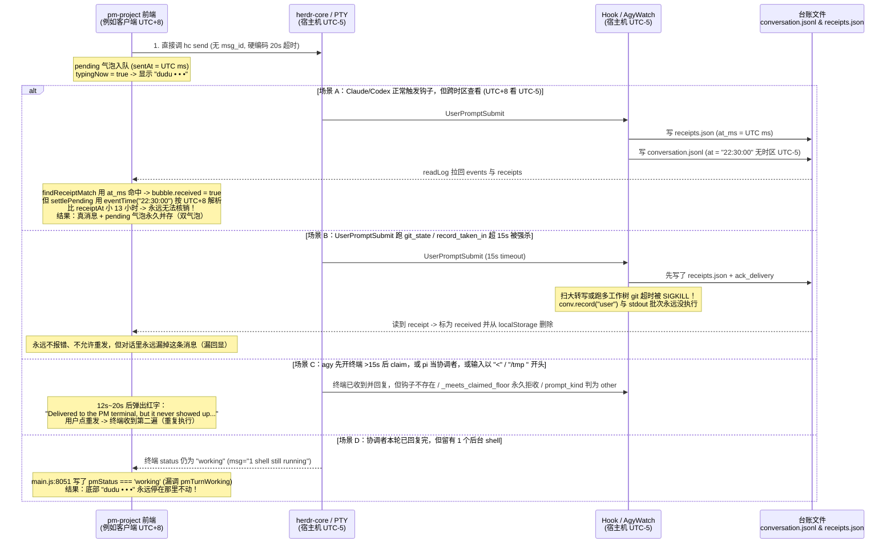
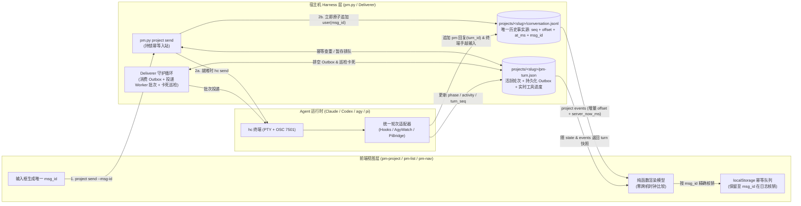
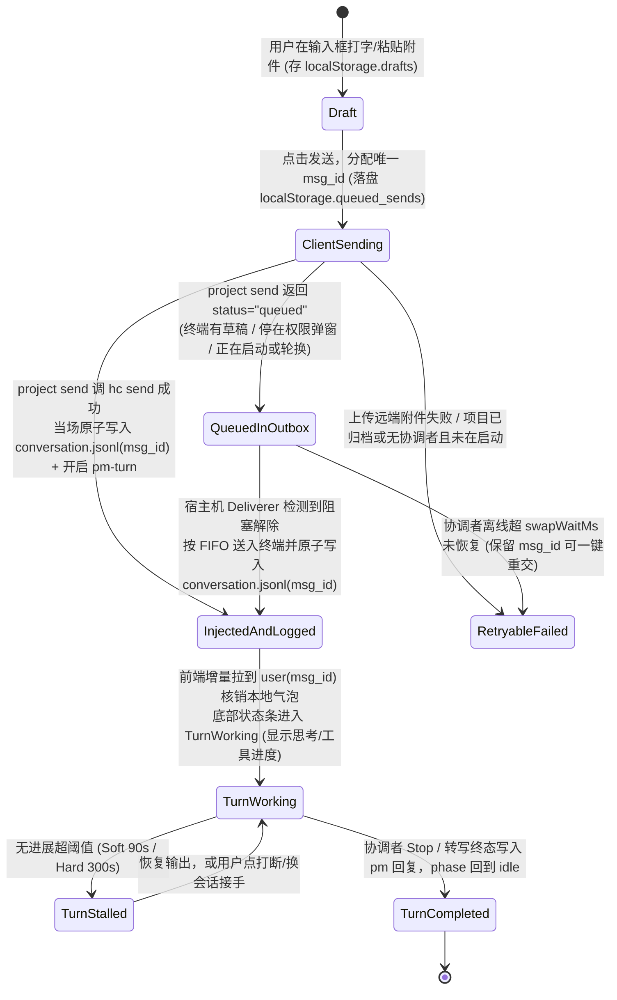

# 从根上解决协调者「卡住干活」与消息/状态失步：架构设计方案

> **背景**：在实际使用中（尤其是跨机器远程查看项目，例如从 `UTC+8` 笔记本连接 `UTC-5` 工作站，或使用 `agy`、`pi`、Codex、Claude Code 等不同编码 Agent 担任项目协调者时），用户反复遇到项目对话底部长期停在 `• • •`（正在干活）不消失、发出的消息出现双气泡、漏回显、或弹出红字 `Delivered to the PM terminal, but it never showed up in the conversation`，以及后台残留进程阻塞事件投递等问题。撰写于 2026 年 11 月。
> **状态：已实现（Implemented）。** 本文从第一性原理出发剖析 Harness 层、多 Agent 轮次适配、跨机器时间/因果协议与前端状态机，给出单一事实源设计与落地方案。文中“协调者（Coordinator / Manager）”在代码标识符、文件路径与 CLI 子命令中对应 `pm`。

---

## 0. 核心诊断与设计原则

### 0.1 一句话穿透表象

现状之痛绝非 UI 动画或超时参数调优问题，而是四个架构级错位叠加的必然结果：

1. **消息走“PTY 盲投先行、台账事后反推”的逆向链路**：前端点击发送时直接调 `hc send` 往终端塞字符，既不经过 `pm.py` 记入台账，也不携带任何因果消息 ID（`msg_id`），随后靠文本归一化与本地时间窗在 `conversation.jsonl` 和 `receipts.json` 里盲猜“我刚才那句话落盘了没有”。
2. **无时区本地时间串与 UTC 毫秒跨机混算**：台账事件只写宿主机本地时间字符串（`YYYY-MM-DD HH:MM:SS`），前端却按观看端时区调用 `new Date(...)` 解析并与 `Date.now()` / `receipts.at_ms`（UTC 毫秒）比大小；跨时区（如 `UTC+8` 看 `UTC-5`，相差 13 小时）下比较恒假或恒真，100% 触发永久双气泡或误报未送达。
3. **把“终端进程树存在后台子进程”等同于“协调者正在本轮思考”**：底层 `hc` 终端状态 `working` 混同了“前台模型推理轮次”与“轮次结束后残留的后台 shell / 子进程”，逃生通道又硬编码绑定了英文状态串 `shells? still running` 与仅 Claude/Codex 才写的 `turns.log`。
4. **多 Agent 适配与前端异步状态机各自打补丁、无单一事实源**：Claude/Codex 靠命令钩子（且 `Stop` 异步钩子存在乱序竞态、15 秒同步钩子超时会吞消息）、`agy` 靠寄生于投递器的轮询器（存在 `claimed` 时间窗拉黑漏洞与投递器退出失聪）、`pi` 完全没有对话同步器；前端又叠加了模块级未决 Promise 缓存与无超时的布尔锁。

### 0.2 第一性原理与架构边界

本方案严格遵循项目既有工程边界，不靠引入重型基础设施掩盖问题：

- **磁盘文件仍是唯一事实源（File-Backed Single Source of Truth）**：保持现有 `<ledger_home>` 目录结构，不引入 SQLite 主库，也不新增必须常驻的独立守护服务；跨机器继续通过 Herdr 原生连接（`exec(..., { on: machine })` 与实时终端流）工作。
- **因果标识（`msg_id` / `turn_id`）与单调序号（`seq` / `offset`）优先于物理时钟**：一切确认、去重、排序与重发幂等只认因果 ID 与单调偏移；一切耗时展示只用同源 UTC 时钟差（`server_now_ms - at_ms`）。
- **任何编码 Agent 平权担任协调者**：Claude Code、Codex、`agy`、`pi` 及 `config.json` 自定义 Agent 通过统一的轮次状态契约接入，不让无原生钩子的 Agent 沦为二等公民。
- **新旧版本渐进兼容**：桌面端内置的 `mods/pm-dash/skill/scripts/pm.py`、宿主机已安装的技能副本、以及远端机器上的 `pm.py` 允许存在短暂版本差；所有新增协议字段与子命令均具备向后兼容降级路径。
- **安静、克制的交互表达**：状态透明但绝不喧宾夺主；操作采用经过设计的图标加悬停说明，不用大块文字按钮，不作循环抖动。

---

## 1. 根因全景图（Root-Cause Panorama）

### 1.1 现状失步与卡死全链路时序剖析



### 1.2 四层 16 项根因分类矩阵（架构缺陷 vs 局部 Bug）

下表列出审阅代码确认的全部真实根因，标注 **`[ARCH]`（架构级缺陷）** 与 **`[BUG]`（局部实现缺陷）**：

#### 第一层：Harness 与事件投递层（`pmlib/events/`、`hooks.py`、`procs.py`、`setup.py`）

| 编号 | 性质 | 代码位置 | 根因机制 | 用户侧表现 |
| --- | :---: | --- | --- | --- |
| **H1** | `[ARCH]` | `mods/pm-project/main.js:2644`、`hooks.py:507-546` | **用户消息走“PTY 先行、台账后补”且无 `msg_id`**：前端绕过 `pm.py` 直接 `hc send`，依赖协调者稍后的钩子或转写轮询反写 `conversation.jsonl`。当协调者正处于长轮次中（如 Claude 将中途输入收进 `queued_command`），`UserPromptSubmit` 根本不触发，要等整轮结束甚至中断后下一轮才由 `record_taken_in` 补写。 | 发送后长时间停在半透明“正在发送…”、跨重载状态悬空、或误超时报红字。 |
| **H2** | `[ARCH]` | `events/policy.py:26-52`、`events/deliverer.py:248-257` | **终端 `working` 混同“前台推理”与“后台残留进程”**：`manager_ready_for_batch` 在 `state == "working"` 时同时要求 `last_turn_stopped == True`（来自 `turns.log`）**且** `status.msg` 匹配英文正则 `\bshells?\s+still\s+running\b`。对不写 `turns.log` 的 `agy`/`pi`，或 `status.msg` 为空/非该英文串的后台子进程，就绪判定恒为 `False`。 | Worker 报 `review`/`blocked`/`done` 后，`pm.py deliver` 被永久卡住不投递，15 分钟后才写一条 `deliver-stall`。 |
| **H3** | `[BUG]` | `mods/pm-dash/setup.py:244`、`hooks.py:513-562`、`events/deliver.py:514,531` | **`Stop` 钩子 `async: True` 引发 `turns.log` 乱序与 `turn-cause.json` 串台**：`Stop` 异步运行，在末尾写 `turns.log` 前串行执行 `record_taken_in`（最高读 32 MiB）、`sweep_exited`（对每个在办任务调一次 `hc get` 子进程）和 Discord 同步。若紧接着下一轮同步 `UserPromptSubmit` 先跑完并写了 `UserPromptSubmit: turn`，上一轮迟到的 `Stop` 随后追加 `Stop: turn` 并读取/覆盖无锁无轮次号的 `turn-cause.json`。 | ① `_last_turn_stopped` 在新轮次干活中途误判为已停；② 用户回复与投递批次的 `after: "deliver"` 标记互相串台，破坏交接摘要 `tail()`。 |
| **H4** | `[BUG]` | `hooks.py:514-543`、`events/deliver.py:422,451,536`、`setup.py:31` | **`UserPromptSubmit` 15 秒超时导致“回执已写、消息漏记、批次被吞”**：钩子先写 `receipts.json`（514 行），再跑 `record_taken_in` 和 `bring_pending`（`batch_text` 对每个任务调 `git status`/`rev-list`），最后才写 `conv.record("user")`（543 行）；且 `bring_pending` 在打印 stdout 前已提交 `ack_delivery`。一旦慢盘或多工作树触发 15s 超时强杀，进程死在半途。 | 前端因读到回执将气泡标为 `received` 并从 `localStorage` 删除（不再报警也不许重发），但 `conversation.jsonl` 永远缺这条用户消息（典型**漏回显**），且待投递批次被静默吞掉。 |
| **H5** | `[BUG]` | `events/deliver.py:42,99-101` | **`prompt_kind` 过滤规则过宽误杀合法用户输入**：任何以 `<` 开头（如粘贴 HTML/XML/`<tag>`）或匹配 `SLASH_COMMAND`（`r"/[\w:.-]+(\s|$)"`，例如用户写 `/tmp 满了帮我看下` 或 `/opt 下的配置`）的消息都被判为 `"other"`，在 `hooks.py` 与 `agy_watch.py` 中直接丢弃。 | 终端实际收到了消息并回复，但用户气泡不写回执也不落盘，12 秒后必现红字 `unconfirmedSend`。 |
| **H6** | `[BUG]` | `mods/pm-project/main.js:2647,3005`、`model.js:2483` | **前端 `hc send` 20s 短超时 + 自动重排造成双发**：后端 `hc send` 用 180s 超时，前端却用 20s；跨机抖动或终端草稿暂挂超 20s 时本地 `exec` 超时报错，而远端 `herdr-core` 可能已送入终端（尤其协调者正忙、尚未触发回执时），`deliverBubble` 按 `isQueueableSendError` 自动重发第二次。 | 同一条消息在终端和对话里重复出现两遍。 |
| **H7** | `[BUG]` | `project/conversation.py:145-148` | **`receipts.json` 读改写未加文件锁**：`read_receipts` → `append` → `write_atomic` 无互斥锁保护，钩子与后台同步并发写时互相覆盖。 | 偶发回执丢失，退化为超时误报。 |

#### 第二层：多 Agent 适配层（`events/agy_watch.py`、`setup.py`、`pm_pi_compact.js`、`agents/`）

| 编号 | 性质 | 代码位置 | 根因机制 | 用户侧表现 |
| --- | :---: | --- | --- | --- |
| **A1** | `[ARCH]` | `mods/pm-dash/setup.py:18-22`、`agents/base.py:17` | **缺少统一的协调者轮次与对话同步契约**：`pi`（`hooks_file = None`）及自定义 Agent 既无钩子也无转写监听；使用 `pi` 当协调者时，没有任何组件写 `conversation.jsonl` 或 `receipts.json`。 | `pi` 当协调者时项目对话完全空白，每条发送必报红字未确认。 |
| **A2** | `[BUG]` | `events/agy_watch.py:361-373,428,464,560` | **`agy` 的 `_meets_claimed_floor` 永久拉黑“先启动、后认领”的协调者会话**：候选发现阶段硬性要求转写首行时间 `first_at >= claimed_dt - 15s`。只要用户在终端打开 `agy` 超过 15 秒后才说“当这个项目的 PM”（执行 `pm.py claim`），该会话首行时间早于 `claimed_dt - 15s`，在发现阶段即被永久跳过（导致 560 行专门为此设计的 `_should_seed_eof` 成为不可达死代码）。 | 整个 `agy` 协调者会话期间，`conversation.jsonl` 零同步，发任何话都在 12 秒后报红字 `Delivered to the PM terminal, but it never showed up...`。 |
| **A3** | `[ARCH]` | `events/agy_watch.py:310,749`、`main.js:2644`、`views/state.py:117` | **`AgyTranscriptWatcher` 仅作为 `Deliverer` 子轮询运行，缺乏保活闭环**：前端发消息（`hc send`）与轮询 `pm.py state` 均不调 `Delivery.ensure_running()`，`agy` 自身又无钩子拉起投递器。一旦 `Deliverer` 因短暂 `hc` 重启、`DELIVER_GONE=30s` 或连续异常退出，在无 worker 更新台账期间无人重启它。 | `agy` 在终端里正常对答，但项目对话界面彻底停更、气泡全部超时报红。 |
| **A4** | `[BUG]` | `events/agy_watch.py:74-110`、`events/deliverer.py:234-238` | **`agy` 异常结束轮次无收口 + 串行 `hc get` 阻塞同步周期**：`parse_agy_row` 忽略 `ERROR_MESSAGE` 与被打断的工具步；且 `Deliverer.look` 先对每个在办 worker 串行跑 `hc get` 子进程才调 `watchers_look`，任务多时将 1.5s 同步周期拖慢至数秒。 | `agy` 报错或被打断后前端状态悬空；多任务并行时 `agy` 对话回显明显卡顿。 |

#### 第三层：协议、消息标识与跨时区时间模型（`conversation.jsonl`、`model.js`、`pm-list`）

| 编号 | 性质 | 代码位置 | 根因机制 | 用户侧表现 |
| --- | :---: | --- | --- | --- |
| **T1** | `[ARCH]` | `project/conversation.py:88`、`mods/pm-project/model.js:1025,1049,1716,2574,2835`、`mods/pm-list/model.js:179` | **无时区本地时间串与 UTC 毫秒跨机混算**：宿主机写无时区本地时间 `at`（如 `UTC-5`），观看端 `eventTime(e.at)` 按本机时区（如 `UTC+8`）解析为毫秒，与 `sentAt` / `receipt.at_ms`（真 UTC 毫秒）直接加减比较。 | ① **`UTC+8` 看 `UTC-5`（`-13h`）**：`settlePending` 恒假，有回执时**每条消息必出永久双气泡**，无回执时必报红字且重发翻倍；`settledReceiptIndices` 永不核销旧回执。<br/>② **`UTC-5` 看 `UTC+8`（`+13h`）**：`turnEndedAfter` 在思考中途恒真导致提前超时报红；新气泡被插到过去 13 小时历史消息上方；侧栏相对时间与今日分割线错乱。 |
| **T2** | `[ARCH]` | `mods/pm-project/model.js:1049,1432,2529`、`events/agy_watch.py:60` | **依赖单条文本全等去重，忙碌期多条排队消息被 Agent 合并后 100% 失配**：协调者忙碌期间用户连发 2+ 条短消息时，`agy`（以及部分缓冲输入场景）会把多条排队输入用换行拼接合并成单个 `<USER_REQUEST>`，导致 `conversation.jsonl` 与 `receipts.json` 写入合并后的长文本，而前端 `pending` 队列仍是两条独立短气泡——全文/摘要精确匹配全部失配，两条都超时标红 `Delivered to the PM terminal, but it never showed up...`；此外重复短语（`"好"`）或纯图片附件也易张冠李戴。 | 忙碌时连发两句话，协调者明明已收到并一并执行，界面却把两条都标红报错，点重发又导致重复执行。 |

#### 第四层：前端状态机、Mod 生命周期与远程轮询层（`pm-project`、`pm-nav`、`pm-list`、`python.js`）

| 编号 | 性质 | 代码位置 | 根因机制 | 用户侧表现 |
| --- | :---: | --- | --- | --- |
| **F1** | `[BUG]` | `mods/pm-project/main.js:8051,8075`、`mods/pm-list/model.js:9` | **`render()` 漏用 `pmTurnWorking`**：`model.js:2430` 已实现排除 `shells? still running` 的 `pmTurnWorking`，但 `main.js:8051` 仍写 `const working = pmStatus === 'working'` 并直接喂给 `typingNow`；`pm-list` 同样把纯后台 shell 当作 `working` 转圈。 | 只要协调者留有任何后台 shell（如后台跑合并检查或测试），即使早已回复完毕，对话底部 `dudu • • •` 与侧栏转圈**永远不消**。 |
| **F2** | `[BUG]` | `mods/{pm-dash,pm-project,pm-nav,pm-list}/python.js:41-45` | **模块作用域缓存未决 Promise**：`found = findPython(run).then(...)` 缓存了未决 Promise。Herdr 切 Layout 或关闭同模块其他实例（`pm-project` 同时存在 `header`、`body`、`agentWindow` 多实例）会丢弃原实例未完成的 HostModule `exec` Promise，导致 `found` 永久 pending。 | 切一次 Layout 或开关小窗若撞上首次探测，整个界面的状态刷新与日志读取永久卡死，只能重启应用。 |
| **F3** | `[ARCH]` | `mods/pm-project/main.js:430,493,2909`、`model.js:2764,2941` | **无超时的布尔异步锁 + `received` 气泡提前移出持久化队列**：`loading`/`logLoading`/`flushingQueue` 一旦因远端 `exec` 悬空未进收尾便永久锁死（且 `flushingQueue === true` 会关闭 `reconcilePendingSends:2764` 的 `inFlight` 超时兜底）；`sendStage(p)` 在 `p.received` 时返回 `''`，使气泡在 `conversation.jsonl` 落盘前就从 `localStorage` 移除。 | 远程抖动后界面不再刷新或发不出新消息；切 Layout 后刚发的消息短暂消失。 |
| **F4** | `[ARCH]` | `mods/pm-project/main.js:383,8050`、`pm-nav/main.js:165`、`views/state.py:132-195` | **远程“实时终端流 vs 10s 日志轮询”失步 + 多路全量 `state` 轰炸**：远程没有 `watchFolder`，协调者结束轮次时 `agents()` 毫秒级推流使 `• • •` 立即消失，但**没有任何边沿触发逻辑去拉 `readLog`**，造成最长 10 秒“点没了、回复也没出来”的真空；同时 `pm-nav`（仅 4s 超时）、`pm-list`、`pm-project` 各自独立高频调 `pm.py state`（内部全量扫阻塞项目对话、逐个跑 `hc get`）。 | 远程看项目明显滞后、回复经常等数秒才蹦出来、侧栏频繁超时闪烁。 |

---

## 2. 单一事实源设计（Single Source of Truth Architecture）

### 2.1 架构范式重构：台账入站先行 + 双事实源收敛

从第一性原理出发，项目对话界面与协调者终端之间只应存在**清晰的单向职责闭环**：



收敛后的**单一事实源分层**：

1. **历史事实源 `projects/<slug>/conversation.jsonl`**：唯一记录“项目里说过什么、发生了什么”的只追加日志。所有来自 UI 的用户消息在送达终端的**同一原子操作内**由 `pm.py` 直接写入，不再苦等 Agent 钩子事后反哺。
2. **活跃轮次与发件箱事实源 `projects/<slug>/pm-turn.json`**：持 `locks/turn-<slug>.lock` 原子读改写，统一收编协调者当前轮次状态（`phase`、`turn_id`、`cause`、`activity`、`bg_shells`）、待送达用户消息队列（`outbox`）与最近已入站消息幂等表（`recent_msg_ids`），**取代并逐步淘汰无锁的 `receipts.json`、易串台的 `turn-cause.json` 以及跨项目混写的协调者 `turns.log` 判定**。
3. **宿主终端层 `hc`（`TerminalInfo` + `procs.background_work`）**：仅作为底层进程与屏幕传感器输入给 Harness，前端不再拿裸 `hc status == "working"` 直接充当“协调者正在回复”。

### 2.2 全链路单调序号、UTC 时间与因果 ID 协议（彻底根除跨时区误差）

#### 1）`conversation.jsonl` 事件结构演进（100% 向后兼容）

`FileStore.append_event(slug, event)` 在持有 `locks/events-<slug>.lock` 期间，自动为每条新事件注入单调序号与 UTC 毫秒戳，同时完整保留原有 `at` 字段供既有 CLI 与单测读取：

```json
{
  "seq": 418,
  "at": "2026-11-23 22:30:05",
  "at_ms": 1795491005142,
  "tz": "-05:00",
  "type": "user",
  "msg_id": "u-m3vr8k2p-9f41c2a8",
  "source": "ui",
  "text": "帮我看下 #298 的合并冲突"
}
```

协调者回复事件同样携带因果关联：

```json
{
  "seq": 419,
  "at": "2026-11-23 22:30:19",
  "at_ms": 1795491019804,
  "tz": "-05:00",
  "type": "pm",
  "by": "hc:t12",
  "turn_id": "t12:27",
  "reply_to": "u-m3vr8k2p-9f41c2a8",
  "text": "已查看 [#298](thread:dudu-foo)，冲突在 `store.py`，已派 helper 处理。"
}
```

- **`seq` 的零额外文件生成**：在 `append_event` 持锁打开 `conversation.jsonl` 时，用现有的 `_each_line_back` 读最后一条有效事件的 `seq`（无历史 `seq` 时以当前文件行数或 `1` 起步）加 `1` 即可，O(1) 块读取，不增加新锁与新文件；同时 `Store.events()` 继续附带字节锚点 `offset`。
- **服务端统一返回 `server_now_ms` 与 `tz`**：`pm.py state` 与 `pm.py project events` 顶层均新增 `"server_now_ms": int(clock.time() * 1000)` 与 `"server_tz": "+08:00" | "-05:00"`。

#### 2）前端彻底消除跨机器时钟假设的三条铁律

1. **气泡结算优先认 `msg_id`，同时原生支持“多气泡合并事件/回执”的有序行划分核销（双保险根治 T1 + T2）**：
   - **第一层（Harness 因果入站 + 合并消重）**：UI 发送走 `pm.py project send --msg-id`，每条消息在送入终端时独立以各自的 `msg_id`、`seq`、`at_ms` 原子落盘 `conversation.jsonl`，并登记到 `pm-turn.json.unhooked_ui_prompts`；当 `agy` 或 Claude 在轮次切换时把多条排队输入合并成单个换行拼接的 `<USER_REQUEST>` 时，`TurnTracker.consume_ui_prompt` 自动按有序行划分识别并一次性消费这批已落盘的 `unhooked_ui_prompts`，绝不向 `conversation.jsonl` 重复写入第三条合并气泡。
   - **第二层（前端 `matchCoalescedBubbles` 精准多对一核销）**：即便在连接未升级远端或走直通 `hc send` 降级路径导致 `conversation.jsonl` / `receipts.json` 已经写入了换行拼接的合并文本时，`settlePending`、`findCoalescedReceiptMatch` 与 `settledReceiptIndices` 均支持有序行切片精确划分匹配——将合并后的单条事件或单条回执无损拆解核销对应的 2..N 条独立 `pending` 气泡，零误报红字、零误重发。
   - **跨时区零偏差校准**：前端统一通过 `eventTimeUtcMs(e, clockOffsetMs)` 取事件真 UTC 毫秒（优先读 `e.at_ms`；旧事件或未升级远端通过服务端同快照返回的 `(now, server_now_ms)` 精确解算时区偏移 `clockOffsetMs`，完全不受网络往返延迟影响）。
2. **相对时长与超时读秒一律由同源时钟计算**：
   - 协调者本轮已运行多久（`elapsed_ms`）、空闲了多久（`idle_ms`）、任务与项目多长时间前更新（`age`），统一使用 `server_now_ms - record.at_ms` 加上客户端自收到快照以来的本地单调增量 `monoNow - snapshotReceivedMono`。
3. **日期分割线（`Today` / `Yesterday`）统一对齐项目时间或明确换算**：
   - 有 `at_ms` 时，按观看端本地时区 `new Date(e.at_ms)` 格式化日期与 `HH:MM`（使身处 `UTC+8` 的用户看到符合自己手表直觉的本地时刻与“今天/昨天”分割线！）；无 `at_ms` 的历史旧事件回退读取 `e.at` 原串。

### 2.3 消息全生命周期状态机与幂等入站协议（`pm.py project send`）

#### 1）单条用户消息全生命周期状态机



#### 2）`pm-turn.json` 数据结构（每项目单文件，持 `locks/turn-<slug>.lock`）

`projects/<slug>/pm-turn.json`（同步加入 `pmlib/store.py` 与 `mods/pm-project/model.js` 两处的 `INTERNAL_PROJECT_FILES`）：

```json
{
  "version": 1,
  "updated_ms": 1795491012400,
  "terminal": "t12",
  "session_key": "fg:48291",
  "agent_kind": "claude",
  "turn_seq": 27,
  "phase": "working",
  "cause": "user",
  "batch": null,
  "active_msg_ids": ["u-m3vr8k2p-9f41c2a8"],
  "started_ms": 1795491005140,
  "last_activity_ms": 1795491012100,
  "activity": {
    "kind": "tool",
    "tool": "Bash",
    "summary": "pm.py diff #298",
    "started_ms": 1795491009300,
    "steps": 3
  },
  "bg_shells": {
    "count": 0,
    "commands": []
  },
  "dialog": null,
  "outbox": [],
  "unhooked_ui_prompts": [
    {
      "msg_id": "u-m3vr8k2p-9f41c2a8",
      "digest": "e3b0c442...",
      "at_ms": 1795491005140
    }
  ],
  "recent_msg_ids": {
    "u-m3vr8k2p-9f41c2a8": { "seq": 418, "offset": 94820, "at_ms": 1795491005142 }
  }
}
```

- **体积严格有界**：`recent_msg_ids` 仅保留最近 64 条（FIFO 淘汰），`unhooked_ui_prompts` 仅保留最近 16 条（被钩子/转写消费或超过 10 分钟即淘汰），`outbox` 上限 40 条，文件常驻大小 < 8 KiB。

#### 3）新增 `pm.py project send` 子命令的工作流与崩溃安全

命令签名：
`pm.py project send <slug> --msg-id <id> [--question <ask_key>] [--from <tmpfile> | --text <text>]`

执行步骤（全在协调者所在宿主机本地完成）：

1. **持锁幂等短路**：获取 `locks/turn-<slug>.lock`（超时 5s）。若 `msg_id` 已在 `recent_msg_ids` 中，直接返回 `{"ok": true, "status": "delivered", "msg_id": id, ...}`；若已在 `outbox` 中，返回当前 `{"ok": true, "status": "queued", ...}`。**无论前端因网络超时、切 Layout 还是手工点击重试多少次，宿主机绝不重复注入第二次**。
2. **保活投递器**：调用 `Delivery(ctx, repo).ensure_running()`，确保 `Deliverer` 进程在线（顺带保证 `agy` 转写监听、Outbox 自动排空与卡死巡检持续运行）。
3. **判定终端可投递性**：读取注册表与 `hc get <term>`：
   - 若协调者正在启动/轮换（`seat` 切换中、`next_session_ready` 为真）、或终端处于 `blocked`/`error` 交互弹窗、或当前已有未过期的 `inflight` 发送租约（`now_ms < inflight.lease_until_ms`，保证单终端严格单写者串行）、或 `outbox` 前面已有排队消息（保严格 FIFO）：写入 `outbox` 并释放锁，立即返回 `{"ok": true, "status": "queued", "reason": "...", "dialog": ...}`。
   - 若终端在线且可接收（`idle`、`done`、或 `working` 态支持输入缓冲）：在 `pm-turn.json` 写入 `inflight = {msg_id, term, pre_turn: info.turn, at_ms, lease_until_ms: at_ms + 50_000}` 后释放锁，调用 `ctx.hc.send(term, text, timeout=45, errors=True)`：
     - **成功（`send_succeeded`）**：重新持锁清除 `inflight`，调用 `Conversation.record("user", msg_id=id, source="ui", text=text)` 原子落盘拿到 `(seq, offset, at_ms)`，记入 `recent_msg_ids` 与 `unhooked_ui_prompts`，若当前 `phase == "idle"` 则推进 `turn_seq += 1`、`phase = "working"`、`cause = "user"`，返回 `{"ok": true, "status": "delivered", "seq": seq, "offset": offset, "at_ms": at_ms}`。
     - **因终端草稿/临时阻塞未送入**：重新持锁清除 `inflight` 并转入 `outbox`（`status: "queued"`），由 `Deliverer` 自动续投，返回 `status: "queued"`。
     - **宿主机在中途崩溃或超时**：`Deliverer` 仅在租约过期（`now_ms >= inflight.lease_until_ms`）后接管残留 `inflight`，比对 `info.turn > pre_turn` 或转写记录——已送入则补写 `conversation.jsonl`，未送入则转回 `outbox` 续投，零漏信、零并发竞争、零重发。

### 2.4 多 Agent 协调者轮次判定统一契约（Claude / Codex / `agy` / `pi` / Generic）

核心抽象：**将“协调者前台轮次（`turn.phase`）”与“终端后台进程（`turn.bg_shells`）”彻底解耦**，用一套统一的三级证据链（主动钩子 → 转写尾部探针 → `hc` 状态与子进程树）驱动所有 Agent：

| Agent 类型 | 轮次开始 (`working`) | 轮次中进度 (`activity` / `last_activity_ms`) | 轮次结束 (`idle`) 的权威信号 | 对话 `user` / `pm` 落盘 |
| --- | --- | --- | --- | --- |
| **Claude Code** | `project send` 或 `UserPromptSubmit`（分配 `turn_seq`） | `PreToolUse` + 转写尾部最后一条 `tool_use` 块摘要与文件 `mtime_ns` | `Stop` 钩子（校验 `turn_seq` 匹配当前活跃轮次）或转写非工具 `assistant` 终态 + `hc` `idle`/`done` | UI 走 `project send`；终端手敲走 `hook-turn` + `record_taken_in`（按 `unhooked_ui_prompts` 消重） |
| **Codex** | `project send` 或 `UserPromptSubmit`（分配 `turn_seq`） | `PreToolUse` + `~/.codex/sessions` rollout 转写尾部 `function_call`/`command` 摘要与 `mtime_ns` | `Stop` 钩子（校验 `turn_seq`）或 `hc` `idle`/`done`（`turn > pre_turn`） | UI 走 `project send`；终端手敲与回复走 `hook-turn` |
| **`agy`** | `project send` 或转写新 `USER_INPUT` 或 `hc.turn` 递增 | `transcript_full.jsonl` `mtime_ns` + 最新 `PLANNER_RESPONSE.tool_calls` 的 `toolSummary`/工具名 | 终态 `PLANNER_RESPONSE`（`status=="DONE"` 且无 `tool_calls`）或 `ERROR_MESSAGE`，或 `hc` 回 `idle`/`done` 且转写静止 | UI 走 `project send`；终端手敲与回复走修复后的 `AgyTranscriptWatcher` |
| **`pi`** | `project send` 或内置扩展 `agent_start` | 内置扩展 `tool_execution_start`（记录工具名与参数摘要） | 内置扩展 `agent_end`（调用 `pm.py hook-turn` 写回复并收口 `idle`），兜底 `hc` `idle`/`done` | UI 走 `project send`；回复与终端输入由升级后的 `pm_pi_compact.js` 桥接 |
| **其他自定义 Agent** | `project send` 或 `hc` `status=="working"` | `hc` `status_ms` / `status.msg` | `hc` `status in ("idle", "done")` | UI 走 `project send`（至少保证用户话必不丢、不报红） |

#### 针对现有四大 Agent 漏洞的根治改造细节

1. **钩子瘦身与序号防乱序（根治 H3、H4、H5）**：
   - **`UserPromptSubmit` 保证 <200ms 完成**：
     - 剥离慢操作：`deliver.py:batch_text` 在 `bring_pending`（同步钩子路径）中**不再调用 `ctx.git.git_state` 子进程**（任务已有 `commit` 字段，分支 `ahead/dirty` 留给异步 `Deliverer` 投递或协调者跑 `pm.py diff` 查看）；**必须先 `ctx.out.line(text_out)` 并 `flush()` 成功后才调 `ack_delivery(start, end)`**，即使进程被外部信号杀死也绝不吞批次。
     - `record_taken_in` 在 `UserPromptSubmit` 中若增量超过 `256 KiB`，改由拆离后台子进程异步追平，绝不卡住同步钩子 15 秒上限。
   - **`Stop` 钩子按 `turn_seq` 原子收口**：
     - `UserPromptSubmit` 启动新轮次时递增 `pm-turn.json` 的 `turn_seq` 并把 `cause`（`"user"` 或 `{"after": "deliver", "batch": [s, e]}`）记在该 `turn_seq` 名下。
     - 异步 `Stop` 钩子一进门先读 `pm-turn.json`：写入 `"pm"` 回复并消费对应轮次的 `cause`；**仅当 `pm-turn.json.turn_seq` 仍等于本轮序号（即没有更新的轮次在它慢悠悠收尾期间启动）时，才将 `phase` 置为 `"idle"`**！随后再跑批量化的 `sweep_exited`（改为单次 `hc ls --all` 查表，消灭 N 次 `hc get`）与 Discord 同步。
   - **收紧 `prompt_kind` 系统过滤边界**：
     - 仅当文本匹配已知的协议包装标签（`<hc\b`、`<task-notification\b`、`<system-reminder\b`、`<local-command-`）或属于无路径分隔符的内置斜杠指令集合（或首词不含常见系统目录前缀 `/tmp`、`/var`、`/opt`、`/etc`、`/dev`、`/proc`、`/home`、`/Users`）时才归为 `"other"`，确保用户发 `<div>` 代码块或 `/tmp 日志` 100% 正常作为 `"user"` 处理。

2. **`agy` 会话发现修复与实时监听（根治 A2、A3、A4）**：
   - **删除 `_meets_claimed_floor` 对 `first_at` 的错误拦截**：在 `_db_candidates` / `_fs_candidates` 中只要求转写文件的**最后修改时间** `mtime >= claimed_dt - 15s`（且 `cid not in exclude`、首屏非 worker/helper 任务书），允许绑定“先启动 `agy` 聊天、几分钟后才 `pm.py claim`”的活跃会话；把 `first_at < claimed_dt - 15s` 留给 `_should_seed_eof` 在首次附着时将游标定在当前文件末尾（不重放认领前的旧对话，紧接着认领后的每一句新话 100% 实时同步）。
   - **`ChangeWaiter` 直接监听已绑定的 `agy` 转写文件**：`AgyTranscriptWatcher` 暴露 `watched_files(repo)`，将当前绑定的 `transcript_full.jsonl` 注入 `Deliverer` 的 `DirectoryEvents`（macOS `kqueue` / Linux `inotify` / Windows 文件通知），使 `agy` 落盘后 **<100ms 即唤醒同步**（`AGY_POLL_SECONDS` 仅作兜底）。
   - **自愈拉起 `Deliverer`**：`pm.py state` 与 `pm.py project events` 在发现项目存在活跃桌面协调者且 `deliver.lock` 未被持有时，非阻塞调一次 `Delivery.ensure_running()`，彻底消除投递器意外退出后的同步盲区。

3. **`pi` 内置扩展桥接（根治 A1）**：
   - 在已随协调者启动自动挂载的 `mods/pm-dash/skill/scripts/pm_pi_compact.js` 中，利用 `pi` 原生事件接口新增 ~30 行非阻塞桥接：在 `agent_start` / `tool_execution_start` / `agent_end` 时以拆离异步方式调用 `pm.py hook-turn`（stdin 传入标准 JSON `{hook_event_name, cwd, last_assistant_message, tool_name, ...}`），让 `pi` 协调者零配置拥有回复落盘与轮次状态同步。

4. **后台残留命令与批次就绪策略统一（根治 H2、F1）**：
   - 升级 `policy.py:manager_ready_for_batch(term_info, turn_state, bg_work)`：
     - 当 `term_info.agent_state in ("idle", "done")` 时就绪；
     - 当 `term_info.agent_state == "working"` 时，只要 **`turn_state.phase == "idle"`**（协调者本轮推理已由钩子或转写终态明确收口，且无新入站轮次），且仅存在后台子进程（`bool(bg_work)` 或 `shells? still running`），一律返回 `(True, False)` 允许投递！彻底摆脱对单一英文文案和 `turns.log` 的脆弱依赖。

---

## 3. 不卡死与可观测性设计（Non-Blocking UX, Observability & Recovery）

### 3.1 告别黑盒 `dudu • • •`：单行安静进度展示（Quiet Activity Line）

当协调者处于活跃处理或排队状态时，对话流底部原本只画三个呼吸灰点的 `typing` 行（`mods/pm-project/main.js:5236`），升级为基于 `pm-turn.json` 单一事实源驱动的**单行安静进度条**（无描边卡片噪音、不改变对话列宽、不作循环抖动）：

| 协调者真实状态 (`pm.turn`) | 对话底部呈现（中文 / 英文） | 说明 |
| --- | --- | --- |
| `outbox` 有排队消息 + `dialog` 非空 | 红点 + `排队中 · 等待终端权限确认` + `[终端图标]`<br/>`Queued · waiting on terminal permission` | 取代原先等发送失败后才弹出的滞后提示 |
| `phase == "starting"` | 旋转细环 + `正在启动会话并从台账接手…`<br/>`Starting session from handover…` | 明确区分冷启动/轮换接手与普通思考 |
| `phase == "working"`（初始推理 <3s） | 呼吸三点 `• • •` | 短回复保持极简呼吸感，不闪文字 |
| `phase == "working"`（纯思考 ≥3s） | 呼吸三点 + `正在思考 · 12s`<br/>`Thinking · 12s` | 用同源 `server_now_ms - started_ms` 读秒 |
| `phase == "working"`（正在执行工具/压缩） | 呼吸三点 + `正在运行 pm.py diff #298 · 18s`<br/>`Running pm.py diff #298 · 18s` | 展示最近一步工具动作（`Read`/`Bash`/`Grep`/派发/压缩上下文），裁剪至 56 字符 |
| `phase == "idle"` 且 `bg_shells.count > 0` | **不显示 `• • •`**（回复已结束，随时可正常对话） | 彻底消灭后台挂着脚本时底部假装“正在打字”的体验；仅在鼠标悬停头栏终端图标时附带一行说明 `1 个后台命令运行中` |

**转写尾部工具摘要提取的性能保证**：
`TurnTracker.refresh_live_activity(ctx, slug)` 仅在 `phase == "working"` 时读取当前协调者转写文件的**末尾 64 KiB**（按 `(inode, size, mtime_ns)` 内存/文件双缓存，转写未增长时零磁盘解析），从中提取最后一条未配对 `tool_result` 的工具名与单行目标参数（复用 `pmlib/agents/transcripts.py` 已有的 `INPUT_FIELDS` 与 `Tidier.line` 路径脱敏逻辑），单次耗时 < 1ms。

### 3.2 超时与真卡住的自动分级检测 + 一键打断/恢复

协调者卡住常见于三类真实原因：① 违反后台规范在前台跑了耗时/卡死的命令（如卡在交互式 `git`/`ssh`/全量测试）；② 上游模型流卡顿、429 重试或网络断流；③ 终端弹出未预期的确认框。

Harness 在 `TurnTracker` 中按**最后有效进展时间 `last_activity_ms`**（新消息入站、转写文件字节增长、工具步骤推进、或终端 `turn` 变化均刷新该时间戳）做两级判定：

1. **一级：长耗时提醒（Soft Slow，`now_ms - last_activity_ms >= 90_000` 或单次前台命令持续 `>= 120_000`）**
   - 底部进度行文字转为温和提示色：`等待命令返回：python3 tests/... · 2m 10s`（英文：`Waiting on command: ... · 2m 10s`）。
   - 行尾安静浮现 **2 个图标动作**（仅图标 + 悬停 Tooltip，不用文字按钮）：
     - **`[打断图标 (stop)]`** — Tooltip：`打断当前耗时操作（发送中断信号，保留当前会话）` → 调用 `pm.py project interrupt <slug>`。
     - **`[终端图标 (terminal)]`** — Tooltip：`打开协调者终端查看输出` → 聚焦该终端。

2. **二级：卡死告警与接手恢复（Hard Stalled，`now_ms - last_activity_ms >= 300_000`，或进程假死/配额耗尽）**
   - `phase` 升为 `"stalled"`（`Deliverer` 同时向 `conversation.jsonl` 记一条幂等 `pm-stall` 诊断记录，带单次入场过渡，不循环抖动）。
   - 底部状态条显示明确诊断原因（如 `协调者已连续 5 分钟无响应（卡在命令：...）`），行尾提供 **3 个图标动作**：
     - **`[打断图标 (stop)]`**：调用 `pm.py project interrupt <slug>`（内部执行 `hc interrupt <term>` 发送 `SIGINT`，清掉卡住的前台工具，会话本身继续存活）。
     - **`[换新会话接手图标 (reattach/rotate)]`**：调用 `pm.py rotate --repo <repo> --reason "从无响应轮次恢复"`，在原 `seat` 终端内干净终止卡死子进程、拉起新协调者会话从台账接手（对话里留一行透明切换记录，且 `pm-turn.json` `outbox` 中排队的消息自动无缝交给新会话）。
     - **`[终端图标 (terminal)]`**：直接打开原生终端排查。

### 3.3 前端幂等自愈与跨机器/切 Layout 防卡死设计

1. **修复 `python.js`：模块级只缓存已解析值，绝不缓存未决 Promise**
   ```js
   let resolved = null;
   export async function python(run) {
     if (resolved) return resolved;
     const found = await findPython(run);
     if (found) resolved = found;
     return found;
   }
   export function forgetPython() { resolved = null; }
   ```
   即使 `pm-project` 的某个小窗或头部块在探测中途随 Layout 切换被销毁、其底层 HostModule `exec` Promise 永不 settle，存活视图与新建视图也完全独立探测，从根上拔除跨视图死锁。

2. **有界异步门闩（`AsyncGate`）取代裸布尔锁**
   - 在 `model.js` 中提炼纯函数/轻量状态器管理 `refresh`、`readLog`、`flushQueue`：每次发起请求分配递增 `seq` 与硬截止时间 `deadlineAt = monoNow + timeoutMs + 2000`。
   - 当下一次触发到来时，若 `gate.busy && monoNow < gate.deadlineAt`，设 `gate.again = true`；若已超过 `deadlineAt`（说明底层跨机进程或已卸载视图的 Promise 悬空），**直接递增 `gate.seq` 抢占放行**，旧异步闭包若晚到发现 `mySeq !== gate.seq` 自动忽略。彻底终结单次 RPC 悬空导致整页永久停更的问题。

3. **`localStorage` 发送队列全程保活至日志核销**
   - 修改 `sendStage(p)`：已收到服务端确认但尚未出现在当前 `events` 窗口中的气泡（`stage: 'injected'`，携带 `msgId` 与 `eventSeq`）**继续保存在 `localStorage[QUEUE_KEY]` 中**，直到 `events` 中读到对应 `msg_id`（或 `logState` 已越过该 `eventSeq`）才移除。切 Layout、刷新 Mod 期间气泡稳如磐石，既不闪烁蒸发，也绝不重发。

4. **远程跨机器“终端状态边沿触发”极速回显**
   - 在 `pm-project` 的 `render` / 状态同步中记录上一次观测到的远端协调者实时签名 `(pmLiveStatus, pmTerm.turn, pmTerm.report?.msg)`（来自 Herdr 毫秒级实时推送的 `terminals()` / `agents()`）。
   - 一旦检测到协调者从 `working` 切向 `done`/`idle`/`blocked`，或 `pmTerm.turn` 递增，**立即以 150ms 防抖触发一次增量 `readLog(cx)`**（`pm.py project events <slug> --after <offset>`），无需傻等 10 秒轮询定时器，跨机器看回复延迟从 **最高 10 秒降至 ~250ms**。

---

## 4. 分阶段落地计划（Phased Implementation Plan）

为保证每一步都可独立编码、独立跑通检查、独立灰度和随时回滚，按“**先止血消死锁 → 再立单一事实源底座 → 再统一多 Agent 钩子与转写 → 再上可观测与一键恢复 → 最后做跨机轮询瘦身**”拆为 5 个阶段。

> **合并检查说明**：仅改 `mods/pm-dash/skill/` 与测试的阶段跑 `python3 tests/run_checks.py --only ...`；动到 `mods/pm-project/`、`mods/pm-list/`、`mods/pm-nav/` 的阶段按仓库规范同时跑 Node 单测（`node --test mods/*/model.test.mjs`）与合并前渲染检查。

### 阶段 1：止血快刀——拔除前端死锁、跨时区双气泡与后台残留假忙（无新状态文件）

- **目标**：在不改变现有入站命令的前提下，立即消灭最痛的 6 个确定性 Bug（F1 假 `• • •`、F2 `python.js` 死锁、T1 跨时区 13h 双气泡/误报红字、H5 `<` 与 `/tmp` 吞消息、H7 `receipts.json` 无锁、F4 远程回复滞后 10s）。
- **改动文件**：
  - `mods/{pm-dash,pm-project,pm-nav,pm-list}/python.js`：改为仅缓存已 resolve 的探测结果。
  - `mods/pm-project/main.js`、`mods/pm-project/model.js`、`mods/pm-list/model.js`：
    - `main.js:8051` 改用 `pmTurnWorking(pmTerm, this.live())`；`pm-list` 的 `liveStatus` 同步排除纯后台 shell 残留；
    - 引入 `AsyncGate` 超时抢占保护；
    - 增加协调者终端状态边沿变化（`working -> done/idle` 或 `turn` 递增）触发防抖增量 `readLog`；
    - 时间比较全面优先使用 `at_ms` + `server_now_ms`（对未升级远端用 `state.now` 自动推算 `remoteClockOffsetMs` 校准 `eventTime`），并为气泡预埋 `msgId` 生成与优先匹配逻辑。
  - `mods/pm-dash/skill/scripts/pmlib/store.py`、`project/conversation.py`、`project/readmodel.py`、`views/state.py`、`events/deliver.py`：
    - `Store.append_event` 持锁自动写入 `seq`、`at_ms`、`tz`；
    - `state` 与 `project events` 输出 `server_now_ms`、`server_tz`；
    - `Conversation.record_receipt` 加上 `locks/receipts-<slug>.lock` 互斥锁；
    - `deliver.py:prompt_kind` 收紧 `<` 与斜杠命令白名单，不再误伤代码标签与 `/tmp` 等路径。
- **验证方式**：
  - 新增跨时区回归单测（模拟 `UTC+8` 客户端消费 `UTC-5` 与 `UTC+8` 双向日志，验证 `settlePending`、`settledReceiptIndices`、`turnEndedAfter`、`flushPendingBefore`、`age` 零双气泡、零误超时）；
  - 新增 `python.js` 未决 Promise 丢弃后二次调用可正常完成的单测；
  - 新增 `prompt_kind` 对 `<div>...</div>`、`/tmp 报错`、`<hc from="t1">`、`/compact` 的分类表测。
- **预期收益与回滚**：合入即消除 80% 日常卡 `• • •` 与远程双气泡；新字段全为增量可选字段，回滚任一端均无数据迁移负担。

### 阶段 2：单一事实源底座——`pm-turn.json` 状态机与 `pm.py project send` 幂等入站

- **目标**：建立服务端单一轮次与发件箱事实源，将用户发消息从“前端裸调 `hc send` 事后猜”升级为“宿主机持锁幂等入站 + 当场落盘 `conversation.jsonl`”。
- **改动文件**：
  - 新增 `mods/pm-dash/skill/scripts/pmlib/project/turn_state.py`（实现 `TurnTracker`、`pm-turn.json` 持锁读写、幂等表、Outbox 队列管理）。
  - `pmlib/home.py`、`pmlib/store.py`、`mods/pm-project/model.js`：注册 `pm-turn.json` 路径并同步加入双端 `INTERNAL_PROJECT_FILES`（同时在测试中新增 Python/JS `INTERNAL_PROJECT_FILES` 集合一致性断言！）。
  - `pmlib/commands/project.py`、`pmlib/project/readmodel.py`、`pmlib/views/state.py`、`pmlib/events/deliverer.py`：
    - 新增 `pm.py project send <slug> --msg-id ...`；
    - `Deliverer.look` 优先按 FIFO 排空 `pm-turn.json.outbox`；
    - `state` 与 `project events` 附带 `turn` 状态快照，并在协调者在线但 `Deliverer` 未运行时自动 `ensure_running()`。
  - `mods/pm-project/main.js`、`mods/pm-project/model.js`：
    - `deliver` 优先走 `project send --msg-id`（遇旧版远端 `isOldPmCommand` 自动平滑回退旧 `hc send` 路径）；
    - `localStorage[QUEUE_KEY]` 保留已入站未进窗口的气泡直至 `msg_id` 在 `events` 中核销。
- **验证方式**：
  - Python 单测覆盖：并发重复提交同一 `msg_id` 仅执行一次 `hc send` 且仅写一条 `"user"` 事件；终端处于 `blocked`/草稿暂挂时自动进 `outbox` 并在恢复后由 `Deliverer` 投递落盘；协调者处于 `working` 长轮次中途发消息立即落盘不报红字。
  - JS 单测覆盖：切 Layout 重载恢复、远端旧版 `pm.py` 自动回退、`msg_id` 精确核销纯图片与重复短文本消息。
- **预期收益与回滚**：从架构根源上彻底消灭 `Delivered to the PM terminal, but it never showed up in the conversation` 与超时重发导致的重复消息；若回滚前端，`pm-turn.json` 不影响旧读取路径。

### 阶段 3：钩子原子化与多 Agent 轮次统一适配（Claude / Codex / `agy` / `pi`）

- **目标**：打通所有主流编码 Agent 的轮次闭环，根治钩子 15s 超时吞消息、异步 `Stop` 乱序串台、`agy` 先启动后 `claim` 永久失聪、以及 `pi` 无协调者对话同步的问题。
- **改动文件**：
  - `pmlib/hooks.py`、`pmlib/events/deliver.py`：
    - `UserPromptSubmit` 按 `unhooked_ui_prompts` 与 `project send` 消重；`bring_pending` 移除同步 `git_state` 子进程，先 `flush` stdout 再 `ack_delivery`；大体积 `record_taken_in` 异步化；
    - `Stop` 按 `pm-turn.json.turn_seq` 校验轮次归属与消费 `cause`，`sweep_exited` 改为单次 `hc ls --all`。
  - `pmlib/events/agy_watch.py`、`pmlib/terminals/events.py`、`pmlib/events/deliverer.py`：
    - 修复 `_meets_claimed_floor`（改查 `mtime` 而非拦截 `first_at`，激活用 `_should_seed_eof` 追尾）；
    - 将已绑定的 `agy` 转写文件接入 `ChangeWaiter` 文件通知，补齐 `ERROR_MESSAGE` 与中断轮次收口。
  - `mods/pm-dash/skill/scripts/pm_pi_compact.js`：新增 `agent_start` / `tool_execution_start` / `agent_end` 到 `pm.py hook-turn` 的异步桥接。
  - `pmlib/events/policy.py`：`manager_ready_for_batch` 接入 `pm-turn.json` 的 `phase == "idle"` + `procs.background_work`，对所有 Agent 统一放行纯后台进程残留下的批次投递。
- **验证方式**：
  - `test_hooks.py`：模拟慢仓库 + 异步 `Stop` 晚于下一轮 `UserPromptSubmit` 到达，验证 `phase` 不误回退、`after: "deliver"` 不串台、超时前不误 `ack` 批次。
  - `test_agy_watch.py`：构造启动 10 分钟后才 `pm.py claim` 的 `agy` 转写，验证首次附着不重放旧历史、后续每轮实时同步且消费 `unhooked_ui_prompts` 不双写。
  - 新增 `pm_pi_compact` 桥接单测与 `test_bg_work_delivery.py` 非英文/空 `status.msg` 后台进程投递单测。
- **预期收益与回滚**：Claude、Codex、`agy`、`pi` 四类协调者体验完全拉齐，不再因 Agent 差异掉链子。

### 阶段 4：协调者轮次可观测性、卡死检测与一键打断/恢复

- **目标**：将黑盒 `• • •` 升级为安静透明的实时工具/思考状态行，并在长耗时或真卡死时提供图标化一键打断（`interrupt`）与换会话接手（`rotate`）。
- **改动文件**：
  - `pmlib/project/turn_state.py`、`pmlib/agents/transcripts.py`：新增针对 Claude、Codex、`agy` 转写末尾 64 KiB 的轻量级活跃工具提取（按 `(inode, size, mtime_ns)` 缓存）及 90s / 300s 两级卡死判定。
  - `pmlib/commands/project.py`：新增 `pm.py project interrupt <slug>`（安全封装 `hc interrupt` 并记录用户打断标记）。
  - `mods/pm-project/main.js`、`mods/pm-project/model.js`、新增图标资源（如 `stop.svg`）：
    - 渲染底部单行实时活动文案与同源耗时读秒；
    - 在 Soft Slow / Hard Stalled 时展示 `[打断]`、`[换会话接手]`、`[打开终端]` 图标操作及中英双语 Tooltip。
- **验证方式**：
  - Python 单测验证各 Agent 转写工具摘要提取、缓存命中与 90s/300s 状态跃迁；
  - Node 单测验证 `STRINGS.en` / `STRINGS.zh` 文案完整性与状态映射；
  - 跑 UI 渲染检查确认深浅色主题、窄宽窗口下进度行与图标排版干净无溢出。
- **预期收益与回滚**：用户随时知道协调者在干什么，真卡住时无需切去 Spaces 翻找终端即可在当前页面一键打断或换人接手。

### 阶段 5：`pm.py state` 与跨机轮询减负收尾

- **目标**：消除多 Mod 并发重型子进程开销，让远程跨机器体验与本机一样轻快，并清理过渡期历史包袱。
- **改动文件**：
  - `pmlib/views/state.py`：
    - 按 `(conversation.jsonl inode, size, mtime_ns)` 缓存阻塞项目的 `answered_tasks` 计算结果，避免每次 `state` 从头解析整本对话日志；
    - 复用单次 `hc ls --all` 行数据填充 `hc_pm`，消除每个注册协调者额外跑一次 `hc get` 子进程；
    - `turns.log` 改为尾部 64 KiB 定长读取。
  - `mods/pm-nav/main.js`、`mods/pm-project/main.js`：将 `pm-nav` 远端 `state` 超时调至 `10000ms`，当 `pm-project` 刚拉完同一远端机器最新 `state` 时共享写入缓存供侧栏复用，减少重复跨机 `hc exec`。
- **验证方式**：
  - 基准测试对比 10 个项目 + 50 个任务 + 5 MB 对话日志下 `pm.py state` 子进程调用次数与耗时（预期 `hc` 调用数从 `O(PMs)` 降为 `1` 次，总耗时下降 60%+）；
  - 全量跑通 `python3 tests/run_checks.py` 与渲染检查。
- **预期收益与回滚**：大幅降低本机电池/CPU 开销与跨机 SSH/隧道拥塞，侧栏与项目页状态跳变严丝合缝。

---

## 5. 关键边界场景验算表（Edge-Case Verification Matrix）

| 极端场景 | 现状行为 | 新架构下的确定性行为 |
| --- | --- | --- |
| **1. `UTC+8` 笔记本给 `UTC-5` 远端工作站发消息** | `eventTime` 差 `-13h`，`settlePending` 永不匹配 → 100% 双气泡或误报红字 | `project send` 落盘带 `msg_id` 与 `at_ms`，前端按 `msg_id` 瞬间精确核销，耗时用 `server_now_ms - at_ms` 显示，零时差影响 |
| **2. 协调者忙碌期间用户连发两条消息，`agy` 将两条合并为单个 `<USER_REQUEST>`** | 日志与回执写入换行拼接后的长文本，前端两条独立短气泡全失配 → 双双超时标红字 | ① 新链路：`project send` 按各自 `msg_id` 独立即时落盘，`TurnTracker.consume_ui_prompt` 按行划分消重合并后的转写输入；② 降级链路：`settlePending` 与 `findCoalescedReceiptMatch` 原生支持多气泡有序行划分匹配，单条合并事件/回执精准核销全部子气泡 |
| **3. 用户在终端先开 `agy` 聊了 5 分钟，再跑 `pm.py claim`** | `first_at < claimed_dt - 15s` 被 `_meets_claimed_floor` 永久拉黑，后续零同步 | 发现阶段按 `mtime` 命中当前活跃会话，首次附着由 `_should_seed_eof` 定标在 EOF，认领后的每句话 <200ms 实时同步 |
| **4. 使用 `pi` 作为项目协调者** | 无钩子无同步器，对话全空、发消息全报红字 | UI 消息由 `project send` 直接落盘；`pi` 回复与工具进度由 `pm_pi_compact.js` 扩展桥接至 `hook-turn` |
| **5. 协调者回复完毕，但后台挂着 `sleep 3600` 或测试脚本** | `hc` 报 `working`，`main.js:8051` 让 `• • •` 永不消失，非英文提示下还堵死 `Deliverer` | `Stop`/终态已将 `pm-turn.json.phase` 置为 `idle`（`bg_shells.count = 1`），底部不画 `• • •`，`Deliverer` 正常投递新事件 |
| **6. 慢盘/多工作树导致 `UserPromptSubmit` 接近超时** | 先写回执后写日志，15s 强杀导致“漏回显 + 吞批次” | 用户消息在 `project send` 已落盘；钩子移除同步 `git` 子进程，且严格先 `flush` stdout 再 `ack_delivery`，耗时降至 <100ms |
| **7. 用户发送 `<div>示例</div>` 或 `/tmp 磁盘满了`** | `prompt_kind` 判为 `"other"` 丢弃，12s 后报红字 | `project send` 直接落盘，且收紧后的 `prompt_kind` 在终端直敲场景下也正常识别为 `"user"` |
| **8. 切 Herdr Layout 或关小窗恰好撞上 `findPython` / 远端 `exec`** | 模块级未决 Promise 或 `this.loading = true` 永久锁死整页 | `python.js` 仅缓存已解析结果；`AsyncGate` 超时后递增 `seq` 自动抢占恢复 |
| **9. 协调者违规在前台跑了死循环或阻塞命令** | 界面只显示黑盒 `• • •`，用户毫不知情也无法在页面内自救 | 90s 显示正在等待的具体命令并提供一键 `[打断]` 图标；300s 报卡死并提供 `[打断]` 与 `[换新会话接手]` |
| **10. 协调者正在 `seat` 轮换会话的几秒间隙用户发消息** | `hc send` 撞上进程切换或新旧会话边界易重排混乱 | `project send` 检测到 `seat` 切换态直接将消息存入 `pm-turn.json.outbox`，新会话就绪后由 `Deliverer` 按严格 FIFO 首条送入 |
