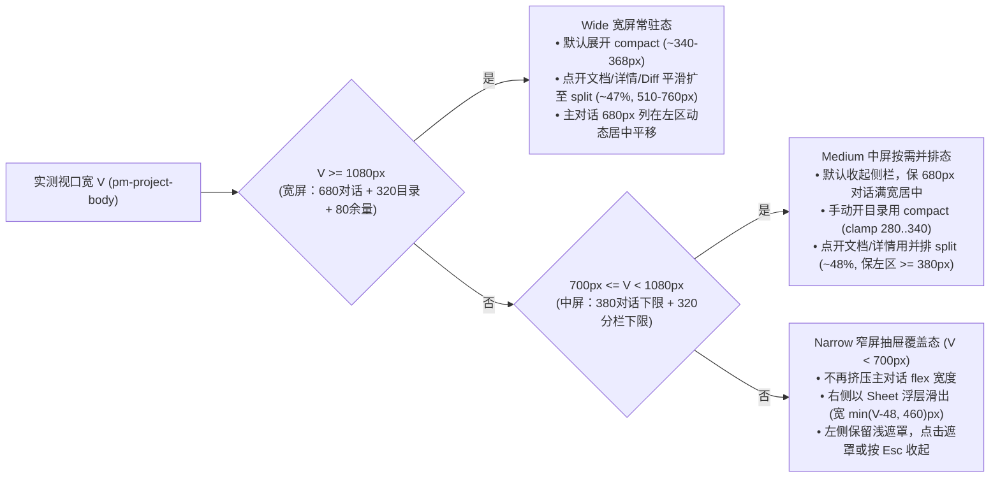
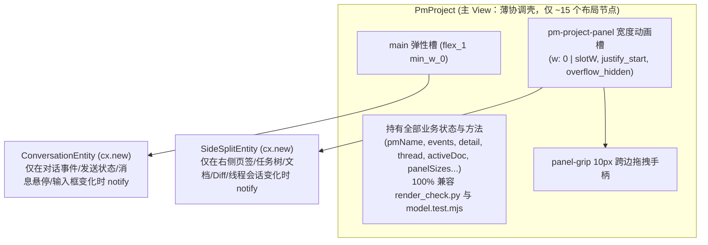

# 右侧边栏升级：Claude Desktop 风格的丝滑分栏设计方案

> **背景**：`pm-project` 项目页当前的右侧栏（`Threads / Library / Memory` 列表、文档阅读与编辑器、线程详情与会话、分支改动 Diff）在功能上已承载完整的项目上下文与工作台能力，但在空间分配、展开/拖拽帧率、顶栏层级和阅读体验上仍停留在“固定 360px 工具侧栏”形态。本文从第一性原理出发，结合公开可见的 Claude Desktop 右侧分栏（Artifacts / Project Knowledge）交互范式与 Herdr GPUI（`gpui-kit` / `gpui-base`）的真实渲染机制，给出可直接落地的改造方案。撰写于 2026-11-24。
> **状态：设计定稿，待实现。** 范围涵盖 `mods/pm-project/model.js`、`mods/pm-project/main.js`、`mods/pm-project/change_view.js` 与 `layouts/pm.json`。

---

## 0. 核心设计结论摘要

要让右侧栏真正达到 Claude Desktop 式的“丝滑分栏”质感，不能只改动画时长或调大默认像素，必须同时解决 **空间语义、视觉容器、动线统一、帧率隔离** 四件事：

| 维度 | 现状症结 | 改造定稿 |
| --- | --- | --- |
| **宽度与比例** | 单一 `PANEL_WIDTH = 360` + 单键 `localStorage.panelWidth`；看文档/Diff 挤在 `~260–324px` 内容宽里，拖宽后切回列表又空旷臃肿 | **双模态自适应宽度**：目录巡检态（`compact`，默认 `~340–368px`）与阅读/工作台态（`split`，打开文档/编辑/历史/线程详情/Diff 时平滑扩宽至 `~47%`，上限 `760px`）；`compact` 记像素、`split` 记比例，互不污染 |
| **视觉与顶栏** | 全局 `56px` 顶栏一条 `1px` 底边横切窗口，右侧栏用外框导航色 `t.chrome`，且叠放 2–3 层带框胶囊与子顶栏（阅读文档前先占 `91px` 头部） | **悬浮圆角分栏卡 + 单行 `44px` 统一顶栏**：主对话顶栏去底边留白呼吸；右侧分栏改为 `t.canvas` 上的 `rounded(12)` 独立卡片（`bg(t.background)`、`border_1(t.border)`）；所有子视图共用同一 `44px` 顶栏，消除多重描边盒堆叠 |
| **导航动线** | 文档页保留外层页签栏再叠返回栏；线程详情 `←` 与 `✕` 代码完全重复；四套子视图 `←` 坐标各异 | **严密区分 `←`、`✕` 与 `Esc`**：`←` 恒定锚在 `(12, 8)` 退回上级列表（并缩回 `compact` 宽），`✕` 恒定在右上角一键收起整个右侧分栏，`Esc` 严格沿用 `escapeStep` 逐层后退 |
| **帧率与跟手** | 拖拽每移动 1px 或悬停手柄均触发 8500 行单体 `PmProject` 全量重绘对话时间线，且触发 `on_size_change -> resized()` 三帧连环重排 | **薄协调壳 + 双保留子视图（`cx.new` `Entity`）+ 过渡锁帧**：拖拽与动画期间左右内容树在 Rust Taffy 中原生排版、零 QuickJS 重建；外框 `.w_full()` 保四角描边、内层正文在 `180ms` 过渡期锁定目标宽度只排版 1 次 |

---

## 1. 当前右侧栏为什么“不够丝滑”：现状逐条诊断

审阅 `mods/pm-project/main.js`、`mods/pm-project/model.js`、`mods/pm-project/change_view.js` 与 `layouts/pm.json` 后，当前实现“生硬、局促、偶发掉帧”的根因可精确归结为以下六条：

### 1.1 目录态与阅读/详情态共用单一 `360px` 宽度，空间分配失衡

- **现状代码**：`model.js`（`PANEL_WIDTH = 360, PANEL_MIN = 260, TALK_MIN = 360`，`panelWidth(want, view)`）与 `main.js`（`PANEL_KEY = 'panelWidth'`）。
- **具体问题**：
  1. **阅读态严重局促**：无论用户是在扫读单行 `Threads` 列表，还是打开几万字的设计文档（`docDetailView`）、查看双列行号代码 Diff（`change_view.js`）、阅读多轮 worker 会话记录（`threadSessionView`），右侧栏宽度一律锁死在 `360px`。扣除内边距与代码块边框后，`docDetailView` 有效阅读宽仅 `324px`（`360 - 18×2`），`change_view.js` 代码正文区仅剩 `~260px`（每行约 35 个等宽字符即被迫软折行 2–3 次），Markdown 表格与代码块几乎无法舒展阅读。
  2. **大屏留白浪费与主副失调**：在常见 `1440px–1728px` 桌面窗口下（扣除左侧 `268px` `sidebar` 后 `viewWidth` 为 `1170px–1460px`），主对话列受 `COLUMN = 680` 限制，两侧空置 `200px–420px` 的纯色 `t.canvas` 留白，右侧长文档却挤在 `25%–30%` 的窄条里。
  3. **单槽拖拽记忆互相污染**：`localStorage.panelWidth` 只有一个全局数值。用户为了看清文档或 Diff 手动把侧栏拖到 `600px`，关掉文档回到 `Threads` 列表时，单行任务列表仍然霸占半个屏幕；双击手柄重置回 `360px` 后，下次点开文档又得重新手动拉宽。

### 1.2 拖拽与悬停触发单体巨型 `View` 全量重绘，伴随连环重排风暴

- **现状代码**：`main.js` 中 `gripMove`（L2220）、`root.on_mouse_move`（L8296）、`panel-grip` 的 `on_hover`（L8570）以及对话块 `on_size_change -> this.resized(cx)`（L8491–8495、L4417）。
- **具体问题**：
  1. **逐像素全树跨桥重建**：`PmProject` 是承载全部 UI 的单一 `View`。按住 `panel-grip` 拖动时，指针每移动 `1px` 就调用一次 `cx.notify()`。虽然 `resolveTimelineData` 与 `resolveTaskTree` 做了纯数据缓存，但 `PmProject.render(cx)` 仍会在每一帧遍历并构建整棵 GPUI 元素树（最多 200+ 条对话块、多段 `TextView.markdown`、段落引用悬停槽、`Popup` 锚点、底部输入框，外加右侧整棵任务树 / 文档块 / 数百行 Diff 元素），全部跨过 QuickJS → Rust `gpui-shell` 边界。
  2. **`on_size_change` 连环 3 帧追加重绘**：拖拽或滑入窄化左侧空间时，只要主对话区宽度小于 `736px`（`680 + 28×2`），任一对话气泡折行高度变化就会触发 `block-${b.key}` 的 `on_size_change` → `this.resized(cx)`，把 `this.settle` 设为 `3` 并再次调用 `cx.notify()`，而 `render()` 内 `this.settle > 0` 又通过 `cx.timer.after(16, () => cx.notify())` 连续追发 3 轮全量重绘（L8439）。
  3. **悬停手柄也重绘全页，且左侧热区缺失**：`panel-grip` 仅在进入/离开时为了改一个 `2px` 竖线颜色就执行 `this.gripLit = hovered; cx.notify()` 重绘整个项目页；且 `grip` 被放在 `pm-project-panel`（`overflow_hidden`）内部 `left(0).w(6)`，热区完全偏向右侧面板内部 `6px`，从左侧对话区靠近分界线时指针在越过边线前毫无响应。

### 1.3 展开/收起动画方向反置（左边界被裁切）且模式切换零过渡

- **现状代码**：`main.js` L8573–8577：
  ```js
  const panel = h_flex().id('pm-project-panel').relative().h_full().flex_none().overflow_hidden().justify_end()
    .w(open ? width : 0)
    .when(this.measured && !dragging, el => el.transition('width', { duration: 200, easing: 'ease-out' }))
  ```
- **具体问题**：
  1. **`justify_end()` 导致动画全程丢失分界线**：外层 `pm-project-panel` 在宽度从 `0 -> 360` 过渡时使用 `justify_end()` 将固定 `360px` 宽的内层面板右对齐到窗口右缘。当过渡到 `100px` 时，内层面板左边缘实际位于 `-260px` 处被 `overflow_hidden()` 裁掉——意味着内层面板上的 `border_l(1)` 分界线、返回按钮和标题左端在 `200ms` 动画期间**一直处于裁切区外不可见**，直到最后一帧才突然贴合显现，视觉上像“原地拉开卷帘露出右半截”，而非物理面板从右缘滑入。
  2. **列表切详情/阅读器瞬间跳变**：从 `Threads` 点进线程详情、从 `Library` 点开文档、或从线程详情点进 `Changes` Diff 时，子树直接硬切，既无宽度平滑伸缩，也无内容层级的轻量淡入过渡。

### 1.4 顶栏横切与 `t.chrome` 底色造成强烈的“IDE 后台侧栏”割裂感

- **现状代码**：`layouts/pm.json`（`pm-project-header` `56px` + `pm-project-body`）与 `main.js`（`renderHeaderBar` L5750、`threadsPanel` L7051、`sideHeader` L7075）。
- **具体问题**：
  1. **语义色错位**：在 Herdr 主题体系中（见 `herdr.d.ts`），`t.chrome` 用于外框导航栏（左栏 `sidebar`），`t.canvas` 是卡片背后的画布，而 `t.background` 才是承载正文的卡片/窗格底色（`layouts/pm.json` 中 `work-body` 的主窗格即采用 `t.canvas` 底 + `t.background` 圆角框）。当前右侧栏直接使用 `bg(t.chrome)`，使其在深浅色主题下都像一块沉重的工具坞，缺乏 Claude Desktop Artifact 面板那种清透的“纸面/工作台”层级。
  2. **三层描边胶囊堆叠**：全局顶栏画了一条贯通左右的 `border_b(1)`，右上角放着带 `border_1` 的 `[Conversation | Board]` 胶囊与工具图标；紧接着正下方 `12px` 处，右侧栏又画了一圈带 `border_1` 的 `[Threads | Library | Memory]` 胶囊（`sideHeader`）；点进线程详情后下面再出一圈带 `border_1` 的 `[Log | Conversation]` 胶囊。三层方框纵向堆砌，视觉噪音重。

### 1.5 子视图头部坐标跳变、阅读顶栏双层叠放、返回与关闭语义混淆

- **现状代码**：`libraryPanel`（L7564–7572）、`memoryPanel`（L7638–7646）、`docDetailView`（L7200）、`panel()`（L8010–8033、L8179）、`change_view.js`（L79）。
- **具体问题**：
  1. **打开文档时双头叠放占去 `91px`**：`libraryPanel` 与 `memoryPanel` 在展示 `docDetailView`、`docEditView`、`historySubView` 时，外层 `wrap` 依然保留 `pt(12)` + `sideHeader`（`34px` 页签栏），其下再渲染 `docDetailView` 的 `topBar`（`45px`），正文未始已耗去近百像素高度；而 `@file` 仓库文件预览（`root === 'repo'`）借道 `libraryPanel` 渲染，导致看代码文件时顶上还亮着 `Library` 页签。
  2. **四处 `←` 按钮位置与尺寸不一**：
     - `docDetailView` / `historySubView`：`←` 位于 `(x=14, y=52)`，按钮尺寸 `32×32`；
     - `panel()`（线程详情）：隐藏了 `sideHeader`，`←` 跳到 `(x=18, y=12)`，按钮变成 `28×28`（`winIconBtn`）；
     - `change_view.js`（分支改动）：去掉了 `pt(12)`，`←` 又跳到 `(x=14, y=6)`，按钮变回 `32×32`（`iconButton`）。
     用户在“列表 → 线程详情 → 看改动”之间点击返回时，左上角 `←` 按钮每次都在肉眼可见地上下左右跳动。
  3. **`←` 与 `✕` 重复或缺失**：线程详情顶栏同时画了左边的 `←`（`thread-back`）和右边的 `✕`（`thread-close`），但两者绑定的回调逐字相同（都只设 `this.detail = false` 退回列表，在宽屏下点 `✕` 根本关不掉侧栏）；反之，`docDetailView` 只有 `←` 没有 `✕`，从对话里的 `@doc` 链接点开文档后无法一键把右侧栏彻底收起。

### 1.6 宽/窄屏断点（`WIDE = 1096px`）缺乏中屏与极窄屏缓冲策略

- **现状代码**：`WIDE = COLUMN + PANEL_WIDTH + 2 * 28 = 1096`（`pm-project-body` 逻辑像素宽度，对应包含 `268px` 左栏的窗口总宽 `1365px`）。
- **具体问题**：在 `viewWidth < 700px` 的窄窗口下，打开面板仍采用硬性水平并排挤压（`flex` 扣减），导致对话区与侧栏双双跌破舒适阅读下限；而在 `viewWidth >= 1200px` 的宽屏下打开文档又不会利用充裕宽度自动展开分栏。

---

## 2. Claude Desktop 风格的分栏布局、比例与视觉设计

对照 Claude Desktop 公开可见的分栏体验，其让人感到“丝滑且克制”的本质在于：**聊天是松弛的画布，右侧分栏是一张按需生长、边界利落、头部统一的独立工作台卡片**。以下结合 `gpui-kit` 能力给出精确规格。

### 2.1 双模态自适应宽度策略与用户偏好记忆

右侧栏的所有状态收敛为 **两种宽度模态（`panelMode`）**——绝不引入三种以上宽度档位，避免切换时产生不可预期的频繁伸缩：

| 模态 | 触发状态（`resolvePanelMode`） | 空间定位 | 默认目标宽度 | 偏好存储策略 |
| --- | --- | --- | --- | --- |
| **`compact`**（目录巡检态） | `Threads` 列表、`Library` 文件列表、`Memory` 记忆列表（无打开的详情/文档/编辑/历史） | 紧凑目录索引，主对话保持绝对视觉重心（占比 `~70%+`） | `clamp(320, round(V * 0.27), 368)`（含右/下边距前卡片净宽） | 存 **像素值** `compactPx`（目录字号固定，跨屏幕保持紧凑感） |
| **`split`**（分栏工作台态） | 打开文档/记忆阅读（`activeDoc`）、新建/编辑（`editingDoc`）、历史恢复（`historyView`）、线程详情（`detail`）、分支改动 Diff（`isThreadChangeOpen()`） | Claude Artifact 式主副并重分栏，文档/代码/Diff 舒展排布，主对话在左半区自然居中 | 宽屏 `min(760, max(440, min(round(V * 0.47), V - 520)))`；中屏 `clamp(380, round(V * 0.48), V - 380)` | 存 **宽度比例** `splitRatio`（`0.30..0.66`，随窗口缩放按比例自适应） |

其中 `V = viewWidth`（`pm-project-body` 实测宽度）。三种视口宽度区间的完整响应矩阵如下（每个断点均由内部最小舒适列宽严格推导，无拍脑袋魔数）：



> [!NOTE]
> **与 `tests/render_check.py` 窗口尺寸的自然兼容**：`render_check.py` 使用 `1000×680` 私有窗口，扣除左侧 `268px` `sidebar` 与 `1px` 分割线后 `V = 731px`，恰好落在 **Medium 并排区间（`700px <= V < 1080px`）**，既不出现遮罩挡住对话，又保证对话区（`371px`）与分栏（`360px`）均不越界。

**拖拽记忆与向后兼容规则（`model.js` 纯函数）**：
1. 存储键升级为 JSON `panelSizes`：`{ compactPx: number | null, splitRatio: number | null }`。
2. **平滑迁移旧配置**：首次读取若无 `panelSizes` 但存在旧 `localStorage.panelWidth`：若旧值 `<= 400` 迁入 `compactPx`，若 `> 400` 换算为比例（按参考宽 `1200px` 夹取到 `0.34..0.62`）迁入 `splitRatio`，不丢弃老用户手感。
3. **独立写入与双击重置**：在目录态拖动只更新 `compactPx`（范围 `[260, min(500, V - 380)]`）；在阅读/详情/Diff 态拖动只更新 `splitRatio`（像素范围 `[360, min(880, V - 380)]`）；**双击拖拽手柄仅清除当前所在模态的自定义值**，平滑弹回该模态默认宽度。

### 2.2 容器形态裁决：无底线主画布 + 内嵌圆角分栏卡片

对比“齐平通高直边分栏”与“内嵌圆角卡片分栏”，本方案选定 **Claude Desktop 同款的内嵌圆角卡片分栏（Inset Rounded Split Card）**，并与 `layouts/pm.json` 顶栏协同去线：

```
┌─────────────────────────── pm-project (bg: t.canvas) ───────────────────────────┐
│  orbit  ~/repos/orbit              Context 75k  [Conversation|Board] 🔍 🔔 🖥 ◫ │ ← 56px 顶栏（无贯通底边，保留 window_drag）
│                                                                                 │
│        ┌──────────────────────┐        ╭─ Split Card (rounded 12, border 1) ──╮ │
│        │   主对话居中列         │        │ ←  #12 Greeting module    🪟  ⑂   ✕ │ │ ← 统一 44px 卡片顶栏 (bg: t.background)
│        │   max_w: 680px       │   ┃    ├──────────────────────────────────────┤ │
│        │   随左侧剩余宽度      │  grip  │                                      │ │
│        │   自然居中平移        │ (10px) │   卡片阅读 / 详情 / Diff / 目录正文区  │ │
│        │                      │        │   bg: t.background (次级块 t.surface) │ │
│        ├──────────────────────┤        │                                      │ │
│        │ [ 对协调者说…     ↑ ] │        ╰──────────────────────────────────────╯ │
└────────┴──────────────────────┴────────┴─────────────────────────── mr:10 mb:10 ┘
```

**为什么这是最契合 Herdr 主题语义与 Claude 质感的做法**：
1. **消除 T 字双线冲突**：移除 `renderHeaderBar`（`main.js` L5750）上的贯通 `.border_b(1)`（`layouts/pm.json` 的 `pm-project-header` 保持 `size: { px: 56 }, window_drag: true` 不变，不破坏窗口拖拽与文本选择隔离）。主对话区从顶栏到底部输入框完全融于同一块干净的 `t.canvas` 画布。
2. **用对 Herdr 语义色**：分栏卡片本体设置在 `pm-project-body` 右侧，外留 `mr(10)` 与 `mb(10)`（顶部 `mt(0)` 紧承 `56px` 顶栏下沿，视觉高度齐整），采用 `rounded(12)`、`bg(t.background)`、`border_1().border_color(t.border)`：
   - **深色主题（`graphite` / `ink` / `moss`）**：`t.background` 比 `t.canvas` 更深邃纯净（或形成微弱明度差），配合 `1px` `t.border` 勾勒出克制的边界，内部代码块/卡片用 `t.surface`、悬停用 `t.hover`，彻底摆脱旧版 `t.chrome` 的灰闷工具栏感（且遵循 `dark-hub-quiet-fill` 原则，绝不使用刺眼亮块）。
   - **浅色主题（`paper`）**：`t.canvas` 为温润浅灰纸底，`t.background` 为清爽白底卡片，配 `1px` 浅描边与极轻预设阴影 `shadow_xs()`（仅浅色主题开启，深色主题靠 `1px` `t.border` 即可清晰分界，无需叠多层阴影盒）。
3. **顶栏开关按钮状态闭环**：右上角 `◫`（`panel` 图标）在 `panelOpen === true` 时赋予柔和激活态（`bg(t.raised).text_color(t.foreground)`），右边距微调对齐下方分栏卡片右缘，一眼看清分栏开闭状态。

### 2.3 分界线（Divider）与拖拽手柄（Grip）交互打磨

在 GPUI 中，`.hover(s => ...)` 只能修改当前元素自身的样式，不支持 CSS 的 `.grip:hover .line` 父子选择器联动。为同时实现 **宽热区、细视觉线、零内容重绘**，分界手柄结构设计如下：

1. **几何与热区布局**：
   - 外层槽 `pm-project-panel` 宽度为 `slotWidth = cardWidth + 10`（含右侧 `10px` 边距）再加左侧 `5px` 热区外延（`pl(5)`），使卡片左描边精确落在 `x = 5px`。
   - 拖拽手柄 `panel-grip` 设为 `absolute().left(0).top(0).bottom(10).w(10).cursor_col_resize()`——热区严格跨在卡片 `1px` 左描边正中央（**左侧画布区 `5px` + 右侧卡片内 `5px`**），无论鼠标从对话侧还是面板侧移近，都能提前 `5px` 稳稳命中。
   - 手柄绑定 `keepPress`（`on_mouse_down('left', ...)` 调 `cx.stop_propagation()`），防止误触底层元素。
2. **三态极简视觉反馈**：
   - **静止态（默认）**：手柄完全透明（`opacity(0)`），界面上只有分栏卡片自身的 `1px` `t.border` 圆角左边缘，极致干净。
   - **悬停态（`gripLit && !dragging`）**：在 `x = 4.5px` 处沿卡片直边段（`top(12).bottom(22)`，避开上下 `12px` 圆角弧度！）浮现一条 `2px` 宽的柔和强调线 `withAlpha(t.accent, 0.55)`，正中配一枚 `3px × 28px` 圆角胶囊抓手 `bg(t.muted).rounded(2)`，通过原生 `.transition('opacity', { duration: 120, easing: 'ease-out' })` 柔和显现。
   - **拖拽态（`dragging`）**：强调线升至 `withAlpha(t.accent, 0.9)`，居中胶囊变为 `bg(t.accent)`，松手后 `120ms` 淡出。
   - **双击重置**：`e.click_count >= 2` 清除当前模态宽度偏好，平滑过渡回默认宽度。

### 2.4 统一 `44px` 单行卡片顶栏与返回/关闭动线

彻底消除“双顶栏叠放”和“`←` 坐标跳变”：分栏卡片顶部固定为一个 **`h(44)`、`px(12)`、`border_b(1).border_color(withAlpha(t.border, 0.7))` 的统一单行顶栏**，所有子视图共享同一套骨架：

#### （1）目录巡检态顶栏（`compact`：`Threads` / `Library` / `Memory`）
- **去掉外层描边方框**：不再在顶栏里套一层带 `border_1` 的胶囊外框。左侧排布等宽轻量页签槽 `Threads` · `Library` · `Memory`（每槽等宽 `slotW = compact ? 72 : 84`、高 `28px`、间距 `2px`、圆角 `7px`；因 GPUI `on_size_change` 只报宽高不报 `x` 坐标，等宽槽可使激活底块 `left = activeIndex * (slotW + 2)` 在中英文与任意字体下零误差对齐，并用 `pm-dash` 已验证的原生 `.transition('left', 150)` 驱动底块平滑横移），激活项 `text_color(t.foreground).font_medium()`，未激活项纯文字+图标静音显示（`t.muted`）。
- **右侧尾随操作**：最右侧固定一枚 `28×28` 的 `✕`（`panel-close`，收起侧栏，在窄/中屏或想专注全屏对话时一键收起，无需移到窗口最顶栏找 `◫`）。`Library` / `Memory` 的搜索框与 `+ / 上传 / 历史` 精简为紧接顶栏下方的紧凑工具行（`px(12).pt(8).pb(4)`）。

#### （2）阅读 / 详情 / 编辑 / 历史 / Diff 态顶栏（`split`：原地替换 `sideHeader`）
点开任何二级内容时，**不再保留上方的 `Threads | Library | Memory` 页签栏**，而是原地将 `44px` 顶栏切换为统一的详情导航栏（节省 `46px` 纵向空间，且 `@file` 仓库文件预览不再误亮 `Library` 页签）：

| 区域 | 元素规格 | 各子视图内容映射 |
| --- | --- | --- |
| **左端返回键** | 固定 `28×28` 图标按钮 `←`，恒定位于卡片内 `(x=12, y=8)` | • `docDetailView`：返回 `Library` / `Memory` 列表（若是 `@file` 仓库预览且从对话点开，返回上一停靠页签）<br/>• `docEditView` / `historySubView`：返回当前文档或对应列表<br/>• `panel()`（线程详情）：返回 `Threads` 列表<br/>• `change_view.js`：`diff -> files -> commits -> 线程详情` 逐级后退 |
| **中段标题区** | `flex_1 min_w(0) truncate`，`13.5px semibold` | • 文档/记忆：状态只读锁（若有）+ 文档标题（悬停 `withTip` 展示完整 `root/path` 与元数据）<br/>• 线程详情：状态环 `threadMark` + 等宽 `#编号` + 线程标题<br/>• 分支改动：分支名 / 提交短哈希 / 当前文件名 |
| **右端工具组** | `gap(2)`，统一 `28×28` 图标按钮 | • 文档/记忆：`查找`、`来源线程`、`编辑`、`历史`、`删除`<br/>• 线程详情：`小窗/重连`、`看改动 (Diff)`<br/>• 分支改动：`折叠/展开代码段`、`刷新` |
| **最右关闭键** | 分隔 `4px` 后固定 `28×28` `✕`（`split-close`） | **所有 `split` 子视图均配备 `✕`**：点击直接收起整块右侧分栏（`listShown = false; detail = false; closeActiveDoc()`），一步回到纯粹的全宽对话视图 |

**返回（`←`）、关闭（`✕`）与 `Esc` 的严密动线矩阵**：
- **点击 `←`（退一层）**：始终在右侧栏内退回上一层视图；当从 `split` 态（如文档阅读、线程详情）退回列表态时，确保列表可见并平滑缩回 `compact` 宽度（`~340px`）。
- **点击 `✕`（关分栏）**：无论当前处于宽屏还是窄屏、处于第几层子视图（哪怕深在 `Diff 单文件` 层），点击 `✕` 直接将右侧分栏滑出收起（`width -> 0`），保留草稿但不打断阅读心流。
- **按下 `Esc`（键盘逐层退，对齐 `escapeStep`）**：保持现有 `escapeStep` 优先级完全不变；当退完 `change -> detail` 或 `edit -> doc` 后：若打开前列表本来常驻（`wide && listShown !== false`），`Esc` 退回 `compact` 列表；若分栏是在列表关闭状态下因点击对话内 `#thread` / `@doc` 临时唤起的，退掉 `detail` / `doc` 时顺势将分栏收起回 `0px`，做到“怎么来的就怎么回去”。

### 2.5 主对话区（`680px` 列）与分栏内容区的排版协同

1. **主对话区自适应居中与弹性边距**：
   - 左侧主区域 `main` 维持 `flex_1().min_w(0)`，内部每行继续使用 `h_flex().w_full().justify_center().px(padX)` 包裹 `max_w(680)` 内容列。
   - 动态内边距 `padX`：`leftWidth >= 760px` 时取 `28px`；`520px <= leftWidth < 760px` 时收至 `20px`；`< 520px` 时收至 `16px`，在分栏扩宽到 `47%` 时为主对话多省出 `16–24px` 有效行宽。
   - 在大屏（如 `V = 1440px`）下，分栏从 `368px`（`compact`）扩宽至 `677px`（`split`）时，左侧剩余宽度从 `1072px` 变为 `763px`——两者都大于 `680 + 28×2 = 736px`！这意味着**主对话列在宽屏扩缩分栏时宽度恒为 `680px`，连一行文字都不会重新折行，只是平滑地向左居中平移 `~154px`**，完美复刻 Claude Desktop 主对话列丝滑让位的视觉体验。
2. **文档与记忆阅读器（`docDetailView`）去噪与舒适行宽**：
   - 正文滚动区采用 `px(24).pt(14).pb(28)`，内部用 `div().w_full().max_w(680)` 居中包裹（超宽屏拖大面板时段落行宽封顶 `680px`，符合最佳阅读视线跨度 `65–78` 字符）。
   - 原本占第一行的 `docs / design / xxx.md` 等宽路径移入标题旁静音副标或标题悬停卡片，元信息胶囊（类型、主题、时间、字节数）收敛为紧凑单行（`gap(6)`、`text_size(11.5)`），让文档正文首屏直出。
3. **线程详情（`panel`）与改动视图（`change_view`）舒展化**：
   - 线程详情中，当分栏宽度 `>= 440px` 时，将 `[Log | Conversation]` 切换器与右侧 `branch / parent` 元信息合并在同一行 `32px` 副栏（左切换器、右分支信息），纵向多释放 `28px` 给步骤卡与会话记录。
   - `change_view.js` 在 `split` 宽度（`520px–760px`）下，`11.5px` 等宽代码区可完整容纳 `80–105` 列代码而不折行，Diff 可读性质的飞跃。

---

## 3. 丝滑过渡与 GPUI 帧率性能保障

### 3.1 Herdr GPUI 动画与布局能力的真实边界

严格依据 `gpui-kit.d.ts`（`gpui-shell 0.7.1`）核查，设计绝不依赖虚构特性：

| GPUI 机制 | 支持情况与真实行为 | 本方案取舍 |
| --- | --- | --- |
| `.transition(prop, policy)` / `.spring(prop, policy)` | **原生支持**，在 Rust GPUI 层插值，不调 JS `render()`；但 `prop` **仅限 `"opacity" \| "width" \| "height" \| "left" \| "top"`** | 用于外层分栏槽 `width` 伸缩、页签滑块 `left` 位移、手柄与子视图切换 `opacity` 淡入 |
| CSS `transform: translateX` / `scale` / 颜色过渡 / `backdrop-filter` | **不支持**（无此类样式方法，颜色与圆角不支持 `transition`） | 不用 `translateX`；抽屉滑入通过 `overflow_hidden` + `justify_start` + 原生 `width` 过渡实现 |
| `gpui-base` 的 `h_resizable` / `resizable_panel` | 拖拽在宿主层运行，但 `resizable_panel().size(px)` **仅作为首次初始值**，后续尺寸归窗口按 `id` 托管，脚本无法动态驱动 `compact <-> split` 扩缩，且 `visible(false)` 瞬时显隐无宽度过渡 | **不采用 `h_resizable`**；保留自绘 `panel-grip` 以掌控双模态动态宽度、双击重置和原生滑入滑出过渡 |
| `cx.new(ViewClass, props)` 保留子视图（`Entity`） | **原生支持**（`gpui-kit.d.ts` L375/L576）：父视图重绘且未对子 `Entity` 调 `cx.notify(entity)` 或 `set_props` 时，**Rust 直接复用子视图已缓存的元素快照参与 Taffy 布局，完全不进 QuickJS 重建子树** | **核心性能武器**：将左对话区与右分栏内容区拆为两个保留 `Entity`，彻底斩断拖拽和局部交互时的全页重绘 |

### 3.2 核心架构解耦：薄协调壳 + 双保留 `Entity` 隔离

为了在不破坏现有 `tests/render_check.py` 与 `mods/pm-project/model.test.mjs` 测试契约的前提下实现 120fps 拖拽与局部刷新，采用 **“状态归属 `PmProject` 主实例、渲染委托双保留 `Entity`”** 的分层结构：



**为什么这样设计能保证零卡顿**：
1. **拖拽跟手 0ms、QuickJS 耗时 `< 0.15ms`/帧**：
   - 用户按住 `panel-grip` 移动指针时，`gripMove` 只更新 `this.panelDragWidth` 并调用无参 `cx.notify()`（仅标记父壳 `PmProject` 脏）。
   - `PmProject.render()` 只重建外层 `root -> mainSlot(convEntity) + panelSlot.w(slotW)(sideEntity, grip)` 共十余个轻量节点，**既不调 `cx.notify(this._convEntity)`，也不调 `cx.notify(this._sideEntity)`**（仅在宽度跨过 `compact < 300px` 阈值或松手 `gripUp` 时通知一次子视图更新 `tooltipLayout` 边界）。
   - Rust 侧 Taffy 布局引擎直接拿着两个子 `Entity` 现成的原生节点树重算布局并送交 Metal 渲染，彻底消除每像素重建 200 条 Markdown 消息与 Diff 行的卡顿。
2. **左右交互彻底互不干扰**：
   - 在右侧 `Threads` 悬停任务行弹信息卡、在 `Library` 输入搜索词、在 `Diff` 展开/折叠代码块，只触发 `cx.notify(this._sideEntity)`，左侧 200 条主对话时间线 **0 次重绘**。
   - 在左侧主对话悬停段落引用按钮、输入草稿，只触发 `cx.notify(this._convEntity)`，右侧长文档或 Diff **0 次重绘**。
3. **GPUI 桥接红线与单测平滑回退**：
   - **`props` 纯标量契约**：`cx.new(ConversationPaneView, { ownerId })` 仅传纯 JSON 标量 `{ ownerId }`（满足 `HostValue` 校验，不传类实例或函数），子视图通过模块内 `Map<ownerId, PmProject>`（在 `PmProject.close()` 中清理，不缓存任何未决 Promise）回调 `owner.renderConversationPane(cx)` / `owner.renderSideSplitPane(cx)`。
   - **严禁在 `render()` 内调用 `cx.notify(entity)`**：在 `gpui-kit` 中，`render` 阶段调用 `cx.notify` 会直接抛出循环重绘异常。所有子 `Entity` 刷新统一收口到事件回调与异步任务中的 `notifyPanes(cx, { conv, side, shell })`；对于 `PmProject.render()` 内检测到的跨项目切换（`wanted !== this.pmName`），沿用现有的 `cx.timer.after(0, liveCx => this.notifyPanes(liveCx, ...))` 延后通知。
   - **单测桩与 Blank Proxy 防护**：`model.test.mjs` 在 Node 环境中通过函数桩直接实例化 `PmProject` 并检查返回的元素树（且部分测试使用任何属性访问都返回 truthy 函数的 blank Proxy）。因此在 `init(_props, cx)` 中仅当 `typeof cx?.new === 'function'` 且返回对象具备真实 `Entity` 方法且非代理兜底时挂载子 `Entity`（辅助布尔函数一律用 `=== true` 严格判断）；在无 `cx.new` 的纯 Node 单测桩下自动内联调用 `renderConversationPane(cx)` / `renderSideSplitPane(cx)`，现有单测零改动全通，同时在 `model.test.mjs` 新增带 `cx.new` 桩的专项测试断言拖拽期间子视图重绘次数为 `0`。

### 3.3 过渡动画编排：不折行、不裁边、不鬼畜

结合前期动效实测结论（`spike-motion-findings`：**直线上单次原生过渡最顺，严禁循环抖动或过冲回弹**），展开/收起与 `compact <-> split` 切换采用以下三项精细控制：

1. **临界阻尼/单次缓出曲线 + 拖拽瞬时摘除**：
   - 非拖拽状态下（`this.measured && !this.panelDrag`），`pm-project-panel` 宽度使用 **`180ms` `ease-out` 原生过渡** `.transition('width', { duration: 180, easing: 'ease-out' })`（若在同向连续动作如“展开侧栏同时点开文档”需速度衔接，可选临界阻尼 `.spring('width', { response: 180, damping: 1.0, epsilon: 0.5 })`，`damping` 严格固定为 `1.0` 确保**零过冲回弹**）。
   - `gripDown` 按下瞬间 `this.panelDrag` 置为真值，`.transition('width', ...)` 当帧摘除，面板边缘与鼠标指针 1:1 刚性贴合，绝无“橡皮筋拖尾”。
2. **“外框流式保边 + 内层正文定宽防重排”双层几何**：
   - **展开 / 收起（`0 <-> targetW`）**：`pm-project-panel` 使用 **`justify_start().overflow_hidden()`**，内部卡片定宽 `.w(cardW).flex_none()`。从第 1 帧起，卡片左描边与圆角就清晰贴在分界线上从窗口右缘滑入/滑出，修复旧版 `justify_end()` 吞掉左边界的问题；收起时保留 `panelHideTimer`（`200ms` 后卸载子树），关闭后再无后台空转开销。
   - **同开态扩缩（`compact 348px <-> split 564px`）**：卡片外框与 `44px` 顶栏设为 `.w_full()`（四角 `rounded(12)` 描边、左端 `←` 与右端 `✕` 在每一帧都完整贴边不裁切）；而卡片下方的**滚动正文容器**在 `180ms` 过渡期内临时锁定 `.w(targetContentW).flex_none()`（`180ms` 定时器到期后恢复 `.w_full()`）。这样长篇 `TextView.markdown` 与几百行 `Diff` 在整个变宽动画中**只在首帧按最终宽度排版 1 次**，彻底杜绝动画途中每帧文字重排抖动。
   - **子视图内容轻柔衔接**：当右侧在 `List -> Doc`、`List -> Thread Detail`、`Thread Detail -> Diff` 之间切换时，对正文容器施加单次 `120ms ease-out` 的原生 `opacity` 过渡（`0 -> 1`，复用 `fade` 的单帧触发后即摘除包装器策略，不在静止节点上挂常驻 transition）。
3. **过渡与拖拽期间冻结 `resized()` 连环追帧**：
   - 新增状态位 `this.panelTransitioning`（当目标宽度改变且差值 `> 2px` 时置 `true`，`200ms` 后置 `false`）。
   - 在 `block-${b.key}` 的 `on_size_change` 中：始终以 `O(1)` 更新 `this.heights.set(b.key, size.height)`，但当 `Boolean(this.panelDrag) || this.panelTransitioning === true` 时**跳过 `this.resized(cx)`**；待 `gripUp` 松手或 `200ms` 宽度过渡落定后，若 `!this.away` 再集中调用一次 `this.resized(cx)` 对齐会话底部。仅此一项即可消除中屏缩放分栏时每秒数十次的无效全量追帧。

---

## 4. 分步落地清单与验收标准

为便于编码线程稳妥推进与独立审查，改造按依赖顺序拆为 **4 个可验证步骤**（纯文档/数据模型先行，性能壳层其次，视觉与排版收口）：

### Step 1：`model.js` 双模态宽度计算、偏好迁移与中英文词条（纯函数 + 单测）
- **改动文件**：`mods/pm-project/model.js`、`mods/pm-project/model.test.mjs`
- **具体内容**：
  1. 新增 `resolvePanelMode({ detail, activeDoc, editingDoc, historyView, changeOpen }) -> 'compact' | 'split'`。
  2. 新增 `resolveSplitLayout({ mode, sizes, viewWidth, wideOverride })`，输出 `{ layoutKind: 'inline' | 'sheet', cardWidth, slotWidth, conversationPadX, wide }`，封装 `V >= 1080`（Wide）、`700 <= V < 1080`（Medium）、`V < 700`（Narrow Sheet）三档纯数学计算。
  3. 新增 `readPanelSizes(jsonText, legacyWidthText)`、`updatePanelSizes(sizes, mode, draggedPx, viewWidth)`、`resetPanelModeSize(sizes, mode)`，保留原 `panelWidth` / `draggedWidth` / `readPanelWidth` 导出兼容现有调用与测试。
  4. 在 `STRINGS.en` / `STRINGS.zh` 补齐新增无障碍与提示词条（遵循 `ui-labels-i18n`）：
     - `closeSidePanel`: `'Close side panel'` / `'关闭侧栏'`
     - `resetPanelWidthTip`: `'Drag to resize; double-click to reset this view’s width'` / `'拖动调整分栏宽度，双击恢复当前视图默认宽度'`
- **单测验证**：`node --test mods/pm-project/model.test.mjs` 验证双模态默认比例、拖拽边界夹取、旧 `panelWidth` 迁移、双击单模态重置及三档响应式断点。

### Step 2：`PmProject` 薄壳与双 `Entity` 渲染隔离 + 零卡顿跨边手柄
- **改动文件**：`mods/pm-project/main.js`、`mods/pm-project/model.test.mjs`
- **具体内容**：
  1. 提取 `ConversationPaneView` 与 `SideSplitPaneView` 两个内部 `View` 子类，在 `PmProject.init` 中安全检测 `cx.new` 创建保留 `Entity`（兼容 Node 单测无 `cx.new` 及 blank Proxy 环境，辅助函数严格用 `=== true` 判真；若新增任何 `terminals()`/`agents()` 读取字段须同步更新 `hostLiveSignature`）。
  2. 细化脏标记路由：拖拽 `gripMove` 与 `gripLit` 悬停只刷新 `PmProject` 外壳；右侧内部状态变更只 `cx.notify(this._sideEntity)`（若引起 `panelMode` 变化则同步通知父壳启动宽度过渡）；左侧对话状态变更只 `cx.notify(this._convEntity)`。
  3. 实现跨边对称 `10px` `panel-grip`（左 `5px` + 右 `5px`）、悬停 `120ms` 显隐 `2px` 强调线 + `3×28px` 抓手胶囊、双击重置当前模态宽度。
  4. 接入 `panelTransitioning` 门控，阻断拖拽与 `180ms` 宽度动画期间的 `resized(cx)` 连环重排；`V < 700px` 时切换为右侧浮层抽屉（带轻遮罩点击收起）。
- **验证**：`node --test mods/pm-project/model.test.mjs` 新增断言：连续调用 20 次 `gripMove` 期间，`ConversationPaneView.render` 与 `SideSplitPaneView.render` 重绘次数均为 `0`。

### Step 3：圆角分栏卡片容器、主顶栏去线与 `44px` 统一单行顶栏
- **改动文件**：`mods/pm-project/main.js`、`mods/pm-project/change_view.js`、`layouts/pm.json`（如需微调顶栏与主体衔接属性）
- **具体内容**：
  1. `renderHeaderBar` 移除贯通左右的 `.border_b(1)`，为右上角 `◫` 按钮增加展开激活态样式。
  2. `pm-project-panel` 改为 `justify_start().overflow_hidden()`，内部承载 `mr(10).mb(10).rounded(12).bg(t.background).border_1().border_color(t.border)` 分栏卡片（浅色主题加 `.shadow_xs()`）；实现“外框+顶栏 `.w_full()`、滚动正文区过渡期定宽防重排”。
  3. 抽出统一的 `renderSplitTopBar({ onBack, backTip, leading, title, titleTip, actions, onClose, closeTip, t })`（固定 `h(44).px(12)`，按钮统一 `28×28`）：
     - 目录态 `sideHeader` 去掉外层 `border_1` 方框，改为轻量无框胶囊 + `.transition('left', 160)` 滑块 + 右端 `✕`；
     - `libraryPanel` / `memoryPanel` 在 `activeDoc`、`editingDoc`、`historyView` 态下不再包裹 `sideHeader`，与线程详情 `panel()`、`change_view.js` 全部统一到同一 `44px` 顶栏，固定 `←` 于 `(12, 8)`、右端配齐 `✕` 一键收起分栏；
     - 修正 `←`、`✕` 与 `Esc` 的区分逻辑（消除线程详情中 `←` 与 `✕` 行为重复的问题）。

### Step 4：阅读器 / 线程详情 / Diff 排版精修与全套渲染验收
- **改动文件**：`mods/pm-project/main.js`、`mods/pm-project/change_view.js`、`mods/pm-project/model.test.mjs`
- **具体内容**：
  1. `docDetailView` 正文区升级为 `px(24).pt(14).pb(28)` + `max_w(680)` 居中排版，收敛路径与元信息噪音。
  2. `panel()` 线程详情在宽分栏（`>= 440px`）下合并 `[Log | Conversation]` 与分支/父任务元信息为单行副栏；子视图切换接入 `120ms` `opacity` 柔和淡入。
  3. `change_view.js` 底色对齐 `t.background` / `t.surface`，校验宽分栏下 Diff 行展示与代码段折叠交互。

### 验收标准清单（Definition of Done）

1. **自动化门禁全绿**：
   - `herdr-app check` 检查 `mods/pm-project` 零报错、零警告；
   - `node --test mods/pm-project/model.test.mjs` 全量通过；
   - `python3 tests/render_check.py` 全部页面 `PASS`（特别确认 `pmName`、`events`、`detail`、`thread`、`threadTask`、`sessionTab`、`sessionState`、`sessionItems` 报告字段与 `1000×680` 窗口下线程详情渲染完全正常）。
2. **丝滑度与帧率指标**：
   - 在含 150+ 条消息的项目对话与打开长篇 Markdown / 300 行 Diff 的状态下，来回快速拖拽 `panel-grip`：边缘实时跟手无延迟，左侧对话树与右侧正文树在拖拽移动中零 JS 重建，主对话不发生连环跳滚；
   - 展开/收起分栏（`0 <-> width`）期间，分栏卡片 `1px` 左描边与圆角从第 1 帧起清晰可见，无裁边穿帮；
   - 从 `Threads / Library / Memory` 点开任意文档、线程详情或 Diff 时，分栏在 `180ms` 内平滑扩宽至 `~47%`，正文不发生逐帧反复折行抖动；点 `←` 平滑缩回 `~340px` 列表，点 `✕` 平滑收起整栏。
3. **跨尺寸与深浅色主题视觉检查（`herdr-app shot` 实拍核验）**：
   - **宽屏（`1440px+`）**：主对话 `680px` 列在左半区自然居中，右侧分栏卡在列表态紧凑安静、阅读/Diff 态宽敞舒展（80 列代码免折行），顶栏无 T 字生硬横线与多重方框堆叠；
   - **中屏（`1000px`）与窄屏（`< 900px`）**：中屏并排不挤爆标题与步骤卡，窄屏自动转为右侧抽屉浮层且可点遮罩或按 `Esc` 退出；
   - **深色主题（`graphite` / `ink` / `moss`）与浅色主题（`paper`）**：`t.canvas` 画布与 `t.background` 分栏卡片层次分明、安静克制，所有新增悬停提示在中英文（`lang: en / zh`）下均完整可读且不越出卡片边界。
