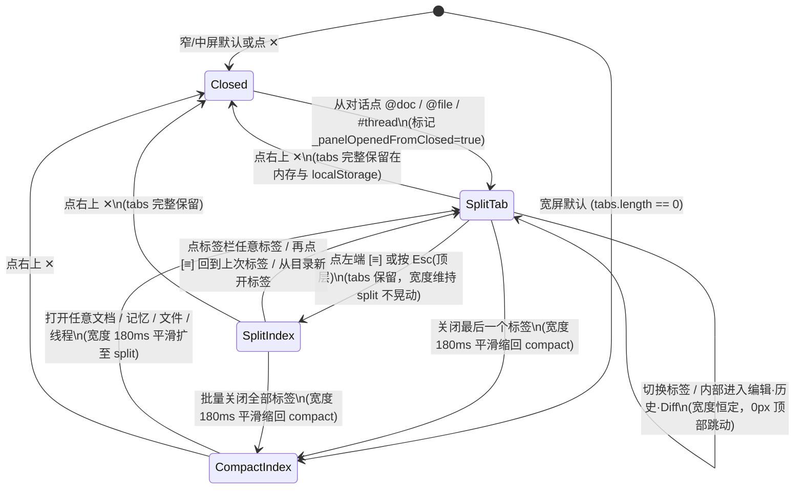

# 右侧边栏多标签页架构设计方案

> **背景**：在 `#320`（commit `1966cb0`）落地 Claude Desktop 风格的圆角分栏卡片、双模态自适应宽度（`compact` / `split`）与双保留 `Entity` 渲染隔离之后，右侧边栏的阅读舒适度与拖拽帧率已达到预期，但当前仍为**单文档/单详情槽位**（`activeDoc` 与 `detail` 互斥，打开第二个文档或查看线程会直接覆盖当前页面）。用户提出需要支持**多标签页设计**，以便在与 PM 对话的同时并行对照多份文档、代码文件与线程详情。撰写于 2026-11-25。
> **状态：设计定稿，待评审后分阶段实现。** 范围涵盖 `mods/pm-project/model.js`、`mods/pm-project/main.js`、`mods/pm-project/change_view.js`、`mods/pm-project/model.test.mjs` 与 `tests/render_check.py`。

---

## 0. 核心设计结论摘要

本方案严格继承并守住 `#320` 的四项基线资产（圆角分栏卡片、`compact ↔ split` 双模态宽度记忆与 `sideScrollBody` 锁帧、`ConversationPaneView` + `SideSplitPaneView` 双保留 `Entity` 隔离、GPUI 真实能力边界），在此之上引入克制的统一工作台多标签页：

| 设计维度 | 裁决结论 | 核心理由 |
| --- | --- | --- |
| **1. 标签页范围** | **选定方案 B：统一工作台标签页**（文档、记忆、仓库文件、新建草稿、线程详情含 Diff 均作为标签页；`Threads / Library / Memory` 目录作为左端固定索引入口） | `dudu` 的真实工作流天然跨实体（边读两篇设计稿、边看 `#320` 线程与 Diff、边翻 `@file` 代码）；统一模型彻底消除 `activeDoc` 与 `detail` 互斥覆盖，让 `activeTabId` 成为单一事实来源 |
| **2. 顶栏与视觉预算** | **0 标签页零开销（沿用 `#320` 单行 `44px` `sideHeader`）；`>= 1` 标签页采用 `36px` 标签条 + `36px` 上下文副栏 = `72px` 双行极简头部** | 避免三层 IDE 堆叠（`< 90px` 预算，比 `#320` 改造前的 `91px` 更省），且在 1→2→N 标签切换时正文 **0px 纵向跳动** |
| **3. 目录往返与宽度** | **`tabs.length === 0` 维持 `compact`；`tabs.length > 0`（含临时切回目录找第二篇文档时）保持 `split` 宽度，且顶部标签条常驻** | 防止“点目录开第二篇文档”时卡片先缩窄到 `348px` 再扩回 `640px` 的来回晃动，保持标签条视野稳定 |
| **4. 面板关闭与 `Esc`** | **点 `✕` 收起分栏但不销毁已开标签页；按 `Esc` 严格遵循 `escapeStep` 逐层退回，绝不误清全部标签页** | `✕` 对应“暂时收起工作台”，重开即恢复现场；`Esc` 退到单标签顶层后再按一次仅退回目录索引（或收起单临时标签分栏），后台标签零损失 |
| **5. GPUI 状态隔离** | **每标签独立持有 `ScrollHandle`（原生保滚动位置）+ 单实例 `InputState`/`TextareaState` 切页快照同步** | 贴合 `gpui-kit.d.ts` 真实约束（`ScrollHandle` 无 JS `offset/set_offset` 接口；`InputState`/`ScrollHandle` 严禁在 `render()` 内创建） |
| **6. 持久化** | **按项目（`pmName`）存入 `localStorage.sideTabs`，单项目上限 `12` 个标签页，超限自动 LRU 淘汰最久未用干净标签** | 切项目/重开应用自动恢复阅读现场；已删文件或已移除线程优雅降级，不报错不崩溃 |

---

## 1. 范围裁决：什么成为标签页？

### 1.1 候选方案对比

| 维度 | 方案 A：仅文档多标签（Docs-only） | 方案 B：统一工作台标签页（Unified Workspace Tabs） |
| --- | --- | --- |
| **进入标签条的对象** | 仅 Library / Memory / `repo_docs` / `@file` 仓库文件；线程详情（`detail` + `change`）仍独占整个右侧栏 | **全部二级工作台对象**：Library 文档（`docs` / `repo_docs` / `research` / `instructions`）、Memory 记忆（`memory` / `personal`）、`@file` 仓库文件（`repo`）、新建草稿（`draft`）、**线程详情（`thread`，内含 `Log / Conversation / Changes Diff`）** |
| **目录视图定位** | `Threads / Library / Memory` 与文档标签混排或分治 | `Threads / Library / Memory` 统一退为左侧固定 **目录索引入口（Index）**，本身不是可关闭标签 |
| **典型跨对象动线** | 在设计文档里点“来源线程 `#320`”或对话里点 `#324` 时，整条文档标签栏被迫隐藏或被替换，心智割裂 | 文档、代码、记忆、线程详情平权并列在一条标签栏里，任意点击 `1` 下往返切换 |
| **状态机复杂度** | 仍需维护 `detail` 覆盖 `tabs` 的优先级分支，以及 `openThread` / `openDoc` 相互清空的补丁逻辑 | 单一状态机：`activeTabId === null` 显示目录索引，`activeTabId === id` 显示对应标签内容；彻底根除互斥补丁 |
| **与 `render_check.py` 兼容** | 线程路径不变，文档路径新增 | `this.detail` / `this.thread` / `this.activeDoc` 保留为当前激活标签的同步投影字段，现有 `render_check.py` 零改动通过 |

### 1.2 明确裁决：**采用方案 B（统一工作台标签页）**

在 `dudu` 的真实使用场景中，用户与 PM 对话时的右侧工作台几乎从未只看“纯文档”——高频任务是：
1. 对照两篇设计稿（如 `sidebar-claude-desktop-split.md` 与 `sidebar-multi-tabs.md`），同时点开代码文件 `mods/pm-project/main.js` 核对实现；
2. 审查 worker 线程 `#320` 的执行日志与 `Changes` Diff，同时参考 `esc-goes-back-one-level.md` 记忆条目与原设计方案；
3. 从 `Library` 调研报告点击“来源线程”跳转检查进度，看完后一键切回报告继续阅读。

若将线程详情排除在标签体系之外（方案 A），用户每查一次线程都会打断文档标签上下文，反而违背多标签的初衷。**方案 B** 让所有“值得在 `split` 宽栏里细读或操作的对象”拥有统一、可预测的标签生命周期，而 `Threads / Library / Memory` 回归纯粹的“找东西的目录”。

---

## 2. 顶栏与视觉预算（Anti-Clutter）

### 2.1 视觉预算原则与像素规格

核心目标：**绝不把卡片顶部做成 `90px+` 的重型 IDE 工具栏**，同时保持 `#320` 的“内嵌圆角卡片（`rounded(12)`、`bg(t.background)`、`border_1(t.border)`、`mr(10).mb(10)`）”清爽纸面质感。

- **状态 1：0 标签页打开（纯目录态，`compact`）**
  - **总头部高度：`44px`**（与 `#320` 完全一致，**0 像素额外开销**）。
  - 不渲染标签条；直接渲染现有 `sideHeader`（`Threads | Library | Memory` 滑块页签 + 右端 `28×28` `✕`）。
- **状态 2：`>= 1` 标签页打开（工作台态，`split`）**
  - **总头部高度：`72px` = Row 1 标签条 `36px` + Row 2 上下文副栏 `36px`**。
  - **为什么在 1 个标签页时就显示 `36px` 标签条**：
    1. 从 1 个标签页开到 2、3、4 个标签页，正文起始 Y 坐标恒定在 `72px`，**0px 纵向跳动**；
    2. 左端固定 `Index (≡)` 入口与右端 `×` 立即向用户传达“这是可并行开多页的工作台，点 `≡` 可继续开第二篇而不丢当前页”。

### 2.2 精确元素尺寸与主题色 Token

全部复用 `herdr.d.ts` / `main.js` 真实语义色 Token，不引入硬编码色值：

| 区域 / 元素 | 尺寸与间距 | 亮色主题（`paper`） | 深色主题（`graphite` / `ink` / `moss`） |
| --- | --- | --- | --- |
| **Row 1：标签条容器** (`side-tab-bar`) | `h(36)`, `px(8)`, `gap(4)`, `items_center()`, `border_b(1)` | `bg(t.surface)`，`border_color(withAlpha(t.border, 0.7))` | `bg(withAlpha(t.surface, 0.55))`，`border_color(withAlpha(t.border, 0.7))` |
| **左端目录索引按钮** (`side-tab-index`) | `size(28)`, `rounded(7)`, `list.svg` `14px`；右侧加 `1px × 16px` 淡竖线分隔 | 激活（正看目录）：`bg(t.background)` + `border_1(t.border)` + `text_color(t.foreground)`；非激活：`text_color(t.muted)`，`hover: bg(t.hover)` | 同左（深色下非激活态静音，激活态用 `bg(t.background)` 轻量抬起，遵循 `dark-hub-quiet-fill`） |
| **横向标签滚动槽** (`side-tab-strip`) | `flex_1 min_w(0) h(36) overflow_x_scroll()`, `gap(2)`, `items_center()` | 透明底；不画常驻粗滚动条（靠鼠标滚轮/触控板横滑 + `scroll_to_item` 自动居中 + 右侧溢出菜单） | 同左 |
| **单个标签项** (`side-tab-<id>`) | `h(28)`, `px(8)`, `gap(5)`, `rounded(7)`, `min_w(88)`, `max_w(168)`（窄屏 `72..128`） | **激活**：`bg(t.background)` + `border_1(withAlpha(t.border, 0.85))` + `shadow_xs()` + `text_color(t.foreground) font_medium()`<br/>**非激活**：透明底 + `text_color(t.muted)`，`hover: bg(t.hover).text_color(t.foreground)` | **激活**：`bg(t.background)` + `border_1(withAlpha(t.border, 0.9))` + `text_color(t.foreground) font_medium()`<br/>**非激活**：透明底 + `text_color(t.muted)`，`hover: bg(t.hover).text_color(t.foreground)` |
| **标签图标 / 标题 / 尾槽** | 图标 `12.5px`；标题 `12px truncate`；尾槽固定 `size(16)`（零抖动） | 干净非悬停且非激活：空槽；脏态非悬停：`6px` `rounded_full bg(t.accent)` 圆点；悬停或激活：`16×16` `close.svg` `10px`（`hover: bg(t.hover)`） | 同左 |
| **标签间细分割线** | `w(1) h(14)`，仅在两个相邻非激活、非悬停标签之间渲染 | `bg(withAlpha(t.border, 0.55))` | `bg(withAlpha(t.border, 0.45))` |
| **溢出/全部标签按钮** (`side-tab-overflow`) | `h(26)`, `px(6)`, `rounded(6)`，`tabs.length >= 2` 时显示（显示数量+`chevron`，如 `4 ▾`） | `text_size(11.5) text_color(t.muted)`，`hover: bg(t.hover).text_color(t.foreground)`；有溢出隐藏标签时微亮 `bg(t.raised)` | 同左 |
| **右端关闭分栏键** (`split-close`) | `size(28)`, `rounded(7)`, `close.svg` `14px`，恒定停靠在 Row 1 最右端 | 沿用现有 `splitIconBtn` 规格 | 同左 |
| **Row 2：上下文副栏** (`side-context-bar`) | `h(36)`, `px(12)`, `gap(6)`, `items_center()`, `bg(t.background)`, `border_b(1).border_color(withAlpha(t.border, 0.5))` | 左：只读锁/路径面包屑（`11.5px t.dim truncate`）或子视图 `←` 返回键；右：本页专属 `26×26` 图标按钮组（`gap(2)`） | 同左 |

> [!NOTE]
> **遵循 `actions-as-icons` 规范**：Row 1 与 Row 2 的所有工具操作（目录入口、编辑、历史、复制路径、查找、小窗、Diff、刷新、收起分栏）均使用现有 `mods/pm-project/*.svg` 图标 + `withTip` 悬停提示，不堆砌文字按钮。

### 2.3 真实内容 ASCII 线框图

#### 场景 A：0 标签页打开（纯 `compact` 目录态，约 `348px`，0 额外开销）

```
╭─ side-split-card (w: 348px, bg: t.background, rounded 12) ──╮
│ [Threads]  Library   Memory                              ✕ │ ← 44px sideHeader（与 #320 完全一致）
├─────────────────────────────────────────────────────────────┤
│ [ 🔍 搜索线程…                                            ] │
│                                                             │
│ 进行中 2                                                    │
│  ● #324 右侧边栏多标签页架构设计方案             在做 · 12m │
│  ● #320 右侧边栏丝滑分栏改造                     审查 · 4m  │
│ 已结束 18                                                   │
│  ✓ #317 Library 接入仓库 docs 目录                    昨天  │
╰─────────────────────────────────────────────────────────────╯
```

#### 场景 B：1 标签页打开（`split` 态，约 `620px`）

```
╭─ side-split-card (w: 620px, bg: t.background, rounded 12) ───────────────────────────╮
│ [≡] │ [📄 sidebar-claude-desktop-s… ×]                                             ✕ │ ← 36px Row 1: 标签条
├──────────────────────────────────────────────────────────────────────────────────────┤
│ 🔒 docs / design / sidebar-claude-desktop-split.md                    📋  🔍         │ ← 36px Row 2: 路径 + 上下文图标
├──────────────────────────────────────────────────────────────────────────────────────┤
│   [只读] [仓库文档]  今天  18.4 KB                                                    │
│                                                                                      │
│   # 右侧边栏升级：Claude Desktop 风格的丝滑分栏设计方案                                │
│   …（max_w: 680 居中正文区）…                                                         │
╰──────────────────────────────────────────────────────────────────────────────────────╯
```

#### 场景 C：3–4 标签页混合打开（文档 + 编辑中脏草稿 + 线程详情 + 代码文件，`split` `660px`）

```
╭─ side-split-card (w: 660px, bg: t.background, rounded 12) ─────────────────────────────────╮
│ [≡] │ 📄 sidebar-multi-tabs… ● │ [🪝 #320 丝滑分栏 ×] │ 📄 main.js │ ● esc-goes-…  4 ▾  ✕ │ ← 36px Row 1
├────────────────────────────────────────────────────────────────────────────────────────────┤
│ ◉ #320  [ 日志 | 对话 ]                    dev/sidebar-split · 3 commits     🪟  ⑂         │ ← 36px Row 2（线程上下文）
├────────────────────────────────────────────────────────────────────────────────────────────┤
│   步骤 4/4  ✓ Step 1  ✓ Step 2  ✓ Step 3  ✓ Step 4                                         │
│   …（线程日志 / 会话区；点击 ⑂ 进入 Diff 时 Row 2 原地变为 [←] dev/sidebar-split  ↻）…       │
╰────────────────────────────────────────────────────────────────────────────────────────────╯
```
*说明：`sidebar-multi-tabs.md` 处于未保存编辑状态，非悬停时右侧显示 `t.accent` 小圆点 `●`；当前激活的是线程 `#320`；右侧 `4 ▾` 可一键展开全部标签列表与批量关闭菜单。*

#### 场景 D：临时切回目录索引（已有 3 个标签页在后台保持打开）

```
╭─ side-split-card (w: 660px, 保持 split 宽不晃动) ───────────────────────────────────────────╮
│ [[≡]] │ 📄 sidebar-multi-tabs… ● │ 🪝 #320 丝滑分栏 │ 📄 main.js                  3 ▾  ✕ │ ← [≡] 呈激活态，标签条常驻
├────────────────────────────────────────────────────────────────────────────────────────────┤
│  Threads   [Library]   Memory                                                              │ ← 36px Row 2: 目录子切换
├────────────────────────────────────────────────────────────────────────────────────────────┤
│  [ 🔍 搜索 Library…                                                ]   [+]  [↑]  [↺]      │
│  项目文档 4                                                                                │
│   📄 sidebar-multi-tabs.md                                              已打开 · 刚刚      │
│  仓库文档 12                                                                               │
│   📄 docs/design/sidebar-claude-desktop-split.md                        只读 · 昨天        │
╰────────────────────────────────────────────────────────────────────────────────────────────╯
```
*说明：在目录列表中，已在标签栏打开的文档/线程行可附带极轻的 `t.accent` 左侧 `2px` 指示或柔和状态点，点它直接激活已有标签而非重复打开。*

#### 场景 E：溢出（8+ 标签页）与中/窄屏退化

```
[宽屏 8+ 标签页 (cardW: 660px)]
│ [≡] │ ‹ 📄 doc-3.md │ [📄 sidebar-multi-… ×] │ 🪝 #320 丝滑… │ 📄 main.js ›  9 ▾  ✕ │
        └─ overflow_x_scroll，滚轮/触控板横滑；点击 `9 ▾` 弹出全部标签列表 Popup ─┘

[中屏 (V = 731px, cardW = 351px) / 窄屏抽屉 (V < 700px, cardW = 360px)]
│ [≡] │ [📄 sidebar-multi… ×] │ 🪝 #320 丝…   4 ▾  ✕ │ ← 标签 min_w 收至 72px、max_w 128px
├─────────────────────────────────────────────────────┤
│ 🔒 sidebar-claude-desktop-sp…        📋 🔍 ✎ ↺ 🗑 │ ← Row 2 仅保留文件名与核心图标，隐藏次要路径前缀
```

---

## 3. 交互流与状态机

### 3.1 打开、去重与插入位置

1. **规范化键（Canonical `tabKey`）**：
   - 文档 / 记忆 / 仓库文件：`doc:${root}/${path}`（例如 `doc:docs/plan.md`、`doc:repo_docs/docs/design/sidebar-multi-tabs.md`、`doc:memory/esc-goes-back-one-level.md`、`doc:personal/reply-in-chinese.md`、`doc:repo/mods/pm-project/main.js`）。
   - 线程详情：`thread:${resolvedTaskId}`（先经现有 `resolveThreadRef` + `foldReviews` / `threadFor` 归并，确保 `#324`、完整 ID、以及折叠在主任务下的审查子任务全部命中同一标签）。
   - 新建未保存草稿：`draft:${sideTab}:${seq}`（保存落盘后原地升级 `key -> doc:${root}/${relPath}`；若目标路径已在另一标签打开，合并更新该标签并移除临时草稿标签）。
2. **去重规则**：
   - 无论从 `Library` / `Memory` / `Threads` 目录点击、从 PM 对话里的可点击 `.md` / `@file` / `#thread` 链接点击、从项目搜索（`⌘K`）跳转、还是从文档内部的相对链接 / “来源线程”按钮点开：
   - 先按 `tabKey` 在 `tabs` 中查找：
     - **已存在**：直接激活该标签（`activeTabId = existing.id`），调用 `this.tabStripScroll.scroll_to_item(index)` 滚入视野；若附带 `jumpQuery`（如搜索跳转），更新该标签的 `find.jumpQuery` 并定位匹配块。
     - **不存在**：创建新标签并激活，滚入视野；若为文档则复用 `docCache`（未命中时触发 `readDoc`），若为线程则触发 `readThread`（并在处于 `session` 子页时触发 `readThreadSession`）。
   - **幂等点击语义**：在 `Threads` 列表或对话里点击已打开的线程，一律**激活该线程标签**（不再像 `#320` 那样二次点击同线程反而关闭详情），符合用户对标签页的直觉预期。
3. **插入位置与上限淘汰（`MAX_TABS = 12`）**：
   - 从目录列表、PM 对话、项目搜索打开的新标签：**追加到标签栏末尾**。
   - 从当前激活标签**内部**点击链接打开的关联标签（如文档内相对 `.md` 链接、`superseded_by` 定稿链接、文档“来源线程”、线程子任务跳转）：**插入到当前激活标签紧右侧（`activeIndex + 1`）**，方便左右对照。
   - 当 `tabs.length >= 12` 且需新开标签时：自动淘汰 **`lastActiveAt` 最早且非激活、非脏（`!dirty`）** 的标签；若全部 12 个标签均含未保存草稿，则在 Row 2 下方提示轻量横幅（“已达 12 个未保存标签上限，请先保存或关闭一个标签”），拒绝静默丢弃草稿。

### 3.2 目录往返与 `compact ↔ split` 宽度状态机



- **`resolvePanelMode` 升级规则**：
  - `resolvePanelMode({ tabCount, detail, activeDoc, editingDoc, historyView, changeOpen })`：只要 `tabCount > 0`（或任意旧单槽标志为真），即返回 `'split'`；仅当 `tabCount === 0` 且无编辑/历史/详情时返回 `'compact'`。
- **收起再展开的现场恢复**：
  - 点击右上角 `✕`（`closeSidePanel`）**不再调用 `_clearClosedSideState()` 销毁已开标签**，仅将 `listShown = false` 并以 `180ms` 滑出至 `0px`。
  - 用户再次点击顶栏 `◫` 重新展开右侧分栏时，若 `tabs.length > 0`，直接恢复收起前的激活标签与全部标签页（若用户在关闭态下有未保存编辑草稿，不会因点了一次 `✕` 而丢失）。

### 3.3 单标签状态保持与脏标签保护

每个标签页切换出去再切回来时，必须完整保留以下独立状态：

| 标签类型 | 切页保留的状态 | 存储位置 |
| --- | --- | --- |
| **文档 / 记忆 / 文件（`doc` / `draft`）** | 精确垂直滚动位置、`mode`（`'read' \| 'edit' \| 'history'`）、`shownBytes`（大文件展开进度）、文档内查找（`find.open / query / matchPos`）、未保存编辑草稿（`editDraft` 含名称/描述/类型/主题/正文/冲突状态、`dirty` 标记）、`history` 列表缓存 | `tab.scrollHandle`（GPUI 原生保留） + `tab` 运行时对象 |
| **线程详情（`thread`）** | `threadTab`（`'log' \| 'session'`）、Log 与 Conversation 各自精确滚动位置、`change` 分支改动三级状态（`commits -> files -> diff` 含展开/折叠 `foldedHunks`）、`logExpanded`、会话工具卡片展开集 `sessionToolsOpen` / `sessionBriefsOpen`、线程输入框草稿 | `tab.logScroll` / `tab.sessionScroll` / `tab.changeScroll` + `tab` 运行时对象 + 现有 `localStorage.drafts` |

**脏标签关闭保护（Dirty Tab Guard）**：
1. 当文档/记忆标签处于 `edit` 模式（或新建 `draft` 标签）且 `editDraft.dirty === true` 时：
   - 标签尾槽在非悬停态展示 `6px` `t.accent` 圆点 `●`，悬停时切换为 `×`。
2. 用户点击该标签的 `×`、中键点击、或触发“关闭其他/关闭全部”命中脏标签时：
   - **绝不静默丢弃草稿**；自动激活该脏标签并在 Row 2 正下方展示单行内联确认条（复用现有 `doc-delete-bar` / `doc-conflict-bar` 视觉语言，`bg(withAlpha(t.blocked, 0.12))` + `border_1(withAlpha(t.blocked, 0.35))`）：
     - 文案：`未保存的修改将在关闭后丢失` / `Unsaved changes will be lost on close.`
     - 按钮（图标 + 提示，或紧凑操作胶囊）：`保存并关闭`（`check`）、`放弃修改并关闭`（`trash` / `close` 红调）、`取消 (Esc)`。
3. 干净标签（`dirty === false`）点击 `×` 或中键**立即关闭**，零弹窗打扰。

### 3.4 关闭策略、鼠标操作、`Esc` 与快捷键

1. **关闭后的焦点落点**：
   - 关闭**非激活**标签：当前激活标签不变。
   - 关闭**激活**标签：按 **MRU（最近活跃时间 `lastActiveAt` 降序）** 激活上一个用过的标签（无 MRU 记录时取右侧相邻标签，再无则取左侧相邻标签）。
   - 关闭**最后一个**标签：`activeTabId = null`；若当初是在面板关闭态下由单个对话链接临时唤起（`_panelOpenedFromClosed === true`），顺势收起右侧分栏，否则平滑缩回 `compact` 目录视图。
2. **鼠标交互（100% 匹配 `gpui-kit.d.ts` 真实事件）**：
   - 左键点击标签：激活。
   - 点击标签 `×` 按钮（`cx.stop_propagation()`）：关闭该标签。
   - **中键点击标签**：`on_mouse_down('middle', ...)`（`gpui-kit.d.ts` L277 `MouseButton = "left" | "right" | "middle"` 已原生支持）直接关闭该标签。
   - **右键点击标签**：`on_mouse_down('right', ...)` 锚定 `Popup.new('tab-ctx-menu', ...)` 弹出菜单：`关闭当前`、`关闭其他标签`、`关闭右侧标签`、`关闭全部标签`（文档类附带 `复制路径`）。
   - 点击右侧 `N ▾` 溢出按钮：弹出 `Popup.new('side-tab-overflow-menu', ...)`，纵向列出全部已开标签（带图标、完整标题、脏点 `●`、每行尾随 `×`）+ 底部分隔线后的 `关闭其他` / `关闭全部`。
3. **`Esc` 与 `escapeStep` 严格集成（绝不误关全部标签）**：
   - 严格遵守项目决定 `esc-goes-back-one-level`，且保证 **`Esc` 永远只退当前激活标签内部的一层，绝不清空后台标签页**：
   - `escapeStep` 新增 `confirmCloseDirty`（优先级紧邻 `confirmDelete` 之后）与 `activeTab`（替代原互斥的 `detail` / `doc` 顶层退回）：
     1. 弹层与输入：`mentionSub` → `mention` → `projectSearch` → `tabMenu`（右键/溢出 `Popup`）→ `selectionBar` → `answering` → `confirmDelete` → `confirmCloseDirty` → `typing`（失焦脏输入框）
     2. 当前标签内部子态：`edit`（退出编辑回到本标签阅读态；若是未改动的空 `draft` 标签则关闭该草稿标签）→ `retopic` → `search`（本标签文档内查找或目录搜索）→ `agentWindow` → `history`（退回本标签文档）→ `bringBack` → `change`（当前线程标签内 `diff → files → commits → 线程详情`）
     3. 当前标签顶层（`activeTab`）：
        - 若 `_panelOpenedFromClosed && tabs.length === 1`：收起分栏（保留“怎么来就怎么回”）。
        - 否则：**仅切回目录索引（`activeTabId = null`），所有已开标签保持打开不被关闭**。
     4. 目录态（`listOpen`）：在 `!this.wide` 下再按一次 `Esc` 收起分栏。
4. **键盘快捷键（避开 Herdr 与 OS 全局热键）**：
   - 经核查 `main.js`（L4468 `cmd-k` 为项目搜索，L8257 `cmd-s` 为保存编辑），明确**禁用** `cmd-w`（关闭窗口/Herdr 标签）、`cmd-t`（新建终端标签）、`cmd-1..9`（Herdr Space 切换），避免与宿主冲突。
   - 仅在 `this.isPanelOpen() && this.tabs.length > 0` 且焦点在 `pm-project` 根视图内生效（`handleKeyDown`）：
     - `cmd-s` / `ctrl-s`：保存当前激活标签的编辑草稿（已有，保持）。
     - `cmd-shift-]` / `cmd-shift-[`（或 `ctrl-tab` / `ctrl-shift-tab`，Phase 2 实测确认不与 Herdr 全局冲突后启用）：在侧栏标签间循环切换。
     - `cmd-shift-w`（Phase 2）：关闭当前激活的侧栏标签（触发脏保护）。
     - `cmd-f` / `ctrl-f`（Phase 2，仅当激活标签为文档阅读态且非主对话输入焦点）：打开/聚焦当前文档内查找框 `docFindInput`。

### 3.5 按项目持久化（`localStorage`）与优雅降级

- **存储键**：`SIDE_TABS_KEY = 'sideTabs'`（与 `drafts`、`QUEUE_KEY` 同属 `pm-project` 的 `localStorage` 命名空间）。
- **JSON 结构**：
  ```json
  {
    "v": 1,
    "projects": {
      "dudu": {
        "activeKey": "doc:docs/design/sidebar-multi-tabs.md",
        "updatedAt": 1795500000000,
        "tabs": [
          { "key": "doc:repo_docs/docs/design/sidebar-claude-desktop-split.md", "kind": "doc", "tab": "library", "root": "repo_docs", "path": "docs/design/sidebar-claude-desktop-split.md", "title": "sidebar-claude-desktop-split.md" },
          { "key": "thread:dudu-sidebar-split", "kind": "thread", "taskId": "dudu-sidebar-split", "title": "右侧边栏丝滑分栏改造", "threadTab": "log" }
        ]
      }
    }
  }
  ```
- **容量与清理策略**：
  - 单项目最多持久化 `MAX_TABS = 12` 个标签；最多保留最近活跃的 `20` 个项目记录（超出按 `updatedAt` 淘汰最旧项目），防止 `localStorage` 膨胀。
  - 新建未保存的 `draft` 标签不写入 `sideTabs`。
- **水合与失效文件/线程处理**：
  - 切换项目（`wanted !== this.pmName`）时，先将旧项目标签序列化写盘并释放旧项目全部 `ScrollHandle`；再从 `sideTabs` 水合新项目标签（在 `cx.timer.after(0, ...)` 内创建 `ScrollHandle` 并触发激活标签数据读取）。
  - 若持久化的文档在磁盘上已被删除：激活时正常走现有 `docNotFound` / `memNotFound` / `repoFileNotFound` 错误态，并在错误提示旁附带一键“关闭标签”按钮；后台标签在 `readLibrary` / `readMemory` 返回新列表确认不存在时标记 `missing: true`（图标淡显，下次水合自动剪枝）。

---

## 4. 数据模型、GPUI 架构与分阶段落地计划

### 4.1 `model.js` 纯函数 API 与状态 Schema

所有标签集合变更、去重、插入、LRU 淘汰、关闭后焦点回落与持久化编解码全部下沉到 `mods/pm-project/model.js` 的纯函数中，确保 `node --test mods/pm-project/model.test.mjs` 可 100% 脱离 GPUI 覆盖边界条件：

```js
// 常量
export const SIDE_TABS_KEY = 'sideTabs';
export const SIDE_TABS_MAX = 12;
export const SIDE_TABS_MAX_PROJECTS = 20;

// 规范化 Key 生成
export function sideTabKey(spec)
// spec: { kind: 'doc', root, path } -> `doc:${root}/${path}`
// spec: { kind: 'thread', taskId }  -> `thread:${taskId}`
// spec: { kind: 'draft', id }       -> `draft:${id}`

// 纯状态容器（存于 PmProject 实例，单测可直接构造）
// tabState = {
//   tabs: SideTab[],            // 有序标签数组（渲染顺序）
//   activeId: string | null,    // 当前激活标签 id；null 表示正看目录索引
//   lastActiveId: string | null,// 切到目录索引前的最后一个激活标签 id
//   seq: number,                // 自增 id 计数器
// }
export function createSideTabsState()

// 核心纯 Reducer（均返回 { state, opened, activated, evicted, blocked }，不直接修改入参）
export function openSideTab(state, spec, {
  now = Date.now(),
  insertAdjacent = false,   // 从当前标签内部点链接时为 true，插在 activeIdx + 1
  maxTabs = SIDE_TABS_MAX,
} = {})

export function activateSideTab(state, tabId, { now = Date.now() } = {})
export function showSideIndex(state)            // activeId = null，保留 lastActiveId 与 tabs
export function toggleSideIndex(state, { now = Date.now() } = {}) // Index <-> lastActiveId 往返

export function closeSideTab(state, tabId, { force = false } = {})
// 若目标标签 dirty && !force：不关闭，返回 { state: activatedTarget, needsConfirm: tabId }
// 若可关闭：按 MRU (lastActiveAt) -> 右邻 -> 左邻 -> null 选择新 activeId

export function closeOtherSideTabs(state, keepTabId) // 仅关闭干净的其他标签，返回 skippedDirtyIds
export function closeRightSideTabs(state, fromTabId) // 同上
export function closeAllSideTabs(state)              // 同上

export function updateSideTab(state, tabId, patch)   // 局部更新 title / dirty / mode / threadTab / missing
export function upgradeDraftTab(state, draftTabId, { root, path, tab, title }) // 草稿保存后原地转正并去重

// 宽度模态兼容升级
export function resolvePanelMode({
  tabCount = 0,
  detail = false,
  activeDoc = false,
  editingDoc = false,
  historyView = false,
  changeOpen = false,
} = {})
// 返回 (tabCount > 0 || detail || activeDoc || editingDoc || historyView || changeOpen) ? 'split' : 'compact'

// 持久化编解码
export function readSideTabsStore(jsonText) // -> { v: 1, projects: { ... } }
export function hydrateProjectTabs(store, pmName, { maxTabs = SIDE_TABS_MAX } = {}) // -> tabState
export function serializeProjectTabs(store, pmName, tabState, { now, maxTabs, maxProjects } = {}) // -> jsonString
```

同时在 `STRINGS.en` / `STRINGS.zh` 补齐全部中英文词条（遵循 `ui-labels-i18n`）：
- `sideTabsIndex`: `'Browse Threads / Library / Memory'` / `'浏览线程 / Library / Memory'`
- `sideTabsAll`: `n => \`${n} open tabs\`` / `n => \`已打开 ${n} 个标签页\``
- `sideTabClose`: `'Close tab'` / `'关闭标签页'`
- `sideTabCloseOthers`: `'Close other tabs'` / `'关闭其他标签页'`
- `sideTabCloseRight`: `'Close tabs to the right'` / `'关闭右侧标签页'`
- `sideTabCloseAll`: `'Close all tabs'` / `'关闭全部标签页'`
- `sideTabDirtyHint`: `name => \`Unsaved changes in ${name}\`` / `name => \`${name} 有未保存的修改\``
- `sideTabSaveAndClose`: `'Save & close'` / `'保存并关闭'`
- `sideTabDiscardAndClose`: `'Discard & close'` / `'放弃修改并关闭'`
- `sideTabLimitDirty`: `'All 12 open tabs have unsaved edits; save or close one first.'` / `'已打开的 12 个标签页均含未保存修改，请先保存或关闭一个。'`

### 4.2 `main.js` GPUI 架构与生命周期约束

严格遵守 `gpui-kit.d.ts` 与项目已知坑（`gpui-child-entity-parent-notify`、`gpui-child-entity-test-cx-isolation`、`herdr-mod-reload-no-pending-promise-cach`）：

1. **双保留 `Entity` 零回归**：
   - 标签栏 `side-tab-bar`、上下文副栏 `side-context-bar` 与标签正文全部渲染在 `SideSplitPaneView`（`this._sideEntity`）内部。
   - 切换标签、悬停标签显示 `×`（更新 `this.hoveredTabId`）、开关溢出菜单 `Popup`、滚动标签正文，**只调用 `this.notifyPanes(cx, { shell: false, side: true })`**，左侧 `ConversationPaneView` 保持 **0 次重绘**。
   - 仅当 `tabCount` 在 `0 <-> 1` 之间跨越（触发 `compact <-> split` 宽度变化）或面板开合时，才同时 `shell: true` 驱动外层宽度 `180ms` 原生过渡。
2. **`sideScrollBody` 过渡锁帧保持生效**：
   - Row 1（`36px`）与 Row 2（`36px`）始终设为 `.w_full()`（保证四角 `rounded(12)` 描边与右上角 `✕` 在 `compact <-> split` 过渡每帧贴边不裁切）；
   - 正文滚动容器继续通过 `this.sideScrollBody(...)` 在 `180ms` 宽度过渡期间锁定目标宽度，防止长 Markdown / Diff 逐帧折行抖动。
3. **`ScrollHandle` 生命周期（每标签独立，绝不在 `render()` 创建）**：
   - 在 `PmProject` 上维护 `this.tabHandles = new Map()`（`tabId -> { doc?, history?, log?, session?, change? }`）。
   - 仅在事件回调（`openSideTab`）或水合回调（`cx.timer.after(0, ...)`）中调用 `ScrollHandle.new()`；关闭标签、切换项目或 `PmProject.close()` 时对对应句柄调用 `.release()` 并从 Map 删除。
   - 标签条本身持有一个 `this.tabStripScroll = ScrollHandle.new()`（在 `init()` 创建），配合 `h_flex().id('side-tab-strip').overflow_x_scroll().track_scroll(this.tabStripScroll)`，激活标签时调 `this.tabStripScroll.scroll_to_item(activeIdx)` 自动滚入视野。
4. **单实例 `InputState` / `TextareaState` 快照同步**：
   - 保留 `init()` 中已创建的 `docFindInput`、`docNameInput`、`memDescInput`、`docEditorInput`、`threadInput`。
   - 抽出 `snapshotActiveTabInputs()` 与 `restoreActiveTabInputs(tab)`，统一在 `activateTab` / `showIndex` / `closeTab`（均为事件回调）中调用：
     - 离开旧标签前：把 `docEditorInput.value()`、`docNameInput.value()`、`memDescInput.value()`、`docFindInput.value()` 写回旧标签对象并重算 `dirty`。
     - 进入新标签后：把新标签的草稿/查找值写入对应 `InputState`（对线程标签调用现有 `showThreadDraft(tab.taskId)`）。
   - `docEditorInput.on('change', ...)` 实时更新当前激活标签的 `dirty` 状态并 `notifyPanes(cx, { shell: false, side: true })` 刷新标签上的 `●` 指示点。
5. **与 `PmProject` 既有投影字段及 `render_check.py` 100% 兼容**：
   - `syncActiveTabProjection()` 在每次 `tabState` 变更后同步更新：
     - 激活 `thread` 标签：`this.detail = true; this.thread = tab.taskId; this.activeDoc = null; this.threadTab = tab.threadTab; this.change = tab.change;`
     - 激活 `doc` / `draft` 标签：`this.detail = false; this.activeDoc = tab.docRef; this.editingDoc = tab.mode === 'edit' ? tab.editDraft : null; this.historyView = tab.mode === 'history' ? tab.history : null;`
     - 处于目录索引（`activeId === null`）：`this.detail = false; this.activeDoc = null; this.editingDoc = null; this.historyView = null;`
   - 因此 `tests/render_check.py` 读取的 `view.detail`、`view.thread`、`view.threadTask`、`view.threadTab`、`view.threadSessionState`、`view.threadSession?.items` 与 `rc-thread:<id>` 命令完全无需修改即可通过；同时可在 `render_check.py` 中追加多标签页断言（如 `sideTabs: view.tabState?.tabs?.length ?? 0`）覆盖“开 2 篇文档 + 1 条线程并切换”的真实渲染验证。
   - 若在 `main.js` 中对 `this._convEntity` / `this._sideEntity` 编写新单测，遵循 `gpui-child-entity-test-cx-isolation`，模拟子视图内点击必须传 `childCx` 而非父壳 `rootCx`。

### 4.3 分阶段落地计划

为降低单次评审体量并尽早交付核心价值，拆为 **2 个独立可合并阶段**：

#### Phase 1：核心统一多标签页 + 状态保持 + 持久化（MVP 闭环）
- **改动文件**：`mods/pm-project/model.js`、`mods/pm-project/main.js`、`mods/pm-project/change_view.js`、`mods/pm-project/model.test.mjs`
- **交付内容**：
  1. `model.js` 实现全部纯函数（`createSideTabsState`、`sideTabKey`、`openSideTab`、`activateSideTab`、`showSideIndex`、`toggleSideIndex`、`closeSideTab`、`upgradeDraftTab`、`readSideTabsStore`、`hydrateProjectTabs`、`serializeProjectTabs`）、升级 `resolvePanelMode` 与 `escapeStep`、补齐中英文 `STRINGS`。
  2. `main.js` 接入 `SideSplitPaneView` 的 `36px` Row 1 标签条（左端 `[≡]` 目录开关、横向可滚动标签项、悬停/激活 `×`、中键关闭、右端固定 `✕`）与 `36px` Row 2 上下文副栏（0 标签页保持原 `44px` `sideHeader` 与 `compact` 宽度）。
  3. 改造 `openDoc`、`openRepoFile`、`openThread`、`startNewDoc`、`closeSidePanel` 接入统一标签状态机；实现每标签独立 `ScrollHandle` 生命周期与 `InputState`/`TextareaState` 切页快照同步。
  4. 接入脏标签关闭保护内联条（保存并关闭 / 放弃并关闭 / 取消）与按项目 `localStorage.sideTabs` 持久化及删档容错。
  5. `change_view.js` 适配 `36px` Row 2 副栏（去掉重复的 `split-close`，由 Row 1 统一提供）。
- **验收标准（Phase 1 DoD）**：
  - `node --test mods/pm-project/model.test.mjs` 新增纯函数全覆盖单测 + `cx.new` 双 Entity 隔离单测（切标签/悬停标签期间 `ConversationPaneView.render` 计数为 `0`），全绿；
  - `herdr-app check` 检查 `mods/pm-project` 零报错；
  - `python3 tests/render_check.py` 全量 `PASS`（`1000×680` 中屏下验证 0 标签目录、单线程标签、多标签混合均无截断溢出）。

#### Phase 2：溢出菜单、右键批量操作与键盘效率打磨
- **改动文件**：`mods/pm-project/main.js`、`mods/pm-project/model.js`、`mods/pm-project/model.test.mjs`
- **交付内容**：
  1. 右侧 `N ▾` 溢出/全部标签 `Popup` 菜单（完整标题列表、脏点标记、逐行 `×`、关闭其他 / 关闭全部）。
  2. 标签右键 `Popup` 上下文菜单（关闭、关闭其他、关闭右侧、关闭全部、复制路径）。
  3. 目录列表（`Threads / Library / Memory`）为已在标签栏打开的条目显示轻量已打开指示，悬停提示完整路径。
  4. 实测验证 Herdr 宿主键位后启用安全快捷键：`cmd-shift-[` / `cmd-shift-]` 切标签、`cmd-shift-w` 关当前标签、文档阅读态 `cmd-f` 聚焦查找。
- **验收标准（Phase 2 DoD）**：
  - 8+ 标签页场景下横向滚动与 `N ▾` 菜单流畅无错位；批量关闭遇到脏标签时正确暂停并提示用户确认；
  - `herdr-app shot` 实拍核验亮色（`paper`）与深色（`graphite`）主题下的宽屏（`1440px`）、中屏（`1000px`）与窄屏（`< 700px`）视觉表现，全部中英文提示无越界。
