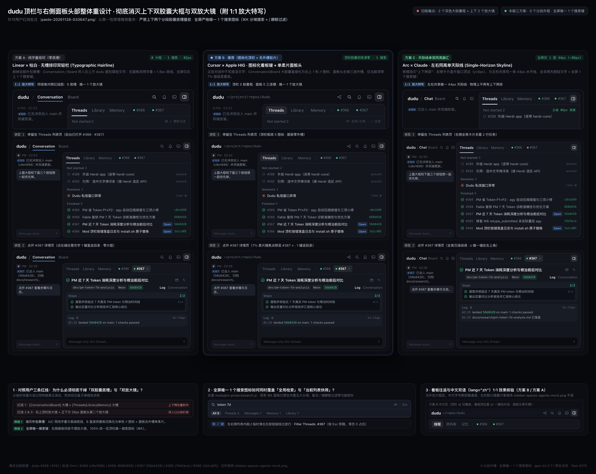

# 参考 X 顶级设计师思路整体重设计顶栏与右侧面板头部（消灭双胶囊大框与双放大镜）

> 关联任务：`#370 dudu-x`（第一性原理设计调研与真实台账 2× 高清视觉对比稿，未修改生产代码，待用户选型拍板）  
> 顶栏 + 右侧面板头部整体去框重设计 2× 对比稿（含 **1:1 头部放大特写**，`3920 × 3120`）：[`./header-chrome-redesign-mock.png`](./header-chrome-redesign-mock.png)

---

## 一、第一性原理复盘：为什么「仅把描边胶囊换成暗底槽」依然失败？

对照用户最新红线批注图（`paste-20261128-033647.png`）与最初截图（`paste-20261128-030209.png`），真正刺眼的根源在**整体组件体量与同构重复**，而非仅仅一条 `1px` 边框：

### 1. 红线 ①：上下两个同构「分段胶囊大框」正面硬撞
- 上方顶栏摆着一个 `~185px` 宽的深黑凹槽大胶囊 **`[ 💬 Conversation | ☍ Board ]`**，紧贴着下方 `10px` 处又是另一个 `~195px` 宽的深黑凹槽大胶囊 **`[ Threads | Library | Memory ]`**。
- **第一性原理诊断**：无论凹槽有没有描边，**在不到 `90px` 的垂直距离内连续出现两个“深底外框 + 亮灰内滑块”的同构重型容器**，视觉上依然是两坨沉重的控制块上下叠罗汉，且主次层级完全拉不开（全局视图切换与局部面板目录长成了同一种大积木）。

### 2. 红线 ② & ③：相距 30px 出现两个放大镜（`🔍` 与 `🔍 /`）
- 顶栏右侧刚有一个全局搜索图标 **`🔍`**，正下方 `30px` 的右侧面板头最右端又摆了一个 **`[🔍 /]`**。
- **第一性原理诊断（结合 `mods/pm-project/search.js` 源码实查）**：
  - 核查 `mods/pm-project/search.js:12`（`SEARCH_SCOPES = ['all', 'threads', 'messages', 'decisions', 'library']`）可知：**顶栏原有的 `🔍`（`⌘K`）本身就已经原生集成了 `All`、`Threads`、`Messages`、`Memory（Decisions）`、`Library` 五大分域检索、日志片段匹配与一键定位跳转！**
  - 在已有全能分域搜索 `🔍` 的正下方 30px 再画第二个放大镜按钮，不仅造成严重的视觉重复，更让用户每次搜索前陷入“我该点上面那个放大镜还是下面那个放大镜？”的认知摩擦。

### 3. 其它同步根除的冗余（保留前序共识）
- **砍掉重复收起键 `×`**：顶栏最右端已有 `◫` 控制右侧面板显隐，面板内部不再重复画 `×`；
- **砍掉假溢出 `2 ⌄`**：仅当 `on_size_change` 实测标签宽度真正超出可用槽宽时才出现 `+N ⌄`；
- **砍掉 `[≡]` 拆行与列表伪选中蓝底**：`Threads / Library / Memory` 与 `#366 / #367` 同处单行 `38px` 轨（详情态点任意目录 1 键直返），列表后台 `Open` 行去掉整行刷蓝底色。

---

## 二、X 与顶级桌面产品关于「彻底消灭大胶囊框与双搜索」的一手手法

| 来源（设计师 / 产品 + 公开出处） | 他们如何消灭“多层大胶囊与双搜索” | 对 `dudu` 顶栏 + 面板头的整体迁移 |
| :--- | :--- | :--- |
| **Linear UI Redesign** Karri Saarinen & Yann-Edern Gillet (`linear.app/now/how-we-redesigned-the-linear-ui`) | **无外槽排印标签（Frameless Typographic Tabs）**：Linear 顶栏的面包屑与视图切换（`All issues · Active · Backlog`）**没有任何三连外包底槽框**，仅靠高对比白字（`#f4f6fb`）与静默灰字（`#6c7486`）或极细单点/底线区分。 | 彻底废除 `seg-well` 大黑槽！将导航降维成无外框纯排印文字或单激活极轻柔片。 |
| **枯白 Kubai (`@Kubai087`)** `notes/design-system-pass.md` + `Lumno` + 项目记忆 `actions-as-icons` | **删掉重复当前画面的文字 & 图标化低频切换**：*“Remove text that repeats what the screen already shows”*——当屏幕左半边本身就是正在进行的对话时，再挂一个大号 `💬 Conversation` 文字块纯属废话；视图切换用克制图标（`☍`）表达即可。 | 衍生出**方案 B**：顶栏彻底取消 `Conversation \| Board` 文字条，收为顶栏右侧图标列中的一枚 `☍`（看板图标），顶栏瞬间清零所有胶囊！ |
| **Raycast & Paco Coursey (`cmdk`)** (`paco.me/craft` + `mods/pm-project/search.js`) | **Single Universal Search (`⌘K`) + Keyboard Filter (`/`)**：全窗口只留 **唯一一个搜索入口**（支持分域 Tab 切换）；重度键盘用户在列表内直接敲 `/` 才滑出临时过滤行（`Esc` 消失），绝不常驻第二个搜索图标。 | **全窗口严格只留顶栏 1 个 `🔍`**：点击 `🔍`（或 `⌘K`）打开分域搜索（右栏开着某页时可智能优先高亮该域）；在面板内敲 `/` 静默浮出过滤条，面板头零放大镜！ |
| **Arc / Dia & Zed GPUI** (`zed.dev/blog/new-panel-system`, Josh Miller) | **天际线单层同高（Single Skyline Horizon）**：左工作区顶栏与右侧分栏顶栏处在同一水平天际线上（`y=0..44px`），物理上不可能形成“上下两排按钮”。 | 衍生出**方案 C**：左右两栏共享唯一 `44px` 顶边，右侧卡片直升顶沿，全屏只有一层轻量文字导航。 |

---

## 三、整体重设计三套方案（A / B / C）：0 大框 · 1 放大镜

视觉对比稿 [`./header-chrome-redesign-mock.png`](./header-chrome-redesign-mock.png) 顶部专门提供了与用户红线截图同视角的 **1:1 放大头部特写**，下方配齐 **「状态 1：`Threads` 列表页」** 与 **「状态 2：`#367` 详情页」** 全真台账渲染：

| 对比维度 | 方案 A · Linear × 枯白「无槽纯排印双轻栏」 *(Frameless Typographic Hairline)* | ⭐ 方案 B · Cursor × HIG「图标化顶栏 + 单柔片面板头」（推荐） *(Iconic Topbar & Troughless Chip)* | 方案 C · Arc × Claude「天际线单层同高融汇」 *(Single-Horizon Split Skyline)* |
| :--- | :--- | :--- | :--- |
| **核心整体思路** | **全部剥掉外包黑槽**：上下两层均改用零底框的纯字重排印，且把 `Conversation / Board` 左移并入 `dudu /` 面包屑，彻底错开右栏轴线 | **彻底消灭顶栏模式框**：正在对话中无需再贴 `Conversation` 大字，将切换看板收为顶栏右侧一枚 **`☍` 图标**；右面板头去掉外槽，仅当前项带 `7%` 极轻柔雾底 | **物理合并为同一水平线**：右侧面板卡片直升窗口顶边（`y=6px`），左列与右卡并排共享唯一一条 `44px` 无槽排印顶栏 |
| **红线 ① 解法：`Conversation / Board` 处理** | 紧随左上方项目名构成无框面包屑： `dudu  /  Conversation   Board` （`Conversation` 纯白字 + `1.5px` 短底线，`Board` 静默灰字，**零胶囊框**） | **文字胶囊彻底消失！** 遵循 `actions-as-icons`，收为右上角图标组首位的 **`☍`（Switch to Board）** `28×28` 图标按钮（在看板页同坐标变为 `💬` 一键回对话） | 左列顶边纯文字轻排： `dudu  /  Chat   Board` （无外框、无底槽，且严格只居左列上方） |
| **红线 ① 解法：`Threads / Library / Memory` 处理** | **零外包底槽**：`Threads` 纯白 `600` 字重 + 贴合分割线的 `1.8px` 极细亮线，`Library`、`Memory` 静默灰字悬浮，右侧接 `• #366  • #367` | **零三连外槽**：去掉包裹三项的黑底凹槽，仅激活项 `Threads` 带一层极轻 `rgba(255,255,255,0.07)` 圆角柔片，未激活项纯文字透明悬浮 | **零外包底槽 + 直抵窗口顶沿**：右卡片顶部单行 `40px` 纯文字排印 `Threads  Library  Memory  \|  • #366  • #367`，右端直接锚定唯一 `◫` |
| **红线 ② & ③ 解法：搜索统一收口（全屏仅 1 个 `🔍`）** | **面板头 `🔍` 彻底移除！** 全屏仅保留顶栏右上角 **唯一 1 个 `🔍`**（`⌘K` 调起自带 `All/Threads/Messages/Library/Memory` 分域的搜索面板）；鼠标在右栏敲 `/` 键可按需滑出静默过滤行（`Esc` 即隐） | 同左：**全屏仅顶栏 `☍  🔍  🔔  >_  ◫` 中唯一 1 个 `🔍`**！若右侧面板正停留在 `Library`/`Memory`，点 `🔍` 可智能默认定位对应分域（或敲 `/` 原地过滤） | **全屏仅左列顶边唯一 1 个 `🔍`**（`⌘K` 全局+分域搜索，`/` 右栏静默过滤），右侧卡片头部干干净净零搜索按钮！ |
| **状态二：点开 `#367` 详情页表现** | 同一 `38px` 无槽头：`Threads  Library  Memory` 全部退为静默灰字（1 键直返任一目录），右侧 `#367 ×` 点亮；正文内 `Log  Conversation` 同样改用无框纯排印切换 | 同一 `38px` 柔片头：`Threads  Library  Memory` 全透明灰字，`[✓ #367 ×]` 带 `7%` 柔雾轻底；下方 `#367` 详情副栏同样零重槽 | 全高卡片同一 `40px` 顶沿点亮 `#367 ×`，`y=50px` 即进入 `#367` 标题、分支微标与无框 `Log  Conversation` 切换 |
| **大框数 / 放大镜数 / 高度** | **0 大框 · 1 放大镜 · `82px`**（立省 `48px`） | **0 大框 · 1 放大镜 · `82px`**（**顶栏最极简纯粹，`layouts/dudu.json` 零结构改动**） | **0 大框 · 1 放大镜 · `44px`**（**全屏仅 1 层顶栏，立省 `86px`**） |

---

## 四、Herdr `gpui-kit`（`0.7.1`）与现有模块可实现性核验

1. **零大框顶栏与面板头（`mods/pm-project/main.js`）**：
   - **方案 A**：`views()` 去掉 `border_1` 与背景色，移至 `renderHeaderBar` 左侧 `data.title` 之后（`h_flex().gap(14)`），激活项加底部 `div().absolute().left(2).right(2).bottom(0).h(1.5).rounded(1).bg(t.foreground)`；面板 `panel-tabs` 去掉 `.bg(surf.well)`，同法渲染 `38px` 贴底细线。
   - **方案 B（最简落地）**：`views()` 直接收敛为单个 `hdrIconBtn('view-board', 'board', word(lang, 'boardView'), ...)` 放入右侧 `#pm-header-controls`（`pm-dash` 项目看板顶栏对应放 `chat` 图标一键切回）；面板 `panel-tabs` 删掉外层 `.bg(surf.well).p(3)`，仅在激活 `tab` 上保留 `.bg(withAlpha(t.foreground, 0.075)).rounded(6)`。
   - **方案 C**：复用前文已核实的 `pm-project-header`（`window_drag: true`）左右分绘顶盖法或 `layouts/dudu.json` 左右双列法。
2. **单一 `🔍` 搜索收口与 `/` 静默内联过滤（`mods/pm-project/search.js` + `main.js`）**：
   - 现有 `search.js` 已完整实现 `SEARCH_SCOPES = ['all', 'threads', 'messages', 'decisions', 'library']`；移除 `Threads / Library / Memory` 常驻搜索框与第二个 `🔍` 按钮后：
     - 点击顶栏唯一 `🔍`（或按 `⌘K`）：打开 `projectSearchOverlay`（若右侧面板打开且处于 `library`/`memory`，支持一键 Tab 切分域或保持 `all` 即时分组命中）；
     - 键盘按 `/`（当焦点不在输入框时）：置 `this.inlineFilterOpen = true`，在列表顶部滑出 `30px` 无外框细底线过滤行（`Esc` 清空并收起为 `0px`），**常态零按钮、零占位**。
3. **左侧栏默认隐藏 `Spaces & Agents`（保留前序已确认方案）**：
   - 保持推荐左栏方案 A：底部 `[▸ Spaces & Agents · 14 · 1●]` 渐进抽屉 + `pm-nav` 补齐 macOS `76px` 窄轨 `»` 展开键。

---

## 五、待用户拍板选型项

1. **顶栏 + 右侧面板头部（三选一，均已实现「0 大框 + 唯一 1 个 `🔍`」）**：
   - **⭐ 推荐：方案 B（图标化顶栏 `☍ 🔍 🔔 >_ ◫` + 面板无外槽单柔片）** —— 顶栏彻底告别文字胶囊，右侧面板头去掉三连黑底槽，层次最干净克制且零布局侵入；
   - **方案 A（无槽纯排印双轻栏：`dudu / Conversation  Board` + 底线 `Threads  Library  Memory`）** —— 适合希望保留 `Conversation / Board` 直显文字但彻底不要任何底槽框的偏好；
   - **方案 C（天际线单层同高融汇）** —— 右侧面板直升窗口顶沿与左栏共享唯一一层 `44px` 无槽顶栏（立省 `86px`）。
2. **左侧栏 `Spaces & Agents` 默认隐藏方案（与上方自由组合）**：
   - 默认推荐搭配 **左栏方案 A（底部 `[▸ Spaces & Agents]` 原地收放抽屉）**（或选左栏 B 顶部双模栈 / 左栏 C 场景自动显隐）。
